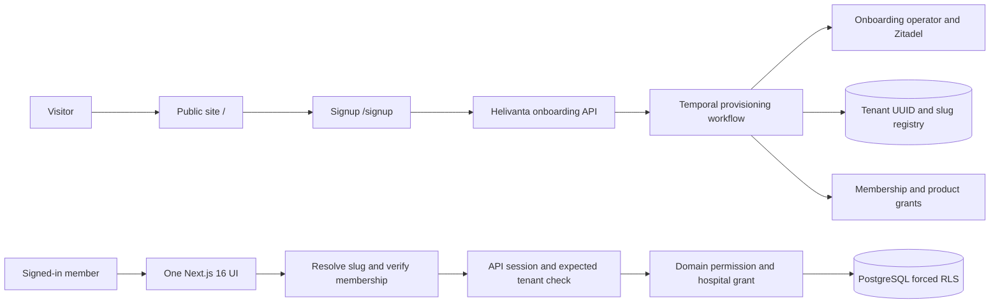

# ADR 0011: Public site, tenant addresses and one web application

Status: accepted direction; implementation and rollout in progress. Issue: #1087.

## Context and capacity

Helivanta's root URL must serve a public product site. Each organisation has an immutable tenant UUID and can own multiple hospitals. A readable workspace address is a routing alias, never an authorisation boundary. The user-facing product name is PharmaConnect; existing pharmacy API contracts remain unchanged.

Planning assumptions, not measured production demand: 100 peak page requests/s, 90:10 read/write ratio, public HTML under 100 KiB compressed, 10,000 tenant addresses at 12 months and 30,000 at 36 months. At approximately 1 KiB per address including indexes, this is under 30 MiB. Use an indexed PostgreSQL registry rather than a separate routing service. Target 99.9% monthly availability and p99 authenticated address resolution under 300 ms. Validate these assumptions against telemetry before scaling.

Editable diagram: [Public site and tenant addresses](../architecture/diagrams/07-public-site-and-tenant-addresses.drawio).

## Route contract

| URL                                        | Audience and purpose                                          |
| ------------------------------------------ | ------------------------------------------------------------- |
| `/`                                        | Public landing page, including signed-in visitors             |
| `/signup`                                  | Public organisation onboarding entry point                    |
| `/login`                                   | Existing Zitadel sign-in and MFA                              |
| `/dashboard`                               | Authenticated workspace selection and compatibility dashboard |
| `/{tenant-slug}/dashboard`                 | Canonical tenant dashboard                                    |
| `/{tenant-slug}/pharmaconnect`             | Tenant pharmacy workspace                                     |
| `/{tenant-slug}/pharmaconnect/medications` | Tenant medication reference                                   |
| `/{tenant-slug}/medicore/opd`              | Tenant outpatient workspace                                   |
| `/{tenant-slug}/medicore/ipd`              | Tenant inpatient workspace                                    |
| `/{tenant-slug}/lab`                       | Tenant laboratory workspace                                   |
| `/{tenant-slug}/workforce`                 | Tenant staff and hospital selection                           |
| `/{tenant-slug}/settings/branding`         | Tenant branding administration                                |

For YES HOSPITAL the requested address is `/yes-hospital/pharmaconnect`. It is a proposed alias until reserved in the authoritative registry. Do not hardcode that alias to a UUID in JavaScript or derive it from an editable display name. Do not advertise it as live until deployed and verified.

A hospital is subordinate to its organisation; it is not a second tenant. Hospital grants and explicit data-sharing rules still apply inside the workspace. Neither a matching URL nor tenant administration implies access to all hospitals.

## Security and onboarding contract

Patient and staff data are the protected assets. An unauthenticated caller or member of another tenant may manipulate the slug, replay a provisioning request, or change the active session in another browser tab. The trust boundaries are the browser/API boundary, onboarding-service boundary, and API/database boundary.

1. The onboarding operator creates the organisation and its canonical tenant UUID. Use a dedicated, product-scoped Helivanta machine identity stored in OpenBao. Never expose that credential to the browser or reuse the login-client identity.
2. Reserve a unique lowercase ASCII slug, 3–63 characters, with alphanumeric segments separated by single hyphens. Reject reserved first segments (`api`, `login`, `logout`, `signup`, `dashboard`, `_next`, `medicore`, `pharmacy`, `pharmaconnect`, `lab`, `workforce`, `settings`) and UUID-shaped slugs. The UUID is a separate identifier, not a mutable name.
3. Use Temporal to orchestrate identity creation, product grant, local tenant projection, owner membership and activation. Activities have bounded deadlines and retries, stable idempotency keys and observable pending/failed states. Never hold a database transaction across the operator call. Do not return success until activation and authorisation projection have converged.
4. Verify the owner's email before activating access. Keep patient data out of signup. Resolve abandoned registrations and failed provisioning through an operator recovery queue; retries must not create duplicate organisations or reassign an existing slug.
5. Resolve addresses through an authenticated membership-scoped lookup. Unavailable and inaccessible addresses return the same 404. An optional public branding projection can expose only deliberately published presentation fields.
6. Every tenant-scoped API request carries its expected immutable tenant ID. Middleware compares it with the verified session tenant before reading or writing. A mismatch stops the request and requires an explicit tenant switch. A client-side page guard alone is insufficient: another tab may have changed the shared session cookie.
7. A switch re-checks membership on the server, clears tenant-specific caches and drafts, and navigates to the new canonical address. Slug changes require an audited administrative operation, retain a reserved redirect alias, and never recycle another organisation's old address.
8. PostgreSQL RLS continues to enforce tenant isolation. Cross-hospital or cross-tenant sharing requires explicit server-side grants; URL routing creates no sharing permission.

## Public content

The homepage has product sections, a hospital/pharmacy directory, testimonials, reviews and trust information. YES HOSPITAL is labeled a synthetic demo workspace. Unapproved partner profiles and testimonials are placeholders with no invented quotes, stars, customer counts or endorsements. SOC 2 Type II and ISO/IEC 27001 are labeled “Not yet certified”; HIPAA documentation is labeled pending. HIPAA is not presented as a certification. Publish certificates only with independently verified scope, issuer, validity and evidence.

## Application consolidation

Clinical routes already live in `apps/shell` ([ADR 0010: one Next app](0010-one-next-app.md), #1086). This ADR builds on that: the public site, signup and dashboard are routes of the same app, and the shared root layout supplies API providers and session renewal for every signed-in route. Keep separate domain API ownership; a shared UI does not merge service data ownership.

## Failure behaviour, migration and cost

The public static page remains available when the operator is down. Signup must report pending or unavailable, never false success. Address lookup fails closed when the registry or membership service is unavailable; it must not fall back to a name-derived UUID or cached authorisation. Existing login remains available independently of signup provisioning where its own dependencies are healthy.

Production discovery on 2026-10-13 found only `helivanta-api`, `helivanta-openfga` and `helivanta-shell` deployments in namespace `helivanta`; the public site ships inside the existing shell image. Rollback restores the prior application image and route configuration; additive registry tables remain in place. Never drop tenant data on rollback.

The public site adds no Kubernetes web deployment. Registry storage is negligible at the stated scale; Temporal activity and email costs depend on signup volume and must be measured. Rejected alternative: retaining proxy-based UI zones adds runtime failure points without a demonstrated independent scaling requirement.

## Current implementation boundary

Implemented: public landing page at `/`, truthful signup availability page at `/signup`, signed-in dashboard moved to `/dashboard`, login callback and in-app home links pointing at `/dashboard`.

Not implemented by this UI change: public self-service provisioning, tenant slug reservation/resolution, expected-tenant request validation, canonical tenant navigation, automatic membership projection. These are release prerequisites for claiming the complete tenant signup and address experience. The signup page intentionally collects no information while provisioning is unavailable.
