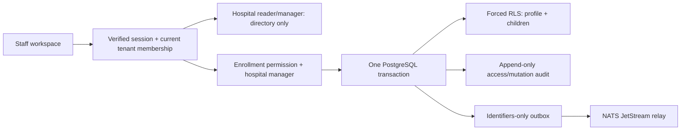

# ADR 0015: Restricted hospital staff enrollment

Status: implementation in progress. Parent #979; workforce registry story #1035 remains open for imports, HR master versioning and reports.

## Evidence and scope

Read-only legacy review on 2026-10-14 covered existing employee profile tabs at `/mednetHR/NewEmployeeRegistration.htm`: personal, contact, employment, qualifications, experience, dependents and documents. The consultant registry was reached separately. The current legacy role did not expose a verified blank enrollment workflow; required-field rules, consultant detail differences and save behavior remain unverified. No source records, values, uploads or screenshots are incorporated into fixtures.

| Observed legacy field definitions                                                                                                                                       | Helivanta treatment                                                                                                                                                                                                            |
| ----------------------------------------------------------------------------------------------------------------------------------------------------------------------- | ------------------------------------------------------------------------------------------------------------------------------------------------------------------------------------------------------------------------------ |
| Name, employee code, gender, DOB, mobile, email, emergency number                                                                                                       | Directory identity plus restricted preferred/structured names, optional DOB/gender, separate work/personal email and phone, named emergency contacts with relationship and priority                                            |
| Current/permanent house, street, city, state, postal code                                                                                                               | Restricted addresses with explicit use, country code, region, postal code and copy-current convenience; international formats                                                                                                  |
| Blood group, donor flag, height, weight, identifying mark, diet                                                                                                         | Optional reported ABO/Rh group only in enrollment; no clinical verification or donor eligibility implication. Other health details belong to a separately governed occupational-health workflow                                |
| Employee/consultant, grade/category/department, supervisor/HOD, status, probation, confirmation, joining/rejoining/retirement, bond, contract, campus-residence periods | Engagement type, department/designation, grade, hospital-local supervisor, employment and probation periods, exit reason. Payroll, bonds, housing and automatic HOD permissions remain separate workflows                      |
| Nurse/professional registration, authority, specialization, issuer, validity, attachment                                                                                | Repeatable credentials with issuer, country, type, number, specialty and validity; recorded status never grants clinical privileges                                                                                            |
| Degree/diploma, institution/university, passing year, marks, attachment                                                                                                 | Repeatable qualification, institution, country, completion year. Marks and attachments are not required enrollment data                                                                                                        |
| Employer/address, designation, start/end, salary, leaving reason, attachment                                                                                            | Repeatable prior employer, role and dates. Salary stays in payroll                                                                                                                                                             |
| Father/mother/spouse/maiden names; marital status; religion/caste/mother tongue/nationality                                                                             | Preferred name and optional communication language. Family/religion/caste are not mandatory identity or employment-selection criteria; nationality is only collected in a later jurisdiction-specific work-eligibility process |
| Aadhaar/PAN/election/licence/passport/work permit/special pass, issuer/dates/attachments                                                                                | No general enrollment government-ID collection; later governed work-eligibility/tax module must have purpose, masking, retention and country-specific validation                                                               |
| Dependents, nominee, income, deceased/living-with flags, government ID                                                                                                  | Named emergency contacts cover immediate safety need. Benefits/dependent/nominee management remains a separate protected HR workflow                                                                                           |
| Employee file number, document category/title/upload                                                                                                                    | Reuse a reviewed staff-scoped GCS quarantine/ClamAV release contract before adding uploads; no direct URL or unscanned attachment accepted by enrollment                                                                       |

[FHIR R4 Practitioner](https://hl7.org/fhir/R4/practitioner.html) informs names, contacts, addresses, qualifications and issuer/validity. [PractitionerRole](https://hl7.org/fhir/R4/practitionerrole.html) informs organization-local engagement, specialty and periods. These are conceptual mappings, not a FHIR conformance claim. [HHS employment-record guidance](https://www.hhs.gov/hipaa/for-individuals/employers-health-information-workplace/index.html) distinguishes employer records from staff patient/health-plan records. Keep clinical records separate; applying strict safeguards to HR does not itself establish HIPAA or SOC 2 certification.

## Decision and security boundary

Retain the directory endpoints and four-field projections for existing clients/readers. Add GET/PUT `.../staff/{id}/enrollment` for an aggregate directory record plus restricted profile, addresses, emergency contacts, credentials, qualifications and prior experience. Require current tenant membership, `workforce.enrollment.manage` and an explicit hospital manager grant. The permission initially belongs to tenant administrators; a directory manager alone cannot read confidential enrollment. New database tables force tenant/hospital RLS and a transaction-local enrollment authorization marker, set only after route authorization. Every child references `(tenant_id, hospital_id, staff_id)`; supervisor references the same hospital. Job, engagement, credentials and inactive status never create or revoke access grants.

PUT uses a stable staff UUID and complete replacement semantics. Parent/children, audit and a minimized `helivanta.in.workforce.enrollment_changed.v1` outbox event commit together. Identical retries preserve timestamps and do not append audit/events; stable child IDs and database uniqueness reject duplicates. Employee-code uniqueness is case-insensitive within a hospital. Expected-version updates reject stale edits; an already-applied identical retry succeeds. Existing directory updates remain compatible and cannot erase private details.

Private data is absent from directory/search responses, errors, audit payloads, event payloads and browser persistence. Audit records resource IDs and actor, including protected detail access. Sensitive profiles are not cached in Valkey. NATS JetStream uses the existing transactional outbox relay; no new broker/worker. Enrollment is one database transaction and does not need Temporal. Future credential-review/document-release/onboarding workflows with waits use Temporal and reference IDs, never HR payloads in workflow history.

## Capacity, failure and delivery

Planning assumptions, not measured demand: 500,000 staff at 12 months and 1.5 million at 36 months; 50 peak requests/s, 90:10 reads:writes. Enrollment bodies <=32 KiB, at most 2 addresses, 5 emergency contacts, 20 credentials/qualifications/experiences each. At roughly 8 KiB/profile, private payloads are ~4/12 GB before indexes/backups. Existing PostgreSQL is sufficient; no new always-on infrastructure cost beyond storage. Target 99.9% availability, p99 <500ms; load validation remains a rollout prerequisite for broad customer usage.

Postgres/OpenFGA failure denies access. Broker outage does not lose enrollment: pending outbox rows retry. Valkey loss does not affect source-of-truth enrollment. A child validation/constraint failure rolls back the complete write. Concurrent editing is serialized on the staff row; version conflicts are explicit. UI preserves unsaved input after validation/409/network failure, scrolls/focuses enrollment when opened, and never submits a partially loaded edit.

Migrations `0002_workforce_enrollment` and `0003_workforce_staff_code_casefold` are additive and forward-only with bounded lock/statement timeouts. Previous API versions tolerate the new tables. Rollback uses the previous application image and retains schema/data; no destructive down migration. Verify real PostgreSQL/RLS, API and browser locally before the authorized CI/Kargo/Argo CD rollout, then verify the designated synthetic YES HOSPITAL owner. Payroll, roster, leave, dependent benefits, government IDs, document scanning integration, imports, shared staff identity and report reconciliation require their own acceptance work and are not completed by enrollment.

[Editable draw.io diagram](../diagrams/staff-enrollment.drawio).

