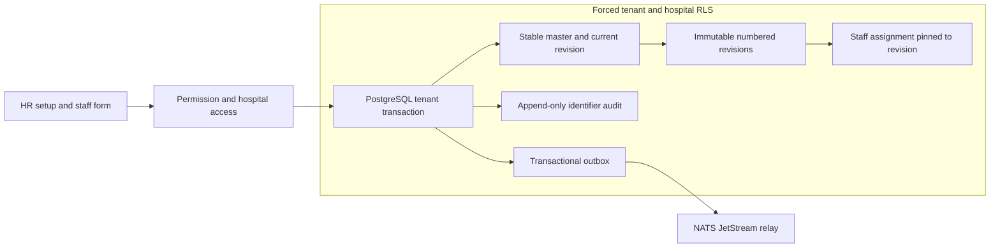

# ADR 0016: Hospital-scoped, versioned HR setup

Status: accepted for implementation. Parent: [#1035](https://github.com/tesserix/helivanta/issues/1035), [#979](https://github.com/tesserix/helivanta/issues/979).

The legacy HR configurable master has a name, group type and default flag. Its staff, performance and payroll screens filter by department, designation and grade. Performance setup exposes allocation, templates and a master containing code, goal, KRA, objective, KPI, weightage and target. Payroll has provisional/processed states, month/year selection, timesheet locking, payable/present/paid leave/unpaid leave/days off, overtime and deduction inputs, salary structures and payslip history with date filters. These observations are field/workflow research only; no employee, bank, salary or customer values are fixtures. Appraisal scoring details and rendered payslip contents remain to be inspected before those features are implemented.

## Decision

Deliver HR setup before attendance, appraisals and payroll. Allowlisted categories are department, designation, grade, qualification, document category, exit reason, relationship, language and contract type. No religion or nationality is copied into employment decisions. Payroll/tax/leave rules and KPI goals need their own typed models rather than unvalidated master metadata.

Each master has a stable UUID and immutable code/category. Name, description and active state create immutable numbered revisions. Code and normalized name are unique within tenant, hospital and category, including inactive records. Retire/reactivate rather than delete. An unchanged PUT preserves timestamps, revision, audit and outbox count; a conflicting stale edit returns 409. PostgreSQL serializes writes for the stable ID, then unique constraints protect concurrent requests with different IDs. Lists and history use bounded keyset pagination.

Assets are hospital HR configuration and staff assignment history. Threats include another tenant, an ungranted hospital user and an insider rewriting history. Authenticated tenant membership, explicit hospital grants, and forced RLS apply on every read/write. Writes additionally require `workforce.master.manage` plus hospital-manager access; registry reconciliation grants the permission to existing tenant-admin roles. Tenant/hospital identity never comes from request JSON. Revision history is append only; foreign keys include tenant and hospital. Error output excludes SQL details, and HTTP responses use `no-store`.

Department, designation and grade assignments pin an immutable revision UUID and store its name as a snapshot. The server derives that name from the revision. New selections require the active current revision. An existing assignment can retain its historical/retired revision while unrelated staff details change. Old free-text assignments remain readable/editable; they are never silently matched or bulk converted. Omitted revision fields from older clients preserve pinned assignments; a database guard prevents older API instances from deleting a pinned profile during rollout. Rename/retirement therefore cannot rewrite staff history.

Master state, revision, identifier-only audit and `helivanta.in.workforce.master_changed.v1` outbox event commit atomically. Existing NATS JetStream relay handles publication. Valkey stays outside the configuration source of truth. A single PostgreSQL transaction requires no Temporal workflow; later approvals, payroll runs and document quarantine need their own workflow designs.

## Acceptance

Real PostgreSQL tests cover concurrent retries, normalized uniqueness, stale conflicts, immutable history, read/write permissions, other tenant/hospital rejection, inactive/current selection rules and preserved staff snapshots. UI tests cover focus/reveal, loading/error/empty states, shared dropdowns, preserving input and stable ID after failed save, history and hospital switches. Local CNPG-backed API/browser checks precede merge. GitOps rollout and live synthetic API/browser checks complete this slice. Other HR work stays open until independently verified.

## Local evidence

The full Go race suite, vet and lint passed with Go 1.26.6. The web lint/format/type/test/build gate passed all 20 tasks with Node 24. The isolated CNPG verifier passed concurrent retry, duplicate/version conflict, hospital-boundary, history, snapshot and inactive-assignment checks; the original staff verifier passed as a regression check. Both new tables have forced RLS. At one checkpoint, six master events were present and all six were acknowledged as published. A two-row configuration query used `workforce_hr_masters_page` and executed in 0.279 ms (planning 0.305 ms). This is a tiny-fixture SQL plan check, not a load or end-user latency benchmark. Browser create/edit/history and staff revision selection were exercised against the CNPG-backed local API. Production evidence belongs in #1035 after rollout.
