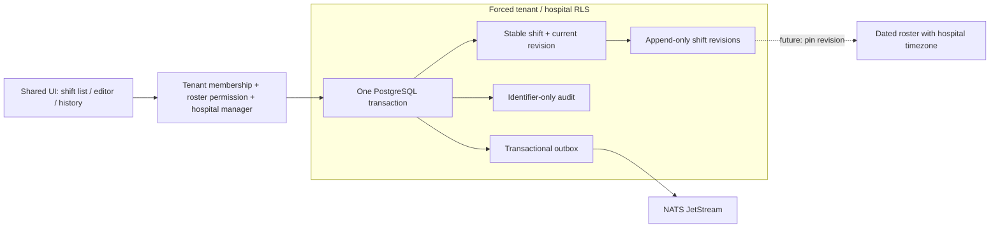

# ADR 0017: Version shift definitions before dated rosters

Status: accepted for implementation. Parent: [#1036](https://github.com/tesserix/helivanta/issues/1036), [#979](https://github.com/tesserix/helivanta/issues/979). Extend the workforce module under ADR-0005; no additional service or cross-module table access.

## Evidence and scope

The 2026-10-13 read-only legacy review recorded shift code/type/start/end/duration/grace/break/full- and half-day OT duration/locum, areas, weekly templates, groups and roster settings. #1036 records the inspected tabs and local source screenshot names. This slice delivers typed, versioned shift definitions only. Dated rosters, area/template/group membership, freeze/unfreeze, qualification/leave conflicts and payroll effects remain open. No source values or presumed policy defaults are copied. A fresh legacy session is needed for further nested forms; the prior review is sufficient for these configuration fields.

## Model and boundaries

`workforce_shifts` owns a stable hospital-local UUID/code, current revision pointer and normalized unique name. `workforce_shift_revisions` owns immutable snapshots. All keys/FKs include tenant and hospital. A deferred composite FK binds the current head to the exact numbered revision. A stable-identity trigger prohibits code/scope changes and non-sequential versions; delete/truncate is prohibited. Retire/reactivate instead of delete. Historical timings and policy values remain reproducible. Future roster rows must pin a revision; a roster must not resolve current head rules after publication.

Start/end are strict minute-precision `HH:MM` local wall-clock times. Duration is generated by PostgreSQL as `(end-start+1440)%1440`, so overnight definitions work without storing contradictory duration. Equal times (including presumed 24-hour shifts) are rejected. Break is nonnegative and shorter than duration. Grace is 0–240 minutes. Full-/half-day OT configuration is 0–1440 minutes, with half ≤ full. These are stored configuration, not entitlement or pay calculations. Zero is an explicit neutral configuration for a new form, not a default copied from the legacy hospital. Dated rosters will require a versioned hospital IANA timezone and explicit handling of ambiguous/nonexistent DST times before scheduling is enabled; clock duration is not paid elapsed duration.

Asset: hospital configuration and scheduling integrity. Threat actors: foreign tenant, unauthorized hospital member, privileged insider rewriting history. Reads require current tenant membership and explicit hospital reader/manager access. Writes require both `workforce.roster.manage` and a hospital manager grant locked within the transaction. Forced RLS applies to both tables; request JSON cannot supply tenant/hospital identity. Responses are private `no-store`; logs/events/audit contain identifiers and versions, not personnel or policy payloads. Enrollment permission does not imply roster management.

Stable UUID PUT plus expected version, per-ID advisory lock and DB uniqueness serialize writes. Unchanged retries preserve revision/timestamps/audit/events; conflicting stale edits return 409. Code cannot be changed. Lists/history use bounded keyset pagination; filter/page paths remain scoped. State, revision, audit and identifier-only `helivanta.in.workforce.shift_changed.v1` outbox commit atomically. Existing NATS JetStream relay publishes after commit; no synchronous consumer dependency. This transaction needs neither Valkey caching nor Temporal. Later approvals, durable reminders and payroll orchestration use their own contracts/workflows.

## Delivery and recovery

The additive bounded migration creates two empty tables/indexes/functions/triggers. It does not update enrollment, rosters or customer data. Production rollout uses existing reusable CI/base images, Kargo and Argo; no imperative reconciler override. If an older API image is restored, new tables/data remain intact but shift endpoints are unavailable; forward correction is preferred. No down migration or destructive data removal is part of this slice.

Verify primary/validation/conflict/retry/other tenant/ungranted hospital/missing role/history immutability and atomic outbox with real PostgreSQL. Shared dropdown, automatic reveal/focus, preserved invalid/failed input, no duplicate identity on retry and readonly controls get UI coverage. Port-forwarded isolated CNPG and browser verification precede merge; final live synthetic API/UI and logs evidence precede marking the slice delivered. #1036 stays open for the full roster acceptance.
