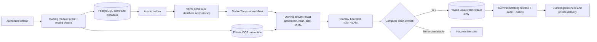

# ADR 0019: Private attachments owned by the source domain

Status: proposed for active implementation, not a deployed pipeline.

Related: #1105, #483, #29, #688, #6; parent tracker #979.

Patientmaster and workforce own their attachment metadata and request routes.
Shared `pkg/attachments` supplies naming and scanner transport without reading
domain tables or granting access. Owning APIs check the current tenant, locked
explicit hospital grant and owning record at intent, finalization and delivery.
Clients cannot supply tenant, actor, bucket, object key, generation or release
state. Module isolation and identifier-only published events remain intact.

Use separate private quarantine and clean GCS buckets for each residency
boundary, with dedicated tenant buckets when required. Application buckets
must not reuse the CNPG backup bucket. Enforce public access prevention,
uniform access and workload identity; use no service-account keys. Grant
quarantine creation to upload, quarantine reading/clean creation to scanning,
and clean reading to delivery.

Each attachment record and file version has an opaque UUID. Stable request
receipts reject reuse against different owners or input. Keys contain only
opaque scope identifiers and the server's fixed UTC upload date:

```text
t/<tenant>/h/<origin-hospital>/o/<patient-or-staff>/<owner>/r/<record>/d/YYYY/MM/DD/f/<file>/v/<version>
```

Clinical/employment dates and original filenames remain protected metadata.
Corrections and explicit sharing do not rename objects. No sibling-hospital or
cross-tenant sharing is implied; any sharing authorization is checked again
when delivering the unchanged object from its original hospital path.



Owning modules register their own Temporal activities. Shared scanning runs
inside those activities and does not query other modules. Content, names,
filenames and demographics never enter workflow history, NATS or Valkey.
Activities load protected metadata, read pinned GCS generations and verify
server-computed facts before scanning. A complete clean verdict is required;
malformed/truncated replies, unavailable scanners, timeouts and limits fail
closed. Antivirus is not a claim that every file vulnerability is eliminated.

Every upload/copy is create only. GCS promotion and PostgreSQL cannot commit
together: retry reconciles an existing immutable clean object against verified
facts before a conditional matching-version release. Failed database writes
leave inaccessible orphans. Stable workflow IDs and transitions tolerate
duplicate JetStream delivery and Temporal retries. Cleanup respects retention
and holds. Delivery uses private cache controls, nosniff and safe attachment
disposition; active formats are not rendered in the application origin.

Before release, verify forced RLS and all ownership denials, concurrent retry
deduplication, generation/hash/type mismatches, actual isolated ClamAV clean
and antivirus acceptance fixtures, outage/retry between copy and commit,
private real GCS/workload identity, and synthetic patient/staff browser flows.

Current local evidence covers UTC naming, complete/fresh ClamAV verdicts,
bounded static-image policy, generation/CRC/SHA-pinned GCS operations,
create-only promotion and conflicting-orphan denial through vendor-protocol
tests. Real isolated ClamAV clean, antivirus and compressed-antivirus fixtures
passed. Workforce-owned metadata intent/list APIs and forced-RLS/immutable
binding/forged-release denials passed against local PostgreSQL test containers.
JetStream after-commit retry uses a committed envelope digest to reject
mismatched duplicate external starts. Go race/vet/build/lint and reachable
vulnerability checks passed; these are not real GCS or deployed pipeline proof.

Storage is proposed in
[infrastructure PR #1414](https://github.com/tesserix/tesserix-k8s/pull/1414),
with eight native Terraform tests passing. No cloud resources have been applied.
Actual GCS/workload identity, domain upload/finalize/delivery, generated UI
contracts/UI, scanner deployment and Temporal orchestration remain required
before release. Production stays on the previously verified source.

Editable diagram: [private files](../architecture/diagrams/helivanta-private-files.drawio).
Legacy policy research: [HR field review](../legacy-hr-policy-research-2026-10-14.md).
