# ADR 0028: Versioned supplier verification and private evidence

Status: accepted design; the private registry is implemented separately, while evidence/review remain pending. Extends ADR 0027 and stories #1135/#1137; it does not activate country trading rules or close those stories before acceptance passes.

## Ownership and trust boundaries

SupplyConnect owns organisation premises, declared licences, verification cases, and non-secret finance references. These records belong to a tenant and a party, with explicit object roles. A hospital is optional and is never fabricated to satisfy an attachment API. An owned organisation remains a business profile in the current tenant, not a new platform tenant. Counterparty profiles do not prove external tenant identity; bilateral relationships are a subsequent explicit protocol (#1136).

Premises and licences have immutable UUIDv7 identities, optimistic versions, immutable private revision snapshots, keyset pagination, and atomic audit/outbox writes. Declared licences capture country, jurisdiction, issuing authority, number, premises, categories and validity dates. Capturing an identifier or uploading an image does not verify it. Country-specific requirements remain reviewed configuration; no statutory approval is inferred from a string or document extraction.

```mermaid
flowchart LR
    O[Organisation administrator / purchasing] --> P[Private profile and premises]
    P --> L[Declared licence and validity]
    L --> U[Bounded upload intent]
    U --> Q[Immutable GCS quarantine generation]
    Q --> N[Transactional NATS outbox]
    N --> T[Idempotent Temporal scan workflow]
    T --> C[ClamAV with fresh signature evidence]
    C -->|clean and complete passive image| R[Generation-pinned private released evidence]
    C -->|infected / invalid / unavailable| B[Blocked or retryable; no download]
    R --> S[Submission pins profile / licence / evidence versions]
    S --> V[Independent authorised reviewer]
    V --> A[Immutable decision and effective validity]
    A --> G[Separate country and relationship eligibility checks]
```

## Roles and state transitions

Purchasing and organisation administrators maintain declarations. Scoped compliance staff can maintain/review licence records but do not gain generic profile write access. Auditors read without mutation. Finance references require an explicit finance/administrator grant and do not appear in general profile, directory or compliance evidence responses. Raw account numbers and payment credentials are not stored in generic metadata.

Submission captures exact source versions and clean evidence generations. A reviewer cannot approve their own submission or override expired/revoked evidence. An edited source invalidates pending approval; approval is never silently carried to changed legal details. Decisions retain actor, timestamp, reason, method and source references in a private immutable history. Suspension/offboarding preserve history and block new activity; obligations and audit retention are not erased.

The future trading gate requires current verification, valid required licences, explicit bilateral relationship, appropriate location/category scope, and an activated reviewed country policy. A verified profile alone is insufficient. Expiry is checked at action time, even if a reminder workflow is delayed.

## Storage, retries and failure handling

Clinical keys remain byte-for-byte compatible: `t/<tenant>/h/<hospital>/o/<patient|staff>/<owner>/r/<record>/d/<UTC date>/f/<file>/v/<version>`. Independent organisation keys use `t/<tenant>/o/organisation/<party>/r/<record>/d/<UTC date>/f/<file>/v/<version>`, and reject a hospital identifier. Every key is server-derived from opaque identifiers; names, licence numbers and filenames never become object paths.

Use the existing private GCS buckets, shared attachment integrity/promotion code, fresh ClamAV checks and the existing document-worker fleet. PNG/JPEG are bounded passive evidence formats; unsupported/active formats remain rejected. No unscanned download or broad public bucket is introduced. Upload size, digest, source generation and released generation are checked. Storage calls run outside database authorization locks; final commits recheck current grants/source versions. Revocation or a stale scan cannot authorize release. Broker/workflow data contains opaque IDs and attempt/version references, not licence/contact/finance contents.

The existing single database transaction remains the source of truth for head, immutable revision, audit and outbox. Exact retries do not create duplicate history/events; conflicting retries return 409. NATS can redeliver and Temporal can retry without promoting a different object generation. Cleanup/retention are explicit lifecycle workflows, not deletion on ordinary user edits.

## Local acceptance gates

Use real disposable PostgreSQL, NATS/JetStream and OpenFGA. Test unknown/foreign objects, forged tenant input, current role revocation, optimistic and concurrent retries, source edits after submission, expired licences, maker/checker, immutable history, outbox/storage/scan failures, duplicate file delivery, malicious content, generation substitution and country mismatch. Browser acceptance exercises the real API with reserved synthetic identifiers, form focus, shared dropdowns, private views and mobile rendering. Production rollout is a later explicitly approved step after the concrete change is reviewable.
