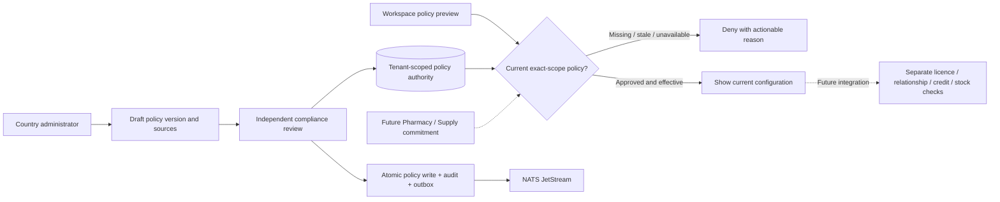

# ADR 0030: Reviewed country policy before B2B commitments

> **2026-10-23, #1287:** Pakistan is no longer a supported country. India is the only country profile; existing Pakistan records refuse the migration rather than being changed. Pakistan content below is historical.

Date: 2026-10-16. Status: implemented locally; production approval pending. Child #1182, parent #1134, related #1136 and epic #1133.

## Problem and decision

The generated IN/PK country profiles describe currency, timezone, locale direction and identifier kinds. They deliberately say `review_required`; that metadata cannot authorise a commercial transaction. An Indian approval must never activate Pakistan, and organisation ownership or a verified licence must never stand in for country/category/operation eligibility.

Platform owns reviewed country-policy authority alongside tenant configuration. Implement its shared authority in a platform-owned package, with configuration/review routes in the existing workspace module. The authority exposes a transaction guard for later Pharmacy and Supply integration; this change wires only workspace configuration and its authoritative preview. Product, supplier, invoice and inventory masters remain with their existing owners. No new deployed service is required.

Each policy identifies a verified tenant, country, explicit jurisdiction, product category and operation. Versions retain source citations, licence/product/prescription/controlled/cold-chain/tax/credit/retention/privacy/residency/reporting requirements, effective dates, author and independent approver. Unknown, incomplete, expired, suspended, mismatched or unapproved policy denies a restricted commitment. Reviewed non-applicability requires a recorded reason; an omitted requirement is not approval.

## Contract and concurrency

Draft creation, submission, independent approval/rejection and suspension use caller-generated UUIDv7 receipt IDs, expected revisions and immutable decision history. Replays return the original receipt; conflicting payload reuse and stale writes return 409. Reads and keyset histories are permission-filtered; another tenant's object returns 404. Approval requires a different subject from the author/submitter and current review permission. Revocation is enforced at the next server-side commitment, including stale sessions and direct API calls.

For the current shared PostgreSQL runtime, the authority evaluates source policy and locks its current version through the business transaction. Its package owns the SQL; future trading callers must supply the verified principal, derived business scope and transaction rather than reading policy tables themselves. Suspension takes the conflicting lock, so approval cannot be revoked between the check and commit. A future service extraction needs a reviewed commitment protocol; an asynchronous projection or Valkey TTL alone cannot provide immediate revocation. Do not add HTTP/network calls inside the transaction.

Use strict forced tenant RLS on policy scopes, versions, requirements and review receipts; tenant/id composite keys and references prevent cross-tenant links. Immutable snapshots and append-only reviews preserve sources and historical decisions. Audit/outbox writes are in the same transaction; JetStream delivery remains at least once with stable event/inbox IDs. Valkey may cache display metadata, never current eligibility. Temporal is for later reminders and durable multi-party workflows, not these single-database decisions.

## Validation and release

Synthetic sources and approvals must be labelled TEST ONLY and must not activate real regulated trading. Sources are stored citations, not server-fetched arbitrary URLs. No genuine legal/licence/provider claims are inferred. Existing catalogue drafts and quarantined receiving remain possible; actual listing/order/dispatch/dispensing commitments need all eligibility checks.

Test the source model, real PostgreSQL RLS and locks, cross-tenant404, role and same-subject denial, IN/PK independence, currency precision, locale direction, effective/expiry transitions, replay/concurrency and exact audit/outbox counts. Verify the complete UI/API path and failed dependency states before claiming story completion.

The additive migration will be named and tested against a scratch database with recovery evidence before production approval. No live database migration is authorised merely by this ADR. Navigation #1178 and Go CI repair #1179/#1176 are already deployed. Child #1182 tracks the configuration/API/UI slice and its pending production acceptance. Parent #1134 remains open until restricted transition integrations and country acceptance are implemented and tested. See [local verification and release notes](../delivery/country-policy-1182.md).
