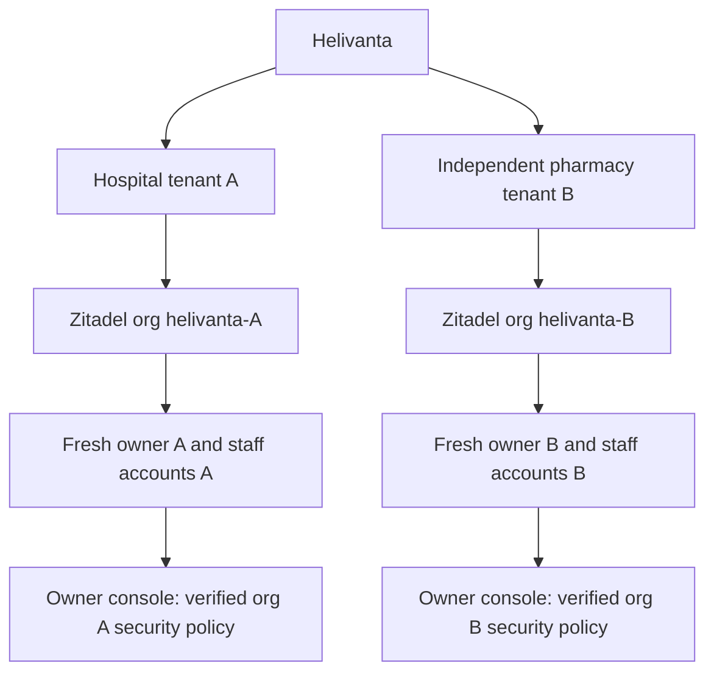

# ADR-0070: Tenant-owned Helivanta login identities

Status: implementation in progress; user-selected identity model, 2026-11-11.
Supersedes the platform contract's cross-organisation existing-owner adoption and the
signup-specific reason for ADR-0069. Existing security keys remain valid for
existing accounts; no credential or membership is removed by this change.

## Decision and ownership

Every public hospital or independent pharmacy signup creates a deterministic,
separate Zitadel organisation `helivanta-<tenant UUID>` and a fresh human
`owner-<tenant UUID>` owned by that organisation. The operator submits an explicit,
tenant-unique username instead of allowing Zitadel to default it to the email.
Native organisation names start with the immutable tenant UUID, preserving uniqueness when native domain labels are truncated, avoiding the
instance-wide name collision when businesses use the same display name; the
Helivanta business name remains unchanged. Existing deterministic organisations
retain their native names on replay. Email is a delivery address, never an
identity key or cross-tenant authority.
The same email may own separate tenants; each account verifies email, sets its
own password, and enrols its own required MFA. Passwords, enrolled factors,
external identity links and sessions from another organisation are not copied.

Onboarding owns immutable intent, delivery reservations and progress. Zitadel
owns accounts, credentials and native policies. The identity operator owns
organisation/project reconciliation. Helivanta IAM owns business membership and
authorization. Global API remains the public application boundary. Canonical
signup/security wire models remain onboarding-service/customercontract and its
generated TypeScript. No duplicate identity master is introduced.

`POST /v1/auth/signup/new` opens a separate browser receipt with an empty JSON
body and the existing same-origin protections. It returns `not_started` and
rotates only the Secure, HttpOnly, SameSite receipt cookie: no native identity,
tenant, membership or existing request is created, changed or deleted. The UI
cancels old receipt polling before replacing its cache and opens a blank form.
Save a ready workspace's specific sign-in link before starting another; an
unfinished request is retained server-side but this browser now tracks the new
receipt. An uncertain network outcome requires refresh to inspect current state.
The next normal signup submission creates the independent tenant under existing
intake limits, idempotency and native verification requirements.

## Sign-in and administrative authority

Opening a ready workspace starts OIDC with its exact organisation scope and
fresh authentication. Normal sign-in supports a workspace-specific link; an
unscoped email must not silently choose among tenant accounts. The login client
asks the identity owner to resolve an email only within the organisation pinned
by the native auth request,
checks the password for that exact user ID, and rejects foreign organisation
sessions before MFA or callback. A browser-supplied workspace is a routing hint,
never proof of membership. Callback exchange retains token verification and
server-side exact-tenant membership checks.

The owner is an administrative authority in their own tenant, approved by their
fresh native proof and the immutable signup, with native ORG_OWNER and Helivanta
owner membership. Clinical authority is independent. Staff authority requires
explicit tenant membership/role assignments, not email matching. New membership
enrolments and role grants additionally verify native resourceOwner against the
verified tenant. Foreign accounts remain generically ineligible; malformed or
unavailable identity proofs fail closed. Historical accepted memberships remain
readable, but new grants/restoration cannot share their foreign native identity.
This tightening requires the coordinated consumer release and database tests.

The existing Settings > Security integration resolves the native organisation
from the verified tenant, verifies current native ORG_OWNER and active product
enrolment, audits before disclosure/mutation, compares policy revision and
requests operator reconciliation. It exposes applied/pending/drifted truth rather
than treating HTTP202 as completion. Current supported policy is mandatory MFA
with no grace period, including external sign-in; arbitrary policy weakening is
not added. Owner administrative privileges must not grant platform/other-org
settings access. Changed subject/tenant is refused; dependency outages fail
closed. Additional configurable policies need explicit contracts and tests.

## Recovery, capacity and rollout

Use existing platform planning targets (1,000/3,000 peak RPS at months12/36,
99.95% availability, p99 reads500ms/acceptance800ms); these are not measured
onboarding loads. Public intake retains the existing20-new-intents/hour cap,
8KiB intent bound and durable per-command idempotency. Resends retain3/hour and
10/rolling24h, native one-hour link lifetime, and stop after verification.
No extra service or store is added; cost grows by one native user per tenant
instead of sharing one native user across tenants.

Remove the cross-tenant email uniqueness index through the owning schema GitOps
repository before enabling same-email intake. Retain immutable intent/owner
triggers, receipt fencing, audit and global capacity bounds. Existing unbound
`existing_account` receipts may recover to fresh identity creation using their
original immutable owner/tenant, only when no existing-owner binding exists and the receipt remains active. The
bounded worker leases these historic intents and resumes their deterministic
claim; no GET-side state mutation is introduced.
Already bound/shared identities are not silently migrated or deleted. Their
reconciliation requires a separately reviewed migration with impact evidence.

Order: operator explicit usernames, approved schema expansion, onboarding worker
and contracts, Helivanta consumer/login/UI, normal CI and release/Kargo gates.
Do not release the earlier cross-account signup experience as this solution.
Rollback after duplicate-email intake cannot restore the unique index without
reconciling accepted rows; retain expanded schema and recover forward. Lost
remote responses replay deterministic org/user IDs; foreign bindings and native
outages remain pending/refused, never replaced.

## Acceptance

Prove same-email hospital and pharmacy receive distinct native org/user IDs;
no global email lookup/adoption; new password/MFA enrolment; tenant-specific
sign-in and callback; no cross-org factor/account selection; duplicate intent
and lost-response recovery; quota/expiry/verified-resend behavior; and owner
policy read/reconcile with cross-tenant, stale revision, revoked ownership and
native outage negatives. Follow ORG access-model least privilege and server
scope requirements. No readiness claim until real deployment acceptance passes.

## Private identity lookup integration

A read-only production probe proved ListUsers returns403 for the existing login
PAT. Its privilege is unchanged. Onboarding exposes the workload-only
`POST /internal/v1/customer-signups/login-target` under the exact existing API
workload/audience and mesh boundary. Its canonical types are owned and generated by onboarding-service/customercontract
and imported directly by the consumer. Generating a schema does not expose the
workload-only route to a browser. The broker adds no public identity-lookup route or service.

Helivanta derives the target from the active native request pinned to its web
client; unsupported/conflicting org selectors are refused. Its existing login
attempt limits/equalised refusal remain before the broker. Onboarding verifies
active Helivanta organisation, enrolment and current native tenant/project proof,
then searches at most2 users within that org. It commits a sensitive-read audit
before returning tenant/org/subject. No password, email echo, token or native
factor is returned. Helivanta checks the actual password session's subject/org.

Unknown/ineligible targets become identical credential refusals. Workload,
store, proof and audit failures become explicit unavailable responses; redirects
and malformed/foreign broker bindings are refused. Native first-factor setup
has a10s total deadline and broker/native service deadlines are bounded by it.
The broker adds registry/native reads and one audit write per successful lookup;
load acceptance and long-term audit retention remain operational review gates,
not measured guarantees. There is no retry/cache or extra credential grant.

Delivery budgets remain independent of identity ownership: each workspace keeps
3/hour and10/rolling24h mail attempts, and the same recipient hash additionally
shares10/rolling hour and30/rolling24h across intents. A transaction-scoped
recipient lock prevents cross-row concurrency bypass. No raw recipient or hash
is added to audit payloads or public responses. New receipts reset neither
budget. The schema's recipient/tenant index is non-unique and grants no access.

The legacy `POST /iam/members` endpoint has the same native-ownership prerequisite
for every new role, including a role added to a historical foreign subject.
Exact existing grants retain their repair behavior without a provider lookup,
but the final transaction locks the exact row and never inserts it if a
concurrent removal won. New-role native reads finish before the transaction.
Foreign identities return409, unavailable proof503, and refusals publish no
member/outbox event. Existing membership/history/list/removal behavior is retained.

## Current identity authority and test dependency

Read-only production checks also returned403 for native user and self-profile
reads using the deployed login credential. Current status, new-member admission
and the caller's profile therefore use the existing identity owner through
`POST /internal/v1/customer-signups/identity-projection`. Helivanta supplies the
verified tenant and signed subject for status/profile; only membership commands
may supply their separately authorised target subject. The owner verifies active
tenant/product enrolment and live native organisation/project proof, then commits
a sensitive-read audit before disclosure. Canonical request/response types and
strict native parsing live in onboarding-service. Helivanta validates the exact
purpose, tenant, organisation and subject, with an8KiB response bound.

The purposes disclose different facts: status returns active/inactive without
profile or grant authority; membership additionally requires an active verified
human's exact native resourceOwner; profile is a trusted product attestation of
a current-principal self-read. Accepted historical foreign memberships may read
their own profile but gain no new role authority. Missing tenant/enrolment,
provider refusal, malformed proof or dependency/audit failure are unavailable,
not inactive. Only an authoritative missing or inactive native user may trigger
credential revocation. No fallback to direct native privileged reads exists.

These checks add owner-store/native proof reads and a durable audit transaction
to every protected identity observation. No cache is introduced. Production
load/latency and audit retention remain explicit acceptance gates. Native MFA
enrolment permission still needs fresh-account live acceptance; this change
does not expand the login credential to an instance administrator.

Browser CI starts the real owner service from the same pinned Go module source
as the consumer. Its separate `identityfixture` command is absent from the
production image, requires explicit development mode and the exact local issuer,
uses only a loopback `onboarding_fixture` database, and exposes only private
identity reads on127.0.0.1:18787. A fixed synthetic workload credential is limited
to that listener. The consumer's local resolver is likewise explicit, rejects
production configuration, and has no signup/browser handlers. Two synthetic
native organisations, tenant metadata and project grants are created before
seeding tenant-owned users; legacy memberships across both seeded tenants remain
explicit test fixtures. Production uses its existing private destination and
projected workload token. Neither fixture path fabricates signup completion,
mail delivery or production data.
