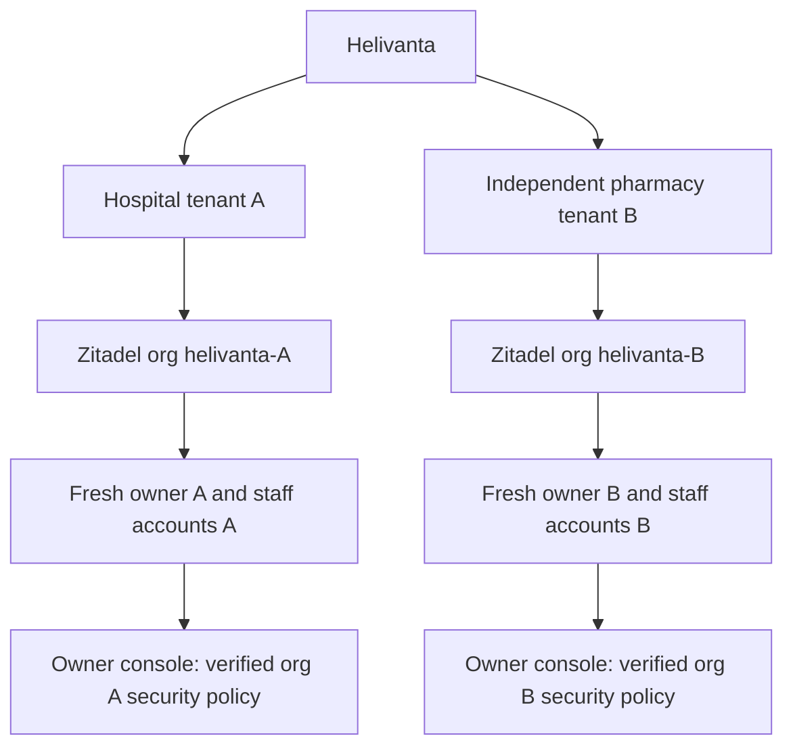

# ADR-0070: Tenant-owned Helivanta login identities

Status: implementation in progress; user-selected identity model, 2026-11-11.
Supersedes the platform contract's cross-organisation existing-owner adoption and the
signup-specific reason for ADR-0069. Existing security keys remain valid for
existing accounts; no credential or membership is removed by this change.

## Decision and ownership

Every public hospital or independent pharmacy signup creates a deterministic,
separate Zitadel organisation `helivanta-<tenant UUID>` and a fresh human
`owner-<tenant UUID>` owned by that organisation. The operator submits an explicit,
tenant-unique username instead of allowing Zitadel to default it to the email.
Native organisation names include the immutable tenant UUID, avoiding the
instance-wide name collision when businesses use the same display name; the
Helivanta business name remains unchanged. Existing deterministic organisations
retain their native names on replay. Email is a delivery address, never an
identity key or cross-tenant authority.
The same email may own separate tenants; each account verifies email, sets its
own password, and enrols its own required MFA. Passwords, enrolled factors,
external identity links and sessions from another organisation are not copied.

Onboarding owns immutable intent, delivery reservations and progress. Zitadel
owns accounts, credentials and native policies. The identity operator owns
organisation/project reconciliation. Helivanta IAM owns business membership and
authorization. Global API remains the public application boundary. Canonical
signup/security wire models remain onboarding-service/customercontract and its
generated TypeScript. No duplicate identity master is introduced.

## Sign-in and administrative authority

Opening a ready workspace starts OIDC with its exact organisation scope and
fresh authentication. Normal sign-in supports a workspace-specific link; an
unscoped email must not silently choose among tenant accounts. The login client
resolves an email only within the organisation pinned by the native auth request,
checks the password for that exact user ID, and rejects foreign organisation
sessions before MFA or callback. A browser-supplied workspace is a routing hint,
never proof of membership. Callback exchange retains token verification and
server-side exact-tenant membership checks.

The owner is an administrative authority in their own tenant, approved by their
fresh native proof and the immutable signup, with native ORG_OWNER and Helivanta
owner membership. Clinical authority is independent. Staff authority requires
explicit tenant membership/role assignments, not email matching. New membership
enrolments and role grants additionally verify native resourceOwner against the
verified tenant. Foreign accounts remain generically ineligible; malformed or
unavailable identity proofs fail closed. Historical accepted memberships remain
readable, but new grants/restoration cannot share their foreign native identity.
This tightening requires the coordinated consumer release and database tests.

The existing Settings > Security integration resolves the native organisation
from the verified tenant, verifies current native ORG_OWNER and active product
enrolment, audits before disclosure/mutation, compares policy revision and
requests operator reconciliation. It exposes applied/pending/drifted truth rather
than treating HTTP202 as completion. Current supported policy is mandatory MFA
with no grace period, including external sign-in; arbitrary policy weakening is
not added. Owner administrative privileges must not grant platform/other-org
settings access. Changed subject/tenant is refused; dependency outages fail
closed. Additional configurable policies need explicit contracts and tests.

## Recovery, capacity and rollout

Use existing platform planning targets (1,000/3,000 peak RPS at months12/36,
99.95% availability, p99 reads500ms/acceptance800ms); these are not measured
onboarding loads. Public intake retains the existing20-new-intents/hour cap,
8KiB intent bound and durable per-command idempotency. Resends retain3/hour and
10/rolling24h, native one-hour link lifetime, and stop after verification.
No extra service or store is added; cost grows by one native user per tenant
instead of sharing one native user across tenants.

Remove the cross-tenant email uniqueness index through the owning schema GitOps
repository before enabling same-email intake. Retain immutable intent/owner
triggers, receipt fencing, audit and global capacity bounds. Existing unbound
`existing_account` receipts may recover to fresh identity creation using their
original immutable owner/tenant, only when no existing-owner binding exists and the receipt remains active. The
bounded worker leases these historic intents and resumes their deterministic
claim; no GET-side state mutation is introduced.
Already bound/shared identities are not silently migrated or deleted. Their
reconciliation requires a separately reviewed migration with impact evidence.

Order: operator explicit usernames, approved schema expansion, onboarding worker
and contracts, Helivanta consumer/login/UI, normal CI and release/Kargo gates.
Do not release the earlier cross-account signup experience as this solution.
Rollback after duplicate-email intake cannot restore the unique index without
reconciling accepted rows; retain expanded schema and recover forward. Lost
remote responses replay deterministic org/user IDs; foreign bindings and native
outages remain pending/refused, never replaced.

## Acceptance

Prove same-email hospital and pharmacy receive distinct native org/user IDs;
no global email lookup/adoption; new password/MFA enrolment; tenant-specific
sign-in and callback; no cross-org factor/account selection; duplicate intent
and lost-response recovery; quota/expiry/verified-resend behavior; and owner
policy read/reconcile with cross-tenant, stale revision, revoked ownership and
native outage negatives. Follow ORG access-model least privilege and server
scope requirements. No readiness claim until real deployment acceptance passes.
