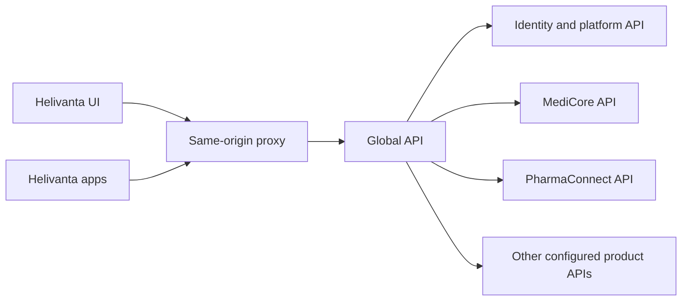

# Global API and product integration rules

[Contract index](README.md) · Required architecture and development acceptance

## Client and ownership boundary

All Helivanta UI and app business API traffic enters the Global API. Browser
requests remain same-origin `/api/v1/*`; the shell or ingress removes `/api`
and forwards to Global API `/v1/*`. Native clients use that same public API
boundary with bearer credentials. Product API origins are server configuration,
never browser configuration or request-selected destinations. Shell-owned login
callback, CSP reporting and public emergency-access information remain local
routes; approved file transfers use scoped owner-issued upload/download grants.

Each product retains its transactions, validation, permissions, database and
business rules. MediConnect is patient-facing; MediCore owns clinical work.
The Global API owns routing and transport policy, and future explicitly approved
integration workflow state. It must never become a second patient, stock,
prescription, result or financial master. No direct cross-product SQL, shared
write credentials, arbitrary URL proxy or client-selected upstream is permitted.

## Implemented connection and remaining boundaries

`backend/cmd/global-api` is the separate entry point. Its explicit route-owner
map is in `backend/internal/globalapi`; current destinations may all be the
existing monolith. This does not extract modules into independent services.
Supported owner keys are `platform`, `mediconnect`, `medicore`, `workforce`, `pharmacy`, `supply`,
`lab` and `emergency`. Platform covers `/v1/auth`, `/v1/iam`, `/v1/workspace`,
`/v1/patients` and `/v1/reference`. The other keys match existing path segments.
The exact `POST /internal/v1/hospital-enrolments` route also goes to platform,
which verifies its existing workload token. Other internal routes are denied.
Paths, methods, response bodies and domain error meanings remain unchanged.

Unknown paths return 404; a known but unconfigured product returns 503. Neither
falls back to another owner. MediConnect exposes only the [account foundation](mediconnect.md);
patient linkage, booking and report APIs remain unimplemented. The [coverage matrix](portfolio.md)
and [review findings](review-plan.md) still govern domain readiness.

This implementation passes credentials to the owning API, whose existing session
signature, revocation, membership, permission and object checks remain mandatory.
The Global API neither mints credentials nor asserts an authenticated identity
header. It does not yet implement audience-scoped machine delegation. Independent
API extraction must implement and test that delegation before accepting connector
service identities as authority. A configured URL alone is not an approved service.

## Mandatory security rules

- Authenticate at the receiving product API; authorize the exact operation,
  verified tenant and hospital/outlet/premise/base/object on every call. Network
  reachability, connector identity and supplied IDs never grant patient access.
- For future delegated calls, bind the service principal and original actor,
  expected issuer/audience, expiry, permitted operations, tenant, narrower scope
  and purpose. Intersect delegation with current user/object authority. Recheck
  revocation and consent at execution/replay and file release; fail closed.
- Use separate, least-privilege workload identities per destination. Product APIs
  stay private behind approved encrypted transport and network policy. The current
  Global API defaults to HTTPS upstreams outside development; explicit `istio`
  transport allows only Kubernetes service DNS over HTTP protected by STRICT mesh
  mTLS and workload authorization. development HTTP is
  limited to loopback. Never disable certificate validation.
- Forward an allowlist of transport headers; discard caller-supplied identity,
  tenant and forwarding assertions. Configure exact trusted proxy CIDRs. Backend
  proxy trust must include only the actual connector peers, so login rate limits
  see a verified client address. `X-Helivanta-Expected-Tenant` remains a precondition.
- Reject ambiguous paths, bounded-body violations and cross-site browser mutations.
  Do not cache sensitive replies. Do not put credentials, PHI, bodies or query
  strings in connector logs. Keep protected audit evidence with the data owner.
- External adapters require configured connection-to-tenant mappings, signed
  webhook verification/replay windows, credential rotation and egress allowlists.
  Provider-supplied tenant IDs and callback URLs are never trusted routing inputs.

## Reliability and completion

The routing slice has per-product concurrency limits, request deadlines and
bounded bodies. It performs no application retries, preserves owner conflicts
and rate-limit headers, and returns 502/504 for transport failure/timeout. A
mutation timeout means unknown outcome. Clients reconcile using the owner's
operation identity; they must not generate a fresh command and blindly retry.
Liveness describes the routing process. Readiness also requires platform `/readyz`
when platform is configured; other product failures are reported on their requests.

Every new command must define durable idempotency scope and fingerprint,
conflicting reuse, retention, optimistic concurrency and recovery lookup. A
connector cannot manufacture idempotency for an unsafe owner endpoint. Preserve
`http-contract.md` current exceptions until owner implementations change.

Multi-product workflows require a named orchestrator, durable step status,
operation query, bounded retries and reconciliation ownership. Local writes and
outbox records commit atomically; consumers deduplicate with local changes.
Use existing Temporal infrastructure for approved multi-step workflows with waits.
An ACK or HTTP 202 is acceptance, not downstream completion. After an irreversible
physical/clinical/financial action, recover forward or issue an attributable
correction; never erase it to simulate distributed rollback.

## New product/API onboarding record

Before enabling a product destination, the change must contain:

1. Named owner and consumers; canonical data and contract source; existing versus
   proposed routes; scope, entitlements and legal state transitions.
2. Exact method/path/version and request/response/error schema; bounds, nullability,
   units, timezone, pagination, sensitive fields and source-version semantics.
   Generate existing Go/Zod models from their canonical inputs, never copy them.
3. Connector route mapping and configuration, product authentication/delegation,
   object authorization, credential ownership and allowed network paths.
4. Timeout and payload budgets, peak volume/fanout, per-product concurrency,
   failure/partial/stale states, deduplication and operator recovery procedure.
5. Owner and actual consumer compatibility tests; fixtures for old/new versions;
   rollout, sunset and single-writer data migration/reconciliation plan.
6. Evidence from the real client → Global API → owning handler → persistence and
   any event consumer path. Tests must assert final owner state and visible output,
   not merely a mock 200 or broker publication.

Required negative scenarios: absent/forged/expired/revoked credential, wrong
product audience, wrong tenant and same-tenant wrong facility/outlet, changed
membership/consent while queued, unknown route, malformed/oversized body, SSRF
and spoofed identity headers, dependency/policy outage, stale version, concurrent
command, duplicate with changed payload, timeout after commit, process restart,
late/out-of-order event, failed compensation and authorized DLQ replay. Select
applicable scenarios explicitly; do not claim unimplemented delegation is tested.

For the current proxy, tests must also preserve login cookies, renewal, switching,
logout, binary/CSV downloads, request IDs and domain errors. Every registered
module route must map to one owner, checked against the real registry. Future
products need the same check before exposure.

See [running and release instructions](../delivery/global-api.md) for configuration,
local startup, E2E ports and the production handoff.

## Capacity and release gates

Reuse [sizing assumptions](../architecture/01-system-design.md): 1,000/3,000 peak
RPS at months 12/36, 80:20 reads/writes, 2–20 KB typical JSON, 30% hot-tenant load,
99.95% target availability, p99 read ≤500 ms and command acceptance ≤800 ms.
These are planning targets, not measured connector performance. Budget the extra
hop and fanout explicitly. Owner-approved connector throughput, memory, latency,
retention, recovery, residency and cost evidence is required before rollout.

The simpler direct UI-to-product pattern is rejected for the requested single
client boundary. A monolithic business-logic connector is rejected because it
duplicates owners and expands failure/privilege scope. Routing is implemented
first against actual APIs; absent product APIs remain unavailable.

Production activation requires the owning GitOps repository to deploy Global API,
route public `/api/v1/*` to it, set the shell's build-time and runtime `API_URL`
to it, restrict product ingress and verify proxy trust/TLS. This repository does
not own that cluster configuration. No production rollout is authorized by these
rules. A routing rollback is safe only if it preserves API versions and single
writers; data ownership changes need separately approved reconciliation.

The `privacy` route prefix uses the existing explicit `platform` upstream. The
privacy owner verifies current officer or subject authority and records sensitive
reads. Gateway routing grants no access and introduces no clinical disclosure.
