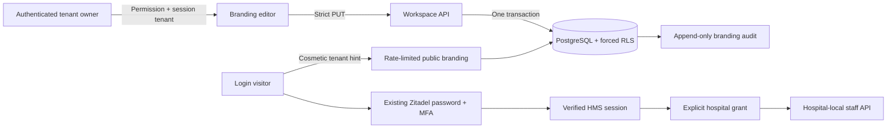

# Workspace UI and branding

The shell remains Next.js 16 / React 19 with Tailwind CSS 4. `/workforce` reads and writes the workforce API; `/settings/branding` edits the signed-in tenant's published branding. No sample records are bundled into either screen.

| Route                               | Authorization and behavior                                                             |
| ----------------------------------- | -------------------------------------------------------------------------------------- |
| `GET /api/v1/workforce/hospitals`   | Signed session, current tenant membership, explicit hospital grants; cursor pagination |
| `GET /api/v1/workspace/branding`    | Signed session and current tenant membership; tenant comes from the session            |
| `PUT /api/v1/workspace/branding`    | Same plus `workspace.branding.manage` (tenant administrator); idempotent replacement   |
| `GET /api/v1/auth/branding/:tenant` | Anonymous, rate limited; deliberately public display fields only                       |

Branding fields are `display_name` (1–100 characters), `welcome_text` (up to 240), `logo_url` (optional public HTTPS image URL, no credentials, query or fragment), `theme` (`teal`, `blue`, `indigo`), and `login_layout` (`centered`, `split`). Invalid fields, unknown properties, multiple JSON objects and oversized bodies are rejected. Logo images load in the browser with no referrer; the API does not fetch URLs. This release accepts an existing image URL, not uploads. The separate GCS/ClamAV upload pipeline remains required before file upload support.

A branded link is `/login?tenant=<tenant UUID>`. Its hint only selects public appearance through the OIDC redirect; authenticated data and branding always use the verified session. Branding editors cannot insert HTML, scripts, custom CSS, credential forms or redirects. Every layout and authenticated workspace retains the Tesserix attribution/copyright footer.

Hospital administrators explicitly confirm their own manager grant when creating a hospital. Hospital creation and the access grant are two idempotent API calls; a partial failure leaves the same form/id available for retry. Staff add/edit requires a hospital manager; a reader sees the directory without mutation controls. Hospital switching resets staff drafts. The filter is explicitly limited to the current page; it does not pretend to search the entire hospital directory.

Migration `0001_workspace` adds only `workspace_branding`, `workspace_branding_audit`, their RLS policies and audit triggers. It does not alter staff/clinical tables. Apply before deploying the new API. Rollback retains these tables and their history; do not drop them. A new production migration requires the specific release approval defined in the working agreements.
