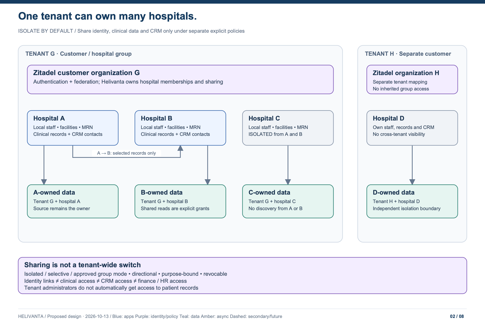
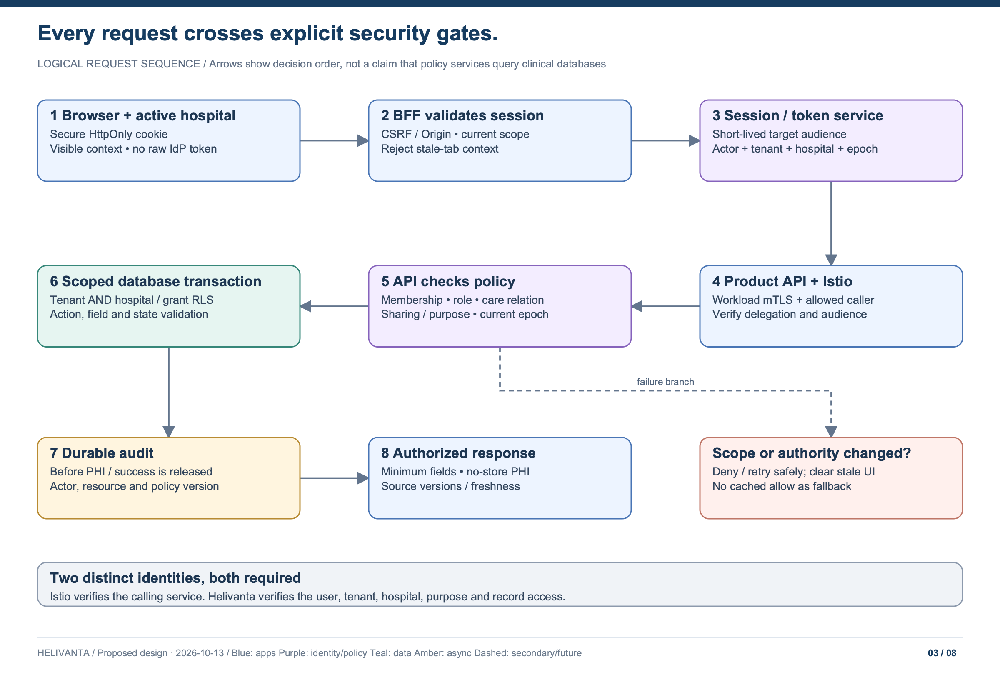
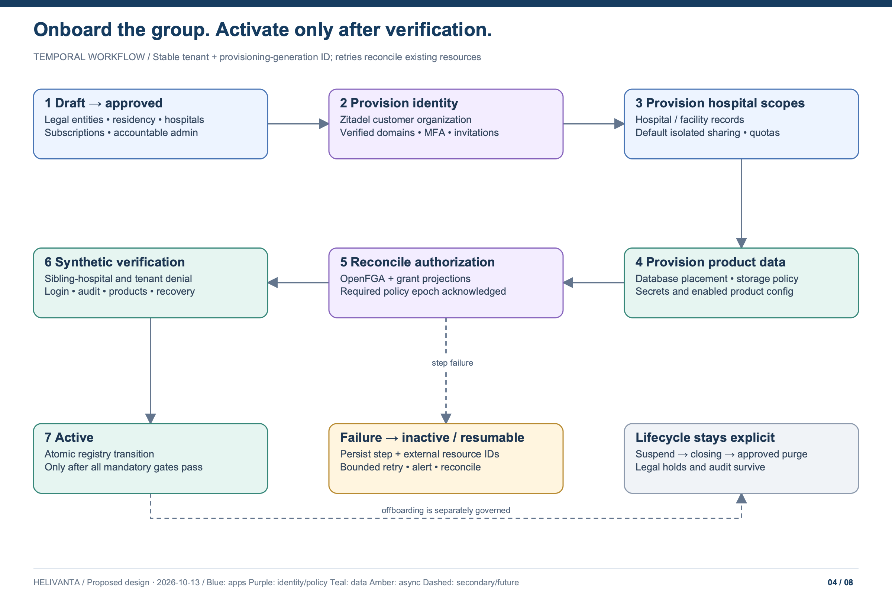

# Tenancy, hospital sharing, identity and CRM

[Architecture index](README.md) · Proposed target · incorporates multi-hospital tenant and CRM clarification

For the implemented operator-backed identity flow, follow the
[hospital onboarding runbook](../delivery/hospital-onboarding.md). It covers new
customers, safe adoption, multitenancy, shared users and verification. The Temporal
lifecycle and full clinical sharing model below remain target architecture; a
Ready identity claim is not proof that all clinical setup has completed.

## Model the customer and hospital separately



| Entity                | Meaning and authority                                                                                                                                    |
| --------------------- | -------------------------------------------------------------------------------------------------------------------------------------------------------- |
| Tenant                | Contracted customer or hospital group; canonical Helivanta UUID, jurisdiction/residency assignment, subscriptions, status and policy version             |
| Hospital              | Mandatory data-access boundary within a tenant; own staff assignments, clinical records, CRM records, operational policy and sharing agreements          |
| Facility/location     | Campus, branch, ward, lab, pharmacy, counter or store inside a hospital; resource scopes can be narrower than a hospital                                 |
| Legal entity          | Contracting/billing/controller identity; mapped explicitly to hospitals. Common tenant ownership does not override separate legal responsibilities       |
| Identity organization | Zitadel organization providing account ownership, authentication policy and federation; normally one per tenant, never itself the clinical data boundary |
| Person and credential | Helivanta-owned immutable actor ID mapped to `(issuer, subject)` credentials; email and name are not keys                                                |
| Membership            | Actor's approved tenant and hospital assignments; role, facility scope, employment dates and current status                                              |
| Patient registration  | Hospital-owned registration and hospital-specific MRN; shared identity links do not confer record access                                                 |
| Sharing agreement     | Directional, versioned grant between named hospitals for named data categories, patients/cohorts, purpose, permitted operations and dates                |

Every tenant-owned resource has `tenant_id`. Every hospital-owned record also has a non-null `origin_hospital_id`; locations belong to a hospital through tenant-aware constraints. Group-level configuration is held in separate, explicitly classified tables, not represented by a null hospital that silently means “all hospitals.” A tenant administrator manages the group but gets no clinical or CRM browsing right by default.

A user can work in several hospitals of one tenant and in several unrelated tenants. The active context contains **one tenant and one acting hospital**. A separately authorized group reporting view can select several hospitals, with an explicit bounded scope. It never turns an ordinary session into an unrestricted tenant-wide clinical view.

## Three sharing modes, independent data categories

| Mode                        | Patient identity and discovery                                                                                        | Clinical records                                                                                                                                        | CRM and operations                                                                                   |
| --------------------------- | --------------------------------------------------------------------------------------------------------------------- | ------------------------------------------------------------------------------------------------------------------------------------------------------- | ---------------------------------------------------------------------------------------------------- |
| Isolated hospital (default) | Search, matching and MRN uniqueness are hospital-scoped; do not disclose that another hospital has a matching patient | Only owning-hospital authorized teams; no sibling-hospital discovery or access                                                                          | Contacts, enquiries, referrals, campaigns, finance and HR remain hospital-scoped                     |
| Selective sharing           | Approved identity links or referrals expose only the needed identity fields                                           | Explicit agreement for recipient hospital, patient/cohort, categories, purpose, time and read/write operation; source owns the record                   | CRM contacts may be shared while campaigns, clinical data or balances remain private, and vice versa |
| Approved group sharing      | Group identity resolution for participating hospitals; local MRNs remain intact                                       | Eligible records visible to authorized staff of participating hospitals, still subject to care-team, sensitivity, consent/legal-purpose and role checks | Group CRM/reporting can operate over an approved scope, with exclusions and per-purpose access       |

“Share all” is not a bypass flag. It means a versioned policy selecting all **eligible** categories in an approved group; specially restricted records, legal restrictions, patient preferences where applicable and staff scope still apply. Sharing is directional: A→B does not imply B→A or B→C. An explicit deny/restriction takes precedence over an allow.

Treat identity linking, patient discovery, demographics, clinical documents, results, prescriptions, financial records, workforce data and CRM communications as different policy categories. Authorizing a referral or shared phone number does not authorize a longitudinal chart. A group analytics total can also disclose sensitive data and needs its own permission and suppression rules.

The policy service evaluates an intersection:

```text
valid session AND active tenant AND active hospital assignment
AND subscribed product AND allowed role/action AND facility/care relationship
AND (owning-hospital permission OR explicit current sharing agreement)
AND sensitivity/purpose/consent-or-other-lawful-basis policy
AND valid resource state
```

Consent is not the sole legal basis for every healthcare operation. The approved jurisdiction/customer policy determines whether consent, treatment, another permitted purpose or a restriction applies. The service returns an attributable decision and policy version, not a browser-editable list of allowed hospital IDs.

### Changes, revocation and exceptional access

Sharing changes require an authorized administrator, documented basis, affected-category preview and additional approval where the customer policy demands it. Activating a policy states whether it covers historic records or future records only. Switching to isolation stops future access, invalidates cached decisions/search results and queued exports, and triggers review of recipient projections. It cannot erase what an authorized recipient already saw or legally incorporated into its own clinical record; that retained copy has its own provenance and retention basis.

The policy authority commits a new scope epoch before acknowledging revocation. New operations must read the current epoch; unavailable authority means denial. OpenFGA projections and local grant projections must acknowledge the same epoch before an allow is usable. Long-running exports and AI retrieval recheck before release. Already completed disclosures cannot be revoked; a transaction authorized before the revocation commit is logged with its authorization point, and high-impact commands revalidate before committing their clinical/business effect.

Emergency access is a time-limited, patient-scoped grant with reason, step-up authentication, immediate security notification and retrospective clinical review. It is never a `BYPASSRLS` connection, a universal cross-tenant search or a fallback when policy services are unavailable. Hospital downtime procedures handle that outage separately.

## Zitadel topology

The target changes the old “hospitals are not Zitadel entities” decision: **tenants are now provisioned into Zitadel**, while multiple hospitals remain Helivanta-managed boundaries within each tenant.

- Helivanta provider organization owns the product project and web client. Per-environment clients have exact redirect URI allowlists.
- Each customer tenant maps to its own customer organization for account lifecycle, branding, MFA baseline and enterprise federation. Project grants, where needed, permit application entry/delegated identity administration only; they do not encode clinical permissions.
- Hospitals normally share the tenant's identity organization. If hospitals need independent IdPs or authentication administrators, support additional verified `tenant_identity_org` mappings, each bound to explicit hospital authentication policy. This is an extension of the identity mapping, not a split or merge of their clinical tenant IDs.
- Users have a home identity organization; external users may receive application grants. A clinician who works for two customers does not acquire access from their home organization name or email domain.
- Zitadel org scopes can restrict login to users of that organization. Do not impose the target hospital/tenant org scope on every guest login: the earlier spike showed this can reject legitimate external clinicians. Resolve the user through the approved identity route, then authorize the active hospital separately.
- Tenant-required authentication assurance must be satisfied for external users too. Check verified authentication method/freshness or perform a proven step-up flow. Do not assume the target organization's MFA policy was applied to a user authenticated elsewhere. Unsupported assurance paths deny access.

Zitadel owns authentication state. Helivanta PostgreSQL owns memberships, hospital assignments, entitlements and sharing policy; OpenFGA is a derived relationship decision model, rebuilt/reconciled from authoritative changes. Product roles are not independently editable in both systems. Tenant admins cannot grant themselves Zitadel instance administration or access other tenants' organizations.

This proposal preserves Helivanta's existing native Zitadel login client. It does not silently switch back to hosted login. Account recovery, MFA, passkeys and federation must be tested against the pinned deployed Zitadel version, including cross-site behavior and external-user scenarios, before the new topology activates.

## Session and request flow

### Role and resource boundaries

Roles are assignments within a tenant/hospital scope, not global names carried as trusted browser claims. OpenFGA object identifiers include tenant ownership; hospital, care-team and resource relationships are explicit. The policy service combines relationship checks with current sharing, sensitivity and purpose rules. A group-level role must name its hospital set and allowed actions; it cannot inherit unrestricted patient access through a generic tenant-admin relation.

| Role                       | Typical permitted scope                                                               | Explicit separation                                                                             |
| -------------------------- | ------------------------------------------------------------------------------------- | ----------------------------------------------------------------------------------------------- |
| Tenant administrator       | Hospitals, subscriptions, invitations and approved policy configuration               | No implicit clinical chart, CRM content, payroll or bulk-export access                          |
| Hospital administrator     | Assigned hospital configuration and staff administration                              | Cannot approve access to another hospital or bypass clinical restrictions                       |
| Receptionist               | Required demographics, registration and appointment/encounter administration          | No unrestricted notes, result sign-off or campaign access                                       |
| Clinician                  | Assigned care relationship, encounter actions and permitted shared records            | Cannot edit another hospital's source record merely because it is readable                      |
| Pharmacist                 | Authorized prescriptions, safety-relevant fields, dispense and pharmacy stock         | No unrestricted hospital chart or payroll access                                                |
| Lab technician / signatory | Assigned specimen/processing work; signatory separately authorized for result release | Processing access does not grant clinical result sign-off                                       |
| CRM/contact-centre agent   | Approved hospitals' contacts, enquiries, referrals and booking requests               | Shared contacts do not grant medical-record or marketing-send permission                        |
| Finance / HR               | Separately assigned ledgers or workforce records                                      | Neither role implies clinical or each other's sensitive-data access                             |
| Patient / delegate         | Verified patient relationship, released records and valid delegation scope            | Separate session/token audiences from staff; guardian/proxy expiry and legal restrictions apply |
| Platform support           | Time-limited support task with attributable delegation                                | No standing PHI browsing or universal impersonation                                             |

Every row remains subject to product subscription, current assignment, facility scope and permitted record state. Export, sharing approval, patient merge, financial refund, controlled dispensing and emergency access are separate permissions with policy-defined step-up/separation of duties. This is the target permission model; the repository's existing route-level permission matrix does not prove all these resource checks are implemented.



1. The browser authenticates through the approved Zitadel flow. The session service verifies issuer, signature/algorithm, audience, expiry, nonce/state or login-client transaction binding, authentication time and required factors. An ID token is accepted only in the login protocol, never as a product API access token.
2. The user selects a tenant and hospital as a **requested context**. The server validates membership, hospital status, products and authentication assurance against current authorities.
3. The BFF uses a Secure, HttpOnly, host-only cookie with SameSite and explicit CSRF/Origin protections. No access or refresh token in local storage. Proposed clinical defaults are 15-minute idle lock and 8-hour absolute lifetime, with stricter scoped policy where needed; these are product policy choices, not claimed HIPAA-prescribed durations.
4. Only the session/security-token service can sign internal delegated tokens. The BFF obtains a short-lived, single-target-audience token containing actor ID, session ID, tenant, acting hospital, scope epoch, authentication assurance, expiry and request correlation. Browser-supplied `X-Tenant`, `X-Hospital`, roles and internal identity headers are stripped.
5. Istio authenticates the calling workload. The destination verifies the delegated token and expected audience, authorized workload/action, current session/membership/policy state and resource-specific permissions. Service-to-service delegation narrows scope; ordinary product APIs have verification keys, never a universal signing key.
6. The API queries PostgreSQL only through a transaction-bound tenant **and hospital/sharing scope**. RLS limits rows; domain checks and authorized serializers limit actions and fields. Clinical reads and writes produce durable audit evidence before data or success is released.

Scope changes rotate session context and invalidate in-flight UI results, query caches, downloads, WebSocket/SSE subscriptions and background browser tasks. The server rejects commands carrying an old scope epoch. Keep a persistent hospital banner and verify context before signing, dispensing or billing. A stale browser tab must never submit a Hospital A form under Hospital B's newly selected session. No PHI in service-worker caches; shared workstations lock and clear sensitive views on timeout/sign-out.

## Durable tenant onboarding



| Stage                      | Persistent outcome and failure handling                                                                                                             |
| -------------------------- | --------------------------------------------------------------------------------------------------------------------------------------------------- |
| Draft                      | Verified customer/legal entities, region, hospital list, data categories, retention profile and subscriptions; tenant UUID allocated once           |
| Approved                   | Named accountable admin, contractual/privacy prerequisites, identity domains verified; client-supplied domains never prove ownership                |
| Provisioning identity      | Temporal workflow creates or reconciles the mapped Zitadel org/project grants, policies and invitations using least-privilege provisioning identity |
| Provisioning scope         | Create hospitals/facilities, default **isolated** sharing policy, database placement, storage scopes, quotas and enabled product configuration      |
| Provisioning authorization | Write authoritative memberships and scopes, then reconcile OpenFGA and grant projections to the required epoch                                      |
| Verification               | Exercise synthetic tenant/hospital isolation, external clinician policy, first-admin MFA, subscriptions, audit, failure recovery and region routing |
| Active                     | Atomic registry state transition only after every mandatory gate passes; tenant becomes accessible                                                  |
| Suspended / closing        | Stop new grants and jobs, revoke sessions, retain authorized continuity/export path according to contract; retain audit and legal holds             |
| Closed                     | Verify exports, deletion/retention policy and derived-store cleanup; produce evidence. Irreversible deletion is separately approved                 |

Use a stable workflow ID derived from tenant UUID and provisioning generation. Persist external resource IDs; retry timeouts by reconciling the existing object, never blindly creating another org. No distributed transaction spans PostgreSQL, Zitadel and OpenFGA. A crash leaves the tenant inactive with a resumable operation and an actionable error. Compensation can disable newly provisioned access; it must not automatically delete a shared identity, clinical data or the last accountable admin.

Adding a hospital uses the same narrower workflow, defaults to isolation, and does not inherit another hospital's sharing grants. Offboarding one hospital retains tenant and other hospitals; stop its subscriptions, sharing edges and credentials without removing a clinician's unrelated memberships.

## CRM within the HMS

CRM is a first-class proposed product API and shared-UI workspace; the user's term is **CRM**, not a common medical-record-number feature. Its addition is a requested design scope, not a capability inferred from a legacy menu.

| CRM capability             | Ownership and access rule                                                                                                                                              |
| -------------------------- | ---------------------------------------------------------------------------------------------------------------------------------------------------------------------- |
| Enquiry/contact            | Hospital-owned record with channel, source, contact details, purpose and retention basis; no diagnosis required                                                        |
| Referral and lead pipeline | Referral received → triaged → appointment requested → appointment confirmed → converted/closed; medical triage stays with licensed clinical workflow                   |
| Appointment                | CRM requests booking from MediCore and stores its reference/status; MediCore owns slot capacity and confirmation                                                       |
| Patient conversion         | Explicit, audited link to a hospital registration after verified identity/matching; never merge on name, shared phone or email alone                                   |
| Communication history      | Tenant/hospital-scoped messages, provider IDs and delivery outcome; content access separated from delivery metadata                                                    |
| Campaigns and outreach     | Purpose/channel-specific consent, opt-out and suppression checks immediately before sending; treatment messaging and marketing have distinct policy                    |
| Shared contact             | Directional contact-data grant between hospitals, with permitted purposes; does not reveal clinical history, other enquiries or another hospital's campaign membership |
| Group contact centre       | Separate assignment for each participating hospital or authorized group scope; active hospital is visible during every booking or call                                 |
| Group analytics            | Approved projections; minimum necessary data, no patient-level drill-down without a separate grant                                                                     |

CRM events contain references and allowed metadata, not diagnosis-bearing message bodies. A receiving hospital creates its own referral/intake record with source provenance; it does not gain write access to the sender's record. Consent withdrawal cancels queued outreach and removes recipients from materialized campaign audiences. Deletion requests are evaluated separately for CRM contact history and legally retained medical records.

### Worked example

Tenant Group G owns Hospitals A, B and C. A and B share released lab results for an approved referral and share CRM contact details for appointment coordination. C remains isolated. A contact-centre agent may book for A and B but cannot read their lab results. A clinician in B can read the referred patient's released results from A, but not A's HR/payroll, unrelated encounters or campaign history. Neither can discover C's patients. Another tenant's records remain inaccessible even if the same clinician also has a membership there.


## Pharmacy ownership clarification (ADR-0024)

Pharma Connect supports independent pharmacy tenants, pharmacy chains and hospital-owned pharmacies. Its access hierarchy is **tenant -> pharmacy -> outlet**. Hospitals are optional owners or partners, not a mandatory pharmacy boundary. A hospital may own multiple pharmacies; a pharmacy may operate multiple outlets. Catalogue/stock/prescription authority never follows automatically from common ownership or an affiliation. Use explicit outlet grants, tenant/pharmacy/outlet RLS and purpose/consent-bound sharing agreements for hospital exchange. Standalone pharmacy workflows must not create fake hospitals or encounters. See [ADR-0024](../adr/0024-pharmacy-ownership-and-outlet-tenancy.md) and the [Pharma API design](pharmaconnect-api.md). The hospital requirements above continue to apply to actual hospital clinical records.
