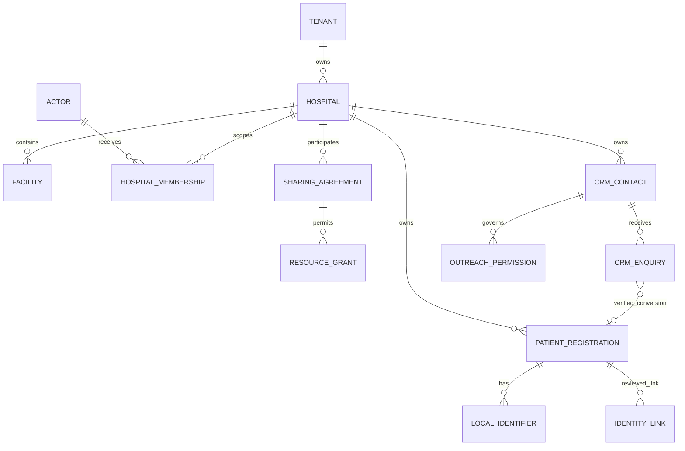
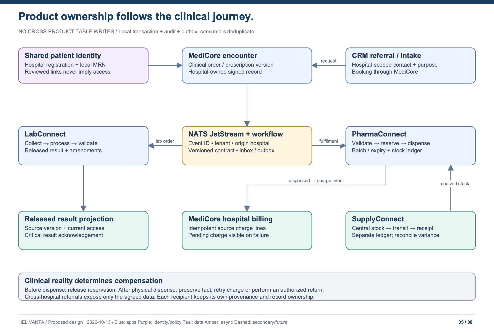
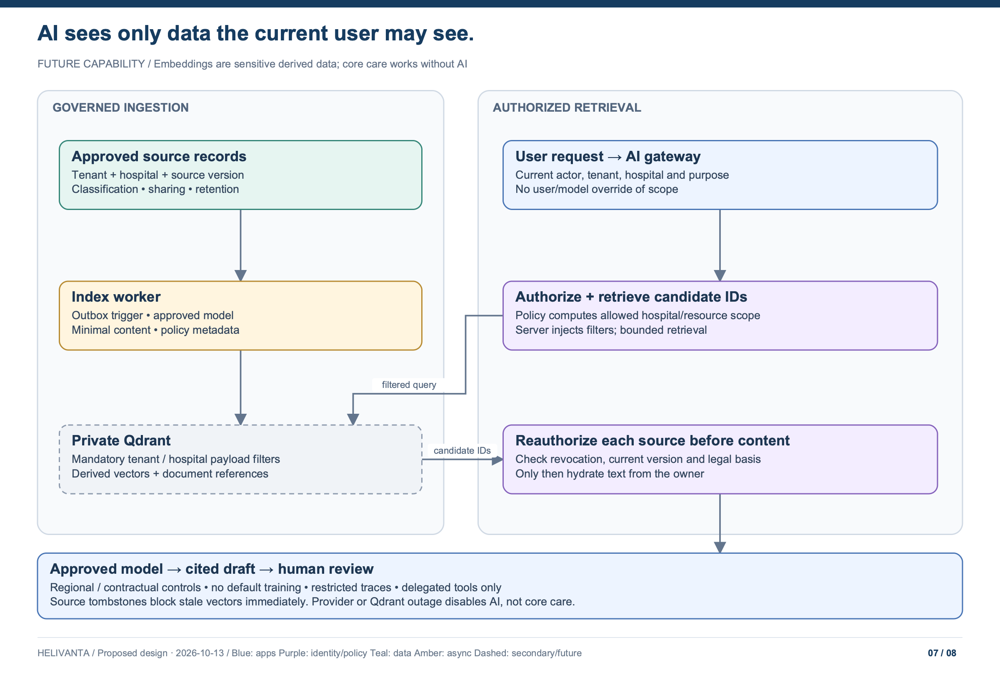

# Data ownership, isolation and workflows

[Architecture index](README.md) · Proposed target

## PostgreSQL is the system of record

Each product has an owned logical database, runtime role, migration role, outbox and schema history. Multiple product databases can share a PostgreSQL HA cluster in a regional cell; this is operational sharing, not permission to join or update another product's tables. Separate identity/control and clinical clusters where risk and load justify it. Dedicated customer cells remain an option for explicit contractual, residency or performance needs. HIPAA does not itself require one database per customer.

| Store                        | Durable purpose                                                                                                      | Isolation                                                                              |
| ---------------------------- | -------------------------------------------------------------------------------------------------------------------- | -------------------------------------------------------------------------------------- |
| Platform PostgreSQL          | Tenants, hospitals, facilities, subscriptions, memberships, sharing agreements, policy epochs, onboarding references | Group-admin rules plus scoped control-plane roles; no broad clinical-data pool         |
| Patient identity PostgreSQL  | Hospital registrations, local MRNs, identifiers, reviewed group links, merge history, consent artefacts              | Tenant + hospital row scope; identity-link registry separately privileged              |
| Product PostgreSQL databases | Product transactions, histories, idempotency records, local projections, audit staging and outbox/inbox              | Per-product credentials; forced tenant and hospital/sharing RLS                        |
| Zitadel PostgreSQL           | Identity provider state                                                                                              | Separate credentials/backup; clinical services cannot query it                         |
| OpenFGA PostgreSQL           | Authorization tuples and model state                                                                                 | Private policy service; derived from authoritative domain/control changes              |
| Temporal persistence         | Provisioning and long-running workflow state                                                                         | Private worker identities/task queues; references instead of PHI payloads              |
| GCS files / PACS             | Documents, reports, diagnostic images, quarantined uploads                                                           | Tenant/hospital/classification metadata and access mediation; retention and encryption |
| Audit archive                | Immutable access and change evidence                                                                                 | Separate security-owned storage and retention controls                                 |

The repository currently uses GORM over PostgreSQL through `pkg/tenantdb`, not a direct pgx-only repository layer. This design preserves that enforced seam. New APIs can use pgx where appropriate, but changing ORM is not part of service extraction and may not weaken isolation.

## Enforce both tenant and hospital boundaries

1. Tenant-owned tables require `tenant_id NOT NULL`. Hospital-owned tables additionally require `origin_hospital_id NOT NULL`. Use tenant/hospital-aware unique keys and foreign keys: a line item cannot reference another tenant or hospital's parent by accident.
2. Runtime roles are `NOSUPERUSER NOBYPASSRLS`, cannot own/alter tables and cannot assume migration/system roles. Enable **and force** RLS on every scoped table. CI and boot checks enumerate tables and reject missing/wrong policies.
3. Every database operation uses a short transaction with transaction-local settings derived from verified context. Tenant, acting hospital, actor, purpose and policy epoch are bound server-side. Missing/invalid context denies; context must not leak through a pooled connection.
4. Tenant predicates and hospital predicates must be conjunctive. Avoid separate permissive policies that PostgreSQL ORs into “tenant matches **or** hospital matches.” The row is eligible only if the tenant matches **and** the owning-hospital scope or a specific valid sharing grant permits it.
5. API policy evaluation and a locally projected, indexed resource/hospital grant table work together for shared reads. The grant projection carries agreement ID, recipient hospital, permitted category/action, patient/resource scope, validity and epoch. An epoch mismatch is a closed gate, not permission to use an old projection. No user-provided list of hospital IDs enters RLS.
6. RLS `WITH CHECK` pins ordinary writes to the authorized owning hospital. Sharing a record for reading cannot move its owner or create cross-hospital writes. A receiving hospital authors its own record linked to a source, or invokes an explicit source-owned collaboration command.
7. Field-level restrictions and clinical action/state checks remain in the API. RLS alone does not distinguish a demographic field from a psychiatric note in an otherwise visible row.
8. Classify tenant-level catalogues, hospital records and truly public reference data explicitly. Public lookup tables are narrowly allowlisted; never exempt a PHI table because a worker needs to scan it.

PostgreSQL notes that superusers/BYPASSRLS bypass row security and integrity constraints can reveal information despite RLS. Use scoped constraints, generic conflict responses and reviewed identity matching to avoid existence leaks. See [official RLS documentation](https://www.postgresql.org/docs/current/ddl-rowsecurity.html).

**Threat boundary:** transaction-local RLS protects against missing predicates; a fully compromised service holding a shared database credential could forge context. Minimize service table privileges, isolate workers, bind context through the shared access layer and test it structurally. Contractual protection against that larger blast radius requires separate database roles/instances or dedicated cells; do not market pooled RLS as physical isolation.

### Privileged workers

The existing monolith opens app, migration and cross-tenant system pools. The target moves cross-tenant outbox draining/reconciliation/retention to separate workers with explicit table/operation grants, no DDL and no browser entry point. Product serving pods receive only their runtime credentials. Prefer enumerating authorized work items then using scoped transactions; any required `BYPASSRLS` role is worker-only, audited and denied clinical-table access it does not need.

### Logical relationships

This is a conceptual relationship map, not cross-database SQL foreign keys. Cross-product references carry tenant, owning hospital, resource ID and version; the owner validates them through a contract. Identity links are versioned and reviewed; do not rewrite signed records or MRNs during a merge. Split/unmerge retains provenance and routes conflicting clinical histories to human review. Retain existing UUIDs during migration; no blanket UUID rewrite to adopt a newer generator.

## Valkey: disposable and scoped

Use Valkey for bounded reference caches, expensive authorized read fragments and capacity counters. Every key has a TTL and namespace including environment, cell, product, tenant, hospital/access-scope fingerprint, policy epoch and resource version as appropriate. Illustrative shape: `hv:v1:<cell>:<product>:<tenant>:<hospital>:<scope-hash>:<resource>`; identifiers must not embed names, phone numbers or diagnoses.

- Partition credentials/key patterns by service; private TLS endpoints and restricted admin commands. Valkey logical database numbers are not a security boundary.
- Prefer non-PHI cache entries. If PHI is justified, classify it as PHI, encrypt storage where applicable, minimize TTL, and include backups/dumps in the privacy inventory.
- Cache miss/outage goes to PostgreSQL with concurrency limits and load shedding. Never serve another hospital's cached result or a stale allow.
- Authorization/session revocation are checked against durable authorities; Valkey is not the only source of truth for either. Security-sensitive verification fails closed if authority is unavailable.
- Capacity limiting can fall back to bounded local limits and alerting, preserving clinical availability. Credential stuffing, OTP attempt limits and other identity protections must not fail open.
- Invalidate after committed writes through the outbox, jitter TTLs and single-flight refills. Domain ledgers, locks protecting stock correctness, durable jobs and audit are not kept only in Valkey.

## Cross-product events and consistency

**Confirmed:** use NATS with JetStream and Temporal. JetStream is the persistence/consumer capability within NATS, not a second competing broker.

- **Core NATS:** optional transient signals, such as UI refresh hints, only when loss is harmless and the authoritative state can be refetched. Never rely on it alone for clinical, audit, billing, stock, file-scan or provisioning work.
- **JetStream:** durable domain events, replay, acknowledgements and durable consumers, backed by PostgreSQL transactional outboxes. Assume duplicate delivery and enforce business deduplication.
- **Temporal:** durable orchestration, timers, human/external waits and compensations. Temporal uses its own persistence and task queues; it is not configured to use NATS as its internal workflow store.
- **Bridge:** derive a stable workflow ID from the tenant/hospital/business event; acknowledge JetStream only after a start is accepted or the matching execution is verified. Retried activities remain idempotent. For subsequent signals/updates, persist event IDs and deduplicate in workflow logic. Do not run competing broker and workflow retry loops for the same business step.

NATS JetStream is already part of the repository; retain it as the durable broker. A local business transaction writes its state, audit intent and outbox event atomically. A relay publishes at least once. Consumers write an inbox deduplication row and their state change in the same local transaction. Broker acknowledgements occur only after durable commit. A crash after publish but before marking the outbox produces a duplicate, not lost work.

Events carry `event_id`, schema version, source product, tenant, origin hospital, aggregate ID/version, occurrence time and correlation/causation references. Include permitted destination scope for directed sharing. Broker subject allowlists constrain service publishers/consumers; consumers verify schema, source identity/contract, tenant/hospital ownership and sharing policy. A supplied destination tenant is not a grant. Do not broadcast PHI into a global subject or put raw patient data in dead-letter dashboards.

Ordering is per aggregate/version, not assumed global. Reject/quarantine impossible version gaps and reconcile against the source. Retry transient failures with capped jittered backoff; permanent contract/authorization failures enter a restricted dead-letter workflow. Replay revalidates current sharing policy; historical delivery authority cannot re-enable revoked access.

| Operation                                             | Consistency / recovery                                                                                                                      |
| ----------------------------------------------------- | ------------------------------------------------------------------------------------------------------------------------------------------- |
| Bed assignment, stock decrement, invoice posting      | Strong local transaction, constraints and ordered row locking; optimistic concurrency where appropriate                                     |
| Source lab/prescription view used for clinical action | Validate current authoritative status/version; a stale projection cannot authorize dispense or sign-off                                     |
| Navigation, dashboards, search and group reporting    | Eventual consistency with visible freshness; never used as the final authority for clinical/financial commands                              |
| Refund/return                                         | New attributable ledger entries; never delete the original transaction                                                                      |
| Long-running multi-product handoff                    | Temporal orchestration with idempotent activities, explicit pending/failed state and recovery owner                                         |
| CRM campaign send                                     | Recheck suppression, current permission and hospital scope immediately before provider submission; reconcile provider status after timeouts |

## Clinical journeys

### Registration → encounter → diagnostics

Patient identity creates a hospital-scoped registration after authorized matching. MediCore creates the encounter with that registration reference. A diagnostic order commits in MediCore with an outbox event; LabConnect accepts it idempotently and owns specimen collection, processing, validation and released result versions. A rejected specimen or cancelled order produces a documented state transition, never disappearance from the worklist. Results update the MediCore projection after release; amendments are new signed versions and notify prior authorized recipients. Critical-result acknowledgement is a durable clinical workflow, not merely a sent SMS.

### Prescription → dispense → billing

MediCore owns a signed prescription version. PharmaConnect checks the current version, patient/hospital access, fulfilment authority and available stock. It creates a local reservation/dispense state with idempotency and batch/expiry ledger entries. Hospital charge posting is a separate operation with a stable source-line ID. If billing is down after physical dispense, keep `dispensed / charge_pending`, retry/escalate and do not pretend the physical act was undone. Before physical fulfilment, reservation cancellation is a valid compensation. After fulfilment, a return/refund requires its own authorized clinical and financial workflow.

Do not route clinical safety through a sequence that charges, dispenses and “rolls back” by deleting history. Deadline/retry ownership belongs to one orchestration layer. Automatic HTTP retries of an irreversible command require an enforced idempotency contract.

### Procurement → pharmacy stock

SupplyConnect approves PO and receives a GRN into central-store inventory. A transfer reserves/ships stock and records transit. PharmaConnect acknowledges received quantities into its own pharmacy ledger; differences remain a reconciliation exception. No service writes both inventories. The original dispatch is preserved if acknowledgement is delayed or an activity is redelivered.

### CRM enquiry → referral across hospitals

Hospital A CRM creates an enquiry and an approved referral to B. The sharing agreement specifies the minimal contact/referral fields; clinical attachments need a separate grant. B accepts an intake record and requests a MediCore appointment. A sees the allowed acknowledgement/status, not B's future chart or campaign history. A cancelled referral cannot cancel an already-completed encounter; compensation closes outstanding coordination work and preserves clinical provenance.

## Documents, reporting and future AI

**Confirmed storage stack: private multi-tenant Google Cloud Storage with ClamAV.** The [file-storage design](07-file-storage-and-scanning.md) defines bucket/IAM boundaries, generation-bound scan verdicts, the JetStream-to-Temporal workflow, promotion, protected delivery and failure handling.

Uploads go to GCS quarantine with type/size validation and ClamAV malware scanning. The object metadata binds tenant, origin hospital, owner product, patient/resource, classification, retention and checksum. Release requires a clean scan and authorization. Short-lived signed downloads follow a fresh policy check; use mediated streaming where immediate revocation is required. Object prefixes alone do not enforce access. Reports and exports reauthorize the full scope at generation and delivery, record scope/policy versions, expire links and never send raw PHI to generic email attachments by default.

Cross-product reports use owned projections/analytical stores built from approved events, not credentials spanning all OLTP databases. Group reports respect participating hospitals and sensitivity restrictions. Reconcile financial totals to source ledgers; label data freshness and definition versions. A dashboard total is not a financial close.

Qdrant is **future only** and rebuildable from approved sources. Use a private deployment in the tenant's residency cell. Collections are organized by embedding model/dimension and data class; payload indexes include tenant, origin hospital, document/version and policy metadata. Dedicated collections/shards/cells are available where isolation or load requires them. Qdrant's documented payload-based tenancy is a retrieval mechanism, not a substitute for application authorization ([Qdrant multitenancy](https://qdrant.tech/documentation/manage-data/multitenancy/)).

Only the AI retrieval service can query Qdrant. It injects mandatory tenant plus current permitted hospital/resource filters; user/model-supplied filters cannot replace them. Candidate IDs are reauthorized against source status, sharing/consent and document version **before text is fetched or sent to a model**. The response cites the exact approved source/version. Revoke/tombstone at the source immediately, remove vectors asynchronously with an auditable deletion job, and block stale results in the meantime. Restore/reindex applies tombstones and current policy before serving.

Embeddings, prompts, model caches and traces can contain or reveal PHI. Apply the same residency, retention, restricted logging, contracts and access controls. No default provider training or clinical prompt capture. Provider/model selection remains an approved future decision with contractual/BAA checks where applicable. Retrieved documents are untrusted input; they cannot grant tools or override system policy. Tools operate under the user's current delegated authority; consequential output requires human review. AI failure leaves normal care workflows available.

## Pharmacy ownership clarification (ADR-0024)

Pharma Connect supports independent pharmacy tenants, pharmacy chains and hospital-owned pharmacies. Its access hierarchy is **tenant -> pharmacy -> outlet**. Hospitals are optional owners or partners, not a mandatory pharmacy boundary. A hospital may own multiple pharmacies; a pharmacy may operate multiple outlets. Catalogue/stock/prescription authority never follows automatically from common ownership or an affiliation. Use explicit outlet grants, tenant/pharmacy/outlet RLS and purpose/consent-bound sharing agreements for hospital exchange. Standalone pharmacy workflows must not create fake hospitals or encounters. See [ADR-0024](../adr/0024-pharmacy-ownership-and-outlet-tenancy.md) and the [Pharma API design](pharmaconnect-api.md). The hospital requirements above continue to apply to actual hospital clinical records.
