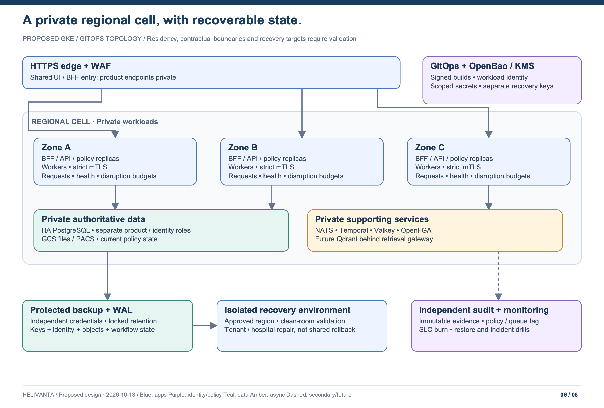

# Deployment, resilience and transition

[Architecture index](README.md) · Proposed target; no live infrastructure inspected or changed

## Regional deployment cell

The existing deployment proposal points to GKE and the `tesserix-k8s` GitOps repository. Reuse that ownership rather than adding imperative deployment commands here. A cell is a region-bound application/data failure domain containing the BFF, product APIs, policy services, workers, private databases, broker, cache and storage. A tenant has an explicit placement record; its hospitals may use separate approved cells when residency requires it. Cross-cell hospital sharing is an explicit mediated exchange, never an invisible cross-region database query.

Production, UAT and development have separate credentials and data; use synthetic data outside production unless a specifically governed de-identification/import process is approved. Proposed production topology: multi-zone GKE, two or more replicas for interactive services, topology spread, disruption budgets, graceful draining, startup/readiness/liveness probes with distinct meanings, private HA PostgreSQL and durable NATS replicas. Capacity and quorum layouts need validation against the platform's actual infrastructure before manifests are written.

A shared Zitadel instance is acceptable only if its region, availability, privileged access, recovery and contractual scope meet Helivanta's requirements. If they do not, use a dedicated compliant identity instance/cell. Do not assume the identity database may freely replicate cross-border because it contains “only accounts.”

File storage uses private regional GCS quarantine/released buckets and isolated ClamAV workers, as detailed in the [file-storage design](07-file-storage-and-scanning.md). NATS with JetStream and Temporal are confirmed platform choices. Scanner freshness, scan backlog, rejected uploads, orphaned generations and denied downloads require monitored service objectives.

## Istio and the request boundary

- Public TLS/WAF fronts the UI/BFF and explicitly authorized integration endpoints. Product API Services, databases, broker, OpenFGA, Temporal and Qdrant are private.
- Istio authenticates workloads and applies default-deny, least-privilege source-workload/path/method rules. Require strict mTLS for meshed workload traffic; database/client-native TLS remains required where traffic is outside mesh termination.
- A workload certificate says which service is calling. It does not identify the patient, hospital or user. Each API verifies delegated user/service authorization and row scope independently.
- On internal JWT-bearing routes, combine `RequestAuthentication` with `AuthorizationPolicy` requiring the expected principal/audience. JWT validation alone can allow requests with no token. Browser cookie routes require the BFF's session/CSRF checks; Istio does not automatically validate a Helivanta cookie ([Istio security documentation](https://istio.io/latest/docs/concepts/security/)).
- Choose the platform-supported sidecar mode or prove equivalent L7 waypoint enforcement in ambient mode. L4 encryption alone is insufficient for HTTP authorization policies. Do not assume that installing Istio activates every required policy.
- Kubernetes NetworkPolicy restricts pod connectivity and protects against paths that bypass proxy assumptions. Egress allowlists, private DNS and identity-protected provider connectors restrict outbound data. No direct public database load balancers.
- Give each call a deadline and each dependency its own concurrency bulkhead. Let the application/orchestrator own retries for business commands; disable mesh retries of unsafe mutations. Limit body size, request count, parallel reports and tenant/hospital background work.

Signed images, provenance/SBOM, pinned dependencies, non-root containers, restricted service accounts, workload identity and secret-manager injection are release requirements. Application migrations are owned and versioned in this repository; infrastructure and delivery live in `tesserix-k8s`. Migration jobs use a distinct short-lived privileged identity and are not embedded in serving pods.

## Dependency failure behavior

| Dependency failure                                 | Required behavior                                                                                                                                                                                                              |
| -------------------------------------------------- | ------------------------------------------------------------------------------------------------------------------------------------------------------------------------------------------------------------------------------ |
| Zitadel unavailable                                | No new login/recovery or assurance escalation; existing sessions may continue only while their own validity, current Helivanta revocation and required assurance remain provable. Renewal that requires IdP state fails closed |
| Membership/policy authority or OpenFGA unavailable | Protected operations deny with an availability error; no cached allow as an outage bypass. Existing clinical downtime procedure applies                                                                                        |
| Hospital-sharing projection behind epoch           | Shared access denied until projection catches up; do not leak prior grants. Own-hospital paths may continue if all their authorities are valid                                                                                 |
| Product PostgreSQL unavailable                     | Owning product commands fail safely; unrelated APIs remain isolated. Never acknowledge a write before durable commit                                                                                                           |
| Valkey unavailable                                 | Read from origin with bounded concurrency; local capacity protection and alerts. Identity/security controls use durable checks or deny                                                                                         |
| NATS unavailable                                   | Local transactions can commit to durable outbox within backlog budget; UI shows pending handoffs. Stop accepting dependent work if backlog safety limits are exceeded                                                          |
| Temporal unavailable                               | New long-running workflows pause/fail explicitly; completed local transactions remain attributable and resume through persisted workflow state                                                                                 |
| Archive unavailable                                | Continue only while durable protected audit staging has capacity and approved lag; deny protected operations if required audit cannot be persisted                                                                             |
| ClamAV unavailable / signatures stale              | Upload remains quarantined; no download/release of unscanned content                                                                                                                                                           |
| PACS/payment/messaging provider unavailable        | Queue/reconcile where safe; display unavailable/pending. Never infer a payment failed solely from a timeout                                                                                                                    |
| Qdrant/model unavailable                           | AI unavailable; normal clinical and CRM workflows continue                                                                                                                                                                     |
| OpenBao/KMS unavailable                            | Existing valid leased/configured credentials may operate within their approved lifetime; no insecure fallback; fail new provisioning/refresh when trust cannot be established                                                  |

Set per-tenant and per-hospital API, connection, report, storage, campaign and AI budgets. A shared tenant's busiest hospital must not starve its siblings. Queue fairness and bounded workers matter as much as ingress throttling. Monitor event lag, projection epochs, failed provisioning, pending charges/transfers, audit lag and user-visible SLO burn, with named on-call owners and runbooks.

## Recovery objectives and procedure

| Failure                               | Proposed objective                                                    | Qualification                                                                                          |
| ------------------------------------- | --------------------------------------------------------------------- | ------------------------------------------------------------------------------------------------------ |
| Single pod/node/zone                  | RTO ≤5 minutes; RPO 0 for acknowledged PostgreSQL writes              | Requires tested synchronous replication/quorum and fencing; not achieved by replicas alone             |
| Regional cell loss                    | RTO ≤4 hours; RPO ≤15 minutes                                         | Encrypted WAL/backup replication into an approved residency location and tested infrastructure rebuild |
| Tenant or hospital logical corruption | Restore/reconcile ≤8 hours after an approved recovery point is chosen | Actual duration depends on data volume and cross-product reconciliation; benchmark it                  |
| Valkey loss                           | Cold rebuild; no business-data RPO                                    | Origin capacity must survive cold starts                                                               |
| Qdrant loss                           | Rebuild within a measured future AI recovery budget                   | No loss of authoritative records and no effect on core care                                            |

For a shared database, never roll back the whole cluster to recover one hospital. Restore into an isolated recovery environment, identify the tenant/hospital records and all event/ledger dependencies, compare manifests and source versions, and repair through approved reconciliation/import tooling. Enforce fresh access/sharing/deletion policy before release. A stock or payment already executed elsewhere cannot be undone by restoring an older row. Reconcile inbox/outbox watermarks and external side effects before consumers resume.

Back up clinical/control databases, Zitadel, OpenFGA, Temporal, broker configuration/state, object metadata/content, keys/recovery material and GitOps configuration according to classification. Separate backup credentials and locked retention; verify checksums and perform quarterly proposed recovery exercises with synthetic validation. Database backups alone are not a complete restore of the platform.

## Connection and cost envelope

Illustrative cluster connection budget: six initial API deployables × three replicas × ten runtime connections = 180. Add 40 worker connections and 30 operational/migration connections = 250; reserve at least 50 more within a reviewed 300-connection envelope. Do not automatically set `max_connections=300` without memory/load analysis. As the portfolio grows, use PgBouncer transaction pooling, smaller pools, separate clusters or dedicated cells. Transaction-local tenant/hospital settings are mandatory through a pooler.

**Planning allowance, not a vendor quote:** approximately USD 4,000–12,000/month for one production regional cell at the month-12 envelope, excluding PACS imaging, AI, commercial support and engineering/on-call labor. Illustrative components: app/mesh compute $1–3k, HA PostgreSQL/storage $1–3k, identity/policy/broker/workflow/cache $0.8–2k, object/backup/telemetry/network $1.2–4k. These allowances can overlap when services share nodes and must be priced from an actual bill of materials; no price lookup or live utilization audit was performed. Large document retention, recovery copies and replicated storage may dominate. Dedicated customer cells and extra regions add an explicit contracted cost floor.

Reduce unnecessary runtime count by retaining product-sized modules, not by dropping isolation, HA, audit or recovery controls. Defer entire optional products/AI until their release gates are met. Charge/show back storage, events, reports and model costs by tenant and hospital without PHI in metric labels.

## Migration from the current repository

1. **Record direction and prove boundaries.** Preserve current ADR history; introduce target ADRs and a contract inventory. Freeze no clinical behavior based merely on a legacy screen. Build synthetic tenant/hospital fixtures, including mixed sharing and CRM.
2. **Introduce hospital scope before broad multi-hospital use.** Add hospital records and explicit owner columns using expand/backfill/validate/contract. For each existing tenant, map existing records to a verified initial hospital. Ambiguous ownership is quarantined for review; do not infer it from a clinician's current hospital or assign everything to a default silently. Legacy MRNs remain mapped. Run dual-scope comparisons on sanitized data, then enable mandatory hospital policy before onboarding a second hospital.
3. **Evolve Zitadel onboarding.** Map existing user identities and preserve `(issuer, sub)`; create tenant organizations/invitations with a resumable workflow. Existing users can remain in their home org with approved external access. Verify cross-org assurance, recovery and no duplicate accounts before activation. Preserve old mappings for rollback; never delete identities as compensation.
4. **Create the BFF/internal delegation boundary.** Keep stable browser routes. Add audience-bound tokens, current scope epoch checks, privileged-worker separation and shared conformance tests before routing to a separate API.
5. **Extract one product at a time.** Start with a bounded PharmaConnect or LabConnect slice after contract review. Copy owned data with scoped manifests and checksums, catch up via controlled change capture/outbox, quiesce the named writer for cutover, and switch routing only after replication lag is zero and constraints validate. Exactly one writer owns each aggregate at any moment.
6. **Separate data credentials and activate workflows.** Remove cross-product table grants. Validate duplicate events, lost acknowledgements, pending clinical/billing states and hospital sharing through the entire UI→mesh→database path. Roll out only after evidence gates and named production authorization.
7. **Add CRM and remaining products as complete slices.** Contact/referral ownership, consent, outreach suppression and hospital sharing ship together. Qdrant/AI waits for independent privacy, safety, provider and retrieval validation.

No uncontrolled dual writes. Before a target API has accepted writes, routing can return to the old writer after verification. Once new writes exist, rollback requires a tested reverse-sync/reconciliation plan or a forward fix; an old binary pointed at an old database would lose data. Destructive schema contractions, live migration, rollout or rollback need specific user authorization and restorable state. This task creates design artifacts only.

## Acceptance gates

| Gate                 | Evidence required before the corresponding slice ships                                                                                                                                                                                 |
| -------------------- | -------------------------------------------------------------------------------------------------------------------------------------------------------------------------------------------------------------------------------------- |
| Scope isolation      | Tenants A/B, sibling hospitals A1/A2/A3, isolated/selective/group modes, directional and expired grants, role/facility restrictions, counts/searches/exports/files/events/cache/AI; hostile headers and guessed IDs cannot widen scope |
| Sharing changes      | Historical/future policy, stale projections, revoked grant during export, inactive hospital, browser scope switch and cross-tenant clinician all deny/behave as specified                                                              |
| Identity             | Native login, MFA/recovery, cross-site cookies, external-user assurance, tenant/hospital selection, sign-out/revoke and no duplicate-account provisioning                                                                              |
| Data correctness     | RLS under real non-superuser roles, composite constraints, pool context reset, stale writes, duplicate/reordered events and no duplicate stock/charge                                                                                  |
| Workflow safety      | Crash at each onboarding/dispense/charge/transfer/referral boundary; delayed provider acknowledgement; compensation failure escalates                                                                                                  |
| Audit/privacy        | Actual emitted log/trace/error bytes contain no test PHI/tokens; reads/writes/shares/exports have durable evidence; archive outage follows policy                                                                                      |
| Resilience           | Peak-load run with cold Valkey, policy failure, broker backlog, PostgreSQL failover and tested complete/hospital-specific restore                                                                                                      |
| Compliance readiness | Owners, policies, contracts/BAAs where applicable, retention/legal hold, independent testing, incident/downtime drill and auditor scope                                                                                                |

## Decisions to confirm before implementation

| Input                      | Working assumption                                                                                                     | Accountable reviewer                   |
| -------------------------- | ---------------------------------------------------------------------------------------------------------------------- | -------------------------------------- |
| Tenant/hospital ownership  | Customer group owns multiple hospitals; isolated by default; selective/group sharing is explicit                       | Product + customer legal/privacy owner |
| CRM scope                  | Enquiries, contacts, referrals, outreach and communication history; no automatic clinical access                       | Product + hospital operations          |
| Capacity                   | Month-12/36 assumptions in system design; hospitals per tenant and busiest-hospital skew still need measured estimates | Product + SRE                          |
| Jurisdiction/regions       | India-first approved cell; other markets require a reviewed residency profile                                          | Legal + platform                       |
| SOC examination            | SOC 2, proposed Security/Availability/Confidentiality and future Type II                                               | Security + auditor                     |
| Retention and recovery     | Proposed windows/targets in this package; contractual and clinical validation outstanding                              | Privacy + clinical owner + SRE         |
| Zitadel topology           | Org per tenant, optional scoped org mappings for hospital-specific federation                                          | IAM + platform                         |
| Runtime versions/mesh mode | Reuse supported GitOps platform; verify pinned versions and L7 policy capability                                       | Platform                               |
| Cost                       | Planning allowance only; detailed regional bill of materials required                                                  | Finance + SRE                          |

These inputs do not prevent documenting the architecture. They do prevent treating it as production-approved or implementing assumptions as irrevocable schema/contracts without review.
