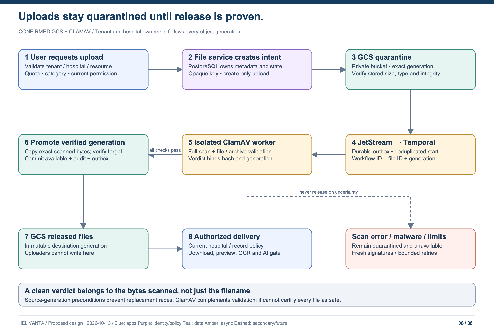

# Multi-tenant GCS storage and ClamAV scanning

[Architecture index](README.md) · **Confirmed technologies:** Google Cloud Storage and ClamAV. Detailed configuration below is the target design, not deployed state.

## Storage boundary

GCS stores Helivanta files: attachments, clinical documents, reports, approved CRM documents and exports. PostgreSQL owns file metadata, ownership, policy and lifecycle state. A PACS/DICOM service still owns imaging protocols and study workflow; a bucket does not replace it.

Use separate private buckets per environment and approved residency cell for **quarantine**, **released files** and **restricted malware retention**, with separate security-owned buckets for immutable audit/backups. Split buckets further by retention/key requirements. Standard pooled tenants use opaque tenant/hospital prefixes plus application enforcement. Dedicated tenant or hospital buckets/projects/keys are available where contractual isolation or blast-radius requirements justify them.

An illustrative immutable object key is `t/<tenant-uuid>/h/<hospital-uuid>/o/<patient-or-staff>/<owner-uuid>/r/<record-uuid>/d/<YYYY>/<MM>/<DD>/f/<file-uuid>/v/<version>`. The date partition is the server-assigned upload date in UTC; clinical/employment record dates remain protected metadata in PostgreSQL. Correcting a record date does not rename historical objects or break provenance. Owner and record UUIDs are validated through the owning module’s published authorization contract, never accepted as unverified claims. Attachments may point to an encounter, assessment, qualification, employment document or other governed record, with explicit record type/version and origin hospital in PostgreSQL. Patients and staff cannot discover each other’s files merely because prefixes share a tenant. Never include patient names, MRNs, phone numbers or original filenames in object paths. Prefixes organize objects; they are not the authorization boundary. No browser or hospital user gets bucket-wide list/read access. Every access is mediated by the file service and current tenant/hospital/sharing policy.

Use uniform bucket-level access, public access prevention, least-privilege IAM and GKE workload identity. Grant upload, scan, promotion and download identities distinct permissions; uploaders cannot write released storage, and scanners cannot grant access or change authoritative ownership. Use supported library/API signing through narrowly scoped identities instead of downloaded service-account keys. GCS encryption, approved KMS/CMEK policy, residency, retention, soft-delete/versioning and recovery are documented per bucket class. Locked retention is applied only after the approved schedule is reviewed because it constrains deletion.

GCS uniform bucket-level access removes object ACLs in favor of IAM. This does not implement Helivanta's patient or hospital policy; that remains in the application ([GCS access model](https://cloud.google.com/storage/docs/uniform-bucket-level-access)).

## Upload, scan and release



1. **Authorize an upload intent.** Validate actor, tenant, acting/owning hospital, resource, product permission, file category, expected size and quota. Allocate an opaque file ID in PostgreSQL. The server chooses bucket and key; it does not trust client-supplied owner metadata.
2. **Upload only to quarantine.** Issue a short-lived capability for the exact new object or a protected resumable-upload session. Require create-only generation preconditions. Enforce transfer limits where supported and verify actual stored size/type afterward; oversized content is never released. Protect resumable session URIs like credentials and expire/reconcile abandoned intents.
3. **Verify completion.** The upload finalizer reads GCS metadata for the exact bucket/key/generation and verifies the intent, actual size, integrity information and declared versus detected content. Finalization is idempotent. Store the immutable source generation, hash, size and detected type; commit `scan_pending` and an outbox event atomically. A reconciler detects completed-but-unfinalized uploads without trusting a browser callback.
4. **Start the durable scan workflow.** JetStream delivers the committed event. A bridge starts Temporal using a deterministic workflow ID derived from file ID and generation. It acknowledges the message only after Temporal accepts the workflow or its identical existing execution is verified. Retry after a crash must not create a second business workflow. Workflow histories/events carry opaque references, not file bytes, signed URLs or PHI filenames.
5. **Validate and scan the exact generation.** An isolated worker downloads/streams that generation, checks the supported file policy and scans with ClamAV. Use resource limits, bounded ephemeral storage, restricted network access and no public `clamd` endpoint. Keep scanning engines/parsers patched; a malware scanner processes hostile inputs itself.
6. **Record an attributable verdict.** Store file hash/generation, engine version, signature database version/freshness, policy version, attempt, timestamps, outcome and sanitized diagnostic code. Partial scans, timeouts, encrypted/unsupported archives and exceeded limits are not clean verdicts. No untrusted callback or user can set `clean`.
7. **Promote and publish.** Only a successful full scan plus all validation checks allows the promotion identity to copy the scanned source generation into an immutable, create-only released object. Verify destination generation/integrity, then commit its reference and `available` state in PostgreSQL with audit/outbox. A crash after copy but before commit leaves an unservable orphan to reconcile; it does not release an unverified file. Promotion is repeatable and does not assume a transaction across GCS and PostgreSQL.
8. **Serve only authorized released bytes.** The file API requires `available`, matching approved generation and current tenant/hospital/object access. Preview, OCR, report parsing, CRM delivery, indexing and AI ingestion use the same release gate. Derivatives carry source provenance and undergo their applicable validation before serving.

```text
upload_pending → quarantined → scan_pending → scanning → clean → promoting → available
                                  ↘ retry_pending / rejected / infected / scan_error
available → revoked / rescan_pending → available only after a new verified release
```

States not explicitly `available` cannot be downloaded through normal product routes. A later security finding blocks new serving, withdraws derived access/index entries and initiates incident review; it cannot undo an earlier disclosure. Any override requires a separately designed and approved security process—there is no “skip antivirus” button.

## ClamAV and file validation

ClamAV is the malware detection component, **not a guarantee that a file is safe or free of every vulnerability**. Pair it with content-signature/MIME checks, extension allowlists, parser hardening, macro/active-content policy and download headers. Reject executable or script content from ordinary clinical/CRM upload categories. Encrypted archives/documents that cannot be fully scanned require rejection or a separate approved handling path, never automatic release.

Define maximum object bytes, decompressed bytes, nesting depth, archive file count, scan duration and concurrent scans per tenant/hospital. Detect archive bombs and malformed formats before downstream processing. A file skipped due to a scanner limit remains blocked, even if a simplistic exit-code interpretation would otherwise call the job successful. See [ClamAV scanning documentation](https://docs.clamav.net/manual/Usage/Scanning.html).

Run managed signature updates with `freshclam` and monitor update failures/version age. A proposed maximum signature age is 24 hours, subject to security/availability review; exceeding the approved age stops new releases and alerts the owner. Retry infrastructure failures with capped backoff and an operator queue. Keep infected files inaccessible with tightly restricted investigation access and policy-driven retention; do not automatically retain them forever or silently delete clinical evidence.

## Hospital sharing and downloads

A released file remains owned by its origin hospital. A sharing agreement grants a permitted read; it does not make the object public or rewrite its tenant/hospital key. Shared CRM attachments do not imply clinical-document access. Search/list/count/preview/export must use the same scope checks as download.

Prefer authenticated mediated streaming for PHI when access revocation and attributable delivery matter. A GCS signed URL is a bearer capability: anyone holding it can use it while valid, and an application grant revocation does not by itself invalidate an issued URL. If policy permits signed delivery, use a short TTL and exact object generation, disclose the bounded revocation window, avoid URLs in logs/referrers and record issuance separately from delivery. See [GCS signed URLs](https://cloud.google.com/storage/docs/access-control/signed-urls).

Use `Content-Disposition`, an approved content type, `nosniff` and private/no-store responses. Render active formats only in a separately sandboxed viewer. No public CDN caching of PHI. Enable appropriate GCS Data Access audit logging with controlled cost/retention; cloud service-account logs supplement rather than replace application actor/hospital audit.

## Failure, recovery and proof

Scanner/definitions unavailable → upload remains pending and unavailable. JetStream/Temporal outage → durable pending work resumes; no inline bypass. GCS outage → storage operations fail explicitly while unrelated workflows continue. Backlog limits cap accepted uploads by tenant/hospital. Surface pending/rejected status and a safe retry path to staff without leaking malware signatures or private object paths.

Reconcile PostgreSQL metadata and object generations during recovery; restore sharing revocations, file tombstones, legal holds and current scan policy before serving. Rescan files where verdict provenance or the approved policy requires it. A clean bucket name or restored `available` flag alone is not proof of a valid scan. Recovering one hospital must not restore visibility for another hospital or undo its deletions.

Acceptance tests must cover cross-tenant/sibling-hospital access, stale sharing grants, forged keys/metadata, replaced source generation, interrupted uploads, repeated workflow starts, scanner crashes/stale signatures, benign files and synthetic antivirus test fixtures, encrypted archives, decompression limits, failed promotion, orphan reconciliation, unauthorized previews/OCR, signed-URL expiry and recovery with revoked files. Run these in non-production; no malware samples or source hospital records belong in this repository.
