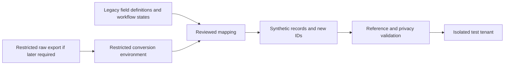

# Development and test data

Development uses synthetic data informed by legacy field definitions and workflows. Replacing a person's name does not de-identify their record: dates, rare diagnoses, addresses, identifiers, attachments and free text can still identify them. No raw legacy records have been exported or imported by this work.

## Available now

Run from the repository root:

```sh
node scripts/hms-fixtures.mjs > /tmp/helivanta-synthetic-fixtures.json
node --test scripts/hms-fixtures.test.mjs scripts/lib/hms-fixtures.test.mjs
```

The generator emits a versioned JSON fixture bundle with two synthetic tenants, three hospitals, ten staff, fifteen hospital assignments and fifteen patients with hospital registrations. YES HOSPITAL has two hospitals; the second tenant provides a cross-tenant isolation case. UUIDs are newly generated on each run, and references remain consistent within that bundle. Names explicitly identify synthetic records, email addresses use the reserved `.invalid` domain, and phone numbers, identity subjects and addresses are absent. Dates are invented rather than derived from people.

Employment assignments describe work locations and job categories. They create **no login, permission or data-sharing grants**. Tests must provision their own explicitly scoped principals and grants. Hospital and tenant identifiers in the fixture file are local fixture identifiers, not authoritative onboarding identifiers.

This is a fixture interchange format for the target multi-hospital model, **not a database seed or a deployed API contract**. The current runtime still uses the earlier hospital-as-tenant model. Do not insert these fixtures into that model by treating a hospital as another tenant. Import through the implemented product API once the new schema, hospital authorization and audit controls are available. The generator has no database, network or identity-provider client and does not accept raw legacy input.

## Legacy conversion boundary



No suitable HR export or de-identified dataset has been verified yet. A conversion implementation requires its actual schema, without committing source records. Prefer an empty export template or field dictionary first. Do not guess column positions or pass unknown columns through.

| Legacy content                                          | Treatment before development use                                                                                                                     |
| ------------------------------------------------------- | ---------------------------------------------------------------------------------------------------------------------------------------------------- |
| Primary and foreign keys                                | Replace with new IDs; retain the mapping only inside the restricted conversion run. Validate tenant and hospital consistency for every relationship. |
| Names, emails, phones, addresses, usernames             | Generate independent synthetic values; use non-deliverable emails and absent phone numbers. Never invite source contacts.                            |
| MRNs, government IDs, licences, bank or payroll details | Remove or replace with visibly synthetic identifiers. Never hash low-entropy IDs as an anonymization shortcut.                                       |
| Dates and demographics                                  | Generate independently for the test scenario. Preserving precise ages and relative dates requires a separate re-identification review.               |
| Departments, job categories, workflow states            | Map only reviewed vocabulary to the target enums. Unknown values fail validation without logging the source value.                                   |
| Clinical history, rare conditions and financial values  | Generate scenario-based data; do not preserve identifiable combinations or unusual values.                                                           |
| Notes, scans, photos, PDFs, DICOM and file metadata     | Exclude from the first conversion. Later use synthetic documents through the same GCS quarantine and ClamAV path as real uploads.                    |
| Permissions, identity bindings and consent              | Do not copy. Provision test access separately; no real consent or sharing authority may be inferred from a source record.                            |

A future raw conversion runs within an approved restricted environment. Raw input and mappings must stay outside the public repository, developer machines, logs, event payloads and exported test artifacts. Record the mapping version, generated dataset ID, counts and validation results without source identifiers. Retention and deletion of raw material follow the approved source-data policy; this document does not authorize deleting production data.

## Import acceptance gates

- Verify the destination tenant is explicitly a test tenant, using its authoritative onboarding ID; fail closed on production or an unrecognized environment.
- Check all references, tenant ownership, hospital scope and duplicate/idempotent import handling before committing a batch.
- Exercise read, write and guessed-ID denial across tenants and sibling hospitals with non-owner, non-BYPASSRLS database credentials.
- Test explicit sharing separately, including revocation; employment at two hospitals is not sharing authority.
- Keep outbound email, SMS and other external delivery disabled in test environments. Fixtures carry no usable contact destinations.
- Scan output against the reviewed field allowlist and source identifier inventory inside the restricted environment; inspect leakage failures without printing source values.

Synthetic generation here is not a certification that a future transformed export meets HIPAA de-identification requirements. That determination needs the applicable review of the actual output and retained relationships.
