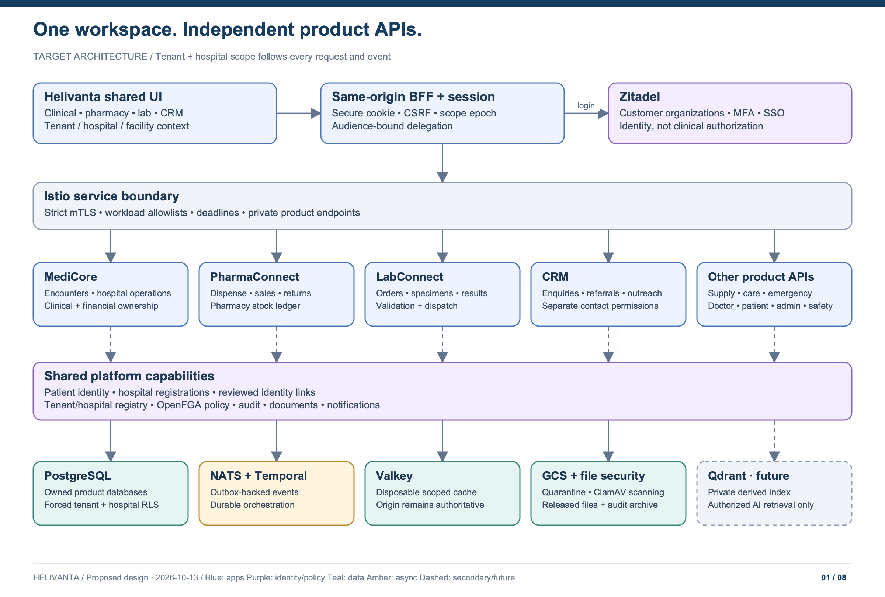

# Helivanta HMS architecture

**Design baseline:** 2026-10-13 · **Status:** Proposed target architecture; not a deployment or compliance attestation.

**Driver:** One shared UI, separately deployable product APIs, Istio, PostgreSQL, Valkey, future Qdrant, and Zitadel-backed tenant onboarding.

**Discovery:** [Exploration epic #979](https://github.com/tesserix/helivanta/issues/979).

Helivanta is a hospital platform with one workspace for clinical, pharmacy, laboratory, reception, finance, workforce and operational teams. Products share identity, patient identity, navigation and security contracts. Each product API owns its transactions and data. A customer can buy PharmaConnect or LabConnect without buying MediCore.

## Read the design

| Document                                                                            | What it decides                                                                                  |
| ----------------------------------------------------------------------------------- | ------------------------------------------------------------------------------------------------ |
| [System and product boundaries](01-system-design.md)                                | Full portfolio, shared UI, APIs, ownership, capacity assumptions and contracts                   |
| [Tenancy, identity and onboarding](02-tenancy-and-identity.md)                      | Tenant versus facility, Zitadel organizations, sessions, permissions, onboarding and offboarding |
| [Data and clinical workflows](03-data-and-workflows.md)                             | PostgreSQL isolation, Valkey, events, cross-product consistency, storage and future Qdrant       |
| [Security and compliance](04-security-and-compliance.md)                            | Threat model, HIPAA/SOC 2 controls, evidence, audit, operations and release gates                |
| [Deployment and transition](05-deployment-and-transition.md)                        | Istio, GitOps, availability, failures, recovery, migration, cost and acceptance gates            |
| [Legacy evidence and sources](06-evidence-and-sources.md)                           | What was observed, current implementation, legacy mapping, gaps and official references          |
| [Design specification](../superpowers/specs/2026-10-13-full-hms-platform-design.md) | Decision summary and relationship to earlier specs                                               |

## File storage and malware scanning

[Multi-tenant GCS and ClamAV design](07-file-storage-and-scanning.md) defines quarantine, exact-generation scanning, hospital-scoped downloads, recovery and release gates. GCS and ClamAV are confirmed choices.

## Development data

[Synthetic fixtures and legacy conversion](08-development-data.md) documents the working fixture generator, the boundary for converting legacy exports, and the required tenant and hospital isolation checks before import.

## API implementation

[Hospital onboarding and multitenancy](../delivery/hospital-onboarding.md) gives
the current step-by-step identity provisioning/adoption procedure and the checks
required before product setup or the console cutover is accepted.

[Workforce API](../api/workforce.md) describes the first implemented hospital-scoped staff slice and its current limits. [ADR 0009](../adr/0009-workforce-foundation.md) records the additive transition, and the [release checklist](../deployment/workforce-release.md) distinguishes local validation from live deployment.

## Editable diagrams

[Coverage and validation record](VALIDATION.md) maps each requested area to its design and records the artifact checks and remaining verification limits.

Open [helivanta-hms-architecture.drawio](diagrams/helivanta-hms-architecture.drawio) in the draw.io desktop application or diagrams.net. It contains eight separately editable pages made of native shapes and connectors, not flattened screenshots. PNG previews are embedded for broad Markdown compatibility; SVG versions are also included for scalable viewing. Keep the draw.io pages, SVGs and PNGs in sync when editing.

| Page | PNG preview                                                    | Focus                                                             |
| ---- | -------------------------------------------------------------- | ----------------------------------------------------------------- |
| 01   | [System overview](diagrams/01-system-overview.png)             | Shared UI, product APIs, platform capabilities and stores         |
| 02   | [Tenant boundaries](diagrams/02-tenant-boundaries.png)         | Organizations, facilities, identities and isolated data           |
| 03   | [Authorized request](diagrams/03-authorized-request.png)       | Browser session, workload identity, policy and RLS                |
| 04   | [Tenant onboarding](diagrams/04-tenant-onboarding.png)         | Durable provisioning and activation gates                         |
| 05   | [Clinical handoffs](diagrams/05-clinical-handoffs.png)         | Encounter, laboratory, pharmacy, billing and audit                |
| 06   | [Deployment and recovery](diagrams/06-deployment-recovery.png) | Regional cell, private stores, evidence and disaster recovery     |
| 07   | [Future AI retrieval](diagrams/07-ai-retrieval.png)            | Governed ingestion, Qdrant, source authorization and human review |
| 08   | [File security](diagrams/08-file-security.png)                 | GCS quarantine, ClamAV, Temporal and authorized release           |

**Diagram legend:** blue = user/API; violet = identity/policy; teal = data; amber = asynchronous work; grey = operational boundary; dashed = secondary/future paths as labelled. All diagrams depict the target, not measured production topology. Valkey is disposable despite sharing the data-store color.

## Main decisions

1. One origin and one workspace; existing Next.js zones can implement it without becoming separate user experiences.
2. Product-sized Go APIs; modules remain inside each API. No service per screen or table.
3. A tenant is a contracted customer/group boundary and can own multiple hospitals. Each hospital is a separate data-access boundary within it; common ownership never grants shared access. Hospitals may be isolated, share selected data, or participate in approved group sharing.
4. One Zitadel customer organization per tenant by default. Helivanta owns the canonical tenant, facility, membership and entitlement registry. Zitadel owns authentication and organization-level federation/policy.
5. OpenFGA remains the relationship authorization engine. APIs combine its decision with current tenant status, product entitlements, hospital/facility scope, hospital-sharing policy, consent/legal-purpose policy and resource state.
6. Each product owns a PostgreSQL database and credentials; pooled tenants use forced RLS. Physical clusters can be shared within a regional cell; dedicated cells are available for contractual isolation.
7. Valkey is disposable. NATS JetStream carries durable events backed by PostgreSQL outboxes. Temporal is confirmed for long-running onboarding and multi-step handoffs. Neither is replaced by Valkey.
8. Qdrant is a future, rebuildable search index behind an AI gateway. Clinical care never depends on AI availability.
9. GCS is the file store; ClamAV scans quarantined uploads before release. File ownership and access remain tenant/hospital scoped.
10. CRM covers enquiries, referrals, outreach and communication history. CRM sharing, patient-identity linking and clinical-record sharing are independent permissions.

## Status and unresolved business inputs

The product API direction is requested by the user. NATS with JetStream, Temporal, Google Cloud Storage (GCS) and ClamAV are confirmed technology choices. Detailed implementation choices remain proposed. Workload, region, retention, budget, SOC 2 examination scope and contractual tenancy assumptions need validation before implementation or procurement; [the transition document](05-deployment-and-transition.md#decisions-to-confirm-before-implementation) assigns owners. No runtime, infrastructure, credentials or GitHub issues are changed by this design package.

HIPAA applicability depends on the customer relationship and data processing. SOC is interpreted here as **SOC 2**, with a future Type II examination goal. Architecture supplies controls; operating effectiveness, contracts, policies and independent examination remain separate work.
