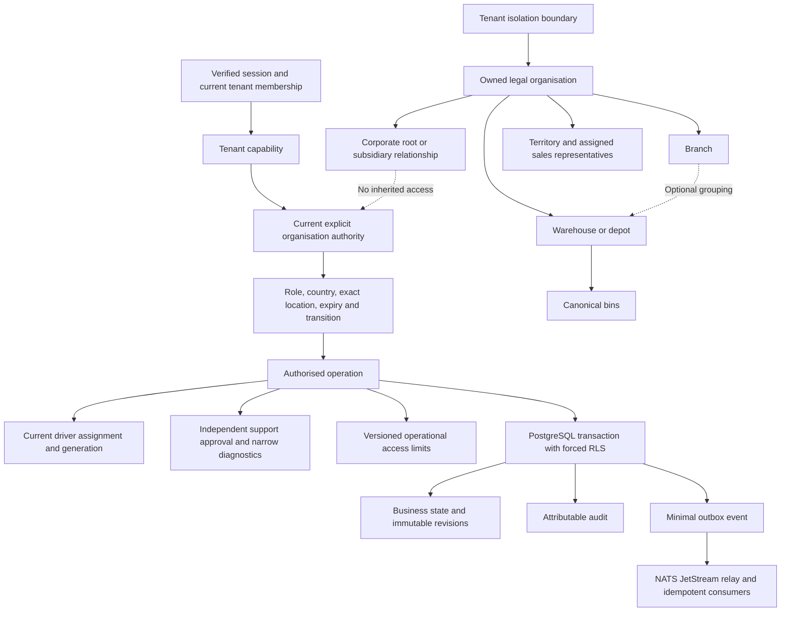

# Distributor structure and access

Story [#1137](https://github.com/tesserix/helivanta/issues/1137), under PharmaConnect epic [#1133](https://github.com/tesserix/helivanta/issues/1133). This describes the new implementation; its release and acceptance evidence must be recorded separately. [Editable Draw.io diagram](diagrams/15-distributor-scoped-access.drawio).

An organisation is a legal and authorisation boundary inside a tenant. Corporate relationships, shared branding, branch links and territory assignments do not grant access to another organisation or tenant. Country registrations remain on the existing legal organisation master. A hospital owning several pharmacies does not implicitly share their records.

Warehouses and depots belong directly to the legal organisation. A branch link is optional grouping within that same organisation.

| Role or workflow                         | Permitted boundary                                                            | Explicit separation                                                                               |
| ---------------------------------------- | ----------------------------------------------------------------------------- | ------------------------------------------------------------------------------------------------- |
| Owner or administrator                   | Current organisation administration and declared tenant capabilities          | No authority inherited from corporate parenthood                                                  |
| Purchasing, finance, compliance, sales   | Explicit organisation-wide role with its own routes                           | No location-only grant that appears active but has no usable workflow                             |
| Inventory                                | Operating warehouse/depot and canonical bin controls                          | No credit terms, licence approval or clinical actions                                             |
| Picker and packer                        | Read operating context at an authorised warehouse/depot                       | Actual picking/packing fulfilment belongs to #1141                                                |
| Dispatcher                               | Manual logistics tasks at an authorised warehouse/depot                       | Scheduling does not receive, reserve or dispense stock                                            |
| Driver                                   | Current assigned task, generation, grant and assignment expiry                | No other drivers' tasks, private source references, finance or clinical records                   |
| Auditor                                  | Explicit organisation or warehouse/depot read authority                       | No mutation implied by read access                                                                |
| Regulator                                | Mandatory exact warehouse/depot scope                                         | No organisation-wide regulator wildcard                                                           |
| Support                                  | Named, reasoned, ticketed, independently approved session of at most 24 hours | Only audited premise state and bin counts; no private profile, evidence, contacts, finance or PHI |
| Pharmacy owner, purchasing and inventory | Pharmacy module permissions intersect existing outlet grants                  | Supply roles confer no Pharmacy or dispensing authority                                           |

New timed grants have immutable identity/scope, expected versions, start/end times and a mandatory reason. Unsupported historical grants remain revocable. A stale browser session cannot preserve a revoked grant or driver assignment. Support diagnostics also require the approver to retain both current organisation administration and a tenant capability permitting support approval.

A finite administrator cannot replace the last permanent organisation administrator. The permanent anchor avoids an organisation losing all administrative access when a temporary grant expires. A tenant-wide recovery bypass is not introduced; independently governed identity recovery remains separate work.

Global private-profile roles and scoped `operating_roles` are distinct response
fields. The UI uses the latter only to enter the assigned operational workspace;
it does not combine them to unlock legal, contact, licence or financial profiles.
Inactive warehouses/depots deny operational writes and scoped entry. Current
global administrators/auditors can still open a visibly archived, read-only
delivery context and its immutable history, with no scheduling or driver actions.

Operational access limits govern new or extended non-administrator access and new support requests/approvals. Reducing a limit does not silently rewrite an existing grant's recorded expiry; administrators revoke existing access explicitly. The UI states this distinction. Platform ceilings and independent support approval cannot be relaxed through organisation settings. Procurement spending matrices and the platform-wide approval engine retain their own owning stories.

Every mutation commits state, revision, audit and outbox intent together. An exact retry returns the existing result; changed stale writes conflict. Broker downtime leaves durable outbox work for retry. Identity or policy failures deny access, and authoritative UI denials remove private records and actions. PostgreSQL is authoritative; no additional Valkey cache or Temporal workflow is introduced for these single-transaction operations.

Compare the [recorded Mednet procurement review](../requirements/pharmaconnect-legacy-procurement.md) for observed fields, unconfirmed capabilities and improvements. Manual logistics tasks are not equivalent to Mednet challans or goods receipts. Tests use synthetic records and do not initiate regulated dispatch or payments.

The release sequence must first ship the schema-compatible legacy grant security fix and verify all API replicas use it. Only then may approved migrations `0007_supply` and `0008_supply` and their feature images be released. Rolling back to the older vulnerable API after introducing timed grants is not a safe recovery plan; use a reviewed forward fix. No new migration or production rollout is asserted by this document.
