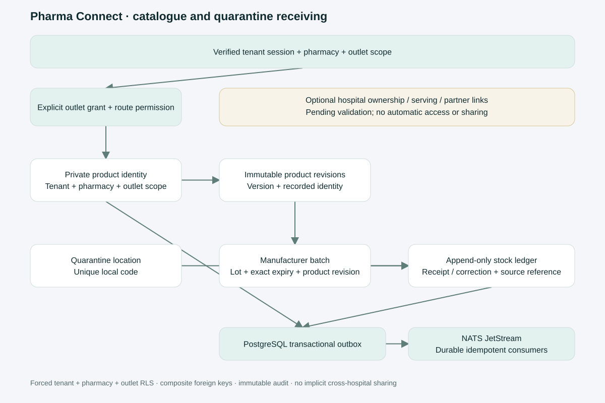
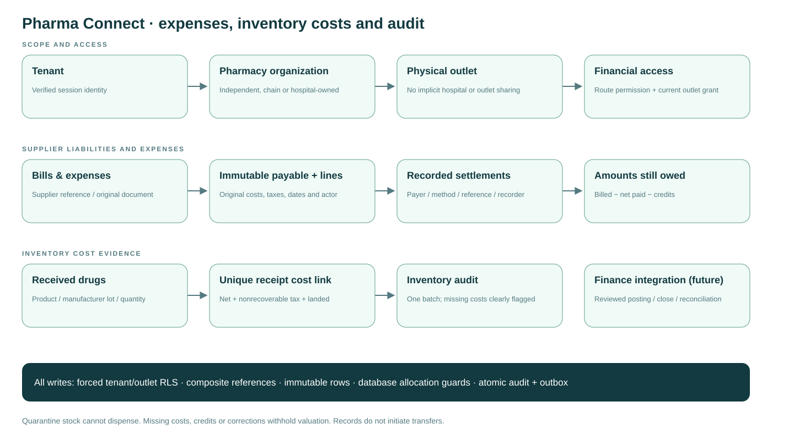
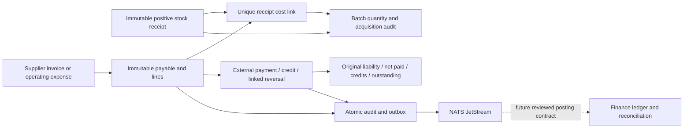
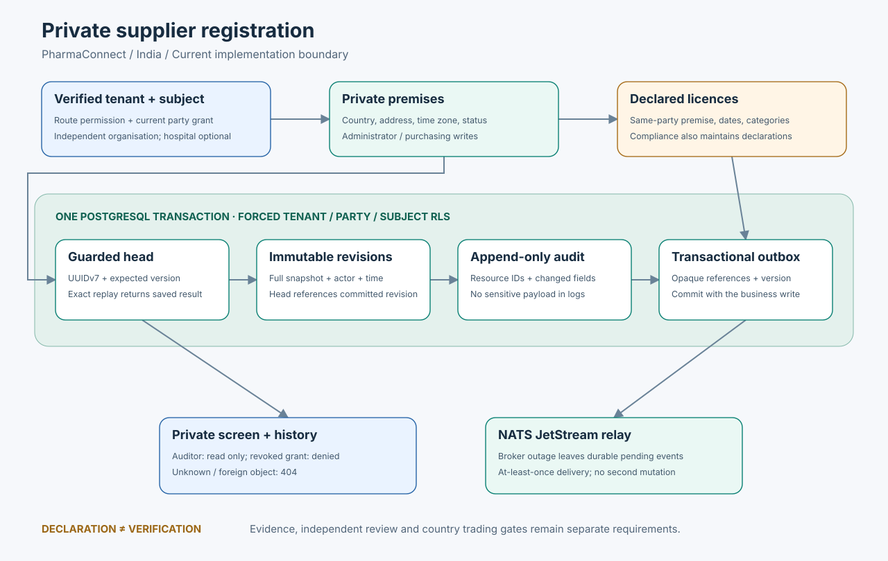

# Pharma Connect: catalogue and quarantine receiving API

Initial implementation of #159, #162 and #166; full story acceptance remains open. See the [full design and backlog](../superpowers/specs/2026-10-15-pharmaconnect-backend.md).

[Editable draw.io source](diagrams/10-pharmaconnect-foundations.drawio).

All paths below start with `/v1/pharmacy/pharmacies/{pharmacy}/outlets/{outlet}`. Identity and tenant come from the verified session, never a request body. Both route permission and a current outlet-specific grant are required. Administrator grant management does not itself confer access to inventory or catalogue records. Pharmacy organizations and physical outlets are module-owned canonical identities. Standalone pharmacies need no hospital. The UI uses the pharmacy directory, not HR's hospital directory. Outlet rows have a tenant-aware foreign key to their owning pharmacy; RLS checks the requested parent pharmacy and outlet against that hierarchy.

Organization APIs are rooted at `/v1/pharmacy`: `GET /pharmacies`, `PUT /pharmacies/{pharmacy}`, `GET /pharmacies/{pharmacy}/outlets`, `GET /pharmacies/{pharmacy}/outlets/{outlet}` (one outlet, under the list's visibility rule; #1303), `PUT /pharmacies/{pharmacy}/outlets/{outlet}`, and cursor `GET` / idempotent `PUT` under `/pharmacies/{pharmacy}/hospital-affiliations[/{id}]`. Directory writes require `pharmacy.access.manage`. Non-admin directory reads include only pharmacies/outlets to which the subject has an explicit outlet grant. An administrator can configure directory metadata without obtaining clinical/inventory access.

Ownership type is `independent`, `chain` or `hospital_owned`; a pharmacy can own many outlets, each with its own country and valid IANA timezone. Registration stays `draft` and outlet regulatory review `pending_review`. Optional hospital ownership/serving/partner declarations remain `pending_validation`, cannot be self-approved by the request body, and never grant sharing. Many hospital-owned pharmacies may declare the same hospital owner. Canonical hospital identity, owner authority, licensing and explicit data-sharing agreement activation are subsequent gates. Cross-tenant hospital linkage cannot be activated just by submitting another tenant's hospital UUID.

| Method and path                          | Permission                 | Behaviour                                                                             |
| ---------------------------------------- | -------------------------- | ------------------------------------------------------------------------------------- |
| GET `/access`                            | `pharmacy.catalogue.read`  | Current account's outlet grant                                                        |
| PUT / DELETE `/access/{subject}`         | `pharmacy.access.manage`   | Grant reader/editor or revoke; audited                                                |
| PUT `/catalogue/products/{id}`           | `pharmacy.catalogue.write` | Create/revise private product; expected version; identical retries return same result |
| GET `/catalogue/products/{id}`           | `pharmacy.catalogue.read`  | Current persisted identity                                                            |
| GET `/catalogue/products`                | `pharmacy.catalogue.read`  | Cursor list; optional brand/generic/SKU prefix `q` and lifecycle `status`             |
| GET `/catalogue/products/{id}/revisions` | `pharmacy.catalogue.read`  | Cursor history with immutable snapshots and actor                                     |
| PUT `/stock/locations/{id}`              | `pharmacy.stock.receive`   | Immutable quarantine location, unique code                                            |
| GET `/stock/locations`                   | `pharmacy.stock.read`      | Cursor list                                                                           |
| PUT `/stock/batches/{id}`                | `pharmacy.stock.receive`   | Immutable manufacturer lot, confirmed full expiry date, original product revision     |
| GET `/stock/batches`                     | `pharmacy.stock.read`      | Cursor list; optional `product_id`                                                    |
| GET `/stock/batches/{id}`                | `pharmacy.stock.read`      | One lot of this outlet; another outlet's or tenant's is 404 (#1303)                   |
| PUT `/stock/movements/{id}`              | `pharmacy.stock.receive`   | Positive receipt in base units                                                        |
| PUT `/stock/corrections/{id}`            | `pharmacy.stock.correct`   | Attributable signed correction; cannot overdraw                                       |
| GET `/stock/movements`                   | `pharmacy.stock.read`      | Cursor list; optional `location_id`, `batch_id`                                       |
| GET `/stock/balance`                     | `pharmacy.stock.read`      | Required location/batch query; on-hand and zero dispensable units for quarantine      |

The pharmacist role receives read/write catalogue and receiving permissions. Correction and outlet-access management are tenant-admin-only. Outlet `reader` never writes; `editor` also needs the relevant route permission. No role bypasses pharmacy/outlet RLS. Cross-tenant/pharmacy/outlet/absent grant returns 404, route denial 403, invalid fields 400, stale version/duplicate business key/overdraft 409, unavailable outlet authorization lookup 503. Responses use existing platform envelopes.

Request models and bounds are generated from `contracts/pharmacy.json` by `scripts/generate-pharmacy-contract.mjs`; the API package type-check rejects stale outputs. Bodies are limited to 32 KiB, reject unknown fields and trailing JSON. IDs for new resources are client-generated UUIDv7. Retain the same ID and payload after an uncertain response. A movement's source line reference must also be unique within the outlet. Reusing an ID with a different payload conflicts. The UI keeps IDs stable until confirmed success.

Catalogue includes SKU, brand/preparation, generic/composition label, structured ingredients (positive decimal-string strength and unit), form, route, manufacturer, marketing company, pack/base unit, currency and integer minor-unit MRP. `active` describes identity lifecycle only; every product is `pending_review`. No tenant write to schedule, narcotic/prescription flags or tax policy is accepted. Withdrawal is terminal at both HTTP and PostgreSQL boundaries. Product composition/pack/unit identity cannot change after a batch exists; register a different product instead.

A batch captures a confirmed `YYYY-MM-DD` expiry and optional manufacturing date, never a guessed end-of-month. Legacy month-only labels require a reviewed precision/country-policy workflow before import. Quantities in this slice are whole base units; fractional measures and pack conversion are not inferred. Existing ledger entries cannot be updated, deleted or truncated. Every successful movement commits its audit and outbox event atomically. Database-trigger serialization protects quantity bounds even for direct app-role writes. No Valkey balance and no dual broker/database write.

The UI routes are `/pharmacy/catalogue` and `/pharmacy/stock`; they include explicit pharmacy/outlet context, modern shared selects, permission/read-only/denied/loading/empty/error states, input validation, revision history and receipt history. Pharmacy/outlet switching remounts the panel and partitions query keys by tenant, pharmacy and outlet. These screens operate on the API, without fixture fallback in product code.

## Verification boundary

All test records are synthetic. Test-harness acceptance uses real disposable PostgreSQL 16 and NATS JetStream, with the non-BYPASSRLS app role. Local browser acceptance uses test authentication and a disposable database; it does not claim to verify production Zitadel or certify SOC 2/HIPAA compliance.

Remaining: governed base catalogue and regulatory approval, licence/credential enforcement, import, fuzzy/ranked search and measured SLOs, releasable stock/reservations/FEFO, prescription verification and fulfilment, ordering/delivery, returns/recalls, controlled-drug registers, billing/refunds and reports. Existing basic medications/free-text dispense endpoints retain their old contract and are **not** the governed clinical fulfilment workflow. Regulated pharmacy rollout requires their guarded replacement as part of #169/#170/#171; this foundation alone is not an approval to dispense medicines.

Migrations `0004_pharmacy` and `0005_pharmacy` are additive and forward-only. Reverting application code preserves these tables and history. Production rollout/migration must follow the repository's approval and GitOps process. No schema or rollout claim is implied by local test results.

## Expenses, supplier payables and inventory audit

[ADR 0025](../adr/0025-pharmacy-cost-and-payable-audit.md) defines the operational financial boundary. UI: `/pharmacy/accounts` (Expenses & audit). New paths below use the same verified tenant/pharmacy/outlet root as catalogue and stock.

| Method | Suffix                                        | Permission                  | Behavior                                                                                                                                    |
| ------ | --------------------------------------------- | --------------------------- | ------------------------------------------------------------------------------------------------------------------------------------------- |
| PUT    | `/accounts/payables/{id}`                     | `pharmacy.accounts.write`   | Immutable original bill/expense, 1–100 ordered lines; identical retry safe                                                                  |
| GET    | `/accounts/payables/{id}`                     | `pharmacy.accounts.read`    | Original document/lines, actor, exact current paid/credited/outstanding amounts                                                             |
| GET    | `/accounts/payables`                          | `pharmacy.accounts.read`    | Cursor-paginated document summaries; no partial-page grand total                                                                            |
| PUT    | `/accounts/payables/{id}/payments/{entry}`    | `pharmacy.accounts.payment` | Record an external payment, including partial payment; no transfer initiated                                                                |
| PUT    | `/accounts/payables/{id}/adjustments/{entry}` | `pharmacy.accounts.adjust`  | Approved credit or exact once-only reversal of an original payment                                                                          |
| GET    | `/accounts/payables/{id}/settlements`         | `pharmacy.accounts.read`    | Cursor history with responsible person, payee through parent, method, original reference, effective date, reason and authenticated recorder |
| GET    | `/accounts/inventory-audit`                   | `pharmacy.accounts.read`    | Cursor report: one manufacturer batch per row, received/on-hand units, cost coverage and valuation status                                   |

Financial permissions are initially tenant-admin-only and still require the current outlet's reader/editor grant. Pharmacist catalogue/receiving access alone does not reveal confidential purchase costs or supplier liabilities. A future controller/auditor role needs an explicitly reviewed permission mapping. Documents cannot be edited or deleted after recording. Correct an original liability with an attributable credit; reverse an incorrectly recorded payment with an exact linked reversal. Further debit/credit-note correction workflows, approvals and period-close controls remain Finance acceptance work.

A payable captures stable payee reference/name snapshot, original supplier document reference, document/due dates and currency. Expense categories include utilities, rent, salaries, transport, maintenance, professional services and other expenses. An inventory line additionally requires a same-outlet positive receipt whose product currency matches. Supplier reference + original document reference and each receipt cost link are unique per outlet. No purchase cost is inferred from MRP. Product currency becomes immutable once a manufacturer batch exists.

Line liability = net after discount + tax + landed charges. Acquisition cost = net + nonrecoverable tax + landed charges. Recoverable tax cannot exceed recorded tax. Individual inputs and document totals are bounded integers in minor units. Batch aggregate costs are decimal strings so JavaScript cannot lose cents after long accumulation; the UI formats them using BigInt and the currency's precision. Currencies are never added together.

Outstanding = original liability − net recorded payments − credits. A payment reversal reduces net paid and reopens that amount. The database serializes competing entries per document and rejects overpayment/over-credit, incorrect parent/currency/date and duplicate reversals. Failed transactions leave no settlement/audit/outbox row. Immutable source rows feed a security-invoker balance view, so reported amounts come from a single PostgreSQL statement under forced source-table RLS.

The stock audit separates original acquisition totals from current stock valuation. `no_receipts` means no stock has been received; `cost_missing` identifies uncosted receipt units. `valuation_review` flags stock corrections or supplier credits that need an approved costing adjustment. `valuation_minor` is null in those cases. `complete` is available only when all receipts are costed and neither credits nor corrections affect them. This is a quarantine-stock acquisition audit, not a claim that future dispensing/returns/COGS valuation is implemented.

Synthetic local example: 25 capsules, net INR 250.00 and recoverable tax INR 25.00 → liability INR 275.00, acquisition cost INR 250.00. Record INR 100.00 external payment → outstanding INR 175.00. Adding a stock correction withholds current valuation until review, while retaining the original receipt and acquisition amount.

[Editable draw.io source](diagrams/11-pharmaconnect-expenses-and-audit.drawio).

Migration `0006_pharmacy` is additive and forward-only. No production migration, financial posting, bank verification, statutory tax filing, certified accounting/compliance status or production deployment is claimed. Sensitive file evidence will reuse authorized GCS/ClamAV document handling when integrated; there is no unauthenticated evidence-upload shortcut.

## Private organisation premises and declared licences

[Editable draw.io source](diagrams/13-supply-premises-licences.drawio).

Issues #1135/#1137 remain open for their wider verification and distributor requirements. These endpoints extend the private Supply profile under `/v1/supply/parties/{party}`; they require no hospital. The verified session supplies tenant/subject, and every lookup also requires a current party-specific role.

| Method and path                                               | Route permission       | Party roles                                             |
| ------------------------------------------------------------- | ---------------------- | ------------------------------------------------------- |
| GET `/premises`, `/premises/{id}`, `/premises/{id}/revisions` | `supply.premise.read`  | administrator, purchasing, finance, compliance, auditor |
| PUT `/premises/{id}`                                          | `supply.premise.write` | administrator, purchasing                               |
| GET `/licenses`, `/licenses/{id}`, `/licenses/{id}/revisions` | `supply.license.read`  | administrator, purchasing, finance, compliance, auditor |
| PUT `/licenses/{id}`                                          | `supply.license.write` | administrator, purchasing, compliance                   |

Premises include unique organisation code, name/type, postal address, country, country-appropriate time zone, and active/inactive state. Licences include type code, number, authority, jurisdiction, premise ID, exact issue/expiry dates and a unique category set (`otc`, `prescription`, `controlled`, `cold_chain`). Categories declare intended coverage; they never authorize restricted transactions. The parent party country is immutable, and compound foreign keys prohibit cross-party/country/tenant premise references.

Both PUTs require a stable client UUIDv7 and `expected_version` (zero for creation). Exact current/current-minus-one replays return the saved record; changed stale/future versions conflict. All lists use bounded keyset pagination. Every head update retains an immutable private revision and atomic audit/outbox entry. Revisions expose actor/time/version/snapshot only to the same scoped readers. Missing and inaccessible heads/history return 404; malformed fields return 400; duplicate code/licence identity and version conflicts return 409. Unknown fields, self-declared approval, and forged tenant IDs are rejected.

All licence statuses remain `declared`. Evidence scanning, independent review, lifecycle transitions and effective country trading eligibility are separate remaining gates in [ADR 0028](../adr/0028-supply-verification-and-evidence.md). A saved declaration never makes a seller eligible to trade. See the [registry spec](../superpowers/specs/2026-10-16-supply-premises-licences.md) for migration/recovery, security and test boundaries.
