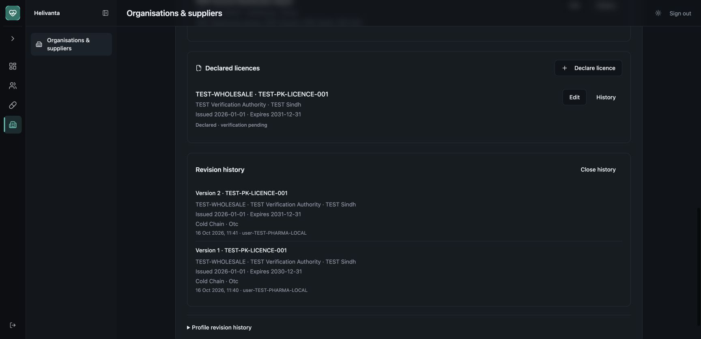

# Supply registry local acceptance — 16 October 2026

Related #1133, #1135, #1137 and #1005. This is a completed private declaration slice, not completion of the seller verification or procurement epic. No production migration or deployment was performed for this branch.

## Delivered and exercised

Independent organisations can record premises and country-bound licence declarations through the private organisation screen. Tenant/party-scoped PostgreSQL heads and immutable revisions, current-role authorization, strict inputs, exact/concurrent retries and atomic audit/outbox publication cover the same API and UI operation. There is no hospital dependency. Declaration status remains unverified. The API/spec and editable diagram are linked from [PharmaConnect API](pharmaconnect-api.md#private-organisation-premises-and-declared-licences).

## Commands and results

| Verification                                                                                                                                 | Actual result                                                                                                                                                                                                                                                                                                               |
| -------------------------------------------------------------------------------------------------------------------------------------------- | --------------------------------------------------------------------------------------------------------------------------------------------------------------------------------------------------------------------------------------------------------------------------------------------------------------------------- |
| Real disposable PostgreSQL/NATS Supply suite, `go test -v -race ./internal/modules/supply -count=1` through the local VM port-forward helper | Passed; six simultaneous exact retries produce one head/revision/audit/event; duplicate identity and outbox failure roll back; wrong tenant, broadened-group RLS, foreign premise, revoked grants, auditor writes and immutable history mutations denied                                                                    |
| `GOFLAGS='-v -p=2' ./scripts/coverage-gate.sh` with Go 1.27.2, disposable infrastructure and VM port forwards                                | Full backend race/coverage gate passed; Supply 83.7%, tenantdb 83.8%, country configuration 100%; architecture and real OpenFGA matrix checks included                                                                                                                                                                      |
| `make lint-go`, `go vet ./...`, `go build ./...`                                                                                             | Passed; linter reported zero issues                                                                                                                                                                                                                                                                                         |
| `pnpm turbo lint type-check test build format:check`, Node 24                                                                                | Passed: 20 tasks; 246 shell + 144 API + 90 UI tests, production Next.js build, contract freshness and format checks; rerun after the UUID patch passed                                                                                                                                                                      |
| `pnpm install --offline --frozen-lockfile`                                                                                                   | Passed after narrowly updating UUID 13.0.0 → 13.0.1; unrelated lockfile refreshes removed                                                                                                                                                                                                                                   |
| `pnpm audit --prod --audit-level=high`                                                                                                       | Passed; UUID GHSA-w5hq-g745-h8pq removed. Existing braces advisory GHSA-vfj7-8cjw-p6xm remains under the documented exception in the vulnerability-management runbook; it is a lint-only dependency                                                                                                                         |
| Pinned `scripts/lint-shell.sh`                                                                                                               | Passed over an identical shell-file snapshot in a Colima-visible cache. Direct `/private/tmp` bind mount could not expose the checkout to the Docker VM                                                                                                                                                                     |
| `make test-scripts`                                                                                                                          | 102 assertions passed from the original clone after confirming Makefile/all shell files were byte-identical. The isolated worktree run had 101 passes and one failure because the original clone owns the existing :4301 server and is correctly treated as foreign to another worktree. No running user server was stopped |
| Gitleaks, redacted                                                                                                                           | Supply source scan passed; staged change scan recorded with the PR                                                                                                                                                                                                                                                          |
| Schema reapplication against a populated disposable registry                                                                                 | Applied the module migrations twice, replayed the original PUT, verified unchanged response and one retained revision; passed                                                                                                                                                                                               |

New route/unknown-history, duplicate-conflict wording, off-page premise selection and history-content regressions were observed failing before their passing implementation. The first broad Go run encountered a stale generated testmain because an unused attachment test was removed while the run was compiling; the subsequent full race/coverage run passed on the stable final Go tree. The initial web build rejected missing public Zitadel settings; the configured production build passed. These failures were not suppressed or skipped.

## Actual browser acceptance

The production Next build on localhost:4310 used a loopback-only test API on :8090, real disposable PostgreSQL/NATS, signed synthetic sessions and no hospital module. Test-only server code remains outside the committed application. The long-lived fixture resumes its NATS dispatcher after the ordinary harness deadline, so publication was checked after browser activity rather than inferred from a database write.

- Pakistan: created TEST-KHI-DEPOT, verified Asia/Karachi defaults, created TEST-PK-LICENCE-001 using the shared premise dropdown and declared OTC/cold-chain categories. These synthetic category declarations do not authorize restricted trade.
- Tried expiry before issue; inline validation rejected it. Saved a later expiry, reloaded, and inspected both retained versions with the original and revised dates.
- India: created TEST-IN-DEPOT from the final UUID-patched build; verified Asia/Kolkata defaults and the persisted address.
- Verified add/edit focus, mobile heading position below the sticky header, 390px document width without horizontal overflow, and the desktop history view. Restored normal browser viewport.
- Local outbox publication observed: two licence events, two premise events and two seeded profile events, all published. No licence numbers, addresses or contacts are in those event payloads.
- Browser error/warning log empty; local API had no unexpected operation errors. No real customer data, production dumps, bank credentials or patient records were imported.

## Remaining gates

Evidence upload/scanning/download, independent maker/checker review, onboarding lifecycle, restricted banking references, bilateral relationships, offers, orders, warehouse fulfilment, deliveries, trade finance, recalls and automation remain under their owning open stories. ADR 0028 describes intended evidence/review architecture, not a claim of implementation. No unused organisation attachment path is included in this slice. Country policy remains review_required; no regulatory approval or SOC 2/HIPAA certification is claimed. Planning SLOs are not load-test results.

Migration `0002_supply` is additive and bounded, creates empty new tables and preserves existing profiles. Code rollback retains immutable data; destructive down migration is intentionally unsupported. Named approval is required before the production migration and rollout.
