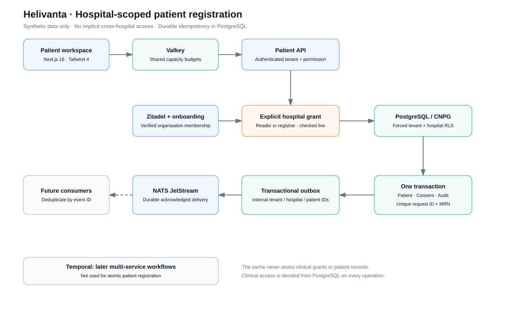

# Patient registry release and verification

Related: #979, #981, #991. This slice is registration, consent, search and
hospital isolation; it does not close OPD scheduling or consultation stories.

[Editable draw.io diagram](../architecture/diagrams/09-patient-registration.drawio)

## Contract changes

Every patient operation requires hospital_id and an explicit clinical grant.
Tenant ownership and staff-directory grants do not convey patient access.
Registration requires a UUID request_id, scoped to tenant and hospital. A retry
replays the original result; changed input with that ID returns 409. Exact
normalized name/date-of-birth collisions, including missing-phone records,
require duplicate review. A name is not a globally unique human identifier;
intentional exception handling remains explicit and audited, never automatic merge.
MRNs and request keys have PostgreSQL uniqueness constraints.

Migration 0003_patientmaster adds hospital scope, clinical grants, registration
request receipts, immutable access audit, and indexes. Existing unassigned rows
remain quarantined. Preflight on production on 2026-10-13 found zero patient rows;
no legacy assignment or customer-data migration is part of this release.

## Infrastructure choices

PostgreSQL remains authoritative for idempotency, authorization grants and consent.
Registration is one transaction, so it does not require Temporal. Temporal remains
appropriate for later file-scan/review, import and provisioning workflows that wait,
retry across services or need compensation; no placeholder workflow is deployed.

The transactional outbox delivers PatientRegistered to NATS JetStream. Its payload
contains internal patient and hospital IDs, not names, birth dates or contacts.
Treat those identifiers as sensitive metadata; this is not a HIPAA de-identification
claim. The envelope contains the authenticated tenant and event identity. Do not
assume exactly-once delivery; consumers must deduplicate by event ID.

Valkey shares atomic capacity budgets across API replicas. Keys use a product
prefix and hashed scope, expire automatically and contain no patient records or
clinical grants. The platform cache's existing ACL/network pattern is reused.
An unavailable cache falls back to bounded per-process limits and emits a warning;
database authorization and tenant/hospital RLS continue to deny unauthorized access.
This is degraded rate accuracy, not an authorization fallback. Within-region
Valkey operations have a 100ms deadline. No patient data is cached.

The Valkey infrastructure change adds a Helivanta ACL user and namespace to the
shared global-valkey-cache chart, plus API-only egress on port 6379. That chart
change rolls the shared cache pool; review and approve that shared rollout before
merging the infrastructure PR. It must not be confused with the Helivanta-only
API/schema/UI image rollout.

## Repeatable synthetic API checks

`scripts/verify-patient-registration.mjs` accepts an authenticated session through
HELIVANTA_VERIFY_COOKIE, an explicit HELIVANTA_VERIFY_HOSPITAL, and
HELIVANTA_VERIFY_TENANT. HELIVANTA_VERIFY_API is either a loopback test API or
https://helivanta.app/api/v1/. The script refuses other production tenants. Never
print/export the session, place it in a command line, or commit it.

Fixtures in scripts/fixtures/patients.synthetic.json were independently invented;
no legacy patient identifier, demographic value, free text or export was transformed
or copied. Reserved fictional phone ranges are used. Re-running fixtures uses the
same request IDs and must leave patient/MRN/event counts unchanged.

Checks: create/replay three patients, eight concurrent retries, changed-input
conflict, exact-identity duplicate review, missing/ungranted hospital denial and
POST-body search. Separately test valid sibling grants, foreign tenant RLS,
revocation, guardian receipts, raw child-table isolation and pagination in the
real PostgreSQL suite. Browser acceptance includes required fields, registration,
opening a persisted record, search, mobile overflow and tenant changes.

## Deployment

Use PR CI, shared image build/scan/sign/publish, deploy branch, Kargo and Argo.
The same API image supplies the migration hook and runtime. Verify both API and
shell replicas, CNPG health, migration ID, synthetic counts, outbox acknowledgements,
Valkey behavior and the live browser journey. Rolling back to the old tenant-only
patient code is unsafe; fix forward if a hospital-scope defect appears.

A dedicated empty CNPG verification database is used through a loopback port-forward
before release. It is separate from the production helivanta database, with separate
owner/app/system identities and expiring credentials. No production data is cloned.

## Local verification evidence — 2026-10-13

- Frontend lint, typecheck, tests, formatting and production build passed.
- Go lint, full race/coverage gate and reachable-vulnerability scan passed.
- Real Valkey 9.1.1 tests passed for shared budgets, concurrency, expiry,
  scoped ACL operation and outage fallback.
- The API ran locally on 8081 against the isolated CNPG verification database
  through a TLS-preserving loopback port-forward. Three stable fixtures replayed
  successfully, including eight concurrent retries, changed-body conflicts,
  duplicate review, missing/ungranted hospital denial and search.
- Database inspection confirmed three unique patients/MRNs and three published
  registration outbox events before the browser registration.
- The local Next.js shell was explicitly restarted against 8081. Normal test-user
  login, registry loading, browser registration of Jordan Synthetic and opening
  its persisted detail passed. Mobile document width equalled the 390px viewport;
  the patient table scrolls within its own container.

Production rollout and post-deployment acceptance are still pending.
