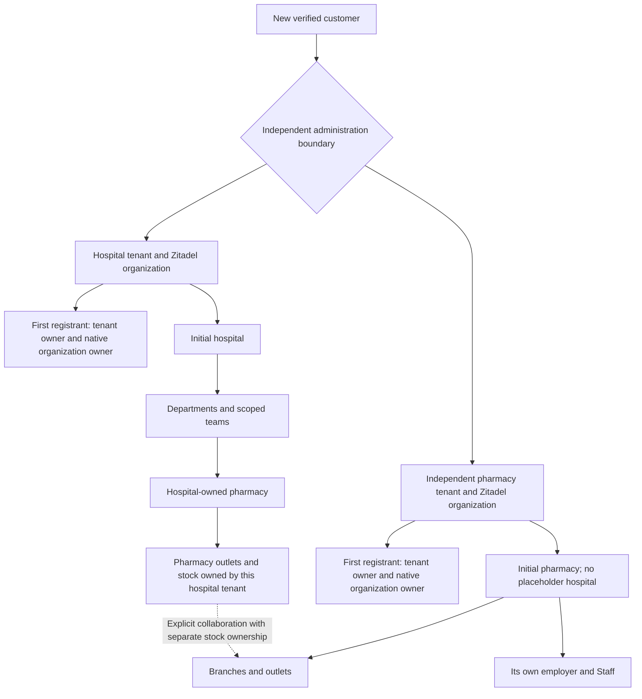

# Automated customer onboarding and a clean test start

Status: the signup implementation is deployed at `https://helivanta.app/signup`.
Configuration, unit tests and public browser checks have been verified. Real
owner email delivery, native proof completion, first login and MFA still need
live acceptance; a rendered form or active mail provider does not close those
gates. Customer onboarding is automated after verified signup, without platform
approval.

## Customer tree and authority



A hospital-owned pharmacy stays within its hospital's tenant and identity
administration. An independently owned pharmacy has its own tenant, identity
organization, employer, Staff and stock. Commercial collaboration never moves
ownership or grants clinical disclosure. A hospital tenant owner is not a
Tesserix platform administrator. Management ownership does not certify a
professional licence, employment review, statutory designation or clinical
privilege. Reuse the current owner/member and scoped Staff workflows; do not
introduce a second module-specific role vocabulary.

The first registrant's supplied email and name become the new native human
owner; the server derives the tenant UUID and subject. The browser cannot pick
an existing tenant, user ID, native organization ID or privileged platform role.
Email verification must be proven by Zitadel, never asserted by the browser.
Existing identities need an authenticated reuse flow, not email-name matching,
automatic account merging or silently duplicated people.

## Required customer journey

1. `/signup` collects the organization name, hospital or independent pharmacy
   choice, supplied owner identity, India and the supported home state
   (Maharashtra or Odisha). Geographic setup is not a licence assertion.
2. The Global API hands a bounded, idempotent command to the onboarding owner.
   Intake is durably recorded before remote provisioning. A protected receipt
   lets the same browser resume an uncertain request without creating a second
   organization. Public responses disclose no other customer's registration.
3. Native identity creates the organization and initial human together. Native
   identity owns verification, first authentication-method setup and recovery;
   Helivanta renders the verification and password forms and submits native
   proofs. It never asserts verification or sets a password without native
   proof. Native organization policy requires MFA.
4. The initial owner remains pending until current native identity and ownership
   are verified. The activation callback establishes the exact first tenant
   administration membership and authorization projection. Retained anti-replay
   evidence prevents a later retry from restoring revoked final membership.
5. The business owners create the selected initial hospital or independent
   pharmacy and the initial owner's corresponding resource administration.
   Reuse workforce/pharmacy owner commands and contracts. Retries reuse the
   same resource IDs, preserve audit evidence and repair partial completion.
   IAM must not write workforce or pharmacy tables.
6. Readiness is recorded only after identity, tenant membership, authorization,
   initial business-resource setup and the retained receipt have completed.
   Native password-setup evidence is also required before the browser receipt
   becomes ready. An email-proven receipt offers password setup explicitly.
   A created organization, sent email or 202 response is not readiness.
7. The owner signs in to the correct tenant and reaches its administration panel
   and existing Staff setup. Department heads, supervisors, transfers, Staff
   login links and narrower operational assignments use their existing scopes.
   Independent pharmacy setup creates a typed pharmacy employer and its initial
   HR management access, with no hospital establishment or hospital scope.

The initial business setup is automatic; entering licence evidence, releasing
stock, employing operational Staff and approving regulated activity still need
real authorized evidence. Signup must not fabricate these as successful.

## Business contacts, headquarters and the initial branch

The signup form requires the organisation phone and contact email, a full
head-office address, and the main branch name and address. The address contains
line 1, optional line 2, city, district, PIN code, state and country. State choices
cover Maharashtra and Odisha in India. The form copies the current head-office
address on submission when the customer selects the same-address option.
Organisation contact email is business metadata. Native first-owner verification
uses the owner's login email.

The canonical `customercontract.OrganizationProfile` and `BusinessAddress` in
onboarding-service generate the browser schemas. The public receipt boundary,
durable signup input, intent fingerprint and private workspace command carry the
same profile. Validation checks bounded text, controls and whitespace,
international-format phone, email, six-digit PIN code and supported geography.
The head-office state/country must match the signup's administrative home scope.
The branch may use another supported state.

The `profile` addition is optional in the v1 wire contract to preserve stored
intents and existing callers. The current signup form requires a complete
profile. Every supplied profile is validated on both service boundaries. Legacy
records return an explicit null profile through the business-profile read API.

Workforce owns the hospital's stored `onboarding_profile`. Its initial hospital
resource uses the supplied main-branch name. PharmaConnect owns an independent
pharmacy's profile and creates its initial outlet with the supplied branch name,
India country and Asia/Kolkata time zone. The outlet starts in `pending_review`.
The initial outlet uses the same UUIDv7 value as its pharmacy organisation in its
own typed resource scope. Tenant, parent and outlet checks supply its authority.
Workforce consumes the pharmacy employer projection for HR administration.

Nullable bounded JSON columns are introduced by
`0096_workforce_business_profile` and `0044_pharmacy_business_profile`. Existing
row isolation and ownership apply. Initializers persist the profile with their
business creation and audit transaction. Replays compare the stored profile and
check the initial resource, preserving the existing anti-replay access behavior.
Only identifiers and field/action metadata enter audit events.

Owners can open **View contact and addresses** in the hospital workforce page or
pharmacy setup. These views request the business owner's scoped endpoints through
the Global API.

| Endpoint                                                 | Required permission         | Additional scope                                          |
| -------------------------------------------------------- | --------------------------- | --------------------------------------------------------- |
| `GET /v1/workforce/hospitals/:hospital/business-profile` | `workforce.hospital.manage` | Current tenant, hospital kind and hospital manager access |
| `GET /v1/pharmacy/pharmacies/:pharmacy/business-profile` | `pharmacy.access.manage`    | Current tenant and visible pharmacy organisation          |

Both return the canonical `{profile: object | null}` view, apply the optional
expected-tenant precondition, set `Cache-Control: no-store` and record an
attributable read. Missing permission returns 403 and an out-of-scope resource
returns 404. Dependency or invalid stored-data errors follow the owner's error
mapping. The UI presents read failures with a retry action.

## First-owner verification delivery through Resend

```mermaid
sequenceDiagram
    participant Owner as New owner
    participant Web as Helivanta / Global API
    participant Signup as Onboarding service
    participant Identity as Identity operator / Zitadel
    participant Mail as Resend SMTP
    Owner->>Web: Submit organization and owner email
    Web->>Signup: Record durable signup with private receipt
    Signup->>Identity: Create organization and initial human owner
    Identity->>Mail: Send native verification email
    Mail-->>Owner: Verification link
    Owner->>Web: Open link and confirm verification
    Web->>Signup: Submit native user ID and verification code
    Signup->>Identity: Verify code and recheck immutable owner binding
    Identity-->>Signup: Current native verified email
    Signup-->>Web: Rotate receipt; offer password setup
```

Zitadel owns the verification code, expiration and proof; Resend delivers the
native email through Zitadel's configured SMTP provider. Helivanta does not
send a second verification email directly through the Resend API and does not
accept a browser assertion that an address is verified.

The identity operator includes `human.email.sendCode` when creating the initial
owner in `/v2/organizations`. The email uses this fixed return template:

```text
https://helivanta.app/signup/verify#phase=email&userId={{.UserID}}&code={{.Code}}
```

The browser removes the fragment from its address bar before submitting the
proof. It requires the owner's explicit verification action, so opening a link
in an email scanner does not consume the proof. The Global API routes the
same-origin request to the signup boundary; onboarding submits the code to
Zitadel's `/v2/users/{userId}/email/verify`, rechecks the exact organization,
subject and email, and rotates the private receipt. Verification errors or
identity outages do not activate an owner or report a ready workspace.

The public email-link action uses the same native destination and bounded mail
request budget. After verification, the owner requests a separate native
password-setup email. Its link uses `phase=password`; setting a password requires
that link's native proof. Email verification alone does not mark password setup
or workspace provisioning complete.

The infrastructure-owned SMTP configuration is `smtp.resend.com:587` with
STARTTLS, SMTP user `resend` and sender `auth@tesserix.app` (Tesserix). The
credential remains in managed identity configuration, never the browser or this
document. The recurring Zitadel bootstrap checks the provider configuration and
active state. Those checks do not prove that Resend accepted a particular email
or that the recipient received it. For a live test, use an explicitly supplied
new-owner mailbox, check the Resend delivery outcome, then complete the native
verification/password flow and owner login. Do not record link codes, passwords
or full recipient details in logs, screenshots, issues or committed evidence.

Source owners: the operator's `internal/zitadelapi/organizations.go` creates the
first native delivery; onboarding's `internal/zitadel/customer.go` issues and
verifies native links; Helivanta's `backend/internal/customeronboarding` owns the
public receipt boundary, and `apps/shell/app/signup/verify` handles the link.
The infrastructure source is `charts/apps/zitadel-bootstrap` in `tesserix-k8s`.

## Owner security administration

The owner panel must read and update the current customer's Zitadel security
policy through a server-side integration. Every request uses verified current
Helivanta tenant membership and fresh native organization-owner authority. The
server resolves the native organization from the verified tenant binding;
client-supplied org IDs or UI visibility supply no authority.

Expose only supported customer settings and registered factor-management flows,
with the platform's minimum MFA requirement enforced. Passwords, factor seeds,
recovery codes and machine credentials never enter claims, logs or ordinary
policy responses. Require appropriate reauthentication/step-up for sensitive
changes, validate stale-policy preconditions, record attributable outcomes and
show provider failures honestly. One tenant's owner cannot edit another tenant
or shared platform policy. Security-policy changes are separate from granting
Staff operational permissions and from first-owner recovery or transfer.

## Owners and recovery

| Record                                                            | Authoritative owner                      | Recovery behavior                                                        |
| ----------------------------------------------------------------- | ---------------------------------------- | ------------------------------------------------------------------------ |
| Customer intake and provisioning progress                         | Onboarding service                       | Durable idempotent receipt; no fabricated completion                     |
| Human, email verification, factors and native organization policy | Zitadel                                  | Native verification/recovery; no direct event-store edits                |
| Private desired identity claim                                    | Identity operator through onboarding API | Immutable binding, deterministic replay, visible pending condition       |
| Tenant administration and authorization projection                | Helivanta IAM                            | Attributable membership plus anti-replay evidence and current projection |
| Hospital, employer and scoped team                                | Workforce owner                          | Existing owner commands and history                                      |
| Pharmacy, outlet and pharmacy resource authority                  | PharmaConnect owner                      | Existing owner commands, separate stock ownership                        |
| Retained onboarding configuration                                 | Held platform archive                    | Fingerprint/receipt verification; no cleartext first-owner profile       |

No public browser calls a private product or identity management API directly.
Use explicit Global API product destinations. Service-to-service credentials are
short-lived, audience-bound and namespace-bound, with distinct actors for each
hop. Durable retries stay with the current owner; remote requests never run
inside a business database transaction. Identity/authorization outages deny or
remain pending. Existing-tenant recovery never recreates removed access.

Planning assumptions inherit the identity ADR's 1 request/s burst, requests
under 8 KiB, 100/1,000 organizations at 12/36 months and a 30-second controller
attempt. Human verification is outside any automated completion deadline.
Customer read/status operations must be bounded and private. No additional
runtime service is justified; use the current onboarding owner and databases.

## Clean test start

Approved scope is all existing business tenants, business data and related
Helivanta-only native organizations/users. Preserve shared platform human and
service identities, system roles, canonical references, migrations, held shared
onboarding history, credential revocations and retained onboarding anti-replay
receipts. Do not seed replacement customers; the user starts manually.

Before deletion, capture a fresh recovery point and exact database, identity,
file, authorization, event and workflow inventories. Pause relevant writers by
the owning GitOps configuration. Use a reviewed maintenance procedure for the
business-history guards; ordinary application deletion must remain forbidden.
Delete identity resources through their owner, never direct Zitadel SQL. Remove
stale desired-state claims so reconciliation cannot restore deleted identities.
Verify every owned store and then resume writers.

The current GCP principal is denied object listing on the Helivanta quarantine
and released buckets. No complete file cleanup or empty-state claim can be made
without authorized access. Existing evidence is outside the repository under
`~/.local/state/helivanta/resets/20261110T002357Z/`; it is discovery evidence, not
an executed reset. Backup retention means deletion of live synthetic records
does not immediately erase recovery copies.

## Release and manual acceptance gates

- Observe regression tests fail before fixes. Run affected unit, authorization,
  scope, replay and dependency-failure tests; real database tests run in CI.
- Build and check locally without starting applications or containers. Remove
  emitted build artifacts. Merge only passing changes and deploy through the
  owning GitOps/Kargo path, verifying actual digests and reconciliation.
- Replace the public placeholder only with the integrated functional journey.
  Test signup, delivery of verification, first authentication, mandatory MFA,
  automatic tenant/resource setup, refresh/resume, duplicate submissions,
  expired verification, lost responses and dependency failures in the live env.
- Test hospital-owned and independent-pharmacy scenarios with fresh customer
  identities. Verify Staff creation/linking and independent stock ownership.
- Test owner security updates against actual native policy and verify that a
  non-owner and another tenant cannot read or modify them. Verify revoked
  membership and stale browser context as well as normal navigation.
- Confirm all approved old business data and identity resources were removed,
  required platform/recovery records survived and no replacement fixture was
  silently created. Only then tell the user to begin their fresh onboarding.

The public signup, automatic business setup and owner security implementations
are deployed. Their real-owner acceptance gates and the approved historic data
reset remain open. First-owner controller tests, provider configuration checks
or a provisioning API PR do not close those gates.
