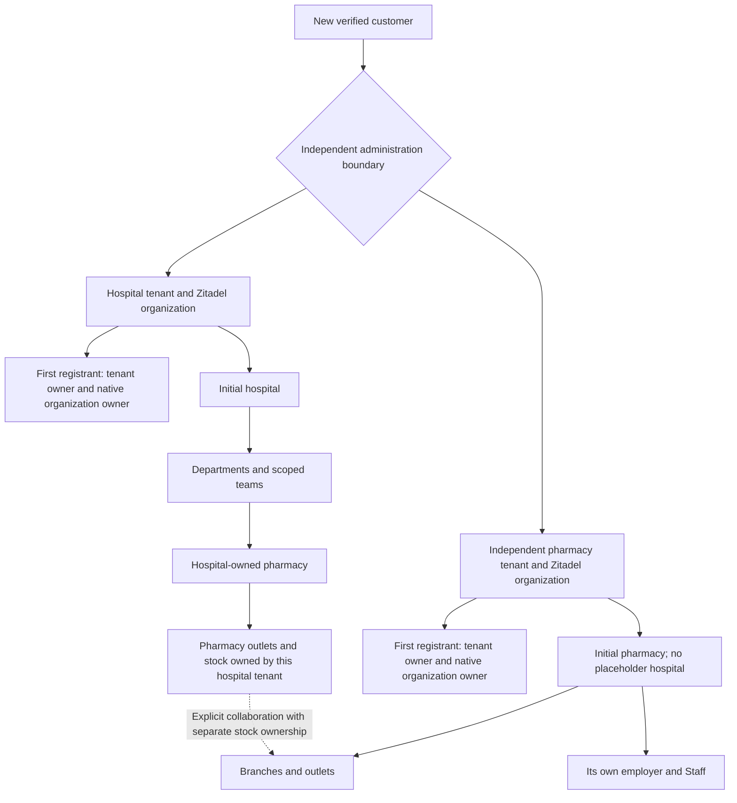

# Automated customer onboarding and a clean test start

Status: the earlier signup implementation is deployed at `https://helivanta.app/signup`.
The tenant-owned identity redesign in [ADR-0070](../adr/0070-tenant-owned-login-identities.md)
is prepared and awaiting its coordinated schema/identity/application rollout.
Verified email delivery, distinct QA tenant organisations and resend no-op checks
have live evidence. Fresh tenant-owned same-email login/MFA and owner-policy
acceptance must be verified after this redesign is deployed. Customer onboarding
remains automated after verified signup, without platform approval.

[Editable tenant identity diagram](tenant-owned-identities.drawio) ·
[Identity decision and rollout](../adr/0070-tenant-owned-login-identities.md)

## Customer tree and authority



A hospital-owned pharmacy stays within its hospital's tenant and identity
administration. An independently owned pharmacy has its own tenant, identity
organization, employer, Staff and stock. Commercial collaboration never moves
ownership or grants clinical disclosure. A hospital tenant owner is not a
Tesserix platform administrator. Management ownership does not certify a
professional licence, employment review, statutory designation or clinical
privilege. Reuse the current owner/member and scoped Staff workflows; do not
introduce a second module-specific role vocabulary.

The first registrant's supplied email and name become the new native human
owner; the server derives the tenant UUID and subject. The browser cannot pick
an existing tenant, user ID, native organization ID or privileged platform role.
Email verification must be proven by Zitadel, never asserted by the browser.
Every signup creates a fresh identity owned by its new organisation, including
when the same email exists elsewhere. Passwords, MFA factors and external IdP
links are independent. Native usernames and organisation names include the
immutable tenant identifier; business display names remain business metadata.
Email is a delivery address and never proves a shared login or authority.

`POST /v1/auth/signup/new` opens a separate browser receipt with an empty JSON
body and the existing same-origin protections. It returns `not_started` and
rotates only the Secure, HttpOnly, SameSite receipt cookie: no native identity,
tenant, membership or existing request is created, changed or deleted. The UI
cancels old receipt polling before replacing its cache and opens a blank form.
Save a ready workspace's specific sign-in link before starting another; an
unfinished request is retained server-side but this browser now tracks the new
receipt. An uncertain network outcome requires refresh to inspect current state.
The next normal signup submission creates the independent tenant under existing
intake limits, idempotency and native verification requirements.

## Required customer journey

1. `/signup` collects the organization name, hospital or independent pharmacy
   choice, supplied owner identity, India and the supported home state
   (Maharashtra or Odisha). Geographic setup is not a licence assertion.
2. The Global API hands a bounded, idempotent command to the onboarding owner.
   Intake is durably recorded before remote provisioning. A protected receipt
   lets the same browser resume an uncertain request without creating a second
   organization. Public responses disclose no other customer's registration.
3. Native identity creates the organization and initial human together. Native
   identity owns verification, first authentication-method setup and recovery;
   Helivanta renders the verification and password forms and submits native
   proofs. It never asserts verification or sets a password without native
   proof. Native organization policy requires MFA.
4. The initial owner remains pending until current native identity and ownership
   are verified. The activation callback establishes the exact first tenant
   administration membership and authorization projection. Retained anti-replay
   evidence prevents a later retry from restoring revoked final membership.
5. The business owners create the selected initial hospital or independent
   pharmacy and the initial owner's corresponding resource administration.
   Reuse workforce/pharmacy owner commands and contracts. Retries reuse the
   same resource IDs, preserve audit evidence and repair partial completion.
   IAM must not write workforce or pharmacy tables.
6. Readiness is recorded only after identity, tenant membership, authorization,
   initial business-resource setup and the retained receipt have completed.
   Native password-setup evidence is also required before the browser receipt
   becomes ready. An email-proven receipt offers password setup explicitly.
   A created organization, sent email or 202 response is not readiness.
7. The owner signs in to the correct tenant and reaches its administration panel
   and existing Staff setup. Department heads, supervisors, transfers, Staff
   login links and narrower operational assignments use their existing scopes.
   Independent pharmacy setup creates a typed pharmacy employer and its initial
   HR management access, with no hospital establishment or hospital scope.

The initial business setup is automatic; entering licence evidence, releasing
stock, employing operational Staff and approving regulated activity still need
real authorized evidence. Signup must not fabricate these as successful.

## Tenant-owned accounts and workspace sign-in

A new hospital or independent pharmacy always receives a separate Zitadel
organisation and fresh native owner. Remove global email detection and
cross-tenant email reservation uniqueness. The new account verifies its own
email, sets its own password, and enrols its own second factor; it never prompts
for an old account's enrolled device to establish new-tenant ownership.

The ready workspace offers a scoped sign-in and a reusable
`/login?workspace=<tenant UUID>` link. Fresh OIDC authorization-code/PKCE state
pins the native organisation and exact Helivanta tenant. The server resolves
email within that native organisation, requires one active verified human,
checks its password by user ID and verifies the resulting session's organisation.
The callback retains native token, nonce/state/PKCE and server membership checks.
An unscoped legacy canonical-login-name path does not search other tenants by email.

Receipt-bound native continuation may prove only the immutable fresh owner in
its target organisation. It cannot adopt another organisation's account by email.
Existing accepted historic bindings retain recovery compatibility and history;
this release does not delete or silently migrate them. Active unbound historic
`existing_account` intents resume their own original deterministic fresh owner
through the bounded leased worker. Expired historic receipts do not resume.
The schema expansion removes the email uniqueness index and retains immutable
intent, proof and legacy-binding guards. It requires named approval before live
application; accepted duplicate-email rows make rollback a forward-recovery task.

New Staff memberships and role grants independently require the native account's
resource owner to match the verified tenant organisation. An active/verified
account from another organisation is generically ineligible. Current memberships
remain readable; granting/restoring new access requires a tenant-owned account.
Staff provisioning/invitation is a separate workflow; an email match cannot link
or create its business authority. Focused tests and real database CI cover these
boundaries; deployment acceptance remains required.

## Business contacts, headquarters and the initial branch

The signup form requires the organisation phone and contact email, a full
head-office address, and the main branch name and address. The address contains
line 1, optional line 2, city, district, PIN code, state and country. State choices
cover Maharashtra and Odisha in India. The form copies the current head-office
address on submission when the customer selects the same-address option.
Organisation contact email is business metadata. Native first-owner verification
uses the owner's login email.

The canonical `customercontract.OrganizationProfile` and `BusinessAddress` in
onboarding-service generate the browser schemas. The public receipt boundary,
durable signup input, intent fingerprint and private workspace command carry the
same profile. Validation checks bounded text, controls and whitespace,
international-format phone, email, six-digit PIN code and supported geography.
The head-office state/country must match the signup's administrative home scope.
The branch may use another supported state.

The `profile` addition is optional in the v1 wire contract to preserve stored
intents and existing callers. The current signup form requires a complete
profile. Every supplied profile is validated on both service boundaries. Legacy
records return an explicit null profile through the business-profile read API.

Workforce owns the hospital's stored `onboarding_profile`. Its initial hospital
resource uses the supplied main-branch name. PharmaConnect owns an independent
pharmacy's profile and creates its initial outlet with the supplied branch name,
India country and Asia/Kolkata time zone. The outlet starts in `pending_review`.
The initial outlet uses the same UUIDv7 value as its pharmacy organisation in its
own typed resource scope. Tenant, parent and outlet checks supply its authority.
Workforce consumes the pharmacy employer projection for HR administration.

Nullable bounded JSON columns are introduced by
`0096_workforce_business_profile` and `0044_pharmacy_business_profile`. Existing
row isolation and ownership apply. Initializers persist the profile with their
business creation and audit transaction. Replays compare the stored profile and
check the initial resource, preserving the existing anti-replay access behavior.
Only identifiers and field/action metadata enter audit events.

Owners can open **View contact and addresses** in the hospital workforce page or
pharmacy setup. These views request the business owner's scoped endpoints through
the Global API.

| Endpoint                                                 | Required permission         | Additional scope                                          |
| -------------------------------------------------------- | --------------------------- | --------------------------------------------------------- |
| `GET /v1/workforce/hospitals/:hospital/business-profile` | `workforce.hospital.manage` | Current tenant, hospital kind and hospital manager access |
| `GET /v1/pharmacy/pharmacies/:pharmacy/business-profile` | `pharmacy.access.manage`    | Current tenant and visible pharmacy organisation          |

Both return the canonical `{profile: object | null}` view, apply the optional
expected-tenant precondition, set `Cache-Control: no-store` and record an
attributable read. Missing permission returns 403 and an out-of-scope resource
returns 404. Dependency or invalid stored-data errors follow the owner's error
mapping. The UI presents read failures with a retry action.

## First-owner verification delivery through Resend

```mermaid
sequenceDiagram
    participant Owner as New owner
    participant Web as Helivanta / Global API
    participant Signup as Onboarding service
    participant Identity as Identity operator / Zitadel
    participant Mail as Resend API
    Owner->>Web: Submit organisation and owner delivery email
    Web->>Signup: Record durable intent and private receipt
    Signup->>Identity: Create unique organisation and fresh owner
    Signup->>Identity: Recheck owner binding; request native code
    Signup->>Mail: Send product verification link with reserved allowance
    Mail-->>Owner: Verification email
    Owner->>Web: Explicitly confirm verification
    Web->>Signup: Submit native proof without logging it
    Signup->>Identity: Verify code and recheck tenant-owned identity
    Signup-->>Web: Rotate receipt; offer password setup
```

Zitadel owns code creation, expiration and proof. Product delivery uses the
Resend API with verified sender `onboarding@helivanta.app`; the API key is supplied
through OpenBao/ESO and a read-only mounted file. Its value never enters a browser,
log, issue or repository. The external-email claim suppresses the operator's
initial shared SMTP send. Shared platform SMTP remains separately configured.

The fixed verification URL uses a fragment:

```text
https://helivanta.app/signup/verify#phase=email&userId={{.UserID}}&code={{.Code}}
```

The browser removes the fragment before submitting the native proof and requires
an explicit verification action, so an email scanner cannot consume it merely
by opening it. Verification rechecks the exact native organisation, subject and
submitted email and rotates the private receipt. A separate `phase=password`
link and native proof are required for first password setup. No browser assertion
can mark verification/password setup complete.

Native email and password links expire after one hour. Initial delivery and
both resend kinds share three attempts per hour and ten per rolling24hours per
immutable signup, including failed provider attempts. Reservations are atomic
and audited without native codes. Verified email resend and completed password
setup return privacy-safe no-ops before spending allowance or generating a code.
Provider acceptance evidence is retained, but an accepted send is not proof of
inbox delivery or completed login. Live QA delivery passed SPF/DKIM and verified
resend probes produced no additional verification email.

Source owners: the identity operator creates the fresh owner and suppresses
shared delivery for the external-email claim; onboarding's native-code client,
mail sender and durable reservation store own product delivery/proof. Helivanta's
public receipt boundary and verification UI continue through Global API.

## Owner security administration

The current owner panel reads and reapplies the mandatory MFA/no-grace minimum;
its applied/pending/drifted state comes from native policy, not just an HTTP202.
It does not expose arbitrary policy editing or disabling required MFA. Additional
settings need explicit supported contracts. The owner panel must read and update the current customer's Zitadel security
policy through a server-side integration. Every request uses verified current
Helivanta tenant membership and fresh native organization-owner authority. The
server resolves the native organization from the verified tenant binding;
client-supplied org IDs or UI visibility supply no authority.

Expose only supported customer settings and registered factor-management flows,
with the platform's minimum MFA requirement enforced. Passwords, factor seeds,
recovery codes and machine credentials never enter claims, logs or ordinary
policy responses. Require appropriate reauthentication/step-up for sensitive
changes, validate stale-policy preconditions, record attributable outcomes and
show provider failures honestly. One tenant's owner cannot edit another tenant
or shared platform policy. Security-policy changes are separate from granting
Staff operational permissions and from first-owner recovery or transfer.

## Owners and recovery

| Record                                                            | Authoritative owner                      | Recovery behavior                                                        |
| ----------------------------------------------------------------- | ---------------------------------------- | ------------------------------------------------------------------------ |
| Customer intake and provisioning progress                         | Onboarding service                       | Durable idempotent receipt; no fabricated completion                     |
| Human, email verification, factors and native organization policy | Zitadel                                  | Native verification/recovery; no direct event-store edits                |
| Private desired identity claim                                    | Identity operator through onboarding API | Immutable binding, deterministic replay, visible pending condition       |
| Tenant administration and authorization projection                | Helivanta IAM                            | Attributable membership plus anti-replay evidence and current projection |
| Hospital, employer and scoped team                                | Workforce owner                          | Existing owner commands and history                                      |
| Pharmacy, outlet and pharmacy resource authority                  | PharmaConnect owner                      | Existing owner commands, separate stock ownership                        |
| Retained onboarding configuration                                 | Held platform archive                    | Fingerprint/receipt verification; no cleartext first-owner profile       |

No public browser calls a private product or identity management API directly.
Use explicit Global API product destinations. Service-to-service credentials are
short-lived, audience-bound and namespace-bound, with distinct actors for each
hop. Durable retries stay with the current owner; remote requests never run
inside a business database transaction. Identity/authorization outages deny or
remain pending. Existing-tenant recovery never recreates removed access.

Planning assumptions inherit the identity ADR's 1 request/s burst, requests
under 8 KiB, 100/1,000 organizations at 12/36 months and a 30-second controller
attempt. Human verification is outside any automated completion deadline.
Customer read/status operations must be bounded and private. No additional
runtime service is justified; use the current onboarding owner and databases.

## Clean test start

Approved scope is all existing business tenants, business data and related
Helivanta-only native organizations/users. Preserve shared platform human and
service identities, system roles, canonical references, migrations, held shared
onboarding history, credential revocations and retained onboarding anti-replay
receipts. Do not seed replacement customers; the user starts manually.

Before deletion, capture a fresh recovery point and exact database, identity,
file, authorization, event and workflow inventories. Pause relevant writers by
the owning GitOps configuration. Use a reviewed maintenance procedure for the
business-history guards; ordinary application deletion must remain forbidden.
Delete identity resources through their owner, never direct Zitadel SQL. Remove
stale desired-state claims so reconciliation cannot restore deleted identities.
Verify every owned store and then resume writers.

The current GCP principal is denied object listing on the Helivanta quarantine
and released buckets. No complete file cleanup or empty-state claim can be made
without authorized access. Existing evidence is outside the repository under
`~/.local/state/helivanta/resets/20261110T002357Z/`; it is discovery evidence, not
an executed reset. Backup retention means deletion of live synthetic records
does not immediately erase recovery copies.

## Release and manual acceptance gates

- Observe regression tests fail before fixes. Run affected unit, authorization,
  scope, replay and dependency-failure tests; real database tests run in CI.
- Build and check locally without starting applications or containers. Remove
  emitted build artifacts. Merge only passing changes and deploy through the
  owning GitOps/Kargo path, verifying actual digests and reconciliation.
- Replace the public placeholder only with the integrated functional journey.
  Test signup, delivery of verification, first authentication, mandatory MFA,
  automatic tenant/resource setup, refresh/resume, duplicate submissions,
  expired verification, lost responses and dependency failures in the live env.
- Test hospital-owned and independent-pharmacy scenarios with fresh customer
  identities. Verify Staff creation/linking and independent stock ownership.
- Test owner security updates against actual native policy and verify that a
  non-owner and another tenant cannot read or modify them. Verify revoked
  membership and stale browser context as well as normal navigation.
- Confirm all approved old business data and identity resources were removed,
  required platform/recovery records survived and no replacement fixture was
  silently created. Only then tell the user to begin their fresh onboarding.

The earlier public signup, automatic business setup and owner security
implementations are deployed. ADR-0070 changes are not yet deployed. Their
real-owner acceptance gates and the approved historic data reset remain open. First-owner controller tests, provider configuration checks
or a provisioning API PR do not close those gates.
