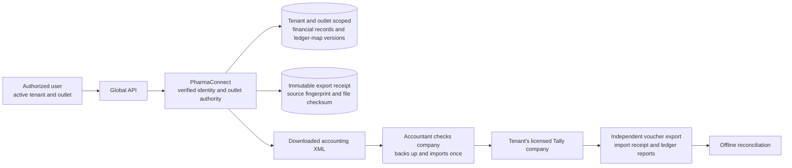

# Tally hosting and tenant integration

Review date: 26 November 2026. Related: [#1690](https://github.com/tesserix/helivanta/issues/1690),
[export owner guide](1690-tally-accounting-export.md),
[acceptance runbook](../testing/tally-acceptance.md).

## What the application currently does

PharmaConnect owns the sales, credit notes, purchase bills, source purchase-tax
evidence, supplier payments and reversals. An authorized user previews a period,
records the target company's ledger/voucher-type names and downloads accounting
XML. An accountant imports it into the intended Tally company and reconciles it.
This is a file export, not an automatic or bidirectional Tally connection.
Tally edits do not update HMS stock, bills, payments or dashboards.

The ledger-map identity is scoped by tenant and outlet. Reads and joins in
`tally_export.go` carry those predicates; mapping writes use the same transaction
scope and preserve previous versions. The server checks accounts-export authority;
UI visibility alone cannot grant access. The SDK uses the Global API and a query
key containing account/resource context. Purchase-enabled preview and download
explicitly request `purchase_bills=true`; the SDK checks the response marker.

The download commits its audit/receipt before releasing XML. A receipt proves what
HMS delivered; it does not prove Tally accepted it. Late postings or corrected
source evidence require another deliberate preview and reconciliation. Never mark
a payment as bank-settled merely because it was exported or imported into Tally.

Existing automated tests include foreign tenant/outlet denial, changed sessions,
stale mapping versions, missing purchase evidence, bounded files, exact tax
postings and preservation of source data. These are code-level coverage;
deployed UI acceptance and external Tally reconciliation are separate evidence.

## User experience and tenant boundaries

1. Confirm the displayed tenant, pharmacy and outlet before opening Supplier bills.
   An owned hospital department and an independent pharmacy use their own authorized
   outlet context; a supply relationship grants no access to the other's books.
2. Choose the inclusive date range. Preview counts are derived from persisted
   records in that scope. Missing source tax evidence is an actionable error,
   not a zero total or a silently omitted purchase.
3. Enter the exact names in the intended Tally company. Show supplier names and
   understandable account-head labels. Save a version and download only after all
   required names are present and pending edits are saved.
4. Confirm the Tally company, financial year, currency and effective numbering
   series. Back up and import once. Preserve failures; inspect before retrying.
5. Independently compare voucher identities, original numbers, dates, types and
   every ledger posting, then inspect supplier and bank balances. An import summary
   alone is insufficient.
6. When switching tenants/outlets, establish verified target context before fetching
   its data. Do not retain another scope's preview, mapping or downloadable result
   as the current scope. Denial or dependency failure must stay visible.

The tenant-to-Tally-company relationship is currently an accountant's explicit
file-import selection; it is **not** a persisted, verified connection binding.
HMS currently does not store tenant Tally activation keys. Automatic connection
setup, import jobs, remote acknowledgements and sync-status screens require a
separate implemented and tested contract before they can be exposed.

## Can TallyPrime run in Kubernetes?

There is no verified, vendor-supported Kubernetes/container deployment in this
review. Do not deploy a repackaged installer, Wine image, Windows HostProcess pod
or shared writable company directory as a production substitute.

Tally's [system requirements](https://help.tallysolutions.com/recommended-system-configuration-for-tallyprime/)
describe 64-bit Windows installations. Kubernetes supports
[Windows containers](https://kubernetes.io/docs/concepts/windows/intro/), but
that does not establish Tally application, desktop, activation or upgrade support.
Windows nodes also retain operating-system infrastructure and licensing costs;
containers do not eliminate those requirements.

Tally's [Cloud Access documentation](https://help.tallysolutions.com/tallyprime-cloud-access-faq/)
describes a managed virtual-computer service, including a Linux-based virtual
computer. That vendor-managed capability is not permission or a supported recipe
for self-hosting its runtime in our Linux pods. It may remove Helivanta-managed
Windows VMs, subject to the provider's connectivity and integration support.

The [licensing guide](https://help.tallysolutions.com/licensing-tallyprime/)
describes Silver, Gold and virtual-user use. Gold supports simultaneous business
users on company data; do not infer unrelated SaaS tenant hosting rights, arbitrary
activation-key multiplexing or concurrent activation in separate environments.
Obtain written vendor confirmation for the intended hosting/licensing model,
company isolation, API access and recovery before offering managed tenant hosting.

## Recommended next architecture, not deployed functionality

Keep HMS and a future connector/job worker in Kubernetes. Connect privately to
each tenant's existing licensed Tally installation or supported managed provider.
Use a tenant-controlled connector where incoming connectivity is unavailable.
Do not make Tally's port 9000 or RDP publicly reachable.

Before implementing automatic imports, define these gates in an accepted contract:

- A verified tenant/outlet-to-company binding, approved by the financial owner,
  checked again before import and read-back; a company name supplied by a client
  is not authority. Hosting may need process/storage isolation in addition to
  Tally company permissions.
- Tenant-scoped secret references in the managed secret store, per-connection
  service credentials and egress allowlists. Activation keys remain with their
  licensed runtime unless a vendor-approved workflow requires otherwise.
- Durable job states for accepted, pending, successful, failed and uncertain
  outcomes. Serialize conflicting company imports, enforce tenant quotas and
  reconcile uncertain outcomes before retrying. Stable `REMOTEID` values alone
  do not prove Tally-side idempotency.
- Exact source/map versions and file checksums, attributable approvals, independently
  read-back vouchers, company identity and audit retention. Report external sync
  status separately from authoritative HMS financial state.
- Bounded timeouts, backoff, circuit breaking, compatible upgrades, encrypted
  backups and demonstrated restoration. Separate each tenant's data, secrets,
  recovery and operational access; never share a company-data volume between pods.

No cluster, licence, firewall, tenant binding or production import is changed by
this design review. The current QA VM remains the real-import acceptance target.
