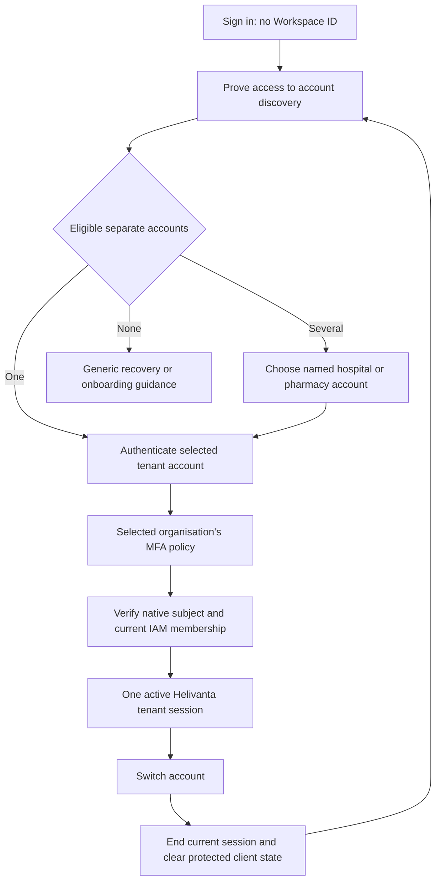

# Separate tenant accounts and account selection

Decision accepted by the product owner on 2026-11-12: **keep separate tenant
accounts with an account chooser**. This refines [ADR-0070](../adr/0070-tenant-owned-login-identities.md).
The coordinated account-discovery release is deployed; see
[delivery details and evidence](account-discovery-delivery.md). Live single-hospital
login passed; independent-pharmacy and multiple-account acceptance remain open.

## User experience

A person starts at **Sign in** without entering a workspace UUID, organisation
ID or tenant code. Hospital and independent pharmacy accounts remain separate.
Account choices show the organisation's current business name and the person's
account label. Internal IDs are never the visible account name.

When a verified discovery result contains one eligible account, continue to its
credential form automatically. When it contains several, show **Choose an
account** before asking for that account's password and required MFA. A supplier
relationship or hospital affiliation is not an account choice unless the person
also has an independently authorised staff account there.

Inside the application, the [verified current tenant name](current-account-tenant-name.md)
identifies the active account even when there is only one. **Switch account** returns to account selection and
authenticates the destination account. It does not transfer the current subject's
roles, credentials, MFA, security policy or data into another organisation. An
abandoned or failed switch must not label the destination as active. The current
account remains clearly visible until its session is ended; after that point,
failure leaves a signed-out screen with a working retry action.

## Identity and authority

| Record                                        | Owner                              | Authority                                                          |
| --------------------------------------------- | ---------------------------------- | ------------------------------------------------------------------ |
| Customer tenant and product enrolment         | Onboarding service                 | Active customer and Helivanta enrolment                            |
| Organisation, human subject, password and MFA | Zitadel                            | Authentication for that separate native account                    |
| Business membership and assigned roles        | Helivanta IAM                      | Current access for the exact authenticated subject and tenant      |
| Staff record and reviewed account link        | Workforce                          | Employment and reviewed person/account relationship                |
| Account selection receipt                     | Identity discovery owner, proposed | Permission to view a bounded selection list; no application access |
| Browser account hint                          | Browser, optional                  | Routing convenience only; never discovery proof or membership      |

An owner is an administrative actor within their own tenant. Staff access still
requires the applicable reviewed link, membership, role and narrower scope.
Neither account selection nor owner status grants clinical authority. Hospital,
outlet and premise enforcement remains at the product owner. The legacy
same-subject `/iam/me/tenant` switch cannot authenticate a different native
subject and must not be reused as the implementation of **Switch account**.

## Discovery privacy and authentication boundary

The assets are account existence, hospital/pharmacy affiliation, credentials,
MFA factors and tenant data. Threats include unauthenticated enumeration,
another tenant's user, a forged selection link and a subsequent user at a shared
terminal. Account discovery, native authentication and business-session exchange
are separate trust boundaries.

An unauthenticated email submission must not return matching accounts, tenant
names, IDs, account counts or different existing/nonexistent-account messages.
Before disclosing choices on a fresh browser, require fresh proof of mailbox
control or a valid, purpose-bound organisation invitation. A remembered choice
is not sufficient proof to discover additional accounts. A verified email from
an unrelated Tesserix/CivicLens account is not a Helivanta account link.

Mailbox proof selects eligible accounts only; it never resets their passwords,
enrols factors, creates memberships or replaces their normal authentication.
Discovery must include eligible staff accounts as well as signup owners; the
signup table alone is not an account directory. Identity-owner reads must
confirm active native account ownership and active customer/product enrolment.
The final session exchange must independently verify current IAM membership.

Discovery proofs require a separate purpose, audience, expiry, bounded attempt
budget and replay policy. Redeem them through a same-origin POST and keep
proofs out of query strings, logs, analytics and persistent client storage.
Use native or vetted cryptographic primitives and the owning service's schema;
do not invent a browser-signed account list. Token lifetime and recipient/IP
delivery limits must be explicit in the canonical contract before release.
They must not silently reuse signup receipts or reset signup mail budgets.

A selected tenant ID is an internal routing hint carried through protected OIDC
state. It is never authority. Preserve PKCE, state, nonce, issuer, audience,
expiry and exact native organisation/subject checks. Fail closed on unavailable
identity or membership checks. An unauthorised target returns the existing
generic refusal or 404, without confirming whether it exists; missing action
permission remains 403 and unavailable authorisation 503.

## Switching and failure recovery

1. Stop new protected commands and warn about unsaved work before leaving the
   current account. Do not replay an uncertain stock or financial command under
   a different account.
2. End the current Helivanta session through its existing protected lifecycle
   API. If that fails, keep the current account clearly identified and report
   that the switch did not start.
3. Clear protected query data, permission caches and local identity/renewal
   state, notify other tabs, and start a fresh OIDC request for the selected
   account. Retain no reusable native factor or password in chooser storage.
4. Require the destination account's own password/MFA policy. Recheck current
   account, customer and IAM state before minting its new session.
5. Display the destination only after server confirmation. A dependency outage,
   revoked membership, expired discovery proof or rejected credential leaves
   explicit retry/recovery guidance; it never falls back to another account.

Recovery retries use durable command identities where a state change exists;
native auth requests and email proofs follow their own one-use semantics. No
distributed transaction spans discovery, native auth and session minting.
Discovery is not cached as long-lived authorisation. Other tabs must invalidate
protected data when the browser's active session changes.

## Delivery and acceptance gates

The deployed starting version exposes a Workspace ID input in
`apps/shell/app/login/page.tsx`; this change replaces it with mailbox discovery. Scoped email resolution is implemented in
`backend/internal/modules/iam/loginclient/tenant_session.go`; its private broker
resolves an email only inside the org pinned by the native request. The existing
`components/tenant-picker.tsx` changes tenants for one subject, rather than
selecting a distinct account. These facts are the starting point, not completed
chooser behaviour. Merely deleting the visible input is insufficient.

Implement canonical discovery/proof/choice contracts in the identity owner and
route application traffic through Global API. Review required schema and
delivery changes with their owning repositories. Keep ADR-0070's separate-user
admission checks intact. No migration of subjects, email-based account merging
or change to native organisation ownership is authorised by this refinement.

Use the existing platform planning targets of 1,000/3,000 peak RPS at months
12/36, 99.95% availability and p99 reads 500 ms/command acceptance 800 ms as
planning references, not measured discovery performance. Bound request bodies,
candidate scans, pages, email deliveries and total dependency deadlines in the
contract. Record measured latency and database/provider load before production
acceptance; sending email is not a synchronous read-latency guarantee. Reuse the
identity owner, existing private database and Resend integration; no extra
service is proposed. Costs grow with audited discovery reads and limited email
delivery. Critical dependency failures deny discovery or login explicitly.

Required behaviour tests and actual-site acceptance:

- Single account: ordinary sign-in reaches the right tenant without an ID field.
- Multiple accounts with the same email: private choices, distinct subjects,
  independent password/MFA and correct staff/owner permissions per tenant.
- Fresh browser, shared terminal, blocked storage and signed-out/idle sessions:
  usable discovery/recovery without disclosing a previous person's accounts.
- Zero accounts, invalid proof, expired/replayed proof, excessive requests,
  ambiguous results and malformed/oversized provider responses: bounded generic
  refusals without account enumeration.
- Tampered tenant, foreign subject, revoked membership, inactive organisation or
  missing product enrolment: no destination session or protected disclosure.
- Switch cancellation, logout failure, destination MFA failure, lost responses
  and another tab switching: no mixed cache, wrong-tenant command or false success.
- Current signup email/password replay and seven-second redirect tests remain
  green; account selection does not weaken those receipts or delivery limits.

Roll out owner contracts and schema before their consumers; expose the new UI
only after the discovery/auth path is working. Preserve existing scoped links
during the transition. Rollback restores the prior UI while retaining any
accepted discovery schema; expiring proofs must remain safely rejectable across
versions. A separate production rollout approval and actual fresh-account tests
are required before calling this flow deployed.

The rejected alternative is one shared Helivanta subject with memberships in
many tenant organisations: the product owner explicitly chose separate accounts.
Public email-to-tenant lookup and matching accounts by email were also rejected
because they expose affiliation or change authority without account proof.
