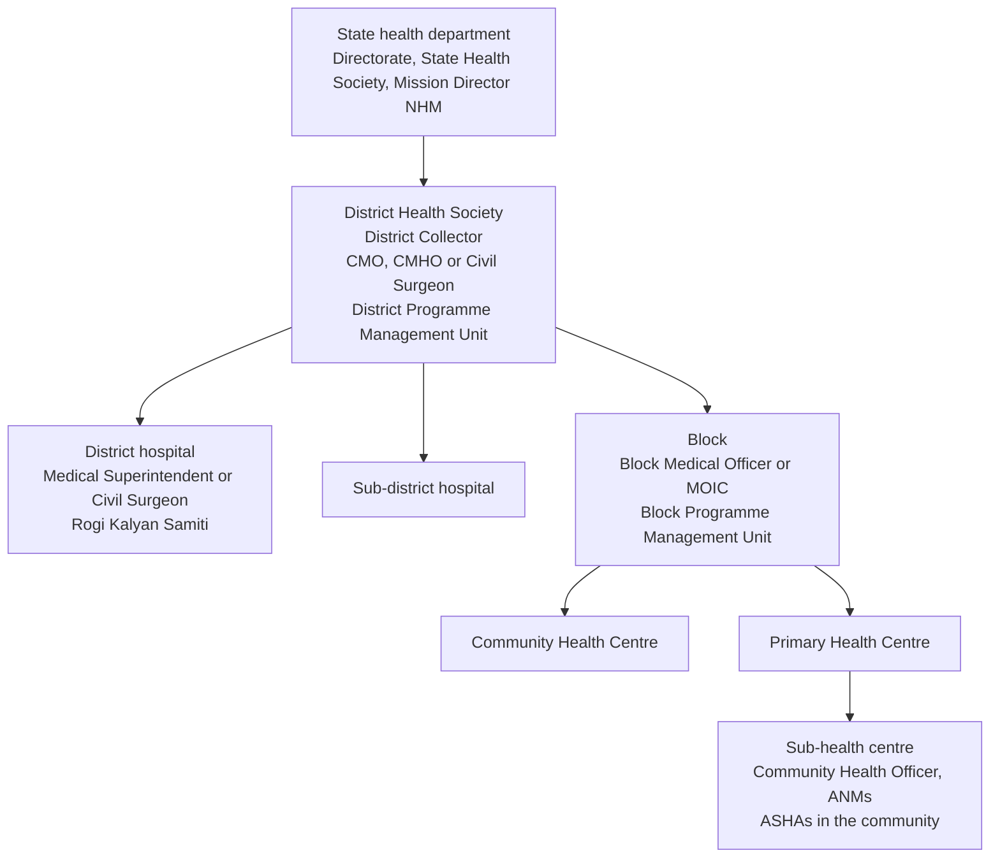

# Public and private sectors

[India knowledge index](README.md) · [organization knowledge](../organization/README.md) · researched 2026-10-26 · proposed specification; state orders and titles vary

Helivanta must serve government facilities, private hospitals and groups, trusts and medical colleges with one product. They differ in who governs, how money is approved, which quality framework applies, how staff move and how often the network is available. They do not differ in how access is checked or who owns a record. Treat sector as a tenant profile over the shared [organization model](../organization/README.md), never as a separate code path. Source IDs refer to the [source register](sources.md#organization-and-public-sector).

## How the sectors differ

| Concern                    | Public (state government, NHM)                                                                                                   | Private (single hospital, group, trust)                                        |
| -------------------------- | -------------------------------------------------------------------------------------------------------------------------------- | ------------------------------------------------------------------------------ |
| Customer                   | State health department or society, sometimes a district for a pilot                                                             | Owner, promoter group or trust                                                 |
| Governance                 | State and district health societies; Rogi Kalyan Samiti or hospital management society at the facility (S21, S23)                | Board of directors or trustees                                                 |
| Hierarchy above facilities | State, district and block administrative levels                                                                                  | Group, region or cluster, if any                                               |
| Facility types             | District and sub-district hospitals, CHCs, PHCs, sub-health centres under IPHS 2022 (S18–S20)                                    | Single and multi-specialty hospitals, nursing homes, day-care centres, clinics |
| Facility head              | Medical Superintendent or Civil Surgeon at district level; medical officer in charge at CHC or PHC                               | CEO or unit head with a Medical Director or Medical Superintendent             |
| Money                      | Budget heads, sanctioned funds, untied funds through the RKS, tenders and purchase orders (#250)                                 | Commercial tariffs, packages, insurance and TPA, corporate contracts           |
| Patient charges            | Many services free or subsidized; scheme-funded care (#243)                                                                      | Self-pay, insurance, schemes where empanelled                                  |
| Quality                    | NQAS and Kayakalp (S22); NABH or NABL where the facility opts in                                                                 | NABH and NABL (S14, S15, S26) where accredited                                 |
| Staffing                   | Regular cadre, NHM contractual and outsourced staff; sanctioned versus filled posts; transfers by state order; additional charge | Employment contracts, visiting consultants, agency staff                       |
| Reporting                  | Programme and surveillance reporting to government systems (#489)                                                                | Mostly internal; regulatory and scheme reporting where applicable              |
| Connectivity               | Intermittent at PHC and sub-centre level; offline-capable work required (#250)                                                   | Generally connected; branch sites may not be                                   |
| Contract                   | Government plan: tender or PO, sanctioned budget, no auto-renewal, no suspension for delayed payment (#250)                      | Subscription plans                                                             |

Medical colleges exist in both sectors and add an academic line: Dean or Principal, professors and heads of department, associate and assistant professors, senior and junior residents, and interns under the compulsory rotating internship regulations (S25).

## Hierarchy

The usual public structure under the National Health Mission is below. The district health society is typically chaired by the District Collector with the district health officer as a senior office-bearer, supported by a district programme management unit (S23). Titles for the district health officer vary by state: CMO, CMHO, DMHO, DHO or Civil Surgeon. Staff often report both to a facility head and to a programme line, a dual reporting pattern noted in NITI Aayog's review (S24).

Mapping to Helivanta (decision ORG-D2 in the [organization index](../organization/README.md#open-decisions)):

- The state authority deployment is the tenant.
- State, district and block are administrative levels. They see aggregates, run approvals and move staff; they get no patient access to facilities below them.
- Each district hospital, sub-district hospital, CHC, PHC and sub-health centre is a hospital boundary with its own departments.
- The Rogi Kalyan Samiti is a governance group and committee attached to its facility, not a department.

Private groups map more simply: the group is the tenant, optional regions or clusters are administrative levels, and each hospital is a boundary. A single hospital is a tenant with one hospital.

## Equivalent titles

| Job                     | Private title                              | Public title                                                     | Helivanta template family and scope               |
| ----------------------- | ------------------------------------------ | ---------------------------------------------------------------- | ------------------------------------------------- |
| Highest governance      | Chairperson, promoter, board               | State Health Society governing body; RKS governing body          | Governance at tenant or hospital                  |
| Network head            | Group CEO, managing director               | Mission Director NHM, Director of Health Services                | Management at tenant                              |
| District oversight      | Regional or cluster head                   | CMO, CMHO, DMHO or Civil Surgeon; District Programme Manager     | Management at an administrative level             |
| Block oversight         | None                                       | Block Medical Officer or MOIC; Block Programme Manager           | Management at an administrative level             |
| Facility head           | CEO, unit head                             | Medical Superintendent, Civil Surgeon, medical officer in charge | Management at hospital                            |
| Medical administration  | Medical Director, Medical Superintendent   | Medical Superintendent, Deputy MS, RMO                           | Management at hospital                            |
| Nursing head            | Chief Nursing Officer, Director of Nursing | Nursing Superintendent, Matron                                   | Management at hospital nursing service            |
| Non-clinical operations | COO, administrator                         | Hospital Manager, administrative officer                         | Management at hospital                            |
| Finance                 | CFO, finance controller                    | Accounts officer, District Accounts Manager                      | Management or administration at hospital or level |
| Ward lead               | Nurse manager, unit in-charge              | Ward sister, nursing officer in-charge                           | Supervision at sub-unit                           |
| Quality lead            | Quality head, NABH coordinator             | Quality manager for NQAS and Kayakalp                            | Supervision and audit at hospital                 |
| Frontline primary care  | Not applicable                             | Community Health Officer, ANM                                    | Clinical at sub-health centre                     |

Titles change between states and over time. Tenants rename templates for their users; the template family and scope decide authority, never the displayed title.

## Money and approvals

Public facilities spend against budget heads and sanctioned amounts, under a schedule of delegated financial powers set by state orders, with some decisions reserved for the RKS executive or governing body (S21). Private groups use approval matrices by amount, department and legal entity. Both are [configurable approval chains](../organization/configurable-workflows.md#public-and-private-approval-chains). Delegation limits, budget heads and committee powers are customer data entered with the source order and effective date. Helivanta seeds none of them.

Public billing records free, subsidized and scheme-funded services. A zero patient charge is a policy outcome and must be reported as such, never as missing data. Scheme eligibility and claims follow the [billing and insurance](billing-and-insurance.md) reference and #243.

## Staff movement

Public staff are transferred by state orders, take additional charge of a second facility, and are relieved from one post before joining another. Model each as effective-dated postings: relieving revokes access at the old facility on the relieving date, joining proposes access at the new facility, and additional charge is a second, time-bound management assignment. Contractual NHM staff and outsourced staff carry mandatory end dates. Sanctioned and filled posts per facility are workforce facts that IPHS staffing norms are compared against (S18–S20); they never grant access.

## Requirements

- **IN-PS-01:** Sector is a tenant profile selecting hierarchy levels, template catalogue, titles, billing plan and quality framework. Code does not branch on sector for access or record ownership.
- **IN-PS-02:** Administrative levels receive aggregates, approvals and staff-movement authority, never patient access to the facilities below. Any programme disclosure of patient data needs its own reviewed legal basis and contract.
- **IN-PS-03:** Transfers, relieving, joining and additional charge are effective-dated postings that revoke and propose access automatically, per the [access model](../organization/access-model.md#staff-lifecycle-drives-access).
- **IN-PS-04:** Government plans follow #250: tender or PO, sanctioned budget, no auto-renewal and no suspension of care workflows for delayed payment.
- **IN-PS-05:** Facilities with intermittent connectivity can continue registration and care documentation offline, with the owning product defining conflict and replay rules before the workflow is offered.
- **IN-PS-06:** Scheme and government-system integrations (#243, #489) are asynchronous and never block care; a failed submission is visible and retryable.
- **IN-PS-07:** Quality evidence is recorded against the facility's actual framework, programme and edition. Helivanta does not claim NQAS, Kayakalp, NABH or NABL compliance for a customer.
- **IN-PS-08:** Titles, committee composition, financial powers and staffing norms are configured per state and facility type with their source and effective date. A rule from one state is never assumed for another.
