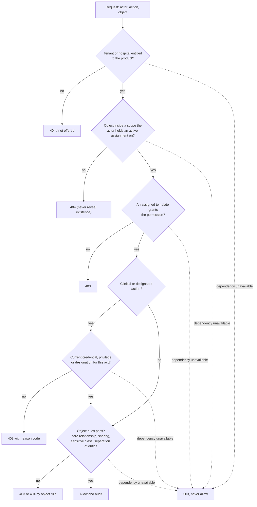
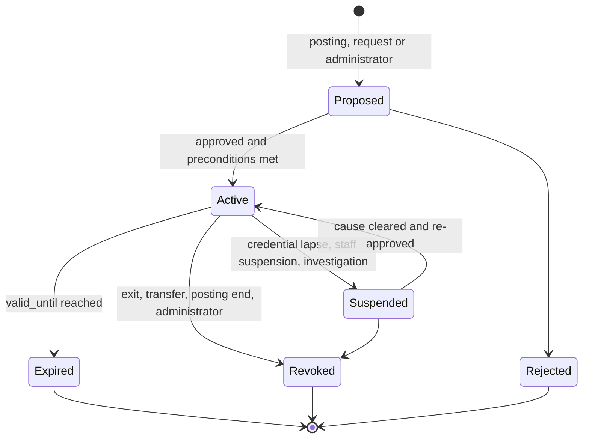
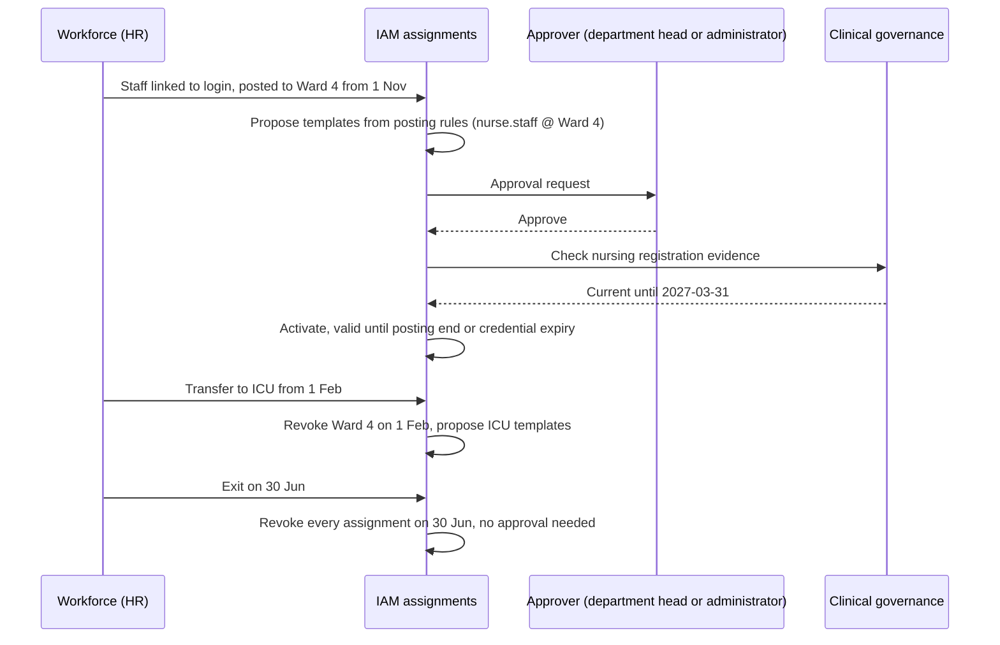

# Access model

[Organization knowledge](README.md) · researched 2026-10-26 · proposed target, not implemented behavior

This is the target for how Helivanta decides whether a person may perform an action on an object. It builds on the accepted [tenancy and identity design](../../architecture/02-tenancy-and-identity.md) and [ADR-0008](../../adr/0008-multi-hospital-tenancy-and-sharing.md), and replaces tenant-wide roles plus separate per-module grant tables with one scoped assignment model. The [current implementation](README.md#current-implementation) is listed in the index.

## The decision

An action is allowed only when every applicable check passes. Any check that cannot be evaluated denies.

Status codes follow the [backend standard](../../standards/backend.md): 404 for anything outside the caller's tenant or scope, 403 for an in-scope member lacking the permission, 503 when the authorization dependency is unavailable.

## Building blocks

| Block               | Owned by            | Contains                                                                         | Changes how                                     |
| ------------------- | ------------------- | -------------------------------------------------------------------------------- | ----------------------------------------------- |
| Entitlement         | Platform commercial | Products and modules a tenant or hospital subscribes to                          | Subscription lifecycle                          |
| Permission          | Code                | `<module>.<resource>.<action>` plus data class, declared by the owning module    | Only with a code change                         |
| Role template       | Platform or tenant  | Named set of permissions, one authority kind, allowed scope types, preconditions | Versioned; platform templates cannot be edited  |
| Assignment          | IAM                 | Subject, template, scope, validity, grantor, approver, reason, source, status    | Proposed, approved, suspended, expired, revoked |
| Credential          | Workforce           | Registration evidence, issuer, number, validity                                  | Verified, expired, suspended                    |
| Privilege           | Clinical governance | Services or procedures a clinician may perform at a hospital, with validity      | Granted and reviewed through a workflow         |
| Designation         | Hospital compliance | Named accountable person for a licence or law, with evidence                     | Appointed, vacated, expired                     |
| Object relationship | Owning product      | Care team, sharing grants, case assignment, supervision link                     | Product commands and events                     |

### Permissions and data classes

Every permission declares one data class so templates can be checked mechanically.

| Data class           | Examples                                                                                                           | May appear in                                             |
| -------------------- | ------------------------------------------------------------------------------------------------------------------ | --------------------------------------------------------- |
| Configuration        | Departments, tariffs, catalogue, workflow definitions                                                              | Administration, management templates                      |
| Operational          | Stock levels, rosters, work orders, bed status without names                                                       | Any template whose job needs it                           |
| Financial            | Invoices, payments, budgets, payables                                                                              | Finance, billing, management templates                    |
| Staff personal       | Staff identity, salary, leave, credentials                                                                         | HR templates; the staff member's own record               |
| Patient identifiable | Demographics, encounters, orders, dispensing, results                                                              | Clinical and specific administration templates            |
| Patient sensitive    | Classes the hospital marks for extra control, for example mental health, HIV, reproductive or medico-legal records | Clinical templates with an explicit sensitive-class grant |
| Aggregate            | De-identified counts and indicators                                                                                | Governance, management, committee templates               |
| Audit                | Access logs, change history                                                                                        | Audit-reader and security templates                       |

`pharmaconnect.read` is replaced by permissions that respect these classes: `pharmacy.stock.read` is operational, `pharmacy.dispensing.read` is patient identifiable. The sensitive classes a hospital uses, and the rules for them, are hospital policy to be confirmed with its clinical and legal reviewers.

### Role templates

Helivanta ships platform templates for the roles in the [role catalogue](authority-and-roles.md#role-catalogue). A tenant may compose its own templates from platform-declared permissions, subject to:

- One authority kind per template, and only the data classes that kind allows (ORG-AU-01 to ORG-AU-03).
- Allowed scope types declared on the template: a dispensing template can be assigned on an outlet, never on a whole tenant.
- Clinical templates name their precondition: credential type, privilege or designation.
- Template changes are versioned. Raising a template's data class or adding a clinical permission requires the same approval as granting it.

Tiers become templates at different scopes:

| Template family            | Scope                                | Grants                                                                                 |
| -------------------------- | ------------------------------------ | -------------------------------------------------------------------------------------- |
| Tenant owner               | Tenant                               | Commercial account, legal entities, appointing tenant administrators, group aggregates |
| Tenant administrator       | Tenant                               | Organization structure, template composition, assignments below itself, settings       |
| Hospital administrator     | Hospital                             | The same within one hospital                                                           |
| Product administrator      | Hospital or product unit             | Product configuration and job-role assignments for that product                        |
| Executive and management   | Tenant or hospital                   | Dashboards, approvals within delegated limits                                          |
| Department head, in-charge | Department or sub-unit               | Supervision of the team and its queues                                                 |
| Job roles                  | Department, sub-unit or product unit | The work of one job                                                                    |
| Committee member           | Committee                            | Committee queues and aggregates                                                        |
| Auditor                    | Tenant or hospital                   | Read-only, with patient-level reads only under a time-bound audit assignment           |

The platform operator is not in this list. Operator access is a separate just-in-time path with tenant authorization (#421, #433, #798).

### Assignments

An assignment records subject, template and version, scope type and identifier, `valid_from`, `valid_until`, grantor, approver, reason, source (posting, request, delegation, break-glass, import), status and status history. `supply_access_grants` already carries most of these fields and is the pattern to generalize.

Every status change commits a new scope epoch before it is acknowledged, as the [tenancy design](../../architecture/02-tenancy-and-identity.md) requires. Sessions, OpenFGA tuples and module projections must reach that epoch before an allow is usable.

## Staff lifecycle drives access

Workforce facts propose and revoke; people approve.

| Event                           | Effect                                                                   |
| ------------------------------- | ------------------------------------------------------------------------ |
| Staff record linked to a login  | No access by itself                                                      |
| Posting starts                  | Proposes the templates the hospital maps to that job and unit            |
| Posting ends or transfer        | Revokes assignments sourced from that posting on the effective date      |
| Suspension or investigation     | Suspends all assignments immediately                                     |
| Exit                            | Revokes all assignments and staff links on the effective date            |
| Credential or privilege expires | Suspends dependent clinical assignments; management assignments continue |
| Designation vacated             | Dependent actions fail closed until a successor is appointed             |
| Login identity disabled         | Sessions end; assignments remain for audit but cannot be used            |

Contractors, visiting consultants, students and agency staff follow the same model with a mandatory `valid_until`.

## Delegation and acting roles

Leave cover is common: a deputy acts for the HOD or Medical Superintendent for a period. A delegation is an assignment with source `delegation` that:

- covers a subset of the delegator's assignments, on the same or narrower scope;
- has a fixed end no later than the delegator's own assignment;
- cannot be re-delegated;
- requires the delegate to meet any credential or designation precondition themselves;
- is visible to both people and recorded on every action taken under it.

## Exceptional and privileged access

- **Break-glass** gives a clinician emergency access to one patient outside their care relationship. It needs a reason, expires quickly, notifies the patient's care team and the privacy reviewer, and enters a retrospective review queue (#432). It never extends to administration or management templates.
- **Privileged templates** (tenant owner, tenant and hospital administrators, auditor) cannot be self-granted, and granting one needs approval from another holder of an equal or higher template. [ADR-0044](../../adr/0044-organization-structure-and-access-defaults.md) settles the single-owner case (ORG-D7): multi-hospital tenants keep two owners, and a single owner's privileged grant notifies every owner and enters review.
- **No escalation through administration.** An administrator may assign only templates on their template's grantable list and only within their own scope. Clinical templates also need the clinical-governance precondition check, which an administrator cannot waive.
- **Platform operators** enter through a separate just-in-time path: tenant authorization, reason, ticket reference, time limit, read-only by default, and an audit trail the tenant can read.

## Separation of duties

The workflow or command owner enforces these; templates alone cannot.

| Activity   | Conflict to block                                                                |
| ---------- | -------------------------------------------------------------------------------- |
| Access     | Requesting and approving one's own assignment                                    |
| Purchasing | Raising and approving the same purchase order; approving and receiving the goods |
| Stock      | Adjusting stock and approving the adjustment                                     |
| Billing    | Granting and approving one's own concession, refund or write-off                 |
| Laboratory | Releasing a result the hospital's policy requires a second person to validate    |
| Workflows  | Authoring and approving the same workflow version                                |

## Reviews and audit

- Department heads attest their team's assignments on a schedule the hospital sets; unattested assignments are flagged and then suspended.
- Grants, approvals, revocations, delegations, break-glass use and sensitive-class reads are audited with actor, scope epoch and reason (#443, #445).
- Reports show who can access what, by person, by department and by template, without exposing patient data.

## Requirements

- **ORG-AC-01:** Only an active assignment confers access. Entitlement, posting, credential, privilege and designation are preconditions, never grants.
- **ORG-AC-02:** Every assignment names a scope of a type the template allows. Missing or unknown scope denies.
- **ORG-AC-03:** Tenant administrator templates exclude patient-identifiable and patient-sensitive permissions. The reconciler stops appending `tenant_admin` to clinical permissions, resolving the conflict with ADR-0008.
- **ORG-AC-04:** Exit, suspension, transfer, posting end and credential expiry take effect without waiting for a person, on the effective date or immediately when urgent.
- **ORG-AC-05:** Granting privileged or clinical templates requires an approver other than the subject and, for clinical templates, a satisfied precondition.
- **ORG-AC-06:** Status changes advance the scope epoch; stale sessions and projections deny until they catch up.
- **ORG-AC-07:** Authorization failures are 404 outside scope, 403 inside scope, 503 when a dependency is unavailable. No path defaults to allow.
- **ORG-AC-08:** The per-module grant tables converge on the shared assignment model through a reviewed migration that preserves history; no module adds a new private grant vocabulary in the meantime.

## Enforcement in the current stack

The model maps onto existing components; the implementation plan decides the order.

| Concern                | Where it is enforced                                                                                                                                                                                                                                      |
| ---------------------- | --------------------------------------------------------------------------------------------------------------------------------------------------------------------------------------------------------------------------------------------------------- |
| Template to permission | OpenFGA `role` and `perm` types today; extended so a template is a tenant-scoped role                                                                                                                                                                     |
| Scope                  | New OpenFGA types for hospital, department and sub-unit with parent relations, following the [custom roles](https://openfga.dev/docs/modeling/custom-roles) and [multiple restrictions](https://openfga.dev/docs/modeling/multiple-restrictions) patterns |
| Row isolation          | PostgreSQL RLS keeps tenant and hospital isolation; scope projections replace per-module grant lookups                                                                                                                                                    |
| Preconditions          | Command handlers check credential, privilege and designation through published projections                                                                                                                                                                |
| Object rules           | The owning module, at the object, as today                                                                                                                                                                                                                |
| Revocation             | Scope epoch and session rotation from the tenancy design                                                                                                                                                                                                  |

## Migration from today

1. Stop the reconciler granting clinical permissions to `tenant_admin`, with a test that fails if any patient-identifiable permission is reachable through it.
2. Introduce the department owner (ORG-D1) and the assignment record, starting from the `supply_access_grants` shape.
3. Map each per-module grant table to templates and scopes, migrate rows with their history, and switch reads module by module.
4. Link workforce staff to login subjects and drive revocation from workforce events.
5. Add posting-based proposals, delegation, attestation and break-glass in their own slices.

Each step is a complete slice with its own tests for out-of-scope 404, missing-permission 403 and dependency-unavailable 503.
