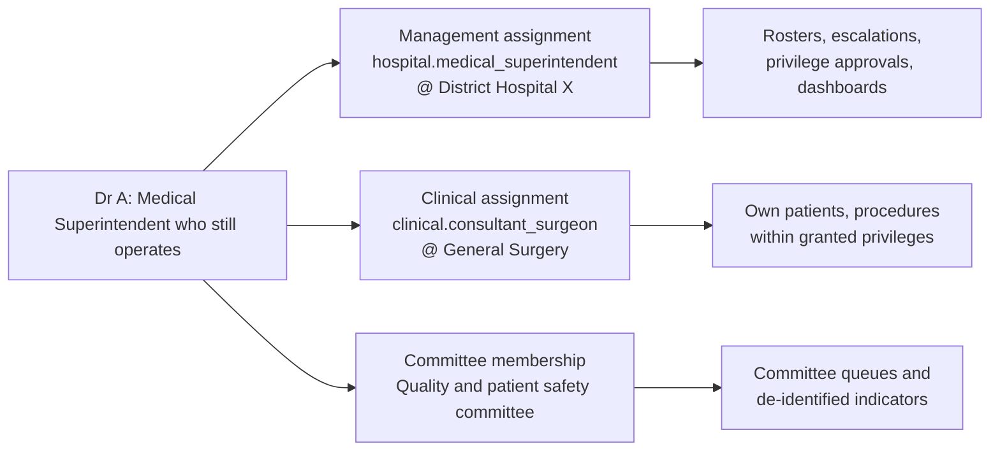

# Authority and roles

[Organization knowledge](README.md) · researched 2026-10-26 · proposed target, not implemented behavior

A hospital title does not tell Helivanta what a person may do. This reference separates the kinds of authority found in public and private hospitals, lists the roles agents will meet (with India, the first launch market, as the worked example), and maps each one to the role templates and scopes in the [access model](access-model.md). Public-sector titles, state variation and sources are in [public and private sectors](../india/public-and-private-sectors.md).

## Kinds of authority

| Kind               | Typical holders                                                                                                              | Decides                                                                 | Sees by default                                                         | Never by default                                        |
| ------------------ | ---------------------------------------------------------------------------------------------------------------------------- | ----------------------------------------------------------------------- | ----------------------------------------------------------------------- | ------------------------------------------------------- |
| Governance         | Promoter, board, trustees; in public facilities the Rogi Kalyan Samiti governing body and state or district health societies | Direction, budgets, sanctioned posts, services offered, policy approval | Aggregate reports across their scope                                    | Identifiable patient records, day-to-day edits          |
| Management         | CEO or MD, COO, CFO, Medical Superintendent, Nursing Superintendent or CNO, Hospital Manager, Dean                           | Running the organization within approved budget and policy; escalations | Operational and financial dashboards, rosters, quality indicators       | Patient charts, clinical sign-off                       |
| Administration     | Front office, admissions, medical records, billing, insurance desk, HR, purchase, stores, IT                                 | Keeping one process running: registration, records, invoices, orders    | The records that process handles, in the units it serves                | Clinical decisions; records of other processes          |
| Clinical           | Doctors, nurses, pharmacists, laboratory and imaging staff, therapists, emergency crew                                       | Decisions and acts about a patient                                      | Patients in their care relationship, within registration and privilege  | Patients outside their care, except through break-glass |
| Supervision        | Head of department, ward in-charge, shift nursing supervisor, chief pharmacist, laboratory section head, store in-charge     | Assigning, approving and reviewing a team's work                        | Their team's queues, rosters and indicators in named departments        | Anything outside those departments                      |
| Platform operation | Tesserix support, SRE and security staff                                                                                     | Running the service                                                     | Nothing inside a tenant without a tenant-authorized, time-bound session | Standing access to any tenant                           |

A **designation** sits across these kinds: a named, qualified person accountable under a licence, registration or law, such as the registered pharmacist for a drug sale licence. A designation is a fact with evidence and validity, not a permission bundle. It can be a precondition for a permission, and its vacancy blocks the dependent action.

Each line is a separate assignment with its own scope, validity, approver and audit trail. Ending the management post leaves the clinical assignment untouched, and suspending a clinical privilege leaves the management post untouched.

## Requirements

- **ORG-AU-01:** A role template carries exactly one authority kind. A person with several kinds of authority holds several assignments.
- **ORG-AU-02:** Governance and management templates contain no identifiable-patient permission. Drill-down from an indicator to a named patient requires a clinical, audit or break-glass assignment.
- **ORG-AU-03:** Administration templates carry only the patient data their process needs: demographics for registration, billed services for billing, release requests for medical records. They never include clinical notes or results beyond that need.
- **ORG-AU-04:** Clinical templates require a current professional credential and a hospital privilege covering the act ([IN-CL-10](../india/clinical-operations.md), [IN-FQ-06](../india/facility-and-quality.md)). HR job category, posting or administrator choice is not evidence.
- **ORG-AU-05:** Supervision is scoped to named departments or sub-units. Oversight of a whole hospital is a management template at hospital scope, not a wider supervision assignment.
- **ORG-AU-06:** Clinical supervision of trainees is recorded per supervisor, trainee and period. Acts the institution requires to be countersigned stay pending until a supervising clinician with the relevant privilege countersigns. The list of such acts comes from the institution's policy and the applicable regulator, never from model memory.
- **ORG-AU-07:** Nobody approves their own request, grants their own access, or acts as the second person on their own work.
- **ORG-AU-08:** A designation is held by a named person with evidence and validity dates. When it is vacant or expired, dependent actions fail closed; they never fall back to an administrator.
- **ORG-AU-09:** Platform operator access is never a tenant role and never standing. It needs tenant authorization, a reason, a time limit and audit (#421, #433, #798).

## Managerial and clinical supervision

| Question          | Managerial supervision                                         | Clinical supervision                                                     |
| ----------------- | -------------------------------------------------------------- | ------------------------------------------------------------------------ |
| Example           | Nursing in-charge of Ward 4; HOD Pathology over the lab        | Consultant over a junior resident; staff nurse over a nursing student    |
| Relationship to   | A department or sub-unit                                       | A named trainee for a period                                             |
| Authority over    | Rosters, assignments, leave, indents, work queues, performance | The trainee's clinical acts and their countersignature                   |
| Patient data      | Through the supervisor's own clinical assignment, if any       | The supervised patients, through the supervisor's care relationship      |
| Ends when         | Posting or assignment ends                                     | Rotation or supervision period ends, or either party's credential lapses |
| Helivanta records | Assignment of a supervision template at department scope       | Supervision link between two people plus their clinical assignments      |

One person often holds both: a professor who heads Medicine supervises the department and clinically supervises residents. These remain two records.

## Role catalogue

The deployed `staff_member` role establishes tenant membership only. It grants no business permission, hospital access or clinical authority, and is separate from a workforce job category or login link.

The tables list the roles agents should expect and how each maps to Helivanta. Template keys are illustrative names for the proposed catalogue, not implemented roles; the 28 roles that exist today are listed in [`authz.go`](../../../backend/pkg/authz/authz.go). "Scope" is the narrowest unit the assignment normally names. Public and private titles for the same job are compared in [public and private sectors](../india/public-and-private-sectors.md#equivalent-titles).

### Governance and management

| Role and common titles                                             | Kind       | Scope                    | Typical authority                                                                                      | Not by default                                     |
| ------------------------------------------------------------------ | ---------- | ------------------------ | ------------------------------------------------------------------------------------------------------ | -------------------------------------------------- |
| Owner, promoter, chairperson (private)                             | Governance | Tenant                   | Subscriptions, legal entities, appoints tenant administrators, group reports                           | Patient data, clinical or operational edits        |
| Board member, trustee, RKS governing-body member                   | Governance | Tenant or hospital       | Read governance reports and committee papers; approve policies through a workflow                      | Operational edits                                  |
| Group CEO or managing director                                     | Management | Tenant                   | Group dashboards, approvals above hospital limits, appointment of hospital heads                       | Patient data                                       |
| Hospital CEO, unit head, facility director                         | Management | Hospital                 | Hospital operations, budgets within delegation, escalations                                            | Patient data                                       |
| Medical Superintendent, Medical Director                           | Management | Hospital                 | Medical administration: doctor rosters, privilege approval workflow, incident and complaint escalation | Patient data unless separately assigned clinically |
| Deputy or Additional MS, Resident Medical Officer (RMO)            | Management | Hospital or departments  | Delegated medical administration, duty arrangements, medico-legal coordination                         | Patient data unless separately assigned clinically |
| Nursing Superintendent, Chief Nursing Officer, Director of Nursing | Management | Hospital nursing service | Nurse staffing, rosters, nursing quality indicators, nursing policies                                  | Patient data unless separately assigned clinically |
| COO, Hospital Administrator, Hospital Manager                      | Management | Hospital                 | Non-clinical operations: facilities, support services, vendors, utilities                              | Patient data                                       |
| CFO, finance controller, accounts officer                          | Management | Tenant or hospital       | Budgets, payment approval within limits, tariff approval, financial reports                            | Clinical records; posting their own approvals      |
| Dean or Principal (medical college)                                | Management | Institution              | Academic and hospital administration of a teaching institution                                         | Patient data unless separately assigned clinically |

### Administration

| Role and common titles                         | Scope               | Typical authority                                                       | Not by default                                  |
| ---------------------------------------------- | ------------------- | ----------------------------------------------------------------------- | ----------------------------------------------- |
| Front office, registration clerk, receptionist | Hospital or counter | Registration, appointments, visit check-in, identity capture            | Clinical notes, results, prescriptions          |
| Admission and bed desk                         | Hospital            | Admission paperwork, bed requests and allocation, transfers             | Clinical notes beyond the admission need        |
| Medical records officer (MRD)                  | Hospital            | Record custody, release requests under authorization, retention, coding | Editing clinical content                        |
| Billing executive, cashier                     | Billing counters    | Charges, receipts, refunds within limits, day close                     | Approving their own concession or write-off     |
| Insurance, TPA and scheme desk                 | Hospital            | Pre-authorization, claims, query responses, scheme beneficiary checks   | Clinical edits; financial approval above limits |
| Patient relations, grievance desk              | Hospital            | Complaints, feedback, escalations, closure evidence                     | Clinical records beyond the complaint's need    |
| HR executive, payroll officer                  | Hospital or tenant  | Staff records, postings, leave, payroll configuration                   | Clinical privileges; access grants              |
| Purchase officer                               | Hospital or tenant  | Requisitions to orders, vendor quotes, purchase orders within limits    | Approving their own orders; goods receipt       |
| Store keeper, store in-charge                  | Store premise       | Receipts, issues, transfers, stock counts                               | Purchase approval; dispensing to patients       |
| IT administrator                               | Tenant or hospital  | Devices, integrations, user provisioning requested by an approver       | Granting clinical access on their own authority |
| Quality manager, NABH or NQAS coordinator      | Hospital            | Indicators, audits, incident review, accreditation evidence             | Patient-level data without an audit assignment  |

### Clinical

| Role and common titles                      | Scope                        | Typical authority                                                     | Preconditions                                                        |
| ------------------------------------------- | ---------------------------- | --------------------------------------------------------------------- | -------------------------------------------------------------------- |
| Consultant, specialist, medical officer     | Department or sub-unit       | Assessment, orders, prescriptions, procedures, discharge decisions    | Council registration, hospital privilege for each service            |
| Senior resident, junior resident            | Department                   | Clinical acts within privilege; some acts need countersignature       | Registration, supervision link, privilege                            |
| Intern                                      | Rotation department          | Supervised clinical acts only                                         | Supervision link; institution's internship policy                    |
| Casualty or emergency medical officer       | Emergency department         | Triage decisions, emergency orders, medico-legal documentation        | Registration, privilege                                              |
| Anaesthetist, surgeon                       | Theatre suite and department | Procedures named in their privilege list                              | Registration, procedure-level privilege                              |
| Staff nurse, nursing officer                | Ward or unit                 | Observations, medication administration, care plans, handover         | Nursing registration, unit assignment                                |
| Nursing student                             | Ward on rotation             | Supervised documentation and care                                     | Supervision link                                                     |
| Pharmacist                                  | Outlet or satellite pharmacy | Dispensing against valid orders, counselling, controlled-drug records | Pharmacy registration; outlet designation where the licence requires |
| Laboratory technician                       | Laboratory section           | Specimen receipt, processing, result entry                            | Qualification evidence, section assignment                           |
| Pathologist, microbiologist, biochemist     | Laboratory section           | Result validation and release (signatory)                             | Registration, signatory authorization for the section                |
| Radiographer, radiologist                   | Imaging unit                 | Image acquisition; report and release (radiologist)                   | Qualification, modality authorization                                |
| Physiotherapist, dietitian, counsellor      | Department                   | Their own assessments and plans                                       | Qualification, department assignment                                 |
| Emergency dispatcher, crew, receiving staff | Emergency base or facility   | Dispatch, en-route care records, handover receipt                     | Existing EmergencyConnect roles and base access                      |

### Supervision

| Role and common titles                                      | Scope                          | Typical authority                                                               |
| ----------------------------------------------------------- | ------------------------------ | ------------------------------------------------------------------------------- |
| Head of department (HOD), professor and head                | Department                     | Rosters, leave, indents, case allocation, departmental indicators and approvals |
| Ward in-charge, sister in-charge, nursing officer in-charge | Ward or unit                   | Nurse assignment, ward indents, handover oversight, equipment requests          |
| Shift nursing supervisor, Deputy or Assistant NS            | Group of wards for a shift     | Cross-ward staffing moves, escalations                                          |
| Chief pharmacist, pharmacy in-charge                        | Pharmacy department or outlets | Pharmacy rosters, indent approval, stock review, controlled-drug oversight      |
| Laboratory section head, quality manager (lab)              | Laboratory section             | Work allocation, QC review, release policy                                      |
| Store in-charge, warehouse supervisor                       | Store or premise               | Issue approval, count review, transfer approval                                 |
| Engineering, biomedical, housekeeping supervisor            | Support department             | Work-order assignment and closure review                                        |

### Support and operations

Biomedical engineers, maintenance technicians, housekeeping, laundry, dietary, CSSD, security, transport and porter staff work in support departments. Their templates cover work orders, tasks, checklists and handovers in their department. They hold no patient-identifiable data except the minimum a task needs, such as a bed number for cleaning or a patient's diet order for the kitchen.

### Committees

Hospital committees cut across departments: infection control (HICC), pharmacy and therapeutics, medical records, quality and patient safety, credentialing and privileging, ethics, and biomedical waste. Model a committee as a group with time-bound membership, not as a department. Members get the committee's queues, minutes and de-identified indicators. Case-level review of a named patient needs an explicit case assignment with reason and expiry.

### Statutory and accountable designations

Several licences and laws require a named, qualified person: a registered pharmacist for a drug sale licence, the authorization holder (occupier) for biomedical waste, the registration holder for a diagnostic facility under the PC-PNDT Act, and a data-protection contact under the DPDP Act. The exact roles, qualifications and duties depend on the licence, facility, state and current text. Record them as designations with evidence and verify each against the [source register](../india/sources.md) before an action depends on one. This list is a prompt for review, not a legal determination.

### Platform

| Role                      | Scope                                        | Rule                                                                                         |
| ------------------------- | -------------------------------------------- | -------------------------------------------------------------------------------------------- |
| Tesserix support engineer | One tenant, one ticket, time-bound           | Read-only by default; tenant authorization and reason; session audited and visible to tenant |
| Tesserix SRE and security | Infrastructure; tenant data only by incident | Production data access through the same just-in-time path, never a shared credential         |
| Implementation consultant | One tenant during onboarding                 | Configuration templates only; access ends at go-live or a fixed date                         |

## Mapping the requested tiers

The tiers first proposed for Helivanta (Super Admin, Owner, Admin, Read-only, Operations and permissions such as `pharmaconnect.read`) map as follows.

| Proposed tier        | Helivanta equivalent                                                              | Why it changes                                                                                                  |
| -------------------- | --------------------------------------------------------------------------------- | --------------------------------------------------------------------------------------------------------------- |
| Super Admin          | Platform operator, outside every tenant                                           | A tenant role with cross-tenant reach breaks isolation; tenants authorize each operator session                 |
| Owner                | Governance template at tenant scope                                               | Owns the account, billing and appointment of administrators; no patient data, so a compromised owner leaks none |
| Admin                | Tenant, hospital or product administrator templates                               | Manages users and settings inside its scope; never clinical, never self-granting                                |
| Read-only            | Scoped viewer templates and an audit-reader template                              | Read-only is still scoped; patient-level reads need an audit assignment with reason and period                  |
| Operations           | Job-role templates such as dispensing pharmacist, store keeper, billing executive | Operations covers dozens of jobs with different data needs                                                      |
| `pharmaconnect.read` | Separate permissions such as `pharmacy.stock.read` and `pharmacy.dispensing.read` | Stock is operational data; dispensing records identify patients and their medicines                             |
