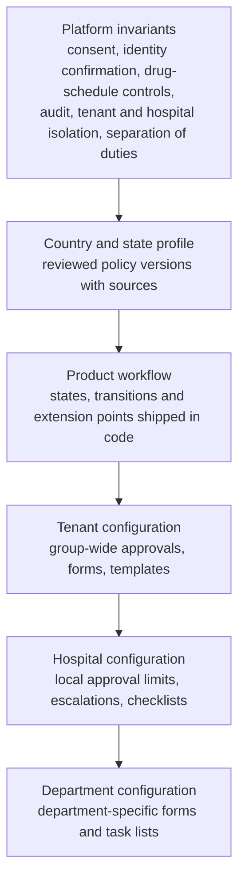
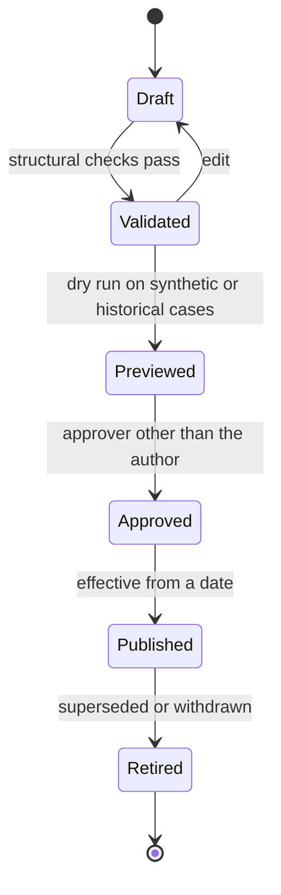

# Configurable workflows

[Organization knowledge](README.md) · researched 2026-10-26 · proposed target, not implemented behavior

Hospitals want to run their own processes on Helivanta: their approval chains, forms, checklists, escalations, maintenance routines and patient-relations processes. A hospital should be able to build these on top of the product workflows without a code change, and without being able to switch off the controls that keep patients, money and data safe. This reference defines what a tenant may configure, who may publish it, and how it runs. It depends on the [access model](access-model.md): every configured step names its authority as a role template at a scope.

## Layers

A lower layer can add to a higher one: more steps, stricter limits, extra fields, extra notifications. It can never remove or weaken a higher layer. When two configurations conflict, the stricter one applies, and the validator rejects a definition that would make a mandatory step unreachable.

## What hospitals can build

| Area                     | Examples                                                                                                       | Owning product or issue                 |
| ------------------------ | -------------------------------------------------------------------------------------------------------------- | --------------------------------------- |
| Approval chains          | Indent and purchase approval by amount, concession and refund approval, leave and overtime, access requests    | SupplyConnect, billing, workforce, #434 |
| Forms and custom fields  | Department intake forms, additional registration fields, checklists on discharge or handover                   | #706, #562, #563                        |
| Escalations and SLAs     | Unacknowledged critical result, delayed discharge, overdue work order, unanswered complaint                    | #404, #405, #648                        |
| Task lists and alerts    | Ward task lists, pending clearances, expiring credentials and licences                                         | #565                                    |
| Maintenance              | Preventive-maintenance schedules and checklist templates per asset class, breakdown work orders, vendor visits | FacilityConnect, #643, #648             |
| Tickets and service desk | Internal requests to IT, housekeeping, biomedical engineering                                                  | #402                                    |
| Patient relations        | Complaints and grievances, feedback follow-up, corporate and referral tie-up tracking                          | Platform; external CRM boundary in #808 |
| Reports                  | Saved and scheduled reports built from published projections                                                   | #592                                    |
| Regulatory rules         | Country and state rules expressed as reviewed configuration                                                    | #455                                    |

### CRM is a boundary, not a module to copy

[#808](https://github.com/tesserix/helivanta/issues/808) sets the system-of-record contract: an external CRM may own leads and marketing, while Helivanta owns everything from patient discovery onward. A hospital's "CRM" processes on Helivanta are therefore configured workflows over Helivanta's own records (complaints, referrals, follow-ups), and integrations exchange published projections with an external CRM. EmergencyConnect's operational CRM (#1224) follows the same boundary.

## Extension points

Product workflows declare where configuration may attach. Configuration attaches only there.

| Extension point     | What a tenant may add                                                                                    |
| ------------------- | -------------------------------------------------------------------------------------------------------- |
| Before a transition | Approval steps, required fields, checklists, conditions on amount, department, category or patient class |
| After a transition  | Tasks, notifications, follow-up timers, handoffs to another department through that product's commands   |
| On a timer          | Escalations to a role at a scope, reminders, automatic expiry of a pending step                          |
| On a record         | Custom fields with type, validation and data class; display layouts per department                       |

A configured step can call only commands the owning product exposes, with the acting person's own authority. It cannot read or write another product's tables, run arbitrary code, or call arbitrary URLs; integrations go through platform connectors. Custom fields declare a data class, so a field that holds patient information is protected like the rest of the patient record.

## Who acts at each step

Steps name a role template and a scope, not a person:

- "Department head of the requesting department", "Chief pharmacist of the outlet", "Medical Superintendent of the hospital", "Finance controller of the tenant".
- At run time the engine resolves the holders of active assignments for that template and scope, including active delegations.
- If nobody holds it, the step escalates to the configured fallback (normally the next scope up) and records why. It never falls back to "any administrator".
- The requester and anyone who already approved an earlier step cannot approve a step that requires a different person.
- Each approval records the person, the assignment and scope epoch they acted under, and the definition version.

## Lifecycle of a definition

- Every definition is versioned. Running instances finish on the version they started on unless a migration is explicitly approved.
- Validation checks: steps reachable, every step's template and scope resolvable, no removal of a platform or profile step, no permission the author lacks, data classes declared on fields.
- Preview shows who would be asked to act on sample cases, without notifying anyone.
- Publishing a definition that touches clinical, medication, diagnostic or financial-approval processes needs a second approver from the relevant governance template (decision ORG-D5 in the [index](README.md#open-decisions)).
- Rollback is publishing the previous version as new; history is never edited.

## Public and private approval chains

Public facilities often follow a schedule of delegated financial powers, sanction and budget-head checks, and approval by a Rogi Kalyan Samiti executive body or a district health society. Private groups use approval matrices by amount, department and entity. Both are configured approval chains over the same model. The thresholds, bodies and budget heads are the customer's data, entered with their source document and effective date, and are never seeded by Helivanta. See [public and private sectors](../india/public-and-private-sectors.md#money-and-approvals).

## Execution

Durable, long-running execution is the subject of [#6](https://github.com/tesserix/helivanta/issues/6). This reference does not choose the engine. Whatever runs the definitions must provide: durable state across restarts, idempotent steps, exactly-once effect on the owning product's command, timers that survive restarts, and an audit trail per instance. An unavailable engine pauses steps; it never auto-approves them.

## Requirements

- **ORG-WF-01:** Configuration attaches only to declared extension points and can add to, never remove or weaken, platform invariants, profile rules or product steps.
- **ORG-WF-02:** Every human step names a role template and scope, resolves holders from active assignments at run time, and fails closed when nobody holds it.
- **ORG-WF-03:** Definitions are versioned, validated, previewed and approved by someone other than the author before publishing; instances keep their starting version.
- **ORG-WF-04:** Configured steps act through owning-product commands with the actor's authority. No direct data access, arbitrary code or arbitrary outbound calls.
- **ORG-WF-05:** Custom fields declare type, validation and data class, and are authorized and audited like native fields.
- **ORG-WF-06:** Separation of duties applies across steps: requester and earlier approvers cannot act where a different person is required.
- **ORG-WF-07:** Financial limits, approval bodies and policy values are customer-entered with source and effective date, never defaulted by the platform.

## Prior art

ERPNext attaches an allowed role and optional condition to each workflow transition and restricts users to departments or branches through [user permissions](https://docs.frappe.io/erpnext/user/manual/en/role-based-permissions). Its core workflow allows one role per transition, and community extensions such as [Frappe Workflow Extension](https://github.com/navariltd/Frappe-Workflow-Extension) add more. Helivanta's steps resolve a template at a scope instead, so "head of the requesting department" works for every department without one role per department.
