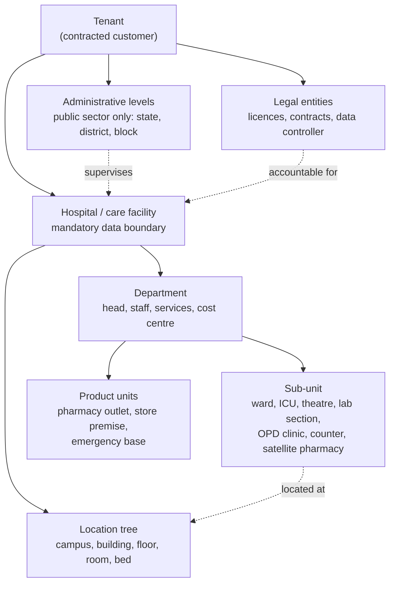
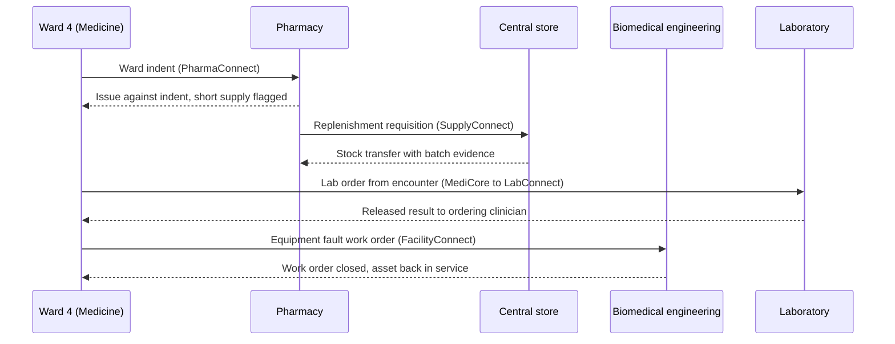

# Structure and departments

[Organization knowledge](README.md) · researched 2026-10-26 · proposed target, not implemented behavior

Departments are where people work, where costs land, where supervision happens and where most access decisions are scoped. Today Helivanta has no department entity, and each product scopes access through its own unit. This reference defines the target structure, what each product holds against a department, and how products exchange work across departments.

## The hierarchy

- **Tenant** is the customer: a private group, a single hospital, a pharmacy chain or a public-health authority. The tenant boundary is absolute.
- **Administrative levels** exist only where a public authority supervises facilities. They group hospitals for reporting, approvals and staff transfers. They hold no patient records and never widen patient access; see [public and private sectors](../india/public-and-private-sectors.md#hierarchy).
- **Legal entity** is mapped to hospitals explicitly. Two hospitals with one owner still have separate licences and may have separate data controllers.
- **Hospital** is the patient-data boundary from [ADR-0008](../../adr/0008-multi-hospital-tenancy-and-sharing.md). A district hospital, CHC, PHC or health and wellness centre is a hospital in this sense.
- **Department** and **sub-unit** form one tree per hospital. A sub-unit belongs to exactly one department at a time.
- **Location** is a separate tree for physical places. A ward is both a sub-unit (who runs it) and a set of locations (where its beds are). FacilityConnect owns the location tree and the assets in it.
- **Product units** are the scopes products already use. Each is linked to the department that runs it, so a department head's scope can reach the outlet or store their department operates.

## Department types

| Type                     | Examples                                                                                                         | Typical sub-units                                          |
| ------------------------ | ---------------------------------------------------------------------------------------------------------------- | ---------------------------------------------------------- |
| Clinical specialty       | General Medicine, General Surgery, Paediatrics, Obstetrics and Gynaecology, Orthopaedics, Cardiology             | OPD clinics, wards, units                                  |
| Emergency                | Emergency or casualty                                                                                            | Triage, resuscitation, observation                         |
| Critical care            | ICU, NICU, PICU, CCU, HDU                                                                                        | Units and bed groups                                       |
| Nursing service          | Nursing department                                                                                               | Ward nursing teams, float pools                            |
| Perioperative            | Operation theatre complex, anaesthesia                                                                           | Theatre suites, pre-op, recovery                           |
| Diagnostics              | Laboratory (pathology, biochemistry, haematology, microbiology, histopathology), radiology and imaging           | Lab sections, collection centres, modalities               |
| Pharmacy                 | Hospital pharmacy                                                                                                | Main store, IPD and OPD dispensaries, satellite pharmacies |
| Blood and sterile supply | Blood centre, CSSD                                                                                               | Collection, processing, issue                              |
| Support and engineering  | Biomedical engineering, civil and electrical maintenance, housekeeping, laundry, dietary, security, transport    | Workshops, crews, shifts                                   |
| Administration           | Front office, medical records, billing, insurance, finance, HR, purchase, stores, IT, quality, patient relations | Counters, desks, stores                                    |
| Academic (teaching)      | Academic departments of a medical or nursing college                                                             | Units, teaching batches                                    |
| Public-health programmes | Programme cells and units run under state or national programmes                                                 | Varies by state and programme                              |

Department names, codes and sub-units are tenant data. Helivanta ships a catalogue of common types so reports compare like with like, and each tenant renames, adds or retires its own departments.

## What each product holds against a department

| Owner                  | Holds                                                                                             | Department reference used for                                      |
| ---------------------- | ------------------------------------------------------------------------------------------------- | ------------------------------------------------------------------ |
| Organization structure | Departments, sub-units, heads, cost centres, effective dates                                      | The single list every product reads                                |
| Workforce (Staff)      | Staff records, postings to departments and sub-units, rosters, leave, credentials, payroll inputs | Who works where and when; proposals for access                     |
| IAM                    | Login identities, staff links, role assignments and their scopes                                  | Assignment scope                                                   |
| MediCore               | Encounters, admissions, orders, notes, discharge                                                  | Treating department and unit; care-team reach                      |
| PharmaConnect          | Outlets, stock, batches, dispensing, indents from wards                                           | Which department runs an outlet; which ward raised an indent       |
| LabConnect             | Orders, specimens, results, sections                                                              | Ordering department; performing section                            |
| SupplyConnect          | Stores, requisitions, purchase orders, receipts, issues                                           | Requesting department; cost centre charged                         |
| FacilityConnect        | Locations, assets, work orders, preventive maintenance                                            | Owning department of an asset; department that raised a work order |
| EmergencyConnect       | Bases, fleet, dispatch, receiving                                                                 | Receiving department at the destination hospital                   |
| Billing and finance    | Tariffs, charges, invoices, budgets                                                               | Revenue and cost centre per department                             |

Products store the department identifier and the effective version they used. They do not copy the department list, and they never decide who heads a department.

## How work crosses departments

Departments exchange work through product records and events, never through shared tables. The common exchanges:

Each request names the requesting and fulfilling departments. Approval inside a department uses that department's supervision assignments, and the fulfilling department applies its own rules. A hospital can add approval steps through [configurable workflows](configurable-workflows.md) without changing who owns the record.

## Matrix reporting

People often report to two lines. An ICU nurse is managed by nursing administration for rosters and appraisal, and works under the ICU consultant for clinical care. A pharmacist posted to an IPD dispensary reports to the chief pharmacist while serving the wards. Public-sector programme staff commonly report to a facility head and to a district programme manager. Model this as two assignments on two scopes, never as a single combined role. Each line approves only the decisions its kind of authority covers.

## Requirements

- **ORG-ST-01:** Every hospital has one department tree with effective-dated changes. A department or sub-unit is retired, never deleted, while any record refers to it.
- **ORG-ST-02:** Every assignment scope, posting and cross-department request references a department or sub-unit identifier from the single owner. Product-specific lists of departments are not created.
- **ORG-ST-03:** Scope flows downward only: an assignment on a department covers its sub-units and the product units it runs, never a sibling department, the parent hospital or another hospital.
- **ORG-ST-04:** Administrative levels supervise hospitals for aggregates, approvals and staff movement; they never confer patient access to the hospitals below them.
- **ORG-ST-05:** Restructuring (merging, splitting or moving a department) is effective-dated. Historical records keep the department version they were created under, and assignments on a retired unit are re-proposed, not silently moved.
- **ORG-ST-06:** Committees are groups with membership and terms, not departments.
- **ORG-ST-07:** Location and department are separate trees. Asset and bed records use locations; responsibility and access use departments.

## The ownership decision

Issues #22, #287 and #616 each describe a department or facility hierarchy, and #429 (department-level access) depends on one. [Product ownership](../../api/portfolio.md) gives FacilityConnect the facility hierarchy. Without a single owner, products will diverge and access scopes will not line up. [ADR-0044](../../adr/0044-organization-structure-and-access-defaults.md) settles ORG-D1: a platform organization-structure owner holds departments and sub-units, FacilityConnect owns physical locations and workforce owns postings. Products reference its IDs once it exists and add no department lists of their own before then.
