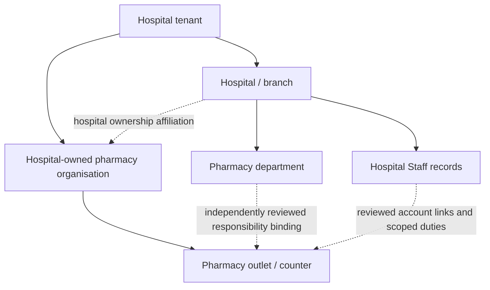

# Set up a hospital-owned pharmacy

The hospital owner works inside the existing hospital tenant. Registering its
pharmacy does not create another tenant or another owner login. An independent
pharmacy customer uses its own tenant and collaborates through reviewed sharing
and trading relationships instead.

The pharmacy owns its organisation, outlets, catalogue and stock. Workforce owns
Staff and employment facts; IAM owns membership and access assignments;
Organization owns departments. An ownership label or affiliation never replaces
an outlet grant, reviewed duty or current licence.

## Owner workflow

1. Sign in to the hospital tenant and open **Pharmacy → Outlets & access**.
2. Under **Register pharmacy**, enter a code and name and select
   **Hospital-owned pharmacy**. Registration opens the new pharmacy, including
   when another pharmacy was previously selected.
3. Use **Register outlet** for each physical counter or branch. Choose its country
   and time zone. The outlet starts in regulatory review; registration does not
   copy another outlet's access grants or approve trading.
4. Under **Owning hospital and affiliations**, select the owning hospital by name
   and declare the **Hospital owner** relationship. Load additional hospital pages
   when needed. An unavailable/refused directory cannot submit a stale choice.
   The declaration remains pending until the hospital's authorized review.
5. In **Staff**, prepare the hospital's pharmacy department and Staff records.
   Use **Staff access** to create or recover a staff login, send its private setup
   invitation, check recipient setup and enroll the account. The recipient verifies
   their email and sets their own password. A Staff record alone is not a login.
6. Propose and independently review Staff account links and the hospital-scoped
   assignments each person needs. Use **Pharmacy relationships** for the outlet's
   reviewed department responsibility binding. Reviewers must be independently
   authorized people; changing to a backend API does not remove that requirement.
7. Assign exact outlet access to the intended people, then complete applicable
   licence/evidence and operating-duty reviews. The owner does not automatically
   become a pharmacist, dispenser, receiver or financial approver.

For a hospital-owned pharmacy, Staff belong to the owning hospital. Do not
register a second standalone pharmacy employer for the same hospital team.
Serving or partner affiliations with other hospitals remain separate declarations.

## Backend automation

All browser/business API commands enter the Global API under `/api/v1`; callers
retain the same authenticated tenant, permission and narrower-scope checks.

- IAM account commands create/recover accounts, deliver private invitations and
  observe current recipient setup. They do not administratively verify an inbox
  or set the recipient's password. See the [Staff identity contract](../api/staff-account-initiation.md).
- Workforce account-link and IAM assignment commands retain independent review,
  source versions, reasons and audit receipts. See [organization access](../domain/organization/access-model.md).
- Pharmacy registration uses immutable UUIDv7 resource identities. Hospital
  ownership declarations carry the expected tenant precondition. Review and
  operating authority remain separate. See the [PharmaConnect contract](../api/domains/pharmacy.md).

For India, country/time-zone selection is metadata. Maharashtra or Odisha premise,
licence and professional scope must be established by the applicable reviewed
evidence; registration is not statutory approval. See [India pharmacy controls](../domain/india/pharmacy-and-supply.md).

The relevant acceptance requirements are ORG-ST-01/02/07, ORG-AC-01/02/03/04/08
and IN-PH-06/10. No statutory policy, professional credential or financial limit
is activated by this setup flow.
