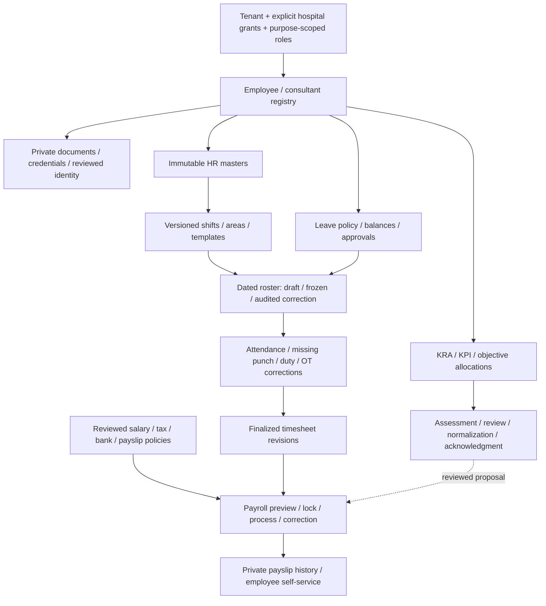

# Full workforce / HR coverage

Root tracker: [#979](https://github.com/tesserix/helivanta/issues/979). Owner: Samyak Rout (`Sam123ben`). The existing eight exploration stories cover the legacy HR module. Five focused implementation children refine the remaining staff-registry acceptance. GitHub limits #979 to 100 direct children; the registry stories are genuine sub-issues of #1035 and the shift-definition story is under #1036; both parents are children of #979. None is closed merely because its menu/schema exists.

## Verified scope and delivery state

Research dates: 2026-10-12–14. Evidence is read-only visible fields, tabs and filters; it does not establish payroll law, reviewed business policy, save behavior, or actual personnel outcomes. Only synthetic fixtures are permitted in development/verification. An authorized session was restored on 2026-10-14 and roster areas/groups/templates, roster settings, allocation modes and leave-master fields were reviewed. Nested holiday/leave structures and rendered payslip content remain to review. No payroll, leave, performance, offboarding, exports or source configuration updates were executed.

| Legacy area                         | Fields and workflow observed                                                                                                                                                                    | Owning story / existing dependency                                                      | Delivery state                                                                                                                                                                                                                                                                                                                                                                                                                                                                                                                                                                                                                                                                                                                                                                                                                                                                                                                                                                                                                                                                                                                                                                                                                                                                                                                                                                                                                                                                                                                                                                                                                                                                                                                                                                                                                                                                                                                                                                                                                                                                                                                                                               |
| ----------------------------------- | ----------------------------------------------------------------------------------------------------------------------------------------------------------------------------------------------- | --------------------------------------------------------------------------------------- | ---------------------------------------------------------------------------------------------------------------------------------------------------------------------------------------------------------------------------------------------------------------------------------------------------------------------------------------------------------------------------------------------------------------------------------------------------------------------------------------------------------------------------------------------------------------------------------------------------------------------------------------------------------------------------------------------------------------------------------------------------------------------------------------------------------------------------------------------------------------------------------------------------------------------------------------------------------------------------------------------------------------------------------------------------------------------------------------------------------------------------------------------------------------------------------------------------------------------------------------------------------------------------------------------------------------------------------------------------------------------------------------------------------------------------------------------------------------------------------------------------------------------------------------------------------------------------------------------------------------------------------------------------------------------------------------------------------------------------------------------------------------------------------------------------------------------------------------------------------------------------------------------------------------------------------------------------------------------------------------------------------------------------------------------------------------------------------------------------------------------------------------------------------------------------- |
| Employee / consultant registration  | Identity/contact, personal/work email, address, emergency contacts, blood group, employment, qualifications, credentials and dependents; employee/consultant lists                              | [#1035](https://github.com/tesserix/helivanta/issues/1035), existing #118 / #589        | Core enrollment delivered; remaining children below                                                                                                                                                                                                                                                                                                                                                                                                                                                                                                                                                                                                                                                                                                                                                                                                                                                                                                                                                                                                                                                                                                                                                                                                                                                                                                                                                                                                                                                                                                                                                                                                                                                                                                                                                                                                                                                                                                                                                                                                                                                                                                                          |
| HR configurable master              | Name, group type, default flag; department, designation, grade, qualification, document category, exit reason, relationship, language and contract type                                         | #1035; ADR-0016                                                                         | Versioned master setup deployed; enrollment pins department/designation/grade revisions. No silent free-text conversion                                                                                                                                                                                                                                                                                                                                                                                                                                                                                                                                                                                                                                                                                                                                                                                                                                                                                                                                                                                                                                                                                                                                                                                                                                                                                                                                                                                                                                                                                                                                                                                                                                                                                                                                                                                                                                                                                                                                                                                                                                                      |
| Duty roster setup                   | Code/type/start/end/duration/grace/break/full-half OT/locum; shift master, areas, weekly templates, groups, automatic population / effective weekday                                            | [#1036](https://github.com/tesserix/helivanta/issues/1036), existing #118 / #589 / #438 | Shift definitions deployed in [#1109](https://github.com/tesserix/helivanta/issues/1109); areas/groups/weekly templates delivered in [#1111](https://github.com/tesserix/helivanta/issues/1111); roster settings (timezone, week start, auto population) and staff weekly-template assignments implemented under #1036 ([ADR-0019](adr/0019-roster-settings-and-staff-assignments.md)); dated rosters under #1036 ([ADR-0020](adr/0020-dated-rosters.md))                                                                                                                                                                                                                                                                                                                                                                                                                                                                                                                                                                                                                                                                                                                                                                                                                                                                                                                                                                                                                                                                                                                                                                                                                                                                                                                                                                                                                                                                                                                                                                                                                                                                                                                    |
| Shift allocation                    | Roster-wise, additional, weekly, employee-wise; roster area, draft/freeze/unfreeze                                                                                                              | #1036                                                                                   | Dated, DST-safe rosters with roster-wise/employee-wise/additional modes, population, per-person overlap exclusion and audited freeze/unfreeze/discard under #1036 ([ADR-0020](adr/0020-dated-rosters.md)); population skips approved full-day leave (#1037); freezing requires acknowledging every reviewed-credential clash (#1108)                                                                                                                                                                                                                                                                                                                                                                                                                                                                                                                                                                                                                                                                                                                                                                                                                                                                                                                                                                                                                                                                                                                                                                                                                                                                                                                                                                                                                                                                                                                                                                                                                                                                                                                                                                                                                                         |
| Leave setup/allocation/requests     | Types, policy/allocation/balances and request/approval flows                                                                                                                                    | [#1037](https://github.com/tesserix/helivanta/issues/1037)                              | Versioned leave types, yearly holiday calendars and leave structures with reviewed effective dates ([ADR-0021](adr/0021-leave-management.md)); effective-dated structure assignments, sequential monthly postings, year-end carry-forward/expiry and reasoned corrections on an append-only half-day ledger; HR-filed full-day, half-day and short-leave requests with holiday-aware counting, overlap/clubbing/probation/balance checks, separated approval posting consumption and reversal, and roster clashes; monthly leave (949) and leave status (954) reports reconciled with the ledger; open: staff self-service (#1132)                                                                                                                                                                                                                                                                                                                                                                                                                                                                                                                                                                                                                                                                                                                                                                                                                                                                                                                                                                                                                                                                                                                                                                                                                                                                                                                                                                                                                                                                                                                                           |
| Duty / OT adjustment                | Duty exchange and overtime request/adjustment controls                                                                                                                                          | [#1038](https://github.com/tesserix/helivanta/issues/1038)                              | Duty exchanges (swap/cover with consent, separate approval, revocation, roster `exchanged` revisions) and overtime (versioned daily/weekly/monthly limits, requested and approved minutes stored apart, separate approval, revocation, monthly payable summary) delivered under #1038 ([ADR-0022](adr/0022-duty-adjustments.md)) and missing-punch corrections (below) delivered under #1038                                                                                                                                                                                                                                                                                                                                                                                                                                                                                                                                                                                                                                                                                                                                                                                                                                                                                                                                                                                                                                                                                                                                                                                                                                                                                                                                                                                                                                                                                                                                                                                                                                                                                                                                                                                 |
| Missing punch                       | Missing-punch requests                                                                                                                                                                          | #1038                                                                                   | Add, void and retime requests with a reason, separate approval (filer never decides), an append-only event trail and approved corrections written as linked punches and voids that keep the original punch ([ADR-0028](adr/0028-attendance.md)); open: document evidence attachments and staff self-service (#1132)                                                                                                                                                                                                                                                                                                                                                                                                                                                                                                                                                                                                                                                                                                                                                                                                                                                                                                                                                                                                                                                                                                                                                                                                                                                                                                                                                                                                                                                                                                                                                                                                                                                                                                                                                                                                                                                          |
| Attendance                          | My Attendance, Daily Attendance, Summary, Attendance Monitor                                                                                                                                    | [#1039](https://github.com/tesserix/helivanta/issues/1039)                              | Manual punches with reasons (append-only, voidable, duplicate and back-dating guards), a versioned attendance policy and attendance derived on read from frozen rosters, leave, overtime and punches (statuses, exceptions, payable minutes, day totals, per-person ranges) delivered under #1039 ([ADR-0028](adr/0028-attendance.md)); approved missing-punch corrections delivered; finalised timesheet periods with recalculation versions, period locks and the hospital punch report (MIS 929) delivered; biometric devices shelved; open: import sources, department filters (#1035) and report export (#1066)                                                                                                                                                                                                                                                                                                                                                                                                                                                                                                                                                                                                                                                                                                                                                                                                                                                                                                                                                                                                                                                                                                                                                                                                                                                                                                                                                                                                                                                                                                                                                         |
| Payroll provisional/process         | Month/year; pending/locked/pre-process/processed; timesheet lock; payable/present/paid/unpaid leave/off days; OT/night OT; late/early hours/counts and deduction percentage                     | [#1040](https://github.com/tesserix/helivanta/issues/1040)                              | Open: reconciled preview/lock/run/correction workflow; no rates copied or real runs executed                                                                                                                                                                                                                                                                                                                                                                                                                                                                                                                                                                                                                                                                                                                                                                                                                                                                                                                                                                                                                                                                                                                                                                                                                                                                                                                                                                                                                                                                                                                                                                                                                                                                                                                                                                                                                                                                                                                                                                                                                                                                                 |
| Salary, tax, bank, template, policy | Salary Setup, Tax Setup, Bank Setup, Salary Template; salary structure / payslip history date filters; HR settings and letter header/footer                                                     | [#1041](https://github.com/tesserix/helivanta/issues/1041), existing #134               | Slice 1 delivered: versioned, reviewed salary heads and structures with an integer calculator, wage-test preview and `/workforce/payroll-setup`; nothing pre-loaded. Slice 2 delivered: PF and ESI rules with maker–checker approval and a statutory preview. Slice 2b delivered: monthly professional tax and LWF slab tables, complete by construction, with gender-aware preview. Slice 3 delivered: per-tax-year income-tax rules for both regimes (age-banded slabs, rebate with marginal relief, surcharge with marginal relief, cess) and an annual liability preview. Slice 4a delivered: per-staff salary assignment (structure plus personal fixed-head amounts) with maker–checker approval, a staff pay preview, and per-tax-year regime elections that are reported, never assumed. Slice 4b delivered: staff bank account, PAN and UAN encrypted in OpenBao Transit under a per-tenant key, masked everywhere, changed by maker–checker approval, revealed only with a separate permission and an audited reason. Slice 4c delivered: half-yearly and annual professional tax, with one deduction month per period enforced in the handler and database, and previews that project the period's wages. Slice 5a delivered: income-tax claim heads on each regime's revision (HRA exemption, home loan interest, capped and grouped deductions), applied in the Act's order and fail-closed for any claim the rule does not list, with stated claims in the preview. Slice 5b delivered: staff Form 124 declarations per tax year (claims, HRA landlords, home loan lenders) with maker–checker approval; landlord and lender PANs encrypted in OpenBao Transit, masked by default and revealed only with a reason and its own permission; the landlord PAN threshold comes from the rule in force, fail closed. Slice 5b-ii delivered: scanned image evidence attached to a pending declaration proposal (up to 10), kept apart from HR files by row-level security, decisions held while scanning, frozen at the decision and revoked unless approved. Open: PDF evidence, actual period wages (#1040), TDS, rendered payslip review and private self-service |
| KRA / KPI                           | Allocation/template/master; code, goal, KRA, objective, KPI, weightage, target                                                                                                                  | [#1042](https://github.com/tesserix/helivanta/issues/1042)                              | Open: versioned objectives, weights/targets, allocations and evidence                                                                                                                                                                                                                                                                                                                                                                                                                                                                                                                                                                                                                                                                                                                                                                                                                                                                                                                                                                                                                                                                                                                                                                                                                                                                                                                                                                                                                                                                                                                                                                                                                                                                                                                                                                                                                                                                                                                                                                                                                                                                                                        |
| Appraisal                           | Status/department/designation/employee filters; monthly/quarterly/half-yearly/yearly allocation; objective code/category/subcategory / YES_NO / DESC; score 0–10 / grade / increment percentage | #1042                                                                                   | Open: self/manager/reviewer assessment, normalization, acknowledgment, appeals and protected history; nested assessment forms unverified                                                                                                                                                                                                                                                                                                                                                                                                                                                                                                                                                                                                                                                                                                                                                                                                                                                                                                                                                                                                                                                                                                                                                                                                                                                                                                                                                                                                                                                                                                                                                                                                                                                                                                                                                                                                                                                                                                                                                                                                                                     |

Observed menus include all the screenshot’s HR branches. Modern extensions below address remaining accepted requirements; their existence must not be presented as observed legacy behavior.

## Remaining registry slices without duplicate modules

| Capability                             | Tracker                                                    | Boundary / dependency                                                                                                                                                                                                                                                                                               |
| -------------------------------------- | ---------------------------------------------------------- | ------------------------------------------------------------------------------------------------------------------------------------------------------------------------------------------------------------------------------------------------------------------------------------------------------------------- |
| Reviewed account/practitioner linkage  | #1053                                                      | Reuse existing identity/practitioner contracts; employment does not automatically create clinical access                                                                                                                                                                                                            |
| Bulk import and conversion             | Existing #617                                              | Reuse existing import pipeline; synthetic/anonymized conversion, preview/dry run, source mapping and idempotent scoped reconciliation                                                                                                                                                                               |
| Staff files and qualification evidence | [#1105](https://github.com/tesserix/helivanta/issues/1105) | #1035 child: private GCS quarantine → ClamAV → immutable clean release, signed authorized download; shared file pipeline to implement                                                                                                                                                                               |
| Dependents / benefit enrollment        | [#1106](https://github.com/tesserix/helivanta/issues/1106) | #1035 child: confidential dependents on the relationship master, versioned effective-dated plans and two-person coverage approval with no overlap (slice A API delivered); shell UI (slice B) and eligibility evidence files with a permissioned export (slice C, with #1066) remain; no automatic patient creation |
| Employment letters / notice / exit     | [#1107](https://github.com/tesserix/helivanta/issues/1107) | #1035 child: templates/provenance and effective milestones; recoverable identity/payroll/clinical handoffs; existing report/template contracts                                                                                                                                                                      |
| Credential expiry / reviewed renewals  | [#1108](https://github.com/tesserix/helivanta/issues/1108) | #1035 child: reviewed validity, second-person approval and expiry register (slice A), durable renewal reminders with a versioned threshold policy and HR inbox (slice B), and acknowledged roster credential clashes (slice C) delivered                                                                            |
| HR reports / private exports           | #1035 / #1018                                              | Reconcile existing reports; purpose/role-scoped outputs, masked payroll values, audited downloads and retention controls                                                                                                                                                                                            |

## Ordered end-to-end delivery

1. Finish registry foundations/master setup with verified local CNPG, browser and deployed evidence. Complete remaining #1035 slices through their existing/new trackers.
2. Deliver shift definitions, areas/groups/templates, then dated draft/frozen rosters and locum/conflict handling (#1036). Definitions are not a published roster.
3. Deliver reviewed leave policy/balance/allocation and approvals (#1037), followed by duty/OT/punch corrections (#1038).
4. ~~Deliver missing-punch corrections and finalized immutable timesheets on the #1039 punch ledger~~ (delivered); payroll consumes the finalised snapshot.
5. Deliver salary/tax/bank/payslip policies (#1041) before payroll preview/lock/process/correction (#1040). Policy jurisdiction/rounding/tax rules need an authorized owner review, not source defaults.
6. Deliver versioned KRA/KPI/objectives/allocations, assessment/review/normalization/acknowledgment and protected appraisal history (#1042). Compensation proposals go through reviewed payroll/HR contracts; no automatic high-impact decision.

Each slice finishes tests, API/schema/UI, synthetic real-DB/browser verification, reusable CI/build, GitOps deployment, production API/UI/log verification and tracker evidence before closure. Dependencies can have design research in parallel; incomplete acceptance is never hidden by checking a parent box.

## Platform guardrails across every slice

- PostgreSQL is authoritative. Forced RLS, composite tenant/hospital keys, object grants, immutable revisions/audits, expected versions, stable IDs and atomic outbox apply to every confidential aggregate. Another hospital within the same tenant gets no implicit access. Any intentional sharing is explicit, purpose-scoped, revocable and separately audited.
- Zitadel authenticates; existing onboarding/tenant registry and permission reconciliation remain the membership authority. Reviewed staff-account linkage never bypasses tenant/hospital authorization. Audit actor comes from authenticated context, not JSON.
- NATS JetStream carries versioned identifier-only committed events and deduplicated consumers. Use Temporal for multi-step approvals, durable timers, scanning/release and payroll runs where required; distinguish retryable infrastructure failure from an explicit rejected business decision.
- Valkey holds safe short-lived technical state, not authoritative salaries, attendance, eligibility or patient data. Qdrant/AI is outside current HR implementation; any future usage requires explicit purpose and privacy design.
- GCS files are private and scoped, quarantine-first, size/type/generation validated, ClamAV scanned and fail-closed; authorization is rechecked before issuing bounded download URLs. Retention, access and audit controls support HIPAA/SOC 2 requirements but do not certify the product.
- UI uses shared dropdown/forms, keyboard labels/errors, automatic form reveal/focus, hospital switching that clears stale records, visible loading/empty/retry states and accurate paged/filter scope. Browser session controls retain the configured renewal/12-hour behavior without weakening sensitive-operation rechecks.

Editable diagram: [full-hr-workflows.drawio](diagrams/full-hr-workflows.drawio). Implementation decisions: [ADR-0016](adr/0016-versioned-hr-masters.md), [ADR-0017](adr/0017-versioned-shift-definitions.md), [ADR-0018](adr/0018-versioned-roster-configuration.md), [ADR-0019](adr/0019-roster-settings-and-staff-assignments.md), [ADR-0020](adr/0020-dated-rosters.md).
