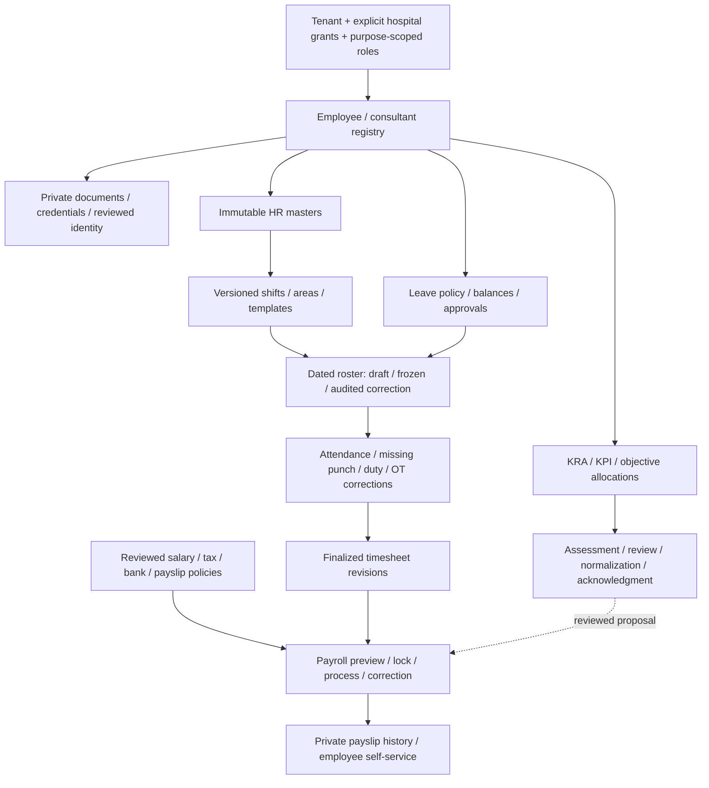

# Full workforce / HR coverage

## Active completion audit — 2026-10-28

Full Staff Management is **not complete**. Production was freshly observed at
`a8af648722cc723e83ea63b87c92c0315155bbce` on 2026-10-28 (local date).
Scoped leave review, supervision and subsequent fixes have merged after CI;
their deployment and fresh production maker/reviewer/employee acceptance remain
open. PR #1403 connects three more profile masters and merged after all CI
checks passed as `9d1d6d355ba5b96cc3e0bd4d1ca7c072b0d45ed7`. Local persisted UI
and full automated evidence passed; main CI and image publication are the next
release gates. No production rollout or migration has been performed for it.

Use the [nineteen-area acceptance ledger](qa/staff-management-acceptance.md) as
the current source of observed workflow evidence. Historical implementation
sections below retain their original checkpoint limits; later evidence does not
close their wider stories automatically. No broad Staff issue is end-to-end
complete from a successful form, deployment health or a schema check.

The current implementation sequence follows the organization research and
ADR-0044. Preserve the separation between employment, login membership,
hospital access, management supervision and clinical supervision. None of these
may be inferred from a job title. Department and sub-unit ownership belongs to
the platform organization owner, with workforce owning effective-dated postings.

| Sequence                             | Issues                            | Required acceptance before completion                                                                                                                                                                                                                                                                   |
| ------------------------------------ | --------------------------------- | ------------------------------------------------------------------------------------------------------------------------------------------------------------------------------------------------------------------------------------------------------------------------------------------------------- |
| Reviewed access administration       | #1053, #417, #434                 | Proposal, independent review, withdrawal, immutable history, pending/failure recovery and live Admin → reviewer acceptance. The Staff access UI and scoped leave-review consumer are merged; local independent review passed, while fresh deployed acceptance and wider lifecycle coverage remain open. |
| Product enforcement and self-service | #1132, #426–#428                  | Current membership/assignment/link/staff checks, target-bound forced RLS, own leave/balance/ledger, no self-approval; stale/revoked/cross-hospital/foreign-tenant denial.                                                                                                                               |
| Organization and supervision         | #22, #287, #616, #429             | One department/sub-unit owner, effective-dated postings and explicit managerial/clinical supervision; no implied clinical authority or payroll disclosure.                                                                                                                                              |
| Employment and confidential files    | #1035, #1105, #1107, #1399        | Synthetic enrollment, scan/release denial paths, immutable employment revisions and recoverable effective-date offboarding.                                                                                                                                                                             |
| Operational workflows and payroll    | #118 and its existing HR children | Coverage-checked rosters, leave, exchanges, overtime, attendance and separately authorized payroll; configuration is not payroll execution or payment.                                                                                                                                                  |
| Imports, dashboards and reporting    | #617, #558, #1018, #589, #1261    | Preview/row errors/duplicate handling, scoped reports, reconciled measures, accessible complete UI and sensitive-export audit.                                                                                                                                                                          |

Each change must link its issue, list the contracts consulted, pass the applicable
tests and CI, merge, deploy through the established release path, and pass the
actual authenticated synthetic UI workflow. Only then may the issue receive an
end-to-end verification label. Existing closed stories still need their relevant
integration behavior checked; a closed issue is not proof of current live behavior.
No issue has been relabelled or closed by this audit.

Root tracker: [#979](https://github.com/tesserix/helivanta/issues/979). Owner: Samyak Rout (`Sam123ben`). The existing eight exploration stories cover the legacy HR module. Five focused implementation children refine the remaining staff-registry acceptance. GitHub limits #979 to 100 direct children; the registry stories are genuine sub-issues of #1035 and the shift-definition story is under #1036; both parents are children of #979. None is closed merely because its menu/schema exists.

## Verified scope and delivery state

### Shared scoped route gate and bootstrap wiring — 2026-10-27

API bootstrap installs the IAM provider in the shared router. The new
`POSTScopedHospital` declaration requires a concrete permission and an exact
hospital path parameter; unsafe registration leaves no route/declaration behind.
Nested groups retain the provider, and contract export retains optional scope
kind/parameter metadata. Middleware preserves tenant membership, constructs
requests from the verified principal and path, and binds evidence to that
principal/hospital/action in private context. Missing permission context and
scoped dependencies fail closed. Legacy permission remains an independent gate;
the product must still verify its corresponding owner scope before acting.

The test first failed on missing route/middleware/composition APIs
(`/tmp/scoped-route-red.log`). It now passes through Global API with real IAM,
Postgres, NATS and OpenFGA: membership-only scoped access after acknowledgment,
denial before projection, cross-hospital denial, forged-header rejection,
action/hospital-bound context, graph failure returning 503 and the independent
legacy gate. Unit tests prove membership is not skipped, missing dependency or
context is rejected, and public/membership-bypass markers or similarly prefixed
hospital parameter names cannot be registered as scoped routes.

Full race run passed platform (9.539 s), Global API (59.139 s), architecture
(37.693 s), contractdocs (6.789 s) and authz (12.450 s), plus platform's
insights/requestid/respond packages (`/tmp/scoped-route-full.log`). Scoped lint
reports zero issues (`/tmp/scoped-route-checks.log`). Commands from `backend/`:
`go test -race ./internal/platform/... ./internal/globalapi/...
./internal/archtest/... ./cmd/contractdocs/... ./pkg/authz/...`,
`go run ./cmd/contractdocs` and `-check`, scoped `go vet` and
`golangci-lint run` over authz/platform/Global API/testutil/API/contractdocs,
and `go build ./cmd/api/... ./cmd/contractdocs/...`. `git diff --check` passed.

The exercised endpoint is test-only. Production workforce leave decisions still
require their existing authority. The next gate is target-bound leave RLS plus
locked active staff/reviewed-login-link checks, own-leave exclusion and scope/link
decision evidence. Reviewer queue/detail reads and UI must expose only necessary
review fields without granting directory, enrollment or payroll access. The
Staff Admin → separate reviewer browser journey remains outstanding. No live
record, grant, migration or deployment changed.

### IAM activation and current-state authorization provider — 2026-10-27

Migration `0012_iam_assignment_activation` adds the guarded `active` transition
after a successful immutable graph write. It retains the reviewed snapshot
version, increments proposal/history, and attributes activation to
`system:iam-assignment-projector`. Membership, expiry and scope epoch are checked
again under locks; no FGA call runs while holding those locks. Activation does
not recursively advance the epoch. Withdrawal also accepts active assignments.
Projection acknowledgment is still required before authority can allow, and
validity is checked at use rather than waiting for a background expiry update.

IAM now implements the shared `authz.ScopedAuthorizer` port. It accepts verified
tenant/subject/hospital and a server-declared action, selects current active
snapshots, verifies membership generation and epoch acknowledgment, checks exact
FGA objects, then rereads the same revision/generation/epoch and validity. Allows
and state-based denials are audited; graph, database or audit failure returns
unavailable without grant evidence. Searches are capped at 200 candidates with a
five-second deadline; evidence is not a bearer token or cache entry.

The activation test first failed with `approved_pending_activation` instead of
`active` (`/tmp/assignment-authority-red.log`). The complete real gateway,
Postgres, NATS and OpenFGA test then passed (31.062 s), covering pending projection,
active snapshot revision, tenant/subject/hospital/permission isolation, missing
dependencies, sanitized graph failure, membership removal/re-enrollment,
withdrawal during a graph check, future validity and expiry during a graph check.
The full run also verifies unauthorized activation denial, one retained activation
audit despite retries, and allow/deny audit records.

Final race run: IAM 154.729 s, Global API 53.223 s, architecture 31.339 s,
contractdocs 3.775 s and authz 11.718 s
(`/tmp/assignment-authority-full.log`). Scoped lint reports zero issues
(`/tmp/assignment-authority-checks.log`). Build, vet, API type-checking, canonical
generation and contract reference generation/check also passed. Commands from
`backend/`: `go test -race ./internal/modules/iam/... ./internal/globalapi/...
./internal/archtest/... ./cmd/contractdocs/... ./pkg/authz/...`, scoped
`golangci-lint run`, `go vet`, `go build`, and `go run ./cmd/contractdocs`
with its `-check` mode; from root, `pnpm --filter @helivanta/api type-check`.

This provider is not yet wired into product route middleware. Workforce-owned
staff/link lifecycle and object checks, broader administrative revoke/renew flows,
staff-self leave, UI and authenticated two-person browser acceptance remain open.
No business route is newly authorized and no live migration or rollout occurred.

### Membership removal and re-enrollment continuity — 2026-10-27

Migration `0011_iam_assignment_membership` adds durable per-tenant/subject
membership generations and current role counts. Database triggers cover normal
member commands and onboarding. Concurrent final-role removal advances the
generation once; removing an extra role does not. Repeated grants/revokes cannot
reset it. Proposal creation captures the generation under a shared lock;
scope verification, approval, retries and snapshot projection require the same
current nonempty generation. Final removal advances all that subject's existing
hospital-scope epochs in the same transaction, invalidating old acknowledgments.

The revoke handler supplies the authenticated actor. Final removal retains
immutable ended-generation evidence and an audit entry; an unattributed final
deletion or attempted generation reset is rejected. Re-enrollment preserves
old proposal/snapshot evidence but cannot revive it. The integration test
explicitly demonstrates that stale FGA tuples can become true again after
re-enrollment, while old proposal retries/approvals are rejected and only a
freshly reviewed snapshot is projected. Therefore the current-state authority
provider remains mandatory before any product uses these graph tuples.

The new test first failed at the absent generation table
(`/tmp/assignment-membership-red.log`). Focused assignment race tests passed
after implementation (27.287 s), then passed with immutable removal evidence
(28.267 s, `/tmp/assignment-membership-final-focused.log`). Coverage includes
extra-role removal, final-role removal, duplicate revoke, re-enrollment, stale
pending review, retained snapshot generations and concurrent role deletions.

Migration testing found and fixed a real forced-RLS backfill failure: the schema
owner initially saw no existing members. The migration now holds a table lock,
temporarily relaxes only the owner's forced-RLS read, and restores forced RLS
before commit; application-role RLS remains enabled. Existing proposal/snapshot
generation bindings stay zero because their historical continuity is unknown.
They require fresh review, rather than a fabricated continuity backfill.

The real migration/query-plan test passed with 100,000 synthetic subjects and
scope rows. Membership lookup used `iam_subject_membership_epochs_pkey`
(0.046 ms), and subject-scope lookup used the new tenant/subject/hospital index
(0.042 ms). These are local fixture timings, not a production throughput claim.
The migration/onboarding race run passed in 7.720 s; full EXPLAIN ANALYZE/BUFFERS
output is in `/tmp/assignment-membership-migration-plan-final.log`. Rollback
preserves membership counts and scope epochs, and migration replay is idempotent.

Final full race runs passed IAM (155.143 s), Global API (35.624 s) and
contractdocs (6.821 s). The architecture gate caught an unapproved admin-pool
call used solely to analyze fixture statistics; it was removed without changing
the allowlist. Statistics refresh now belongs to the migration backfill. The
affected migration/onboarding run passed again (7.779 s), with indexed lookups
at 0.031/0.044 ms; final architecture checks passed (29.876 s). Evidence:
`/tmp/assignment-membership-full-final.log`,
`/tmp/assignment-membership-migration-reviewed.log`, and
`/tmp/assignment-membership-architecture-reviewed.log`. The full log retains
the earlier architecture rejection; the latter log records its resolution.
These final tests also cover foreign-tenant isolation, unattributed deletion
denial, immutable removal evidence, rollback of that evidence, and forced-RLS
restoration. Commands run from `backend/`: `go test -race
./internal/modules/iam/... ./internal/globalapi/... ./internal/archtest/...
./cmd/contractdocs/...`, the targeted migration/onboarding rerun and the full
architecture rerun; `go run ./cmd/contractdocs` and `-check`, scoped `go vet`,
`go build` and `golangci-lint run` for IAM/Global API. `git diff --check` passed.

The authority provider, product staff/link lifecycle checks, activation, UI and
the user's Staff Admin → separate reviewer browser acceptance remain open.
No live migration, deployment or reviewer permission change was performed.

### Reviewed assignment projection and scope epochs — 2026-10-27

IAM migration `0010_iam_assignment_projection` now records immutable approved
permission snapshots and epochs keyed by tenant, hospital and subject. Approval
and withdrawal advance that epoch and publish an IAM-owned projection request
in the same transaction. The canonical event contains only proposal ID; its
consumer reloads current owner state. The existing event bus `AfterCommit`
mechanism performs OpenFGA writes outside database transactions, then acknowledges
only the unchanged scope epoch. Projection uses 200-row keyset pages and a
30-second attempt deadline; retries and dead-letter recovery reuse the bus.

The new gateway test first failed because the scope epoch table did not exist
(`/tmp/assignment-projection-red.log`). It now passes with real Postgres, NATS
and OpenFGA, including a synthetic graph outage followed by durable retry,
withdrawal while a graph write is paused, stale acknowledgment exclusion,
snapshot retention, zero tenant-wide business permissions, forced-RLS isolation,
snapshot immutability and guarded epoch transitions. The final recovery run
passed under the race detector in 10.926 s
(`/tmp/assignment-projection-recovery.log`).

The broader race run passed IAM (157.616 s), Global API (33.834 s) and
contractdocs (5.730 s), with IAM loginclient cached. It caught a missing published
event registry entry, which was added before regenerating the reference. Logs
retain that initial failure at `/tmp/assignment-projection-full.log`.
The corrected full architecture race run passed (26.984 s), along with
contractdocs (4.672 s), at `/tmp/assignment-projection-architecture-final.log`.
Commands run from `backend/`: `go test -race ./internal/modules/iam/...
./internal/globalapi/... ./internal/archtest/... ./cmd/contractdocs/...
./pkg/staffaccess/...`, followed by the focused projection recovery test and
the architecture/contractdocs rerun; `go run ./cmd/contractdocs` and `-check`.
Also passed: API type-checking, scoped Go vet/build, generator parity and scoped
lint (zero issues at `/tmp/assignment-projection-lint-final.log`).

This is graph-delivery evidence, not effective access or UI acceptance. Proposals
remain `approved_pending_activation`. Current-state authorization, membership
removal/re-enrollment invalidation, staff lifecycle integration, effective
activation, administration UI and the two-person browser journey remain open.
Large-scope load/query-plan evidence also remains unproven. Existing approved
proposals are not silently backfilled; migration of old/legacy state needs its
own reviewed path. No live migration, deployment or permission grant was made.

### Independent assignment review and withdrawal — 2026-10-27

The worktree now implements versioned approve/reject/withdraw commands through
Global API, with IAM-owned immutable decision records and migration
`0009_iam_assignment_decisions`. Review excludes both proposer and target, requires
review permission plus current authoritative IAM administrator membership, and
requests a fresh workforce-owned hospital-manager check. The intake scope proof
cannot authorize a decision. Administrative reads and commands also recheck
current IAM administrator membership to reject stale graph grants.

Approval stops at `approved_pending_activation`, granting no effective access.
Rejected owner verification returns to `pending_review`; successful independent
rejection records `rejected`. Withdrawal invalidates pending owner-response
correlation and retains history. The decision ledger records requested actions;
proposal state/history records whether each action completed. Competing commands
at one version cannot both succeed; identical retries return current state.

The focused real Postgres/NATS/gateway integration run passed with race detection
(`/tmp/assignment-decision-extended.log`, 18.041 s). It covers proposer/target
exclusion, reviewer-only reads, unauthorized hospital scope, successful approval,
rejection, withdrawal, retries, conflicting reviews, delayed positive responses
after withdrawal and stale permission rejection after authoritative membership
revocation. This fixture uses deterministic route permissions; it does not replace
the separate OpenFGA permission matrix or authenticated browser acceptance.

The broader race run also passed: IAM (159.474 s), IAM loginclient (5.302 s),
Global API (28.436 s), architecture checks (33.284 s) and contractdocs (4.079 s),
recorded in `/tmp/assignment-decision-full.log`. Commands run from `backend/`:
`go test -race ./internal/modules/iam/... ./internal/globalapi/...
./internal/archtest/... ./cmd/contractdocs/... ./pkg/staffaccess/...`,
`go run ./cmd/contractdocs`, `go run ./cmd/contractdocs -check`, and scoped
`go vet`, `go build` and `golangci-lint run` for IAM/Global API/staffaccess.
API type-checking, the canonical staff-access generator check, Prettier checks
and `git diff --check` passed. The API command reports the existing Node 26 versus
required Node 24 engine warning; it still exits successfully.

Additional decision-ledger checks passed with race detection (13.447 s,
`/tmp/assignment-decision-ledger-final.log`): cross-tenant and unguarded reads
return no rows, updates/deletes raise the immutable-history error, and truncate
is denied by database privileges. An initial stricter assertion incorrectly
expected the trigger error for truncate; the test now checks the actual privilege
boundary. Final scoped lint reports zero issues
(`/tmp/assignment-decision-lint-final.log`).

Activation, effective immutable assignments/templates, scope epochs, projection
acknowledgments/provider, the administration UI and the user's two-person browser
journey remain open. No live migration, deployment or reviewer grant was made.

### IAM proposal intake and owner verification — 2026-10-27

The UI QA gap led to inspection of the legacy workforce access endpoint. It grants
immediately without independent approval or assignment history, so no new UI was
built over it. Instead, the worktree adds IAM-owned assignment proposal creation,
detail/list/history routes and the same-tenant owner-verification event exchange.
This is part of the reviewed assignment path. The later decision slice is recorded
above; activation and UI stages remain unfinished.

Canonical `contracts/staff-access.json` generates API Go/Zod models and the owning
IAM/workforce event declarations. IAM migration `0008_iam_assignment_proposals`
adds forced-RLS proposals and immutable history. Proposal fields cannot change;
only the correlated pending scope check can transition to `pending_review` or
`scope_rejected`. History and audit commit with state, and the owner request commits
in the same transaction as creation. Protected reads also produce audit evidence.

The first fixed template identifier is `workforce.leave_reviewer.v1`. It proposes
only leave approval, but does not grant it. IAM checks target membership in its own
authoritative table. Workforce verifies the hospital and proposing actor's explicit
manager access using only its own tables; the consumer requires no Temporal client.
IAM correlates the response and rechecks membership/expiry before admitting review.
Events omit target subject and private reasons. Approval will need fresh owner
verification and a distinct, independently authorized reviewer; the preliminary
result must never be accepted as a reusable authorization proof.

Gateway integration tests exercise actual IAM/workforce handlers, Postgres, NATS
and OpenFGA, including eligible and unauthorized-owner paths, retry idempotency,
changed-body conflicts, late negative responses, immutable history, RLS isolation,
member checks, invalid input and tenant-precondition mismatch. Route permissions in
this fixture are deterministic; the separate full architecture matrix exercises
actual OpenFGA grants. The proposed target still resolves no business permissions.
This is backend evidence, not a substitute for the user's required two-person UI
QA. No live migrations, deployments, grants or browser data changes occurred in
this implementation step.

The contract exporter previously read only `contract/events.go`. A failing fixture
proved it omitted generated sibling declarations; it now reads non-test Go files
in the same contract directory and reports the actual source file/line. Canonical
models remain the source; no copied event-wire models were hand-edited.

At the end of intake, withdrawal and review decisions remained open; the later
slice above implements them. Still open: immutable effective
assignments/templates, current epochs and projection acknowledgments, scoped
authorization provider, staff self-service, the administration/reviewer UI, safe
legacy migration and authenticated UI acceptance. A proposal in `pending_review`
is not an approved or active assignment and closes none of those gates.

Verification for this slice (from `backend/`, using the existing Colima test
socket environment): the full race runs passed workforce (311.693 s), IAM
(160.106 s), Global API and architecture tests (final architecture run 33.170 s);
platform passed from cache. The final focused gateway run passed uncached
(9.352 s), explicitly waiting for the target's real OpenFGA membership before
asserting that proposal processing grants no business permissions. Logs are
`/tmp/assignment-proposal-full.log`, `/tmp/assignment-proposal-final-iam.log`,
`/tmp/assignment-proposal-final-architecture.log` and
`/tmp/assignment-proposal-final-focused.log`. The initial full log retains failures
from old IAM registration counts, missing permission/detail-route registration
and consumer payloads not using their published contract types; corrected runs
passed. No failing test was skipped.

Also passed: `go test ./cmd/contractdocs`, `go run ./cmd/contractdocs`,
`go run ./cmd/contractdocs -check`, scoped `golangci-lint run` (zero issues),
`go vet` and `go build` for IAM/workforce/Global API/staffaccess/contractdocs,
`pnpm --filter @helivanta/api type-check`, `node scripts/generate-staff-access.mjs
--check`, Prettier checks for the canonical/generator/TypeScript files, and
`git diff --check`. The exporter regression test first failed on generated
sibling declarations, then passed after the file-discovery fix. No shell/UI
behavior changed in this slice, so it provides no new browser acceptance claim.

### Required UI QA workflow — 2026-10-27

The user requires QA data entry and approval through the actual UI, acting first
as Staff Admin and then as a different reviewer. API/database integration tests
remain supporting evidence and do not substitute for that journey. Use only
synthetic records in the designated synthetic hospital; identify the submitting
and reviewing principals separately, verify tenant/hospital scope after each
login, inspect the pending record before approval, and verify persisted state
and history afterward. Include self-review denial, unauthorized scope, invalid
input, duplicate/retry and cancellation/rejection journeys where applicable.

Existing QA identities were located in the user-provided private
`~/.helivanta/` directory. Both owner and reviewer credentials successfully
authenticated through `helivanta.app` using normal UI sign-in. Credentials were
loaded privately and are not included in this report. The owner was explicitly
switched to YES HOSPITAL and could manage YES Main Hospital (Synthetic).
The separate reviewer reached that tenant but the directory displayed
"No hospital access yet". Evidence is stored privately at
`~/.helivanta/staff-ui-qa-20261027/reviewer-no-hospital-access.png`.

Live gaps: the reviewer lacks hospital access, and the deployed directory does
not yet expose the worktree's account-link controls. Source inspection also
finds no workforce hospital-access administration UI. Reviewer setup and the
reviewed scoped-authority path must be completed before claiming two-person
Staff Connect approval. Do not substitute a tenant-admin grant or direct SQL/API
seed for the required UI journey. No reviewer permissions were changed.

Administrator UI execution then created `Jordan Staff UI QA Synthetic`, employee
code `SYN-UIQA-20261027-01`, in YES Main Hospital (Synthetic), with Administration
job category and designation `Synthetic QA administrator`. The only contact value
was a reserved `example.invalid` address. No real personal, clinical, pay or
identity-document data was entered. This synthetic record remains available for
continuing QA; it does not create a login account or grant access.

Observed UI results:

- Empty submission displayed full-name and employee-code validation errors.
- Saving the valid enrollment returned to the directory and increased its count
  from three to four. Reopening the protected enrollment returned the saved
  name, employee code, Administration category and designation.
- A second new-record submission using the same employee code displayed
  `employee code already exists in this hospital`. The failed form was cancelled;
  the directory retained four records.
- The browser encountered one command-dispatch timeout during data entry. A fresh
  accessibility snapshot showed the category picker was open and all entered
  fields were intact; the form was submitted only after inspecting that state.
- No independent approval was performed or claimed. The reviewer-access and
  undeployed-control gaps above still prevent the required full acceptance run.

Private screenshots: `~/.helivanta/staff-ui-qa-20261027/staff-created.png` and
`~/.helivanta/staff-ui-qa-20261027/duplicate-code-rejected.png`. All QA record
creation and negative-case submissions used the authenticated UI, with no SQL,
direct API requests, session injection or mocked browser responses. The browser
is left on the Staff Admin directory for continuation.

### Review of the 2026-10-26 research additions — 2026-10-27

Reviewed the new organization index, authority/roles, structure/departments,
access model, configurable workflows, India public/private sectors, source
register additions S18–S26 and ADR-0044 against the current IAM, workforce,
platform dependency wiring and scoped-access design. These worktree documents
are research/target evidence, not proof of merged or deployed capability.

Applied requirements: ORG-AU-01/02/04/07 keep titles, management and clinical
authority separate; ORG-ST-01/02/07 preserve the department owner and separate
physical locations; ORG-AC-01/04/05/06/08 require approved current assignments,
automatic revocation, independent review, fresh epochs and shared IAM authority;
ORG-WF-01/02/04/06 prevent configuration from bypassing product controls;
IN-PS-01/03/08 keep sector profiles, effective postings and sourced local policy
distinct from access grants.

Reconciled the structure reference's stale claim that IAM owns staff links:
workforce owns the reviewed hospital-local binding; IAM owns membership and
assignments. Added the membership-only prerequisite to the scoped-access design
and plan. `staff_member` is a central system role with no declared business
permissions, not a clinical role or workforce job category. Enrollment and link
approval never grant it automatically.

Unresolved review items remain explicit:

- ADR-0044 ORG-D7 says privileged grants always require a second person, but
  also says a single-owner grant "takes effect" and enters review. The point
  at which such a grant may authorize an operation needs product/security
  clarification before implementing that exception. This change adds no
  privileged-grant bypass and does not reinterpret the accepted ADR.
- The structure reference limits administrative levels to public authorities,
  while the sector reference also uses them for private regions/clusters.
  Resolve that scope vocabulary together with open ORG-D2 before building it.
- ORG-D5/D6 remain open; the workflow and permission research must not silently
  activate governance-publishing rules or tenant-defined permission behavior.
- S18–S25 were recorded by the research author as consulted without clause-level
  evidence. S26 is explicitly secondary reproduction, not official current NABH
  text. No staffing minimum, statutory designation, privilege, financial limit
  or legal policy is activated from those notes. Current primary text and
  customer/state/service applicability still need verification when used.
- The actual module boundary is event-based. IAM must not read workforce tables
  or acquire a direct private owner callback to shortcut scope verification.
  A synchronous owner contract and production wiring remain part of the
  assignment-lifecycle work.

The existing authenticated browser session still opens YES HOSPITAL and its
synthetic hospital directory and leave balances. Leave balances truthfully reports
no open leave year or assigned leave structure. No live account, grant or staff
record was changed.
The pre-change race run passed IAM, workforce, Global API and authz; the latter
two results were cached. This does not establish deployment of worktree changes.

### Membership-only prerequisite — implemented in the worktree

Added `authz.RoleStaffMember` (`staff_member`) and its IAM catalogue label. The
central permission-matrix test includes every system role and now checks this
role against every registered permission. An additional real-OpenFGA test proves
membership, empty permission resolution, cross-tenant denial and revocation.
The Global API test uses real sessions, IAM, Postgres, NATS and OpenFGA to prove
catalogue visibility, repeat grant idempotency, one authoritative membership row,
empty permission response, denied catalogue/member administration, and ordered
revocation. It drains both grant events before revoke; it does not claim to fix
the existing delayed-event ordering gap. Scoped-graph and staff-link integration
fixtures now use this membership-only role rather than a clinical role.

No frontend role enum changed: workforce job categories and workspace examples
are different concepts from the string-valued IAM system-role catalogue. No
existing account or hospital grant is changed automatically. Assignment APIs,
durable epochs, owner verification, self-service and migration remain open.

Validation on 2026-10-27, from `backend/` (container tests used
`DOCKER_HOST=unix:///Users/samyakrout/.colima/helivanta-tests/docker.sock` and
`TESTCONTAINERS_DOCKER_SOCKET_OVERRIDE=/var/run/docker.sock`):

```sh
go test -race ./pkg/authz ./internal/modules/iam ./internal/modules/workforce ./internal/globalapi ./internal/archtest ./internal/platform
go test -race ./internal/globalapi ./pkg/authz ./internal/modules/workforce -run 'Test(StaffMembershipThroughGlobalAPI|WorkforceGlobalAPIAuthority|ScopedAssignment|LoginLink|StaffInactivation|EnrollmentInactivation)' -count=1
go vet ./pkg/authz ./internal/modules/iam ./internal/modules/workforce ./internal/globalapi ./internal/archtest ./internal/platform
go build ./pkg/authz ./internal/modules/iam ./internal/modules/workforce ./internal/globalapi ./internal/platform
golangci-lint run ./pkg/authz/... ./internal/modules/iam/... ./internal/modules/workforce/... ./internal/globalapi/... ./internal/archtest/... ./internal/platform/...
go test ./cmd/bootstrap ./cmd/contractdocs
go run ./cmd/contractdocs
go run ./cmd/contractdocs -check
```

All passed. The focused uncached run covers fixture edits made while the full
suite was running. Changed Go files passed `gofmt -l`; `git diff --check` passed.
Initial red tests proved the unknown role and missing catalogue label. Two
gateway-test assertions were corrected to the existing response contract and
membership-free permissions route; they were fixture mistakes, not production
defects. The first bootstrap run omitted the Docker environment and could not
start Postgres; rerunning with the configured socket passed. Logs:
`/tmp/staff-membership-final-tests.log` and `/tmp/staff-membership-focused.log`.

### Scoped authorization foundation — in progress

The [scoped staff access design](superpowers/specs/2026-10-27-scoped-staff-access.md)
records ownership, synthetic capacity assumptions, failure behavior, migration
and remaining delivery gates. `pkg/authz` now supports separate `assignment` and
`scoped_permission` graph types. An assignment holder must also be a member of its
tenant; a scoped grant never appears in tenant-wide permission resolution. Keys
bind the complete immutable snapshot, including hospital/resource, revision,
subject and sorted permissions. Delayed old projections cannot populate a newer
snapshot's keys. Legacy reconciliation deliberately excludes these new types.

Real OpenFGA tests cover exact tenant/hospital/staff/revision isolation, wrong
subjects and permissions, absent/revoked membership, duplicate projection,
interrupted projection recovery, conflicting snapshot content, dependency outage,
malformed input and the 32-permission/100-character permission/200-character
subject bounds. The first graph run exposed OpenFGA's 256-character object limit;
hashing the complete snapshot corrected it. The boundary fixture initially used
101 characters and was corrected to the intended 100 before its passing run.

Passed with the established Colima environment: `go test -race ./pkg/authz`,
`./internal/platform`, `./internal/archtest` and `./internal/globalapi` (the last
three passed in the combined integration run; authz passed after correcting the
boundary fixture). Also passed: `golangci-lint run ./pkg/authz/...`,
`go vet ./pkg/authz`, `go build ./pkg/authz`, and
`go run ./cmd/contractdocs -check` from `backend/`.

This is a graph foundation only. There is no production caller of the new graph
check yet. IAM assignment/history/epoch storage, independent review commands,
owner scope validation, projection acknowledgments and the fail-closed authority
provider must be implemented before staff-self APIs can use it. Graph success
alone cannot authorize access; no new route, role grant, live model rollout or
database migration was performed in this step. The full goal remains open.

### Continued verification — 2026-10-26

Reconnected to the existing authenticated Chrome session at `helivanta.app`.
The initially selected tenant had no hospital access. Another already-authorized
tenant, YES HOSPITAL, exposed YES Main Hospital (Synthetic). The directory loaded
three synthetic records, filtering to an absent employee produced an explicit
empty state, and the existing enrollment editor loaded successfully. The leave
form offered the two active synthetic staff members but no leave types; no leave
request was submitted. Payroll setup loaded explicit unconfigured states for
heads, structures and statutory rules. No staff, leave, payroll or access records
were changed during this browser pass. This establishes authenticated browser
read/form coverage, not a complete command or downstream-integration walkthrough.

The uncommitted staff-login-link implementation now has a migration, handlers,
generated models and focused integration tests. It is not a deployed capability,
an access grant, scoped IAM assignments or completed self-service story #1132.
The architecture omissions found in this pass were subsequently resolved: the
matrix now explicitly records the existing admin-only binding permissions, and
all five minimized event fields have documented privacy classifications. No new
role or access grant was added. The full architecture race suite passes against
real OpenFGA. The account-link directory panel is now implemented; scoped HR assignments
remain open. The generated contract inventory was refreshed and its check passes.

The generated client now rejects ambiguous account IDs without normalization,
pins the expected tenant on every request, validates response ownership and
preserves caller-provided proposal IDs across retries. A regression first failed
because a leading-space subject was accepted. The corrected API suite passes
48 files / 377 tests. The Global API integration test now covers proposal replay,
independent approval, non-admin denial even with a hospital manager grant,
hospital/cross-tenant denial and inactivation revocation using real OpenFGA.

Follow-up verification also passed:

- `go test -race ./internal/globalapi` with the Colima environment below.
- `go test -race ./internal/modules/workforce -run TestLoginLinkApprovalRacingInactivation -count=3`
  — simultaneous approval and inactivation always leave the binding revoked.
- `go test -race ./internal/modules/workforce -run 'Test(LoginLink|StaffInactivation|EnrollmentInactivation)'`.
- `pnpm --filter @helivanta/api type-check`, `pnpm --filter @helivanta/api lint`,
  and the generator checks included by type-check, plus
  `node scripts/generate-emergency-dispatch.mjs --check`.
- `golangci-lint run ./internal/globalapi/... ./internal/archtest/...` and
  `golangci-lint run ./internal/modules/workforce/...`; Go vet/build for the
  affected implementation packages. The only lint correction was an equivalent
  one-line boolean simplification, covered by the link regression rerun.

Self-service use, scoped IAM migration and live rollout remain
unverified/unimplemented requirements; these tests do not close the parent stories.

Verification commands in this pass:

- `NODE_OPTIONS=--no-experimental-webstorage pnpm --filter @helivanta/shell test workforce`
  — 29 files / 214 tests passed.
- `node scripts/generate-workforce-login-links.mjs --check` — passed.
- From `backend/`: `go test -race ./internal/modules/workforce ./internal/globalapi ./pkg/authz`
  with the Colima environment below — passed for all three packages.
- From `backend/`: `go vet ./internal/modules/workforce ./internal/globalapi ./pkg/authz`
  and `go run ./cmd/contractdocs -check` — passed (inventory regenerated first).
- From `backend/`: `go test ./internal/archtest` with the existing Colima test
  socket — initially failed event classification and permission-matrix gates;
  `go test -race ./internal/archtest` passed after the documented corrections.
  An initial run without the Colima environment also failed container setup;
  that setup error is not product evidence.

Backend integration tests use the existing isolated Colima environment at
`unix:///Users/samyakrout/.colima/helivanta-tests/docker.sock`, with
`TESTCONTAINERS_DOCKER_SOCKET_OVERRIDE=/var/run/docker.sock`; they do not mutate
the deployed hospital database.

### Account-link directory panel verification

The directory now exposes Account link only with a hospital manager grant and
one of the two link permissions. The panel checks current identity, proposes a
UUIDv7 command, displays independent review/withdraw/revoke actions, and pages
through protected history. Proposer and target-subject review actions are hidden;
the backend remains authoritative. An ambiguous failure freezes the submitted
fields and retains the command ID/body for a retry. Conflicts direct the user to
refresh. Reads are no-store and the query cache includes tenant, hospital, staff
and actor, with zero retention after unmount. Scope changes reset the form.

Seven panel tests cover proposal retry, proposer/subject review exclusion,
versioned decisions, scope reset, dependency error states and history pagination.
Four additional API-hook tests verify no previous private results appear while
loading after a tenant, hospital, staff or reviewer change. The workforce UI suite
passed 30 files / 221 tests. The complete `NODE_OPTIONS=--no-experimental-webstorage
pnpm turbo lint type-check test build format:check` run passed all 29 tasks,
including 110 shell test files / 730 tests and the production build.
After the actor-cache and mobile-layout refinements, the complete web gate passed
again. Final affected-package lint, type-check, build and format tasks passed
(7/7), the seven panel tests passed again, and the API suite passed 49 files /
381 tests. No tests were skipped to achieve these results.

A headless Chrome render of the running local shell used intercepted synthetic
API responses at 1440×1100 and 390×844. It exposed overflowing mobile action
buttons; wrapping the action rows corrected the layout and the repeated render
was visually inspected. Local artifacts: `/tmp/helivanta-account-link-desktop.png`
and `/tmp/helivanta-account-link-mobile.png`. No command was submitted in that
visual check. This is UI evidence, not an authenticated live account-link journey;
the deployed environment has not received the link migration or panel. Real
Global API/OpenFGA/backend command evidence is recorded above.

### Source and tracker reconciliation — 2026-10-26

This review uses worktree baseline `b812bcf` plus existing uncommitted Global API
and organization-design changes. It does not establish that those changes are
merged or deployed. Staff Connect is the product-facing HR scope; its current
backend owner remains `workforce`, with `/v1/workforce/hospitals/...` routes.

| Requirement group                                                    | Current evidence and remaining acceptance                                                                                                                                                                                                                                                                                       |
| -------------------------------------------------------------------- | ------------------------------------------------------------------------------------------------------------------------------------------------------------------------------------------------------------------------------------------------------------------------------------------------------------------------------- |
| Registry and masters (#1035, #617)                                   | Enrollment and versioned masters exist. Import preview, duplicate reconciliation and the full synthetic registry walkthrough still require evidence.                                                                                                                                                                            |
| Planning (#1036), leave (#1037), duty/OT (#1038), attendance (#1039) | Registered handlers, immutable revisions/ledgers and integration tests exist. These four stories remain open; implementation presence does not close policy and end-to-end acceptance.                                                                                                                                          |
| Payroll policies (#1041), execution (#1040)                          | Salary, statutory and tax configuration/preview exists. Preparation, locking, processing, corrections, payslips and reconciled payroll execution remain separate requirements. Current HR/legal approval must precede activating statutory rules.                                                                               |
| Appraisals (#1042)                                                   | Open: objectives, reviewer scope, assessment, normalization, acknowledgment and protected history. Appraisal approval must not directly alter payroll.                                                                                                                                                                          |
| Private files (#1105), benefits (#1106), credentials (#1108)         | #1105 remains open. #1106 and #1108 are closed, with merged implementation evidence; their runtime integrations must still be verified in the target environment.                                                                                                                                                               |
| Letters and exit (#1107)                                             | Open: versioned letters, effective milestones and recoverable identity/payroll/clinical handoffs. Staff inactivation revokes reviewed login links, but does not prove universal IAM/legacy/session cutoff or completed settlement.                                                                                              |
| Identity and self-service (#1053, #1132, #417)                       | Reviewed staff-to-login links are deployed with history and independent-review checks. Local independent login-link/access/leave review and self-only enforcement have evidence in the acceptance ledger. Fresh deployed reviewer/employee acceptance, wider account lifecycle and universal access cutoff remain open.         |
| Structure and access (#22, #287, #616, #429)                         | ADR-0044 assigns the department master to platform organization structure and postings to workforce. Reviewed hospital-scoped assignments and current-state enforcement exist; department-scoped consumers and the platform organization master remain open. HR classification revisions do not establish department authority. |
| Reports and UI (#1018, #589, #1261)                                  | Purpose-scoped analytics, protected exports, accessible failure/empty states and complete synthetic browser walkthroughs remain acceptance gates.                                                                                                                                                                               |
| Global API and consumers (#118)                                      | The worktree gateway maps `workforce` to an explicit owner destination and passes credentials to product authorization. Live authenticated routing, downstream handover/drill/facility consumers and reconciliation need their own proof.                                                                                       |

Verified merged examples include enrollment #1100, masters #1102, shifts #1110,
dated rosters #1126, leave reports #1154, overtime #1160, attendance #1162,
corrections #1164, finalised timesheets #1168, salary configuration #1177,
credential review/reminders #1231/#1239, credential clashes #1243, and benefits
UI/evidence #1248/#1250. These are feature evidence, not completion of parent #118
or exploration epic #979.

#### Actual authorization boundary

`backend/pkg/authz/model.go` defines user, role, permission and tenant objects.
OpenFGA resolves tenant membership and route permissions. It does not currently
model a staff self relation, reporting hierarchy, department assignment or payroll
preparer/approver relation. `workforce/module.go` declares 30 workforce permissions
without dedicated seeded HR roles; the current reconciler implicitly grants all
declared permissions to `tenant_admin`. The target role catalogue must not be
described as available roles.

`workforce/handlers.go` and `schema.sql` additionally enforce hospital scope through
`workforce_hospital_access` and `workforce_staff_allowed`, within tenant-scoped
transactions and RLS. A route declared `authz.Public` still requires tenant
membership and its handler's object checks. Staff job category and employment
status are HR facts, not login authority. Changes must retain 404 for inaccessible
objects, 403 for missing operation permission and fail-closed authorization errors.

Workforce owns HR records and credential evidence; IAM owns login membership and
assignments; platform organization structure owns departments; clinical products
own clinical authority and patient records. HR managers, payroll reviewers and
staff self-service actors need distinct scoped assignments and approval rules;
neither a staff posting nor a hospital management title is clinical authority.

#### Story discrepancies to resolve before implementation

- #118 and #417 reference Keycloak; the current identity integration uses Zitadel.
  Reuse the existing identity contract rather than adding another identity owner.
- #417 and #429 describe automatic department/roster-derived grants. Accepted
  ADR-0044 requires postings to propose access, approval before activation and
  automatic revocation when the source ends (ORG-D4).
- The implicit `tenant_admin` grant conflicts with accepted ORG-D3. Removing
  clinical access requires an explicitly tested migration slice, including existing
  assignments and recovery, rather than a silent change to workforce permissions.
- #118's illustrative employee/payroll FGA model is not the current model. Its
  compensation separation and independent payroll approval require implementation
  evidence, not a claim that existing tenant permissions already satisfy them.

The next development dependencies are approved scoped role/assignment contracts,
reviewed staff-login linkage, lifecycle revocation, and self-service integration.
Continue the remaining payroll, appraisal, import, reporting and cross-product
requirements above; completing the access foundations does not complete Staff
Connect. ORG-D2, ORG-D5 and ORG-D6 remain unresolved in the organization index.

#### OpenFGA model upgrade prerequisite

Source review found that `authz.ensureModel` compared only type/relation names.
Changing a permission rewrite or allowed tuple type without renaming the relation
therefore left the old authorization rule active after startup. A real OpenFGA
regression reproduced an obsolete direct `workforce.payroll.view` grant surviving
startup. The corrected comparison includes full rewrite trees, tuple restrictions,
schema version and condition definitions; it normalizes only known empty server
defaults and preserves authority-bearing `this` and `wildcard` objects.

The regression now proves that the obsolete direct grant loses authority while
the declared role grant still works. A separate real OpenFGA case proves that
metadata-only wildcard authority is removed, and a repeated boot reuses the
unchanged model. Model versions are append-only: this does not delete old tuples
or migrate staff assignments, and no production model was modified in this review.
This repair is a prerequisite for safely evolving the Staff Connect access model,
not implementation of the proposed scoped assignments.

`go test -race ./pkg/authz ./internal/globalapi`,
`go vet ./pkg/authz ./internal/globalapi`,
`go build ./pkg/authz ./internal/globalapi`, and
`golangci-lint run ./pkg/authz/... ./internal/globalapi/...` passed. The first
regression failed before the comparison was fixed. The reboot assertion also
caught empty server defaults causing needless model versions during development;
that issue was corrected before the passing run.
The reconciliation and permission-matrix checks also passed with
`go test -race ./internal/platform ./internal/archtest -run 'Test(Reconcile|PermissionMatrix|CrossTenantDenial|EveryGuardedRouteIsCoveredByTheMatrix)'`.
An additional failing-first regression ensures duplicate type declarations are
not collapsed into a false match; they reach OpenFGA validation and cannot be
silently accepted as an unchanged model. The final authz/Global API race suites,
vet, build, lint and `go run ./cmd/contractdocs -check` passed after this check.

#### Verification in this review

- `go test -p 2 ./internal/globalapi ./pkg/authz ./internal/modules/workforce`
  from `backend/` passed against the existing Colima `helivanta-tests` Docker
  socket, with `DOCKER_HOST` set to that socket and
  `TESTCONTAINERS_DOCKER_SOCKET_OVERRIDE=/var/run/docker.sock`. These tests create
  isolated infrastructure; they do not test production data. The first attempt
  without the explicit socket failed infrastructure discovery.
- `go vet ./internal/globalapi ./pkg/authz ./internal/modules/workforce` and
  `go run ./cmd/contractdocs -check` passed from `backend/`.
- `NODE_OPTIONS=--no-experimental-webstorage pnpm --filter @helivanta/shell test workforce`
  passed all 214 tests in 29 files. Under the local Node 26.12.0 default runtime,
  the first run passed 195 and failed 19 in setup because `window.localStorage`
  was undefined; disabling Node's experimental Web Storage resolved those failures
  without changing tests or application code.
- An unauthenticated GET to the deployed
  `https://helivanta.app/api/v1/workforce/hospitals` returned 401. This proves only
  that request was rejected, not authenticated routing or object isolation.
- `TestWorkforceGlobalAPIAuthority` now drives the real workforce handlers through
  the Global API with signed sessions, real OpenFGA permission and membership
  resolution, and isolated PostgreSQL/NATS. It proves explicit hospital grants,
  sibling-hospital and cross-tenant denial, reader write denial, unchanged PUT
  replay, forged identity-header rejection, no-store responses, hospital-grant
  and tenant-role revocation, OpenFGA outage (503) and owner outage (502).
  Inaccessible staff lists retain their documented empty-page behavior; individual
  inaccessible records return 404. This is a directory integration test, not
  coverage of every workforce workflow.
- The test harness now accepts an explicit permission resolver, retaining static
  permissions by default. The new test failed with 403/missing
  `workforce.hospital.manage` before that resolver was wired, then passed with
  real OpenFGA. `go test -race ./internal/globalapi ./internal/testutil`,
  `go vet ./internal/globalapi ./internal/testutil`,
  `go build ./internal/globalapi ./internal/testutil`, and
  `golangci-lint run ./internal/globalapi/... ./internal/testutil/...` passed.
  The full workforce package also passed `go test -race ./internal/modules/workforce`
  after the harness change. `go test ./... -run '^$'` compiled the complete backend
  test tree; it was not a full backend test execution.
- Authenticated deployed browser acceptance, full repository race/build/lint
  gates and downstream consumer acceptance remain unverified by this review.
  No production authorization behavior was changed by this test addition.

Research dates: 2026-10-12–14. Evidence is read-only visible fields, tabs and filters; it does not establish payroll law, reviewed business policy, save behavior, or actual personnel outcomes. Only synthetic fixtures are permitted in development/verification. An authorized session was restored on 2026-10-14 and roster areas/groups/templates, roster settings, allocation modes and leave-master fields were reviewed. Nested holiday/leave structures and rendered payslip content remain to review. No payroll, leave, performance, offboarding, exports or source configuration updates were executed.

| Legacy area                         | Fields and workflow observed                                                                                                                                                                    | Owning story / existing dependency                                                      | Delivery state                                                                                                                                                                                                                                                                                                                                                                                                                                                                                                                                                                                                                                                                                                                                                                                                                                                                                                                                                                                                                                                                                                                                                                                                                                                                                                                                                                                                                                                                                                                                                                                                                                                                                                                                                                                                                                                                                                                                                                                                                                                                                                                                                               |
| ----------------------------------- | ----------------------------------------------------------------------------------------------------------------------------------------------------------------------------------------------- | --------------------------------------------------------------------------------------- | ---------------------------------------------------------------------------------------------------------------------------------------------------------------------------------------------------------------------------------------------------------------------------------------------------------------------------------------------------------------------------------------------------------------------------------------------------------------------------------------------------------------------------------------------------------------------------------------------------------------------------------------------------------------------------------------------------------------------------------------------------------------------------------------------------------------------------------------------------------------------------------------------------------------------------------------------------------------------------------------------------------------------------------------------------------------------------------------------------------------------------------------------------------------------------------------------------------------------------------------------------------------------------------------------------------------------------------------------------------------------------------------------------------------------------------------------------------------------------------------------------------------------------------------------------------------------------------------------------------------------------------------------------------------------------------------------------------------------------------------------------------------------------------------------------------------------------------------------------------------------------------------------------------------------------------------------------------------------------------------------------------------------------------------------------------------------------------------------------------------------------------------------------------------------------- |
| Employee / consultant registration  | Identity/contact, personal/work email, address, emergency contacts, blood group, employment, qualifications, credentials and dependents; employee/consultant lists                              | [#1035](https://github.com/tesserix/helivanta/issues/1035), existing #118 / #589        | Core enrollment delivered; remaining children below                                                                                                                                                                                                                                                                                                                                                                                                                                                                                                                                                                                                                                                                                                                                                                                                                                                                                                                                                                                                                                                                                                                                                                                                                                                                                                                                                                                                                                                                                                                                                                                                                                                                                                                                                                                                                                                                                                                                                                                                                                                                                                                          |
| HR configurable master              | Name, group type, default flag; department, designation, grade, qualification, document category, exit reason, relationship, language and contract type                                         | #1035; ADR-0016                                                                         | Versioned master setup deployed; enrollment pins department/designation/grade revisions. No silent free-text conversion                                                                                                                                                                                                                                                                                                                                                                                                                                                                                                                                                                                                                                                                                                                                                                                                                                                                                                                                                                                                                                                                                                                                                                                                                                                                                                                                                                                                                                                                                                                                                                                                                                                                                                                                                                                                                                                                                                                                                                                                                                                      |
| Duty roster setup                   | Code/type/start/end/duration/grace/break/full-half OT/locum; shift master, areas, weekly templates, groups, automatic population / effective weekday                                            | [#1036](https://github.com/tesserix/helivanta/issues/1036), existing #118 / #589 / #438 | Shift definitions deployed in [#1109](https://github.com/tesserix/helivanta/issues/1109); areas/groups/weekly templates delivered in [#1111](https://github.com/tesserix/helivanta/issues/1111); roster settings (timezone, week start, auto population) and staff weekly-template assignments implemented under #1036 ([ADR-0019](adr/0019-roster-settings-and-staff-assignments.md)); dated rosters under #1036 ([ADR-0020](adr/0020-dated-rosters.md))                                                                                                                                                                                                                                                                                                                                                                                                                                                                                                                                                                                                                                                                                                                                                                                                                                                                                                                                                                                                                                                                                                                                                                                                                                                                                                                                                                                                                                                                                                                                                                                                                                                                                                                    |
| Shift allocation                    | Roster-wise, additional, weekly, employee-wise; roster area, draft/freeze/unfreeze                                                                                                              | #1036                                                                                   | Dated, DST-safe rosters with roster-wise/employee-wise/additional modes, population, per-person overlap exclusion and audited freeze/unfreeze/discard under #1036 ([ADR-0020](adr/0020-dated-rosters.md)); population skips approved full-day leave (#1037); freezing requires acknowledging every reviewed-credential clash (#1108)                                                                                                                                                                                                                                                                                                                                                                                                                                                                                                                                                                                                                                                                                                                                                                                                                                                                                                                                                                                                                                                                                                                                                                                                                                                                                                                                                                                                                                                                                                                                                                                                                                                                                                                                                                                                                                         |
| Leave setup/allocation/requests     | Types, policy/allocation/balances and request/approval flows                                                                                                                                    | [#1037](https://github.com/tesserix/helivanta/issues/1037)                              | Versioned leave types, yearly holiday calendars and leave structures with reviewed effective dates ([ADR-0021](adr/0021-leave-management.md)); effective-dated structure assignments, sequential monthly postings, year-end carry-forward/expiry and reasoned corrections on an append-only half-day ledger; HR-filed full-day, half-day and short-leave requests with holiday-aware counting, overlap/clubbing/probation/balance checks, separated approval posting consumption and reversal, and roster clashes; monthly leave (949) and leave status (954) reports reconciled with the ledger; open: staff self-service (#1132)                                                                                                                                                                                                                                                                                                                                                                                                                                                                                                                                                                                                                                                                                                                                                                                                                                                                                                                                                                                                                                                                                                                                                                                                                                                                                                                                                                                                                                                                                                                                           |
| Duty / OT adjustment                | Duty exchange and overtime request/adjustment controls                                                                                                                                          | [#1038](https://github.com/tesserix/helivanta/issues/1038)                              | Duty exchanges (swap/cover with consent, separate approval, revocation, roster `exchanged` revisions) and overtime (versioned daily/weekly/monthly limits, requested and approved minutes stored apart, separate approval, revocation, monthly payable summary) delivered under #1038 ([ADR-0022](adr/0022-duty-adjustments.md)) and missing-punch corrections (below) delivered under #1038                                                                                                                                                                                                                                                                                                                                                                                                                                                                                                                                                                                                                                                                                                                                                                                                                                                                                                                                                                                                                                                                                                                                                                                                                                                                                                                                                                                                                                                                                                                                                                                                                                                                                                                                                                                 |
| Missing punch                       | Missing-punch requests                                                                                                                                                                          | #1038                                                                                   | Add, void and retime requests with a reason, separate approval (filer never decides), an append-only event trail and approved corrections written as linked punches and voids that keep the original punch ([ADR-0028](adr/0028-attendance.md)); open: document evidence attachments and staff self-service (#1132)                                                                                                                                                                                                                                                                                                                                                                                                                                                                                                                                                                                                                                                                                                                                                                                                                                                                                                                                                                                                                                                                                                                                                                                                                                                                                                                                                                                                                                                                                                                                                                                                                                                                                                                                                                                                                                                          |
| Attendance                          | My Attendance, Daily Attendance, Summary, Attendance Monitor                                                                                                                                    | [#1039](https://github.com/tesserix/helivanta/issues/1039)                              | Manual punches with reasons (append-only, voidable, duplicate and back-dating guards), a versioned attendance policy and attendance derived on read from frozen rosters, leave, overtime and punches (statuses, exceptions, payable minutes, day totals, per-person ranges) delivered under #1039 ([ADR-0028](adr/0028-attendance.md)); approved missing-punch corrections delivered; finalised timesheet periods with recalculation versions, period locks and the hospital punch report (MIS 929) delivered; biometric devices shelved; open: import sources, department filters (#1035) and report export (#1066)                                                                                                                                                                                                                                                                                                                                                                                                                                                                                                                                                                                                                                                                                                                                                                                                                                                                                                                                                                                                                                                                                                                                                                                                                                                                                                                                                                                                                                                                                                                                                         |
| Payroll provisional/process         | Month/year; pending/locked/pre-process/processed; timesheet lock; payable/present/paid/unpaid leave/off days; OT/night OT; late/early hours/counts and deduction percentage                     | [#1040](https://github.com/tesserix/helivanta/issues/1040)                              | Open: reconciled preview/lock/run/correction workflow; no rates copied or real runs executed                                                                                                                                                                                                                                                                                                                                                                                                                                                                                                                                                                                                                                                                                                                                                                                                                                                                                                                                                                                                                                                                                                                                                                                                                                                                                                                                                                                                                                                                                                                                                                                                                                                                                                                                                                                                                                                                                                                                                                                                                                                                                 |
| Salary, tax, bank, template, policy | Salary Setup, Tax Setup, Bank Setup, Salary Template; salary structure / payslip history date filters; HR settings and letter header/footer                                                     | [#1041](https://github.com/tesserix/helivanta/issues/1041), existing #134               | Slice 1 delivered: versioned, reviewed salary heads and structures with an integer calculator, wage-test preview and `/workforce/payroll-setup`; nothing pre-loaded. Slice 2 delivered: PF and ESI rules with maker–checker approval and a statutory preview. Slice 2b delivered: monthly professional tax and LWF slab tables, complete by construction, with gender-aware preview. Slice 3 delivered: per-tax-year income-tax rules for both regimes (age-banded slabs, rebate with marginal relief, surcharge with marginal relief, cess) and an annual liability preview. Slice 4a delivered: per-staff salary assignment (structure plus personal fixed-head amounts) with maker–checker approval, a staff pay preview, and per-tax-year regime elections that are reported, never assumed. Slice 4b delivered: staff bank account, PAN and UAN encrypted in OpenBao Transit under a per-tenant key, masked everywhere, changed by maker–checker approval, revealed only with a separate permission and an audited reason. Slice 4c delivered: half-yearly and annual professional tax, with one deduction month per period enforced in the handler and database, and previews that project the period's wages. Slice 5a delivered: income-tax claim heads on each regime's revision (HRA exemption, home loan interest, capped and grouped deductions), applied in the Act's order and fail-closed for any claim the rule does not list, with stated claims in the preview. Slice 5b delivered: staff Form 124 declarations per tax year (claims, HRA landlords, home loan lenders) with maker–checker approval; landlord and lender PANs encrypted in OpenBao Transit, masked by default and revealed only with a reason and its own permission; the landlord PAN threshold comes from the rule in force, fail closed. Slice 5b-ii delivered: scanned image evidence attached to a pending declaration proposal (up to 10), kept apart from HR files by row-level security, decisions held while scanning, frozen at the decision and revoked unless approved. Open: PDF evidence, actual period wages (#1040), TDS, rendered payslip review and private self-service |
| KRA / KPI                           | Allocation/template/master; code, goal, KRA, objective, KPI, weightage, target                                                                                                                  | [#1042](https://github.com/tesserix/helivanta/issues/1042)                              | Open: versioned objectives, weights/targets, allocations and evidence                                                                                                                                                                                                                                                                                                                                                                                                                                                                                                                                                                                                                                                                                                                                                                                                                                                                                                                                                                                                                                                                                                                                                                                                                                                                                                                                                                                                                                                                                                                                                                                                                                                                                                                                                                                                                                                                                                                                                                                                                                                                                                        |
| Appraisal                           | Status/department/designation/employee filters; monthly/quarterly/half-yearly/yearly allocation; objective code/category/subcategory / YES_NO / DESC; score 0–10 / grade / increment percentage | #1042                                                                                   | Open: self/manager/reviewer assessment, normalization, acknowledgment, appeals and protected history; nested assessment forms unverified                                                                                                                                                                                                                                                                                                                                                                                                                                                                                                                                                                                                                                                                                                                                                                                                                                                                                                                                                                                                                                                                                                                                                                                                                                                                                                                                                                                                                                                                                                                                                                                                                                                                                                                                                                                                                                                                                                                                                                                                                                     |

Observed menus include all the screenshot’s HR branches. Modern extensions below address remaining accepted requirements; their existence must not be presented as observed legacy behavior.

## Remaining registry slices without duplicate modules

| Capability                             | Tracker                                                    | Boundary / dependency                                                                                                                                                                                                                                                                                                                                                                                                            |
| -------------------------------------- | ---------------------------------------------------------- | -------------------------------------------------------------------------------------------------------------------------------------------------------------------------------------------------------------------------------------------------------------------------------------------------------------------------------------------------------------------------------------------------------------------------------- |
| Reviewed account/practitioner linkage  | #1053                                                      | Reuse existing identity/practitioner contracts; employment does not automatically create clinical access                                                                                                                                                                                                                                                                                                                         |
| Bulk import and conversion             | Existing #617                                              | Reuse existing import pipeline; synthetic/anonymized conversion, preview/dry run, source mapping and idempotent scoped reconciliation                                                                                                                                                                                                                                                                                            |
| Staff files and qualification evidence | [#1105](https://github.com/tesserix/helivanta/issues/1105) | #1035 child: private GCS quarantine → ClamAV → immutable clean release, signed authorized download; shared file pipeline to implement                                                                                                                                                                                                                                                                                            |
| Dependents / benefit enrollment        | [#1106](https://github.com/tesserix/helivanta/issues/1106) | #1035 child: confidential dependents on the relationship master, versioned effective-dated plans and two-person coverage approval with no overlap (slice A API and slice B shell UI at `/workforce/benefits` delivered); scanned eligibility evidence on proposals and a permissioned, audited coverage CSV (slice C, with #1066) delivered; open: exports above 1,000 rows and scheduled exports; no automatic patient creation |
| Employment letters / notice / exit     | [#1107](https://github.com/tesserix/helivanta/issues/1107) | #1035 child: templates/provenance and effective milestones; recoverable identity/payroll/clinical handoffs; existing report/template contracts                                                                                                                                                                                                                                                                                   |
| Credential expiry / reviewed renewals  | [#1108](https://github.com/tesserix/helivanta/issues/1108) | #1035 child: reviewed validity, second-person approval and expiry register (slice A), durable renewal reminders with a versioned threshold policy and HR inbox (slice B), and acknowledged roster credential clashes (slice C) delivered                                                                                                                                                                                         |
| HR reports / private exports           | #1035 / #1018                                              | Reconcile existing reports; purpose/role-scoped outputs, masked payroll values, audited downloads and retention controls                                                                                                                                                                                                                                                                                                         |

## Ordered end-to-end delivery

1. Finish registry foundations/master setup with verified local CNPG, browser and deployed evidence. Complete remaining #1035 slices through their existing/new trackers.
2. Deliver shift definitions, areas/groups/templates, then dated draft/frozen rosters and locum/conflict handling (#1036). Definitions are not a published roster.
3. Deliver reviewed leave policy/balance/allocation and approvals (#1037), followed by duty/OT/punch corrections (#1038).
4. ~~Deliver missing-punch corrections and finalized immutable timesheets on the #1039 punch ledger~~ (delivered); payroll consumes the finalised snapshot.
5. Deliver salary/tax/bank/payslip policies (#1041) before payroll preview/lock/process/correction (#1040). Policy jurisdiction/rounding/tax rules need an authorized owner review, not source defaults.
6. Deliver versioned KRA/KPI/objectives/allocations, assessment/review/normalization/acknowledgment and protected appraisal history (#1042). Compensation proposals go through reviewed payroll/HR contracts; no automatic high-impact decision.

Each slice finishes tests, API/schema/UI, synthetic real-DB/browser verification, reusable CI/build, GitOps deployment, production API/UI/log verification and tracker evidence before closure. Dependencies can have design research in parallel; incomplete acceptance is never hidden by checking a parent box.



## Platform guardrails across every slice

- PostgreSQL is authoritative. Forced RLS, composite tenant/hospital keys, object grants, immutable revisions/audits, expected versions, stable IDs and atomic outbox apply to every confidential aggregate. Another hospital within the same tenant gets no implicit access. Any intentional sharing is explicit, purpose-scoped, revocable and separately audited.
- Zitadel authenticates; existing onboarding/tenant registry and permission reconciliation remain the membership authority. Reviewed staff-account linkage never bypasses tenant/hospital authorization. Audit actor comes from authenticated context, not JSON.
- NATS JetStream carries versioned identifier-only committed events and deduplicated consumers. Use Temporal for multi-step approvals, durable timers, scanning/release and payroll runs where required; distinguish retryable infrastructure failure from an explicit rejected business decision.
- Valkey holds safe short-lived technical state, not authoritative salaries, attendance, eligibility or patient data. Qdrant/AI is outside current HR implementation; any future usage requires explicit purpose and privacy design.
- GCS files are private and scoped, quarantine-first, size/type/generation validated, ClamAV scanned and fail-closed; authorization is rechecked before issuing bounded download URLs. Retention, access and audit controls support HIPAA/SOC 2 requirements but do not certify the product.
- UI uses shared dropdown/forms, keyboard labels/errors, automatic form reveal/focus, hospital switching that clears stale records, visible loading/empty/retry states and accurate paged/filter scope. Browser session controls retain the configured renewal/12-hour behavior without weakening sensitive-operation rechecks.

Editable diagram: [full-hr-workflows.drawio](diagrams/full-hr-workflows.drawio). Implementation decisions: [ADR-0016](adr/0016-versioned-hr-masters.md), [ADR-0017](adr/0017-versioned-shift-definitions.md), [ADR-0018](adr/0018-versioned-roster-configuration.md), [ADR-0019](adr/0019-roster-settings-and-staff-assignments.md), [ADR-0020](adr/0020-dated-rosters.md).

### Staff membership enrollment implementation — 2026-10-27

The Staff access page now includes a permission-gated existing-account enrollment
form fixed to IAM `staff_member`. The existing command checks the expected tenant
before writing and supports identical-request repair. This establishes membership
only. Identity-provider existence, reviewed account links, hospital authority,
scoped leave enforcement and live independent-review QA remain separate gates.
See [the enrollment design](superpowers/specs/2026-10-27-staff-membership-ui.md).
Issues #417/#1053 remain open for their complete acceptance scope.
