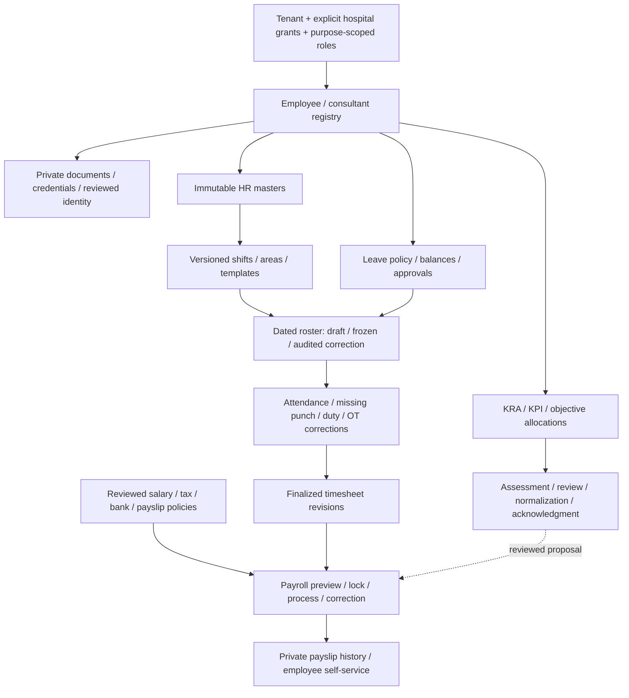

# Full workforce / HR coverage

Root tracker: [#979](https://github.com/tesserix/helivanta/issues/979). Owner: Samyak Rout (`Sam123ben`). The existing eight exploration stories cover the legacy HR module. Five focused implementation children refine the remaining staff-registry acceptance. GitHub limits #979 to 100 direct children; the registry stories are genuine sub-issues of #1035 and the shift-definition story is under #1036; both parents are children of #979. None is closed merely because its menu/schema exists.

## Verified scope and delivery state

Research dates: 2026-10-12–14. Evidence is read-only visible fields, tabs and filters; it does not establish payroll law, reviewed business policy, save behavior, or actual personnel outcomes. Only synthetic fixtures are permitted in development/verification. Fresh login expired on 2026-10-14 when opening Duty Roster Setup; remaining nested forms and rendered payslip content need another authorized read-only session. No payroll, leave, performance, offboarding, exports or source configuration updates were executed.

| Legacy area                         | Fields and workflow observed                                                                                                                                                                    | Owning story / existing dependency                                                      | Delivery state                                                                                                                                                |
| ----------------------------------- | ----------------------------------------------------------------------------------------------------------------------------------------------------------------------------------------------- | --------------------------------------------------------------------------------------- | ------------------------------------------------------------------------------------------------------------------------------------------------------------- |
| Employee / consultant registration  | Identity/contact, personal/work email, address, emergency contacts, blood group, employment, qualifications, credentials and dependents; employee/consultant lists                              | [#1035](https://github.com/tesserix/helivanta/issues/1035), existing #118 / #589        | Core enrollment delivered; remaining children below                                                                                                           |
| HR configurable master              | Name, group type, default flag; department, designation, grade, qualification, document category, exit reason, relationship, language and contract type                                         | #1035; ADR-0016                                                                         | Versioned master setup deployed; enrollment pins department/designation/grade revisions. No silent free-text conversion                                       |
| Duty roster setup                   | Code/type/start/end/duration/grace/break/full-half OT/locum; shift master, areas, weekly templates, groups, automatic population / effective weekday                                            | [#1036](https://github.com/tesserix/helivanta/issues/1036), existing #118 / #589 / #438 | Shift definitions implemented in [#1109](https://github.com/tesserix/helivanta/issues/1109); release evidence is tracked there; other setup and planning open |
| Shift allocation                    | Roster-wise, additional, weekly, employee-wise; roster area, draft/freeze/unfreeze                                                                                                              | #1036                                                                                   | Open: dated/timezone-aware allocations, overlap/leave/qualification checks, audited corrections                                                               |
| Leave setup/allocation/requests     | Types, policy/allocation/balances and request/approval flows                                                                                                                                    | [#1037](https://github.com/tesserix/helivanta/issues/1037)                              | Open: effective policy, accrual/carry-forward, balances, requests and approvals                                                                               |
| Duty / OT adjustment                | Duty exchange and overtime request/adjustment controls                                                                                                                                          | [#1038](https://github.com/tesserix/helivanta/issues/1038)                              | Open: typed approval workflows, reasons, bounded corrections and downstream recalculation                                                                     |
| Missing punch                       | Missing-punch requests                                                                                                                                                                          | #1038                                                                                   | Open: evidence, manager review, corrected immutable attendance events                                                                                         |
| Attendance                          | My Attendance, Daily Attendance, Summary, Attendance Monitor                                                                                                                                    | [#1039](https://github.com/tesserix/helivanta/issues/1039)                              | Open: device/import contracts, source deduplication, exceptions and finalized timesheets                                                                      |
| Payroll provisional/process         | Month/year; pending/locked/pre-process/processed; timesheet lock; payable/present/paid/unpaid leave/off days; OT/night OT; late/early hours/counts and deduction percentage                     | [#1040](https://github.com/tesserix/helivanta/issues/1040)                              | Open: reconciled preview/lock/run/correction workflow; no rates copied or real runs executed                                                                  |
| Salary, tax, bank, template, policy | Salary Setup, Tax Setup, Bank Setup, Salary Template; salary structure / payslip history date filters; HR settings and letter header/footer                                                     | [#1041](https://github.com/tesserix/helivanta/issues/1041), existing #134               | Open: approved jurisdiction/versioned policies, private bank/pay configuration, rendered payslip review and private self-service                              |
| KRA / KPI                           | Allocation/template/master; code, goal, KRA, objective, KPI, weightage, target                                                                                                                  | [#1042](https://github.com/tesserix/helivanta/issues/1042)                              | Open: versioned objectives, weights/targets, allocations and evidence                                                                                         |
| Appraisal                           | Status/department/designation/employee filters; monthly/quarterly/half-yearly/yearly allocation; objective code/category/subcategory / YES_NO / DESC; score 0–10 / grade / increment percentage | #1042                                                                                   | Open: self/manager/reviewer assessment, normalization, acknowledgment, appeals and protected history; nested assessment forms unverified                      |

Observed menus include all the screenshot’s HR branches. Modern extensions below address remaining accepted requirements; their existence must not be presented as observed legacy behavior.

## Remaining registry slices without duplicate modules

| Capability                             | Tracker                                                    | Boundary / dependency                                                                                                                          |
| -------------------------------------- | ---------------------------------------------------------- | ---------------------------------------------------------------------------------------------------------------------------------------------- |
| Reviewed account/practitioner linkage  | #1053                                                      | Reuse existing identity/practitioner contracts; employment does not automatically create clinical access                                       |
| Bulk import and conversion             | Existing #617                                              | Reuse existing import pipeline; synthetic/anonymized conversion, preview/dry run, source mapping and idempotent scoped reconciliation          |
| Staff files and qualification evidence | [#1105](https://github.com/tesserix/helivanta/issues/1105) | #1035 child: private GCS quarantine → ClamAV → immutable clean release, signed authorized download; existing file pipeline                     |
| Dependents / benefit enrollment        | [#1106](https://github.com/tesserix/helivanta/issues/1106) | #1035 child: minimal confidential data, versioned plan and effective coverage, reviewed eligibility; no automatic patient creation             |
| Employment letters / notice / exit     | [#1107](https://github.com/tesserix/helivanta/issues/1107) | #1035 child: templates/provenance and effective milestones; recoverable identity/payroll/clinical handoffs; existing report/template contracts |
| Credential expiry / reviewed renewals  | [#1108](https://github.com/tesserix/helivanta/issues/1108) | #1035 child: revision-bound deduplicated reminders/tasks; existing practitioner and notification contracts; Temporal for durable waits         |
| HR reports / private exports           | #1035 / #1018                                              | Reconcile existing reports; purpose/role-scoped outputs, masked payroll values, audited downloads and retention controls                       |

## Ordered end-to-end delivery

1. Finish registry foundations/master setup with verified local CNPG, browser and deployed evidence. Complete remaining #1035 slices through their existing/new trackers.
2. Deliver shift definitions, areas/groups/templates, then dated draft/frozen rosters and locum/conflict handling (#1036). Definitions are not a published roster.
3. Deliver reviewed leave policy/balance/allocation and approvals (#1037), followed by duty/OT/punch corrections (#1038).
4. Deliver attendance source ingestion/exceptions and finalized immutable timesheets (#1039); freeze input revisions before payroll.
5. Deliver salary/tax/bank/payslip policies (#1041) before payroll preview/lock/process/correction (#1040). Policy jurisdiction/rounding/tax rules need an authorized owner review, not source defaults.
6. Deliver versioned KRA/KPI/objectives/allocations, assessment/review/normalization/acknowledgment and protected appraisal history (#1042). Compensation proposals go through reviewed payroll/HR contracts; no automatic high-impact decision.

Each slice finishes tests, API/schema/UI, synthetic real-DB/browser verification, reusable CI/build, GitOps deployment, production API/UI/log verification and tracker evidence before closure. Dependencies can have design research in parallel; incomplete acceptance is never hidden by checking a parent box.

## Platform guardrails across every slice

- PostgreSQL is authoritative. Forced RLS, composite tenant/hospital keys, object grants, immutable revisions/audits, expected versions, stable IDs and atomic outbox apply to every confidential aggregate. Another hospital within the same tenant gets no implicit access. Any intentional sharing is explicit, purpose-scoped, revocable and separately audited.
- Zitadel authenticates; existing onboarding/tenant registry and permission reconciliation remain the membership authority. Reviewed staff-account linkage never bypasses tenant/hospital authorization. Audit actor comes from authenticated context, not JSON.
- NATS JetStream carries versioned identifier-only committed events and deduplicated consumers. Use Temporal for multi-step approvals, durable timers, scanning/release and payroll runs where required; distinguish retryable infrastructure failure from an explicit rejected business decision.
- Valkey holds safe short-lived technical state, not authoritative salaries, attendance, eligibility or patient data. Qdrant/AI is outside current HR implementation; any future usage requires explicit purpose and privacy design.
- GCS files are private and scoped, quarantine-first, size/type/generation validated, ClamAV scanned and fail-closed; authorization is rechecked before issuing bounded download URLs. Retention, access and audit controls support HIPAA/SOC 2 requirements but do not certify the product.
- UI uses shared dropdown/forms, keyboard labels/errors, automatic form reveal/focus, hospital switching that clears stale records, visible loading/empty/retry states and accurate paged/filter scope. Browser session controls retain the configured renewal/12-hour behavior without weakening sensitive-operation rechecks.

Editable diagram: [full-hr-workflows.drawio](diagrams/full-hr-workflows.drawio). Implementation decisions: [ADR-0016](adr/0016-versioned-hr-masters.md), [ADR-0017](adr/0017-versioned-shift-definitions.md).
