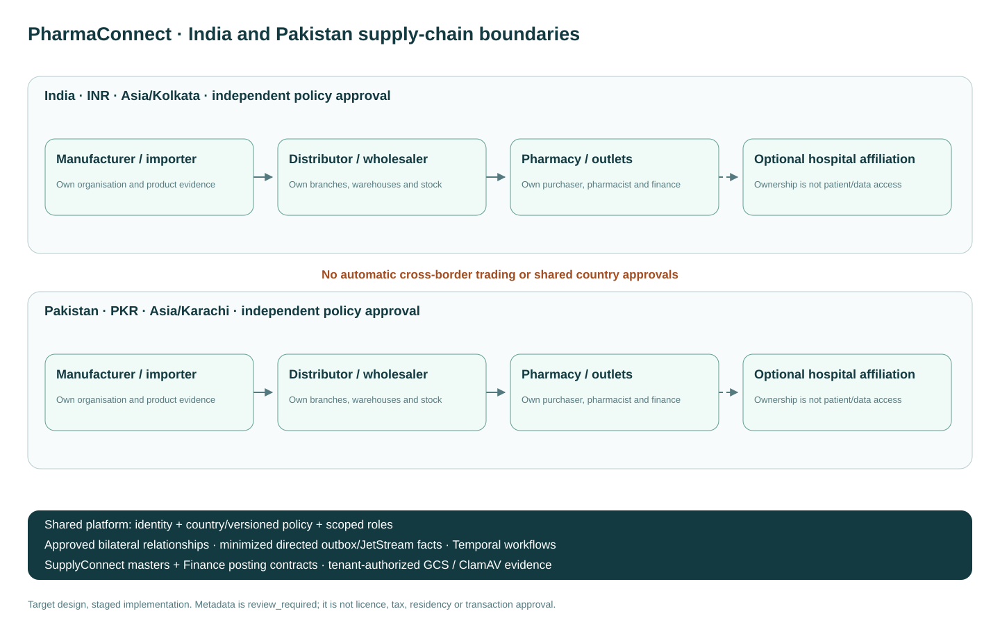

# PharmaConnect — India requirements and workflow map

> **2026-10-23, #1287:** Pakistan was removed; India is the only supported country. The file keeps its name because issues link to it.

Epic: #1133. Owner: Sam123ben. Related exploration: #979 (at GitHub's 100-child limit). Country/tenancy decision: [ADR 0026](../adr/0026-pharmaconnect-country-and-trading-boundaries.md). Machine-readable issue inventory: [manifest](../delivery/pharmaconnect-inpk-issues.json).

## Confirmed commercial scope

Release 1 is a procurement network. The seller is contracting party and invoice owner. Initially record external invoices/payments and reconcile their evidence. Optional marketplace and payment-provider processing are separately delivered and activated; they do not silently change an accepted order's parties or create a transfer from a record-payment action. India is the only supported country (#1287). The country model stays: a country's transaction activation requires independent policy and operational acceptance. Countries, currencies and group membership do not confer cross-border or cross-organisation permission.



_The diagram predates #1287 and still shows Pakistan, which is no longer supported._

[Editable draw.io source](../architecture/diagrams/12-pharmaconnect-india-pakistan-network.drawio).

## Roles and organisation model

Manufacturer/importer -> national distributor/super stockist -> regional/state distributor -> local wholesaler/stockist -> pharmacy -> customer. Support direct manufacturer supply, sub-distribution, several suppliers, branch/warehouse groups and country-specific legal registrations. Pharmacy owner/admin, pharmacist, purchasing/inventory, distributor sales/warehouse/finance, manufacturer representative, platform reviewer/support and scoped auditor/regulator are distinct roles. A hospital may own one/many pharmacies, and a pharmacy may have one/many outlets, without sharing clinical or financial records implicitly.

Every organisation has legal/trading identity, ownership/registrations, contacts/addresses, country/jurisdiction licences and premises, responsible professionals/signatories, locations, staff/approval settings, categories, service areas/routes/business hours, cutoff/delivery schedules, customer/supplier relationships and commercial limits. Bank/payment data is minimized and restricted. Onboarding draft/review/approve/reject/suspend/reinstate/offboard states retain versioned evidence and actor/reason history. OCR extraction is not verification.

## Requirement coverage

| User area                           | Required behavior                                                                                                                                                                                                                                 | Owning stories                                      |
| ----------------------------------- | ------------------------------------------------------------------------------------------------------------------------------------------------------------------------------------------------------------------------------------------------- | --------------------------------------------------- |
| 1. Users and roles                  | Per-object/transition/org/location roles, approval settings, access review, scoped read-only auditor, purpose-bound support.                                                                                                                      | #418 #1137 #1148                                    |
| 2. Onboarding/verification          | Legal/tax/premises/licences, categories, contacts/signatories, evidence/expiry, credit/order limits, review and suspension/offboarding.                                                                                                           | #19 #171 #271 #1135 #1143                           |
| 3. Catalogue                        | Shared governed identity plus private seller listings: brand/ingredient/strength/form/pack/barcode/manufacturer/images, registration/prescription/storage/shelf life, equivalents, availability/MOQ/terms, revision audit, unsafe-product blocks. | #159 #168 #171 #988 #1138                           |
| 4. Pharmacy inventory               | Location/lot/expiry quantities; receiving/dispense/transfers/adjustment/returns/write-off, barcode counts, min/max/preferred suppliers, alerts, POS import, immutable history.                                                                    | #162 #166 #167 #490 #1144                           |
| 5. Procurement/orders               | Eligible multi-seller price/stock/ETA/terms comparison; drafts/saved/repeat/bulk orders, approvals/spend caps, validation, amendments/partial/substitution/backorder and quoted/final snapshots.                                                  | #160 #1000 #1001 #1139                              |
| 6. Distributor operations           | Entity/branch/depot/warehouse/bin/territory/rep structures; price lists/discounts/schemes/bonus quantities, customer accounts, receiving/reservation/FEFO/picking/packing/dispatch, returns and performance.                                      | #1135 #1137 #1138 #1140 #1141                       |
| 7. Fulfilment/delivery              | Acceptance-to-delivery timeline, courier/fleet/routes/capacity/manifests/labels/POD, recipient/time/custody/temperature, partial/damaged/missing/failed deliveries and reconciliation.                                                            | #161 #1141                                          |
| 8. Batch/expiry/recall              | Manufacturer-to-outlet/transaction traceability; current product/batch holds, approved recall scope, acknowledgements, quarantine/return/disposal and escalation/closure.                                                                         | #164 #165 #166 #167 #1062 #1140                     |
| 9. Invoices/payments/credit         | Seller-owned invoices, credit/debit notes and statements; PO/receipt/POD matching, shortages/prices/tax disputes, exact partial allocations/reversals, credit/exposure/overdue blocks and Finance integration.                                    | #172 #456 #1002 #1029 #1044 #1046 #1051 #1142 #1151 |
| 10. Returns/claims/disputes         | Eligibility by seller/product/country, original quantity/batch/condition/evidence, approvals/collection/credit/replacement/rejection and timestamped decisions.                                                                                   | #163 #1003 #1029                                    |
| 11. Notifications/messages          | In-app and configurable email/SMS recipients/preferences; order/claim-bound messages/evidence and role/location summaries, retries and privacy-safe content.                                                                                      | #1146                                               |
| 12. Reports/dashboards              | Stock/low/near-expiry; spend/product/supplier; fill/backorder/substitution/delivery; invoice/credit/reconciliation; expenses/payments/outstanding; return/claim/recall/audit; permissioned CSV/BI.                                                | #576 #586 #1016 #1060 #1061                         |
| 13. Integrations                    | POS/pharmacy, ERP/WMS/supplier/manufacturer, Finance/payment, courier/POD, channels/identity and approved government contracts; mapping/freshness/ownership/replay/monitoring.                                                                    | #457 #490 #1147                                     |
| 14. Security/privacy/audit          | Strong sessions/roles/entitlements; tenant/org/location/country isolation, transport/storage protection, immutable audit, secure GCS/ClamAV evidence, retention/legal hold/deletion/backup/recovery/access review/incident response.              | #67 #1112 #1137 #1149                               |
| 15. Regulatory/operational          | Country/jurisdiction/category/premises/effective policy for product/medicine scope, licences/registration, prescription/controlled/cold chain, tax/invoice/retention/privacy and contracting responsibility.                                      | #271 #454 #455 #458 #461 #1134                      |
| 16. Platform support/admin          | Onboarding/licence review, categories/settings, scoped suspensions/reinstatements, authorized incident/transaction/integration investigations, tickets/audit/backlogs.                                                                            | #1148                                               |
| 17. Non-functional                  | Measured availability/latency/growth/consistency/idempotency/RTO/RPO, mobile/tablet/keyboard/accessibility, languages/Urdu RTL/currencies/timezones and observable integration/automation failures.                                               | #1149 #1150                                         |
| 18. Delivery phases                 | Core ordering -> distributor operations -> finance/connectors -> controlled automation/compliance -> separately approved second-country activation; no partial scaffold closes acceptance.                                                        | #1133 #1150                                         |
| Operational inventory/expense audit | Original acquisition/landed/recoverable-tax snapshots distinct from MRP; who paid whom/how/when, exact outstanding, source-linked credit/reversal and incomplete valuation visibility.                                                            | #1060 #172 #1002 #1142                              |

## Role-by-role workflow map

| Actor                              | Screens and sequence                                                                                                                                                              | Authoritative state and access                                                                                                 | Human/recovery gates                                                                                                        |
| ---------------------------------- | --------------------------------------------------------------------------------------------------------------------------------------------------------------------------------- | ------------------------------------------------------------------------------------------------------------------------------ | --------------------------------------------------------------------------------------------------------------------------- |
| Pharmacy owner/admin               | Register organisation/premises -> evidence -> approval settings -> staff/outlet access -> approved supplier relationships -> credit/order limits                                  | Own tenant/org/outlet only; optional hospital relationship separately declared                                                 | Reviewer approves licences; owner approves purchasing/auto-order limits; suspension blocks new commitments                  |
| Pharmacy purchaser                 | Eligible catalogue/offer comparison -> saved/draft/repeat/bulk order -> spend/clinical approval -> submit -> acceptance/backorder/amendments -> receive -> match invoice -> claim | Buyer PO/revisions and disclosed seller quote snapshots; no unrestricted seller stock or negotiated prices for other customers | Changed quote/credit/licence/serviceability needs review; stale feed cannot place another order                             |
| Pharmacist/inventory               | Receive/scan -> verify lot/expiry/condition -> quarantine/release -> stock/count/replenish -> approved dispensing -> return/recall                                                | Explicit outlet, licence and clinical purpose; B2B purchasing has no patient identity by default                               | Country/category/prescription/substitution/temperature checks; no unapproved release or automatic restock                   |
| Distributor sales                  | Customer eligibility/terms -> offers -> incoming orders -> accept/partial/reject -> substitutions/backorders -> customer timeline                                                 | Seller-side order projection and approved customer relationship; prices/credit only within granted roles                       | Credit/product/policy hold, changed price or restricted substitute routes for approval                                      |
| Warehouse controller/picker/packer | Supplier receiving -> document/quality checks -> put-away -> allocation/FEFO -> pick wave/scan -> pack/exception -> dispatch manifest                                             | Assigned warehouses/bins/stock states; no invoice/payment approval or unrelated pharmacy patient data                          | Concurrent reservation cannot oversell; shortages/temperature/recall need explicit disposition; transfers balance both ends |
| Driver/courier                     | Assigned manifest -> collect/custody -> route -> recipient/POD/temperature -> delivery/partial/failed exception                                                                   | Minimum assigned shipment/recipient information, limited validity                                                              | Failed/offline updates reconcile by stable shipment/event keys; no fabricated POD                                           |
| Distributor finance                | Customer credit -> invoice/POD/PO match -> payment/credit/debit -> allocation/statement -> overdue/dispute -> accounting reconciliation                                           | Seller operational subledger; approved Finance owns GL/tax/period close                                                        | Currency-separated balances; exact payment/reversal keys; no bank-verified flag without trusted evidence                    |
| Manufacturer/importer              | Legal/product registration -> approved supply relationships -> governed product/feed/listing -> lot provenance/recall response                                                    | Own listings/evidence and permitted trading disclosures                                                                        | No ability to lower platform restrictions or trigger an unreviewed recall                                                   |
| Platform compliance/admin          | Review queues -> verify evidence/policy -> approve/reject/suspend -> expiry/recall escalation -> recovery queues                                                                  | Platform controls with explicit org/premises/category purpose; no automatic business-data access                               | Independent country/category approval; support escalation and every decision audited                                        |
| Auditor/regulator                  | Approved scoped access -> trace product/batch/order/invoice/stock -> inspect original/reversal/evidence -> approved export                                                        | Read-only, country/org/location/time/purpose scope with download/export audit                                                  | Access expires/revokes; other organisations/patient records remain inaccessible                                             |

```mermaid
sequenceDiagram
    participant B as Pharmacy purchaser
    participant P as Buyer purchase order
    participant T as Temporal trading workflow
    participant S as Seller order/warehouse
    participant D as Delivery
    participant F as Finance/reconciliation
    B->>P: Draft, quote snapshot and approvals
    P->>T: Atomic state + outbox (stable order/revision)
    T->>S: Approved relationship and eligible acceptance
    S-->>T: Accepted / partial / review / rejected
    T->>S: Idempotent eligible lot reservation
    S->>D: Pick, pack, dispatch and custody
    D-->>T: Actual quantities, exceptions and POD
    T->>P: Buyer receiving / discrepancy review
    T->>F: Source-linked invoice draft and match
    F-->>B: Billed / paid / credited / outstanding
    Note over T,F: Duplicate or delayed activity never creates another commitment; stuck states are visible
```

## Automation and ownership

Every automated decision records country/org/location/category/role/rule version, minimized inputs, outcome, timestamp, human approval and correlation. Temporal owns waits and multi-step recovery; activities remain idempotent and compensation is semantic. NATS carries minimized outbox facts; Valkey never authorizes a stock or payment commitment.

| Automation               | Rules and safety behavior                                                                                                                                                            | Story           |
| ------------------------ | ------------------------------------------------------------------------------------------------------------------------------------------------------------------------------------ | --------------- |
| Onboarding/licences      | Required evidence, review routing, expiry reminders, suspend applicable activity, exceptions and verified human approval; extracted data is not proof.                               | #1143           |
| Pharmacy replenishment   | On-hand/available/on-order/usage/lead time/safety/min-max/preferred seller, packs/MOQ/budget/expiry; draft by default, bounded explicit auto-order opt-in and no stale/repeat order. | #1144           |
| Distributor procurement  | Supplier PO drafts, open inbound, slow/excess/near-expiry/backorder analysis, eligible warehouse transfer suggestions, scarce allocation and unusual-spend approval.                 | #1145           |
| Order acceptance         | Relationship/licence/account/product/price/pack/stock/service/credit checks, current quote snapshots, configured warehouse/supplier splitting and review of substitutions.           | #1139           |
| Warehouse/delivery       | Pick waves, scan/FEFO/remaining shelf life, handling flags, shipping/manifest/routes/capacity, custody/POD/temperature and actual dispatch/delivery reconciliation.                  | #1141           |
| Expiry/recalls/quality   | Configured expiry windows and approved recall instructions find affected parties/transactions; holds, acknowledgement, quarantine/return/disposal and overdue escalation.            | #1143 #164 #167 |
| Invoice/payment matching | Draft from actual fulfilled quantities, approved tax/offer rules, three-way/POD match, signed external events/files, duplicate/missing/mismatch flags and approved credit drafts.    | #1142           |
| Alerts/reporting         | Role/location recipient preferences and summary schedules, delivery/credit/licence failures, monitored adapter freshness/dead letters and attributable replay.                       | #1146           |

## Country configuration and regulatory approval

Country configuration includes allowed organisation/licence/document/product categories, registration and controlled classification, state/province/local premises, tax identifiers/calculation/invoice/credit rules, currency/number/date/timezone/language/direction, prescription/dispensing, privacy/retention/legal hold/residency, evidence/verification/renewal, storage/temperature/traceability/recall and approved national reporting adapters. One country's rules and approval never apply to another by fallback. Approved local specialists provide current authoritative sources and terminology; do not hard-code legal assertions from a legacy UI or a country name. Cross-border trading stays disabled until separately approved.

Country metadata is implemented first as a generated shared contract. It is explicitly `review_required`, with no tax rates, licence validation claims or transaction activation. Since #1283 it also carries each country's tax scheme structure (India: GST jurisdictions, GSTIN and HSN, with sources), still without rates: the hospital records each product's rate, and a country with no scheme refuses tax setup. Follow-on approved effective-dated rules are separately versioned; original transactions retain their rule/price/tax snapshots.

## Legacy procurement coverage

The entire highlighted procurement sidebar and the observed vendor/receiving fields are mapped in [the read-only procurement reference](pharmaconnect-legacy-procurement.md). Keep shared supplier/item/retailer/department/pricing masters under their existing owners; seeing a legacy menu is not workflow completion.

## Product boundaries and consistency

Platform owns identity, country/policy/role primitives and canonical person identity. Pharma owns pharmacy/trade state, private listings and operational workflows. SupplyConnect owns its supplier/procurement masters; Finance owns statutory posting/tax mappings/period close; source references and contracts connect them. No duplicate patient/supplier/drug/GL master or cross-module repository access. Preserve current modular runtime while meeting ADR 0007 extraction gates.

PostgreSQL is authoritative for stock, reservations, credit, approvals and obligations. All mutations enforce route + object + transition + country/relationship policy and forced RLS. Immutable source IDs and outbox/inbox deduplication cover API, broker, webhook, batch and replay. Read models may be eventually consistent only where explicitly safe; stale stock/eligibility/credit cannot approve an order. No real customer records, bank credentials or PHI enter development fixtures or broad event/workflow histories.

## Delivery and evidence

| Release                      | Deliverables                                                                                                                         | Exit gate                                                                                                 |
| ---------------------------- | ------------------------------------------------------------------------------------------------------------------------------------ | --------------------------------------------------------------------------------------------------------- |
| 1: core network/ordering     | Organisation/location/roles/licence records, governed catalogue/offers, serviceable search, approvals/PO/status, core in-app updates | Synthetic buyer/seller complete journey; missing rules/credentials block restricted commitments           |
| 2: distributor operations    | Warehouse receiving/reservations/FEFO, picking/packing/dispatch, delivery/temperature/POD, traceable returns                         | Concurrent quantity conservation, custody/exception handling and recall holds proven                      |
| 3: finance/connectors        | Source invoices/credits/debits, reconciliation/credit, expense/acquisition audit, selected real ERP/POS/finance/courier adapters     | No duplicate postings/settlements; actual provider and source mappings tested                             |
| 4: automation/compliance     | Bounded replenishment, licence reminders, recalls, reconciliation/summary automation and advanced reporting                          | Deterministic workflow tests, recovery/compensation, explicit human approvals and jurisdictional sign-off |
| 5: second-country activation | Complete independent local configuration, vendor/residency/policy review and operations drills                                       | Country-specific release approval; one country's release cannot activate another                          |

An issue closes only when its full acceptance is proven, including denied/empty/stale/retry/concurrent/failure states, real local PostgreSQL/API/UI tests, relevant NATS/Temporal/provider contracts, accessibility/keyboard/mobile/RTL, required CI/security/build gates and release/recovery evidence. Existing local catalogue/quarantine/payable foundations are partial issue evidence, not full platform completion.

Explicit remaining launch decisions: exact countries' approved category/legal policies and residency/retention; first-release ERP/POS/courier/accounting vendors and provider credentials; measured order/organisation volumes and capacity/recovery targets. Confirmed: procurement network first, seller-owned transactions/invoices, external-payment reconciliation first, optional later marketplace/provider processing. These decisions do not block safe schema/API/UI development with synthetic data.
