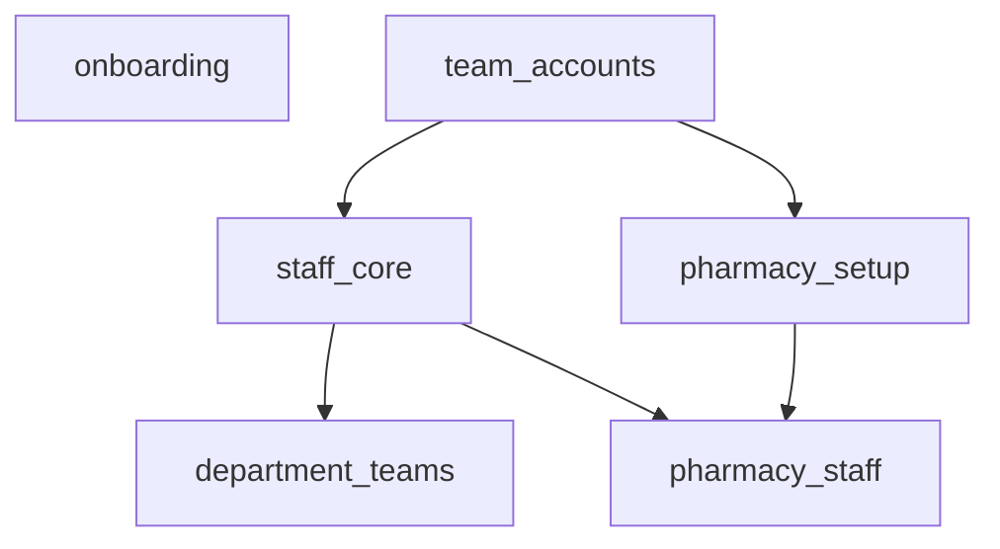

# Manage Helivanta feature flags

Product operators control released features in the
[Tesserix Console](https://console.tesserix.app/platform/feature-flags/helivanta).
Hospital and pharmacy owners manage staff permissions in Helivanta; they do not
control these platform switches. Changes affect **all Helivanta tenants in
production**. A flag never grants membership, professional authority, staff
permissions or access to another employer or outlet.

## Before changing availability

1. Sign in to Console with a platform account. Editing additionally requires
   `manage-feature-flags`; hospital ownership does not imply this role.
2. Open **Feature flags → Helivanta**. Check the product and production environment.
3. Select **Refresh** and wait for completion. Resolve any unavailable management
   state or unresolved command before making another change.
4. Find the feature by its title, Staff/PharmaConnect group or full flag key.
   Review its description, release eligibility and prerequisites.
5. Prepare the tested release or incident reference. Keep credentials, patient
   details and staff personal information out of the change reason.

**Provider enabled** means the desired GrowthBook value. **Available in Helivanta**
means released, enabled and all prerequisites available. **Release locked**
features require a reviewed application release; provider edits cannot release them.

## Enable a released feature

1. Enable the feature's prerequisites first, using the dependency tree below.
2. Select its **Enable** switch. Locked or dependency-blocked switches cannot be enabled.
3. Review the confirmation dialog and the dependent features that will resume.
   Their desired values are preserved, so one prerequisite can restore several features.
4. Enter **Reason for this change**, including the release reference (8–500 characters).
5. Select **Confirm enable** once and wait for the acknowledged result.
6. Refresh Console. Confirm desired and effective availability and inspect the
   recorded command in the history.
7. Wait for a fresh Helivanta capability snapshot, then refresh the affected page.
   Check navigation, the direct page URL and the corresponding Global API request
   with an authorized account. A provider write alone does not prove app acceptance.

## Disable and restore a feature

1. Find the feature and select **Disable**.
2. Review the dependent-feature impact. Disabling a prerequisite also makes its
   dependents unavailable; their desired values remain stored.
3. Enter the release or incident reason and select **Confirm disable** once.
4. Refresh Console and verify the acknowledged command and effective values.
5. After a fresh Helivanta snapshot, confirm the feature disappears from navigation,
   bookmarked business pages are unavailable and new gated API work is refused.
6. To restore, follow the enable procedure with a new reason referencing the
   original change, and recheck the dependents.

Disabling does not delete records, revoke IAM assignments or sign users out.
Baseline authentication, verification, password setup, session recovery and
tenant-security routes keep their existing authorization checks.

## Current MVP and dependency tree

The dated production baseline on **2026-11-17** has 22 definitions and six enabled
capabilities. Future desired values may differ. The canonical application source
is [`contracts/release-capabilities.json`](../../contracts/release-capabilities.json).
All suffixes below use the prefix `helivanta.release.`.

| Suffix             | Prerequisites                  | Enabled MVP purpose                                                      |
| ------------------ | ------------------------------ | ------------------------------------------------------------------------ |
| `onboarding`       | None                           | Hospital and independent pharmacy signup                                 |
| `team_accounts`    | None                           | Staff accounts, invitations and reviewed access                          |
| `staff_core`       | `team_accounts`                | Staff directory, person/employment review, account links and credentials |
| `department_teams` | `staff_core`                   | Department structure, team membership and reviewed postings              |
| `pharmacy_setup`   | `team_accounts`                | Pharmacy employer, outlets, contacts and hospital affiliations           |
| `pharmacy_staff`   | `staff_core`, `pharmacy_setup` | Pharmacy staff and reviewed identity/employment evidence                 |



The other 17 definitions are release locked: `pharmacy_catalogue`, `pharmacy_stock`,
`pharmacy_stocktake`,
`pharmacy_prescriptions`, `pharmacy_returns`, `pharmacy_reports`, `pharmacy_counter`,
`pharmacy_payables`, `workforce_scheduling`, `workforce_payroll`,
`workforce_advanced`, `supplier_collaboration`, `clinical`, `lab`, `emergency`,
`billing_workspace` and `unreleased`. Do not turn on stock, supplier fulfilment,
receiving, financial or advanced Staff workflows as a shortcut to MVP testing.

### Retained pharmacy stocktakes

The **Retained stocktakes** page uses `pharmacy_setup`, independently of Stock
and Reports. It requires stock-read permission, the existing pharmacy directory
access and the selected outlet's current grant. Ordinary stock staff do not need
access-management authority. Managers also have recovery in an opened outlet's
**Outlets & access** detail. These continuations can inspect retained status and
original outcomes; cancellation additionally needs correction permission and an
outlet editor grant. They cannot start a count, change quantities, approve
adjustments or export inventory while Stock is disabled.

### Reviewed Stocktake duties — development only

`pharmacy_stocktake` is a separate capability, dependent on `pharmacy_setup`
and compiled **ineligible**. Its provider key is
`helivanta.release.pharmacy_stocktake`. A Console value of true cannot override
that compiled lock. Do not enable broad Stock/Catalogue to reach this work.

The canonical release panels classify each operating template as
`staff.operating.<template-key>`. Existing duties retain their baseline
visibility. The new `pharmacy.stocktake_reader.v1`,
`pharmacy.stocktake_counter.v1` and `pharmacy.stocktake_reviewer.v1` all bind to
`pharmacy_stocktake`. The duty picker filters these bindings using the current
account's release snapshot. IAM independently checks availability for new
proposals and approval; unknown bindings or unavailable policy fail closed.
Rejection, withdrawal, revocation and exact recorded-result recovery retain
their existing current-authority checks.

When adding a template, update its canonical panel binding in
`contracts/release-capabilities.json`, then run both
`generate-release-capabilities.mjs` and `generate-operating-assignments.mjs`.
The operating generator refuses a missing or unknown release binding. These
bindings control availability, and do not assign Staff or confer stock authority.

The unreleased independent/chain development path includes start, line reads,
counting, submission, independent posting, rejection, cancellation and original
command recovery with retained Staff/link/duty evidence. Current reviewed
header/list/register reads also passed hosted scope, audit-failure and rollback
tests. Clean independent reviewed capacity also passed in hosted 45075494219.
Reviewed header/list and original count/decision receipts are baseline
continuations. A dedicated `PUT /stocktakes/{stocktake}/cancellations/{command}`
accepts only cancellation under a current counter duty; it cannot admit submit,
approval or rejection. These continuations do not need a release-provider
snapshot, but still require the current account, Staff/link, exact outlet,
command ownership and audit evidence. New starts/counts/decisions, line browsing
and CSV export remain gated; retrying a blocked write is not the recovery path.
The SDK requires explicit `authority: "operating"` to use reviewed routes and
separate recovery/cache namespaces. Existing legacy references remain readable
through the legacy flow; they are not adopted into reviewed work. A scope change
removes confirmed results from view until the new scope is checked. This SDK
support does not release a page or replace current server authorization.

Hospital department admission/capacity, the operational
page/SDK and both-model live acceptance remain required by #1686. Keep eligibility
false until those gates pass. A passing independent backend gate does not enable
these capabilities by itself.

### Pending Staff authenticator recovery control

Policy `2026-11-19-r1` adds `staff_mfa_recovery`, dependent on `staff_core` and
`team_accounts`, for the Staff account panel and reset commands. Its Console
flag is `helivanta.release.staff_mfa_recovery`. The recovery candidate makes it
eligible after isolated native acceptance, with the final release gates pending.
Its provider value stays disabled until approved activation. The Helm-managed catalogue creates its
missing provider definition disabled after the deployed application contract
matches; neither catalogue synchronization nor provider configuration can bypass
compiled eligibility. A future activation uses the normal product-wide Console
procedure above and does not grant Staff account authority.

Hospital-owned pharmacy staff stay within their hospital tenant and employer.
Independent pharmacy staff belong to their pharmacy tenant and employer. Shared
email addresses and declared affiliations do not create cross-tenant authority.

## Dashboard cards follow the same flags

Dashboard shortcuts use the same canonical page classifications and effective
capability snapshot as the sidebar and destination pages. They also require the
account's existing page permissions. There is no separate dashboard flag list to
maintain. A new page must be classified in the canonical contract before it ships.

| Dashboard cards in this MVP                                                              | Required flag suffix                                                           |
| ---------------------------------------------------------------------------------------- | ------------------------------------------------------------------------------ |
| Staff access; Branding                                                                   | `team_accounts`                                                                |
| Staff directory; Employment reviews; Person reviews; Credential register                 | `staff_core`                                                                   |
| Department teams; Posting preparation; Posting reviews; HR setup; Organization structure | `department_teams`                                                             |
| Setup in PharmaConnect                                                                   | `pharmacy_setup`                                                               |
| Staff in PharmaConnect; Pharmacy Staff; Pharmacy relationships                           | `pharmacy_staff`                                                               |
| Workspace security                                                                       | Baseline authenticated account security; independent of optional release flags |

`onboarding` controls public signup and has no dashboard shortcut. Flags control
capability groups, so the six enabled flags can produce 16 cards for an owner
with all required permissions. For example, disabling `pharmacy_staff` removes
its three cards while leaving pharmacy setup and hospital Staff cards available.
Disabling `team_accounts` also closes its dependent features, leaving baseline
account security. Account switching immediately withholds the previous tenant's
business cards until the new account has a valid snapshot.

Automated dashboard acceptance lives in
`apps/shell/app/(workspace)/dashboard/page.release.test.tsx`. It checks the exact
accepted MVP card set against the canonical eligibility list, each enabled
flag's disabled/dependency state, a refreshed off/on transition, unavailable and
wrong-account snapshots, and tenant switching. New eligibility needs a reviewed
update to this acceptance baseline, not an automatic opt-in of untested pages.
The release generator and navigation tests additionally enforce page coverage.

### Reviewer choices follow the release catalogue

In **Staff → Staff access → Reviewer appointments**, account-link, person and
employment roles require Staff Core. Hospital scoped-access reviewer requires
Department Teams. Governance auditor requires Team Accounts. Named pharmacy
scopes additionally require Pharmacy Staff. The operating reviewer and supplier
scope are not part of the released MVP. Turning off a dependency also withholds
its choices; owners cannot use a reviewer appointment to enable a locked product.
A successful appointment receipt may still be provisional or awaiting review.
It does not grant clinical authority or pharmacy outlet operations.

### Snapshot expiry and automatic refresh

Capabilities remain bound to the current tenant/account and the provider's original
60-second lifetime. The client refreshes every 15 seconds, including background
polling, refreshes on focus and makes one deduplicated recheck when its snapshot
expires. A missed poll must not strand the user until a full page reload. Expired
or wrong-account data never permits a business action. Continuing provider/source
failure still makes the feature unavailable; refresh is not a stale-data bypass.
Browser scheduling can delay background work, so resolve an unavailable source
before preparing a new command. Keep retained command references for recovery.

## Troubleshooting and uncertain commands

| Observation                           | Action                                                                                                                                                  |
| ------------------------------------- | ------------------------------------------------------------------------------------------------------------------------------------------------------- |
| Read-only Console                     | Follow the authorized platform access process; do not grant customers platform administration.                                                          |
| Prerequisite unavailable              | Check its desired value, eligibility and dependencies; enable only the reviewed chain.                                                                  |
| Release locked                        | Implement, deploy and accept the application release first.                                                                                             |
| Pending or uncertain command          | Retain its reference. Use the displayed recovery control or **Retry same request**; do not submit a second intent. Editing stays paused until resolved. |
| State changed while dialog was open   | Close it, refresh, review the new revision and reopen.                                                                                                  |
| Availability cannot be verified       | Refresh after recovery. This does not mean every flag is off; do not reset provider data.                                                               |
| Provider enabled but app refuses work | Check effective availability, prerequisites, running policy version, snapshot freshness and the actor's permissions and scope.                          |

Console refreshes visible pages every 30 seconds. App snapshots have a maximum
60-second lifetime; changes are not instantaneous across all open tabs. Unknown,
expired or unavailable provider state refuses new gated work with 503; explicitly
unavailable features return 404. Identity and object authorization still apply.
See the [API contract](../api/release-capabilities.md).

## Add future flags through Helm and the reconciler

Maintainers can add reviewed definitions through the chart. Console's manual
creation supports missing reviewed entries, not arbitrary unbound feature names.

1. Implement the feature and tests. Update the canonical contract with its owner,
   dependencies, route/page/panel bindings and release eligibility. Do not ship
   unclassified routes or hand-edit generated outputs.
2. Regenerate and verify in Helivanta:

   ```sh
   node scripts/generate-release-capabilities.mjs
   node scripts/generate-release-capabilities.mjs --check
   node --test scripts/release-capabilities.test.mjs
   ```

3. Update the reviewed catalogue/schema in `tesserix/tesserix-k8s` using its
   `scripts/sync-helivanta-feature-catalogue.py` (canonical contract path, with
   `--check` supported). Follow that repository's
   `docs/adr/2026-11-17-helivanta-feature-catalogue.md` for chart ownership and checks.
4. The onboarding-service chart publishes `helivanta-feature-catalogue` ConfigMap
   in `helivanta-growthbook`. The dedicated GrowthBook chart owns the CronJob of
   the same name, scheduled every five minutes (`*/5 * * * *`). Deploy through
   its owning GitOps/Kargo lane.
5. The reconciler validates the entire catalogue, schema, dependencies and published
   release-contract parity before writing. It creates missing definitions
   **disabled**, preserving existing values, rules and versions. It never enables
   features, resets Console choices or deletes flags.
6. Wait for a successful scheduled Job and refresh Console. For a missing reviewed
   entry, operators can instead select **Create disabled flag**, enter a reason
   and **Confirm create**. Both paths converge on the same definition.
7. Deploy the compatible application and complete acceptance tests. Enable the
   eligible feature separately using the Console procedure above.

GrowthBook stays version/digest pinned, with upgrades through its platform-tools
Kargo lane. Its deployment is API-only; operators use Console. Credentials come
from OpenBao/ESO and stay server-side, outside catalogues, chart values, browser
code, screenshots and this public repository.

## Evidence for an acceptance run

Record the running commit/digest, flag and command references, before/after
desired and effective values, tenant/actor test labels, UI result, API status and
restoration result. Keep real contacts and credentials in private evidence.
Distinguish hosted CI, live browser and backend checks. Do not call a workflow
accepted while independent review, recipient verification, scope denial or
recovery checks remain unexecuted.
