# Hospital-owned pharmacy stocktake delivery — #1686

Status: implemented development candidate, still unreleased. The independent
foundation in #1823 is merged; hospital work remains in draft #1826 and its
continuation branch. This implements part of the
[reviewed authority design](../specs/2026-11-23-reviewed-stocktake-authority.md),
not the full #1686 release.

The hospital command path and separate immutable evidence are implemented. The
actual reviewed employment/department-assignment fixture passed start, count,
submit, independent approval, exact retries and receipt recovery, source/evidence
failure, movement/stale rejection, ledger conservation and binding withdrawal in
hosted run **45197016258**. The schema integrity and exact-restoration cases passed
in **45197010131**. These runs do not establish hospital browser or capacity
acceptance.

Current-account named assignment discovery is a newer candidate with narrow
Workforce hospital-name and Organization department-name projections. Its
missing-endpoint red is recorded in **45203058085**. The implementation passed
together with the complete hospital fixture in **45207440232** on **c0d66d85**
and is consolidated into draft #1826 at **65892125**. New real audit-rollback and
bound-outlet cases are verified separately; their greens are not implied here. Local focused race tests, canonical
checks, affected builds, typechecks and linters pass. New work remains compiled
ineligible. Pharmacy-owned bound-outlet discovery, hospital worker entry UI,
binding/department/ownership-change recovery, hospital browser/capacity and
approved rollout/live acceptance remain open.

## Verified starting point

- Pharmacy's `operatingStock` consumes independent IAM duties. Its employer guard
  correctly rejects a hospital-owned pharmacy. Hospital Staff must never be
  represented by fabricated independent employment to pass this check.
- `fulfilment_stock.go:hospitalFrame` demonstrates current approved
  outlet/hospital/department binding and Organization-owned revision checks. The
  Supply-owned `HospitalSourceAuthority` uses procurement actor eligibility and
  fulfilment permission; it must not authorize a physical stocktake.
- Workforce's `staffActorGuard.withCurrentEmployeeActor` locks current Staff,
  account link and employment generation, requires an already-held exact IAM
  source-use grant, constrains its guarded transaction deadline and audits the
  consumed source. Before this candidate it permitted governance and procurement purposes only;
  the candidate adds the separate stocktake purpose.
- `IndependentStaffHistoryGuard` verifies retired observation evidence and known
  Staff/account aliases. It does not establish hospital employment history.
- Pharmacy's preceding header discriminator permitted legacy and independent
  operating counts; the candidate adds hospital authority. Independent evidence records duty, Staff revision and link
  revision; hospital evidence needs assignment and employment generation instead.

## Owners, authority and invariants

Pharmacy owns one existing snapshot/count/command/adjustment/physical ledger.
Workforce owns hospital Staff, account-link and employment-generation history.
IAM owns reviewed department assignments and their acknowledged snapshots.
Organization owns the department revision. Pharmacy owns the approved outlet
binding. No module reads another owner's private tables or creates a second
Staff, stock or account master.

Use department-scoped reader, counter and independent reviewer templates in
`contracts/staff-access.json`. Counters receive stocktake read/count, reviewers
read/review, and readers read only. Each template includes a separate
Workforce-owned stocktake actor-use permission. An owner role, hospital grant,
posting, job category or procurement assignment grants none of these operations.
No dispensing, stock release, controlled-drug designation or financial permission
is added.

Retain ADR-0073's budgets: 10,000 snapshot buckets, 100 observations per command,
500 posted differences, 200-row pages, five-second start/post and page p99 below
300 ms. The existing planning workload is 10 commands/s with 10:1 reads/writes;
200 outlets produce approximately 14.4 million snapshot rows/year. Hospital
source locks, historical participant checks and binding checks must be measured
inside these budgets, without changing their thresholds.

## Delivery sequence and acceptance

1. Add red-first real Workforce/IAM tests for a separate hospital stocktake
   actor-use boundary. Valid current reviewed employment succeeds only inside
   the exact department assignment's guarded transaction. No IAM basis,
   governance/procurement purpose, wrong tenant/hospital/department, retired or
   replaced account/generation and expired employment all refuse before callback.
   Dependency/audit failures fail closed. Keep the source-use permission without
   legacy role grants. Do not ship an unused wrapper: wire it to the hospital
   stocktake consumer in the same implementation continuation.
2. Add a callback-only Workforce historical independence check for hospital
   observations, under the reviewer's current held authority. Retain exact Staff,
   account-link version, employment generation and employment epoch. Verify the
   original accepted source even after retirement; reject same Staff, original
   account, relinked account and historical alias overlap. Missing historical
   proof is a refusal, never independent-by-default. Query through owner RLS,
   audit before returning and restore narrower transaction settings on all exits.
3. Register the hospital route family under
   `/pharmacy/hospitals/:hospital/departments/:department/pharmacies/:pharmacy/outlets/:outlet/stocktakes`.
   Resolve the canonical department path through its owner. Hold exact current
   IAM operation and actor-use authority, Workforce actor eligibility, approved
   binding and current department revision through the Pharmacy command commit.
   Bind every lookup to verified tenant, hospital, department, pharmacy and outlet.
   Return 404 for foreign or unavailable resource scope, 403 for a proven scope
   with missing operation permission, 409 for stale source/session/command intent,
   401 for revoked credentials and 503 when required authority or audit cannot be
   evaluated. Confirm these errors against the final registered router/middleware.
4. Reuse existing stocktake protocol helpers for start/all/selected, lines,
   counts, submit/cancel, independent approve/reject and CSV. Add a hospital
   authority discriminator and append-only hospital evidence, with assignment
   snapshot, binding/revision and Workforce source references. Evidence is not a
   duplicate count or Staff master. Legacy and independent commands must not
   adopt hospital history; hospital commands must not adopt their history either.
   Reserve actual forward migration IDs after rechecking merged registry state.
   Keep historical migrations immutable, tenant/composite foreign keys, forced
   RLS, UUIDv7 evidence IDs and bounded migration lock/statement timeouts.
5. Test current-duty/assignment separation and participant independence through
   Global API with real IAM, Workforce, Organization and Pharmacy owners. Cover
   binding revocation/replacement, changed department revision, sibling/foreign
   scope, current Staff/link/employment changes, concurrent correction/reservation,
   complete rollback, exact replay and source/audit failure. A current reviewer
   may review retained observations from a retired different counter only when
   Workforce can still prove attribution and historical independence.
6. Add named current-account hospital working-location discovery and exact-outlet
   product/quarantine projections. Do not use management, procurement, general
   catalogue or receiving discovery as worker authority. Use sealed bounded
   pagination and current account/scope/version cache keys. Keep independent
   directory behavior intact; hospital and independent choices need explicit
   authority discriminators rather than guessed routing.
7. Connect the same start/count/review/export UI to the hospital authority.
   Current assignment hints govern presentation; every API operation reauthorizes.
   Account/scope/source/read failure removes private state. Persist only scoped
   command references, not private counts or tokens. Capability withdrawal must
   preserve exact original receipts, retained status and authorized cancellation
   while removing new-work controls and lines/export.
8. Run the real built-shell journey with separate hospital owner, access approver,
   counter and stocktake reviewer. Observe count and approval response loss,
   reload recovery without another mutation, selected/all snapshots, scheduled
   discrepancy sections and unchanged later receipts. Re-run maximum capacity
   through actual hospital source admission; independent/legacy measurements
   are not hospital performance evidence.

## Merge, rollout and closure

Run focused hosted builds/race tests and canonical generation/checks, then the
current-head required PR checks. Align contracts, registered inventory and
consumer/release bindings without implying live acceptance. Keep the repository
public and do not use Colima or start local apps/databases/containers.

Before the protected production release, enumerate the actual pending migrations,
capture the affected schema definitions and obtain named migration/rollout
approval. Migrations are forward-only; application rollback preserves new
history and needs an older-code compatibility check. Promote signed main images
through Release/Kargo and verify migration completion, Freight/image revisions,
readiness and actual authenticated browser behavior.

Stocktake remains release-locked until the applicable independent and hospital
acceptance gates are satisfied. Do not enable general Stock/Catalogue as a
shortcut. After the reviewed release change, use Console's audited desired-state
control and verify effective UI/API behavior under real authorized synthetic
Staff, including both owners and negative scope checks. Record pending cases
explicitly. Close #1686 only after its requested end state is demonstrated live.

### Hospital historical participant verification (candidate)

Workforce retains ownership of canonical login-link history and employment
generations. A stocktake reviewer must carry both a current department-scoped
`workforce.stocktake_actor.use` assignment and `pharmacy.stocktake.review`.
The historical check binds the saved counter link version, generation and
employment epoch, rejects the same Staff or subject and shared historical Staff
aliases, and does not require the former counter to remain employed. It restores
its narrow read context before calling the Pharmacy consumer; failed consumer
work rolls back the Workforce audit too.

Candidate migrations `0122_workforce_stocktake_actor_history` and
`0123_workforce_stocktake_actor_history_index` preserve the previous selection
integrity checks, update only the three explicitly changed policy fingerprints,
and refuse prior authority drift. Runtime checks require canonical immutable
history and forced row-level security. These are development changes only:
hospital commands, UI and live migration/rollout
remain pending; the release capability stays compiled ineligible.

### Application source wiring checkpoint

The application and integration harness now resolve a combined current/history
stocktake guard from exactly one Workforce owner. Missing database, missing or
duplicate Workforce ownership, or an incomplete source provider deny admission.
The provider retains the existing Workforce factory and does not expose
procurement authority. The real-owner platform test verifies these refusals and
that neither current nor historical source callbacks run without guarded IAM
authority. This wiring adds no hospital route or stock write admission by itself.

### Hospital command candidate

The command branch now registers the hospital stocktake route family, reuses the
single stocktake snapshot/observation/decision/ledger implementation and retains
separate hospital evidence. Admission holds the actual operation and Staff-source
assignments, locks each assignment's department scope against current ancestry,
verifies current reviewed Staff, and pins the approved hospital-owned outlet
binding and Organization revision through the command transaction. Historical
review consumes only Workforce's hospital identity boundary. Independent employer
admission and its evidence remain separate.

Source verification found the current last Pharmacy migration is **0065**, so the
new forward-only candidate is `0066_pharmacy_stocktake_hospital`. No live migration
has run. Its new evidence table has forced RLS, composite source/command foreign
keys, immutable history, bounded participant indexes and operating-choice
restrictions. The prior choice integrity is verified before adding the new table's
policy fingerprints. Hospital and independent command triggers require original
source evidence; legacy commands cannot adopt either count. Explicit route
capability bindings preserve authorized recovery while new work remains locked.

Hosted run 45183518049 observed the intended red at the hospital start route
(404, expected 200), after real owner setup, department approval, stock receipt
and reviewed assignments. Positive command acceptance, binding-change recovery,
hospital discovery/UI/capacity and authenticated live release verification remain
pending. No readiness or rollout claim follows from compilation or static SQL
parsing.

### Hospital client scope checkpoint

The SDK now selects hospital routes only from explicit hospital authority plus
both hospital and department coordinates. Incomplete or ambiguous authority fails
before traffic/cache access. Cache and tab-local recovery keys include authority,
account, tenant, hospital, department, pharmacy and outlet; existing independent
and legacy recovery keys retain their prior bytes. Recovery hooks observe
hospital/department changes. Selected-product start consumes the hospital
stocktake's named product/quarantine choices without general inventory grants.
Red-first SDK, selected-product form and recovery tests exposed the unsupported
route and the legacy recovery-key collision before these were corrected.
Hospital working-location discovery and the real built-browser journey remain
pending; these reusable components alone do not create hospital worker access.

### Failure and migration regression coverage

The hospital journey additionally injects a database evidence-write failure and
requires 503 plus a missing command receipt before an exact retry can succeed.
After the completed count, the fixture explicitly authorizes the binding reviewer
for the existing binding-administration surface, ends the source binding, removes
that administration access and verifies that old reads and new counts are denied.
A separate migration fixture applies the real prior Pharmacy migrations, proves
unrelated source/policy tampering refuses the hospital migration transaction, and
checks that adding the hospital evidence table preserves operating-choice
integrity. These database cases run only on hosted Linux; their acceptance is
pending until the matching run completes.

Hosted runs 45188557765 and 45191216544 created and recovered the hospital
snapshot without legacy editor authority. Their count was correctly rejected by
the canonical physical-movement guard: the fixture inserted another receipt
before recording the observation. An earlier progress update incorrectly
attributed this to a stale version (the input already used version 0). The journey
now takes each precondition from the prior receipt, accepts the observation before
the later receipt, and explicitly rejects a recount after that movement. The
frozen book remains 30, the accepted observation is 27, and approval must preserve
the later 5-unit receipt for a final balance of 32. No stock safety guard changed.

### Runtime schema guard (hosted red observed, candidate implemented)

The dedicated hosted `hospital-schema` suite exercises the new integrity boundary
without running the full employment journey. Pharmacy must refuse hospital work
when its hospital evidence isolation, immutable triggers, approved-binding policy
or source helper definitions drift. The guard captures reviewed metadata
for the hospital evidence/binding/stocktake tables, source functions and immutable
command triggers after the candidate migration; it retains the existing selection
integrity check. It returns false on drift and is checked inside the held source
transaction before the consumer runs. Missing functions/query failures also return
503; metadata is not a substitute for actual IAM/Workforce/Organization proofs.
Legitimate future schema changes must deliberately reseal the owner guard in a
forward migration. No live schema has been changed for these tests.

Hosted schema run 45193701385 observed the intended red: the new drift fixture
failed because `pharmacy_stocktake_hospital_integrity()` did not exist (42883).
The candidate now captures owner table RLS, policies, constraints, immutable
triggers and function definitions after selection fingerprints are sealed. Every
hospital admission checks it inside the held source transaction. During deliberate
constraint drift, both command and receipt reads return 503; only after exact
schema restoration does a missing receipt return 404 and the retry proceed.
Hosted schema run 45197010131 passed all migration and runtime drift cases. The schema-only workflow is now
restricted to its selected job and validated by `actionlint` against repository
pinned actions; the first setup failure was not counted as the TDD red.

The first guard-candidate run (45195113044) verified the baseline, RLS-disable,
binding-policy replacement and hospital-function replacement cases. One fixture
used a nonexistent trigger suffix (`_frozen`); it is corrected to the actual
`_immutable` trigger. The seal also includes the actual shared
`pharmacy_catalogue_immutable()` implementation, with a separate function-tamper
case, so a matching trigger name alone is insufficient proof of immutability.

### Next bounded slice: hospital worker discovery and UI (not implemented)

Source verification confirms independent discovery is owned by IAM at
`/v1/iam/me/pharmacy-stocktake-locations`, not a Pharmacy `/me` route. Preserve that
contract and its independent employer/duty semantics. Add a separate hospital
scope contract and endpoint, proposed as
`/v1/iam/me/hospital-pharmacy-stocktake-scopes`. It pages actual own department
assignments, each with current authorized hospital/department and role names.
A separate Pharmacy-owned bound-outlet page will follow selection of that scope.
This keeps each owner collection on the existing bounded two-column keyset instead
of omitting outlets under a many-outlet assignment. Neither proposed endpoint is
yet registered or deployed.

```mermaid
flowchart LR
  I[IAM: own current department assignments] --> C[Candidate coordinates only]
  C --> P[Pharmacy: approved outlet binding]
  P --> G[Held operation and Staff-source grants]
  G --> O[Organization: current assignment ancestry and revision]
  O --> W[Workforce: reviewed current hospital Staff]
  W --> N[Authorized names and role labels]
  N --> U[Hospital stocktake workspace]
  U --> A[Reauthorize every command through Global API]
```

- IAM owns current membership, department assignments and immutable template
  labels/permission snapshots. An assignment candidate is never authority.
- Pharmacy owns the approved binding and outlet/pharmacy names. Candidate scans
  expose only bounded internal coordinates; no names or business data reach the
  consumer until complete current source admission succeeds.
- Organization supplies department names through a narrow authorized reference
  projection and retains hierarchy/revision ownership. Do not add broad
  Organization read permissions to make a selector work.
- Workforce owns the current hospital name in `workforce_hospitals` as verified
  in `staff_actor_scopes.go`; its narrow stocktake-purpose projection must supply
  that name without borrowing governance actor authority. Workforce retains all
  current/historical Staff, alias and generation facts. Neither the choice schema
  nor Pharmacy creates a second hospital or identity master.
- Compose owner interfaces through the existing sole-owner platform factories;
  update the real application and test harness together. Match the existing
  independent discovery pattern rather than creating a new service or browser
  bypass.
- Define a new canonical hospital choice schema with named hospital, department,
  pharmacy, outlet and role, exact resource coordinates and timezone. Bound pages
  to 20 and bind cursors/cache/recovery to the current tenant/account and hospital
  authority. Do not reinterpret independent employer IDs as hospital IDs.
- Discover current canonical counter/reviewer assignments, handle multiple
  assignments/outlets without cursor omissions, and reauthorize every actual
  command. Disabled new work must retain authorized receipt/cancellation recovery.
  Missing dependencies or disclosure audit return unavailable, not an empty page.
- Verify the built UI with actual reviewed counter/reviewer Staff, approved
  binding, named selections, lost responses, withdrawal, self-review rejection,
  later movement and exactly-once posting. No user should enter or see account or
  resource IDs as a substitute for names.

Before enabling release eligibility, characterize binding replacement, department
retirement and hospital ownership changes with real owner workflows. Continuing
or approving an old hospital's snapshot must not bypass its original source;
recovery/cancellation must preserve history and never silently adjust stock.
Record the exact supported recovery policy and negative tests before exposing
hospital choices. These are remaining gates, not completed capabilities.

### Verified checkpoint

| Scope                                                                     | Hosted evidence                                                               | Result                           |
| ------------------------------------------------------------------------- | ----------------------------------------------------------------------------- | -------------------------------- |
| Independent built UI, actual owners and lost-response recovery            | [45191932101](https://github.com/tesserix/helivanta/actions/runs/45191932101) | Passed                           |
| Independent regression, 10,000 buckets and 500 adjustments                | [45190810380](https://github.com/tesserix/helivanta/actions/runs/45190810380) | Passed                           |
| Hospital migration refusal, selection integrity and runtime drift/restore | [45197010131](https://github.com/tesserix/helivanta/actions/runs/45197010131) | Passed                           |
| Hospital employment/source plus actual count, review and withdrawal       | [45197016258](https://github.com/tesserix/helivanta/actions/runs/45197016258) | Running; do not infer acceptance |

The application code tested in the last two runs is `b3d314bb`. Subsequent edits
at this checkpoint are documentation only. Local API/shell builds passed and their
generated outputs were removed. Hospital discovery/UI, binding-change recovery,
hospital browser/capacity and live migration/rollout remain open release gates.

The next red-first integration assertion runs after the complete hospital count,
independent approval, ledger verification and binding withdrawal. It requires
named own scope rows for the counter's two real assignments and the reviewer's
one assignment, exact canonical permission sets and no private identity facts.
The unassigned tenant owner must receive an empty collection. It intentionally
requires the unimplemented IAM scope endpoint; do not infer a passing route from
this test declaration or from the prior physical-workflow run.

### 24 November continuation: discovery red and CI repairs

Hosted run **45203058085**, commands head **29c0aae9**, reached the new named
hospital scope assertion after physical count/approval and source withdrawal.
Its intended red is `GET /v1/iam/me/hospital-pharmacy-stocktake-scopes?limit=20`
returning **404 instead of 200**. It is not a stock-math failure.

PR #1826 CI exposed a historical query-plan fixture that assumed migrations
0120/0121 were the last pair. The fixture now selects its named boundary and
retains its real before/after forced-RLS assertions. Workforce 0122/0123 are
later history migrations, so they must not move that earlier boundary. Source
review pins were refreshed after reviewing: IAM's additive template migration;
Workforce's additive stocktake permission/history migration and source-purpose
allowlist; the supervision lock before Staff inactivation; and Pharmacy's new
hospital stocktake dependencies. Existing classification and unfulfilled runtime
obligations remain unchanged.

The discovery implementation adds narrow owner name projections, not borrowed
organization-management authority or cross-module SQL. It uses the existing
IAM sealed filtered-list primitive and actual assignment snapshots. New unit
checks first failed on absent projection interfaces, then passed after adding
the guarded owner implementations. The full hosted discovery green must still
be observed before consolidating this candidate into PR #1826. Bound-outlet
choices, hospital worker UI, source-replacement recovery, hospital browser and
capacity acceptance, migration/rollout approval and live acceptance remain open.

The next broad web check reached the immutable-template tests and exposed a
stale synthetic append golden file (it omitted the three new hospital stocktake
templates). Reproduced locally before correction; the test fixture was rebuilt
from the latest canonical generated migration plus its existing synthetic
`workforce.leave_reviewer.v2` extension. All **107 template-migration tests** now
pass without changing production migration digests. Added HTTP error-boundary
coverage for revoked credentials, deadlines, unavailable owners and failed
disclosure constraints; focused race tests pass and no SQL/private fields appear
in the response. The next hosted candidate additionally injects a real IAM
disclosure-audit failure, expects 503 without a named partial page, and checks
that Workforce source/name evidence rolls back before successful restoration.

### Bound-outlet candidate (separate continuation branch)

The next branch `feat/1686-hospital-stocktake-outlets` first recorded the absent
route's **404 instead of authenticated admission** in a focused HTTP test, then
added real reviewed-hospital assertions for counter/reviewer name discovery,
owner/foreign-scope denial, canonical metadata, private-field exclusion and
immediate disappearance after binding withdrawal. The hosted red is separate
from the accepted named-assignment checkpoint; do not count fixture setup as a
behavioral red or infer database success from local compilation.

The candidate implements the Pharmacy-owned exact-department page described in
the Pharmacy contract. The shared hospital actor admission was extracted and is
used by both commands and discovery, preserving actual-grant ancestry checks,
held IAM/Organization proofs and current Workforce Staff. A new private-list
primitive binds every route coordinate without introducing a fictitious query
filter. Existing list implementations remain unchanged; their pinned source
reviews were refreshed only after reviewing that additive primitive. Focused
crypto/pagination tests reject other hospitals, departments and accounts before
the scan. A page-index migration is separate from the fail-closed schema change.

Database acceptance must prove prior-authority drift refusal, intact independent
selection and hospital seals, private catalogue exclusion, exact selected-name
visibility, forbidden writes/deletes and context restoration. The source fixture
must then prove actual names and withdrawal through the owner APIs. Those hosted
results, descendant-department selection, source-change recovery and hospital
UI/browser/capacity/live acceptance are still required before enabling release.

The actual outlet HTTP red is now observed in hosted run **45211045286** on
**997da7cc**: the reviewed hospital setup reached the new named-outlet assertion
and received **404 instead of 200**. The earlier synthetic outbox errors in its
log belong to existing negative cases, not this failure. The implementation's
focused HTTP/private-cursor race tests, API typecheck, Go vet/lint, architecture
and contract checks, actionlint and SQL/PLpgSQL parsing pass locally. The affected
API and shell builds also pass; their generated binaries and `.next`/incremental
metadata were removed. Actual migration/read-mode and owner-workflow greens are
still required for this branch. Nothing in this candidate was applied live.

The first outlet-schema run **45215392320** reached real PostgreSQL and rejected
unchanged input at the migration admission check. The candidate incorrectly
called the application-role support check as the schema owner (which has
TRUNCATE privileges). Migration admission now checks the reviewed structural
integrity snapshot; runtime choice admission still requires application-role
support and complete projection policy integrity. The prior-drift rejection
assertion remains unchanged. This was a migration setup failure, not a passing
outlet workflow or a reason to relax current runtime authority.

In **45216199800**, unchanged migration admission and prior-drift refusal now
passed. The remaining failures were test setup: I had used a nonexistent
`pharmacy_catalogue_entries` name in two new assertions. The actual catalogue
owner schema defines `pharmacy_catalogue_products`; the fixtures now use that
verified table. This changes tests only. Read-mode and complete drift acceptance
are pending the corrected hosted run, not inferred from migration admission.
