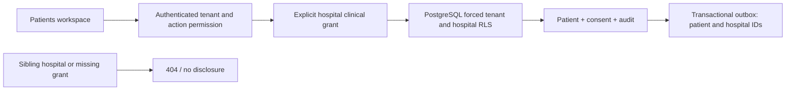

# Hospital-scoped patient registration

Related: #979, #981, #991, #70, ADR-0008. Implementation slice, not closure of the OPD stories.

The authenticated legacy EMR was reviewed read-only on 13 October. Its OPD entry
surface exposes patient name, MRN, ABHA, date, category and referrer searches.
The epic's existing evidence distinguishes patient identity from an encounter,
clinician, token and ward context. No patient values, exports or transactions
are used as development data. Fixtures are independently invented.

## Boundary and threat model

Patient identity, contact details and consent are protected assets. Another
tenant, a sibling hospital's employee, or a tenant administrator without an
explicit clinical grant must not discover them, including through matching.
Authenticated tenant permission AND an explicit patient-registry hospital grant
are required. Staff-directory access is not a clinical grant.

Retain the existing patientmaster owner and patient IDs. Add hospital scope to
patients with an append-only migration; existing unassigned rows are quarantined
by RLS, never guessed into a hospital. All child reads/writes follow their parent
patient's visibility. Matching operates only within the selected hospital.
Hospital IDs are external references to the canonical onboarding/workforce
directory, not new patientmaster-owned hospital identities. Patientmaster owns
only its clinical access grants. Provision grants with the canonical tenant and
hospital pair; no cross-module SQL or automatic staff-to-clinical promotion.

The grant administration API requires patient.access.manage. Readers can read;
registrars can register. Tenant administrators may administer grants but cannot
read patients until explicitly granted. Revocation is checked from PostgreSQL
on every transaction. Sharing across hospitals remains denied in this slice;
ADR-0008's category-specific sharing requires a separate reviewed implementation.

## Contract and UI

Existing /v1/patients routes require hospital_id query scope. Missing, unknown
or ungranted scope returns 404. Tenant comes only from the authenticated
principal. Patient search is submitted in a POST body so names and phone numbers
do not enter URL/access logs. Search is bounded and paginated, supports exact
MRN/mobile and name prefix, and never returns another hospital's match.

The Patients page uses the existing hospital directory, an explicit hospital
selection, server-side search, patient details and registration with a consent
receipt. It displays errors and duplicate refusal without creating an automatic
override. Fields: given/family names, date of birth and estimated flag, sex,
international phone, address, notice version and patient/guardian consent.
No real consent is fabricated by test data; synthetic records are labelled.

Registration and consent/outbox stay atomic. A UUID request_id makes identical retries replay their saved result; changed
input returns 409. PostgreSQL uniqueness and transaction locks handle concurrency; overrides remain API-only and
attributable. No clinical prescribing, billing, OPD scheduling, identity merge,
ABHA verification or cross-hospital sharing is claimed.

## Capacity and operation

Planning assumptions, not measured production load: 20 peak requests/s per
hospital, 4 KiB requests, 20 KiB pages, 9:1 reads:writes; 100k registrations/year
per hospital (100k at 12 months, 300k at 36). Target 99.9% availability and p99
under 500ms within the region. Composite hospital/keyset and matching indexes
support this scope; no clinical cache or new service is needed. PostgreSQL failure denies
access; identity/permission failure denies access; no AI dependency. Audit writes
are mandatory in the same transaction as successful PHI reads and registrations.
Incremental storage estimate is under 1 GB per 100k registrations excluding
attachments/audit retention; cloud cost must be measured, not represented as a quote.

## Migration and verification

Nullable hospital_id preserves old rows without making them visible. New API
writes always require a hospital. Verified assignment of historical rows is a
separate migration and is not automated here. Roll forward after deployment;
rolling back to a tenant-only API would reopen hospital access and is unsafe.
Test on disposable PostgreSQL: same-tenant sibling isolation, foreign tenant,
missing grant, read-only grant, revocation, children, duplicate matching, consent
atomicity, malformed input, pagination and audit without demographic payloads.
Use synthetic YES HOSPITAL records for the browser acceptance journey.

