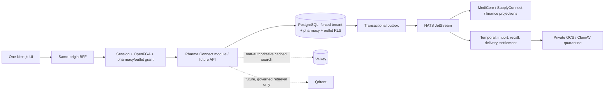

# Pharma Connect backend and data design

Date: 2026-10-15. Owner: Sam123ben. Parent exploration: #979.
Stories: #159–#172, #741, #742, #987, #988, #1029, #1051, #1060–#1062.
Cross-product pharmacy dependencies also assigned: #19 (pharmacy tenant/licence), #271 (compliance), #418 (pharmacist credentials), #476 (governed drug master), #490 (supplier integration), #493 (OCR), #567 (mobile app), #576 (dashboard), #586 (reports), #619 (catalogue import). Other clinical/shared-finance dependencies retain their owning product; assigning does not transfer ownership.
Status: implementation in progress; no story is complete solely because this document exists.

## Architecture and boundaries

Follow ADR-0007 as the target (one UI, product APIs); retain the existing pharmacy module in the current runtime until its extraction gates pass. PostgreSQL is authoritative. Module-owned tables and contracts make extraction possible without another writer. Do not reach into patientmaster, workforce, SupplyConnect or finance tables. Existing `/pharmacy/medications` and `/dispenses` contracts remain backward compatible; they are not the governed catalogue or stock ledger.

Tenant is the customer group; pharmacy organization and physical outlet are first-class pharmacy boundaries (ADR-0024). A tenant can own standalone pharmacies/chains, hospitals owning multiple pharmacies, or both. Hospital affiliation is optional and never the pharmacy access boundary. New requests require verified tenant + pharmacy + outlet plus route permission and an explicit outlet grant. Declared hospital ownership/serving/partner links stay pending verification and never imply data sharing. A pharmacy must not require an invented hospital or encounter. Existing clinical hospital isolation remains in force for genuine hospital records.

Planning assumptions (capacity targets, not measurements): 100 outlets, 60,000 catalogue products per tenant, 50 concurrent counter operators, peak 100 reads/s and 20 writes/s, <=32 KiB catalogue payload; 5:1 read/write ratio. At 10,000 movements/outlet/day, ~365m ledger rows/year across 100 outlets; plan retention and partitioning from measured growth, not before the ledger exists. Target monthly availability 99.9%, API p99 <=500 ms; #159 separately requires catalogue search p95 <=150 ms at 50 clients. No performance claim until a load test demonstrates it.

Assets are patient prescriptions, controlled-drug registers, stock integrity and financial records. Threats include another tenant, a sibling-outlet user, an insider changing drug schedules, duplicate delivery and simultaneous last-unit reservations. Boundaries are verified session -> route permission -> outlet grant -> forced RLS -> immutable ledger/outbox. Missing scope denies; database or authorization failures never broaden access.

## Story sequence and completion boundaries

| Stories                  | Backend responsibility                                                                                    | Dependencies / acceptance                                                    |
| ------------------------ | --------------------------------------------------------------------------------------------------------- | ---------------------------------------------------------------------------- |
| #159                     | Governed product, composition, pack, revisions, lifecycle, two-tier formulary, search and reviewed import | Country policy; platform governance; no tenant downgrade of regulatory flags |
| #988                     | Pharmacy categories, effective discount policy, templates and indent buckets                              | Shared category IDs; no duplicate financial master                           |
| #162, #166, #167         | Location/batch identity, immutable movements, reservations, FEFO, expiry, transfers and stocktake         | Supply receipt contract; concurrent quantity invariants                      |
| #171, #165, #1062        | Effective country rules, controlled registers, immutable access/export audit                              | Pharmacy/compliance owner confirms statutory retention and schedule rules    |
| #169, #168, #170         | Licensed pharmacist verification, approved substitutions, prescription-version fulfilment                 | Signed MediCore prescription and consent/identity projections                |
| #160, #161               | Rule-checked orders, durable payment/delivery state, OTP/cold-chain exceptions                            | Payment provider and delivery adapters; Temporal recovery                    |
| #163, #164               | Original-batch returns, explicit disposition, recall blocks and reconciliation                            | No automatic restock after broken custody; durable notifications             |
| #172, #987, #1029, #1051 | Sale/liability snapshots, credit notes/refund settlement, hospital bill attribution                       | Original tax policy; unique source-line IDs; no duplicate revenue            |
| #1060, #1061             | Stock/indent/margin and GST/HSN reconciled reports                                                        | Authoritative ledger and original financial snapshots                        |
| #741, #742               | Human-reviewed prescription assistance and demand forecasting                                             | Validated knowledge source/model evaluation; no autonomous clinical decision |

Implement these as successive correct slices. The user explicitly requested backend/schema first, so new UI work follows API acceptance rather than being bundled into the initial backend slice. Keep stories open until their complete acceptance criteria, including UI and deployment, are met.

## First slice: outlet-private product identity

`PUT /v1/pharmacy/pharmacies/:pharmacy/outlets/:outlet/catalogue/products/:id` creates or revises a tenant/outlet-private product. Client generates UUIDv7 and supplies expected_version (0=create). Identical retries return the same revision; changed requests need current version. SKU is case-insensitively unique within outlet, never brand-name-unique. Composition is an ordered bounded list of named ingredients and decimal-string strength/unit. Pack size uses positive integer base units; currency is an explicit three-letter code, money integer minor units.

The slice stores operational identity and **unreviewed** regulatory status. Regulatory attributes (schedule, prescription requirement, narcotic, tax slab, teleconsult eligibility) are deliberately not writable through this API; unknown fields are rejected. These products are not authorised for ordering/dispensing. Platform-governed base catalogue, regulatory review/approval, import, fuzzy ranking and cache integration remain separate acceptance slices of #159. No invented clinical rules or false OTC default.

Products have immutable revision snapshots and an optimistic version. `withdrawn` is terminal; no hard deletion. GET product/revisions and cursor-paginated search expose only the admitted outlet. Every mutation atomically stores revision, audit and `catalogue_updated` in the existing outbox. PHI is excluded from catalogue events. New outlet grants require `pharmacy.access.manage`, granted only through tenant-admin's existing implicit permission mapping; catalogue write also requires outlet `editor`. Reader cannot write. The same tenant subject needs an explicit second outlet grant to access a sibling.

## Second slice: quarantined stock receiving (#162, #166)

A product awaiting regulatory review may be received and reconciled only into quarantine. Add immutable quarantine-location and batch identities and an append-only receiving/correction ledger. This is a completed receiving boundary, not dispensing or FEFO. Quantities are positive/negative integers of the catalogue's base unit; this slice rejects fractional quantities and does not guess pack-to-unit conversions. Receipt is positive, correction requires a reason and separate admin-only permission. Corrections cannot overdraw the bucket. Stable client UUIDv7 movement IDs make retries return the original movement, while changed payload reuse conflicts. No on-hand balance is client-editable; compute it from ledger entries under a transaction advisory lock. The database trigger takes the same lock and rejects an overdraft, including through direct app-role writes. Compound outlet/tenant foreign keys protect batch and location references. All inventory remains non-dispensable in this slice; allocation/stock availability must not interpret quarantine on-hand as sellable.

Batch captures product ID, manufacturer lot, explicitly supplied full expiry date and optional manufacturing date. No manufacture/expiry guessing from month-only labels; month-precision conversion, outlet timezone expiry cutoffs, commercial receipt pricing, supplier-GRN integration and release from quarantine belong to subsequent reviewed slices. Identity tables are immutable so a lot or expiry correction cannot rewrite prior ledger provenance. Every receipt/correction has actor and reason, audit and a transactional stock_movement_recorded event. Lists are cursor-paginated, and the latest on-hand quantity is read from PostgreSQL, never Valkey.

## Subsequent inventory and workflow design

- Product -> pack -> batch (manufacturer lot, manufacture/expiry date) -> location balance. Composite tenant/outlet foreign keys prevent cross-boundary references. Use exact decimal quantities in base units, never binary floats; preserve conversion and pricing snapshots.
- Append-only movement IDs and unique source keys make receipts, returns and adjustments idempotent. Lock balance buckets in deterministic order, enforce on_hand >= reserved >= 0 in PostgreSQL, and commit ledger/balance/reservation/outbox together. FEFO excludes expired, quarantined, recalled, withdrawn and unreviewed products.
- Do not expose a generic stock decrement as dispensing. Fulfilment requires approved prescription version, patient/pharmacy consent and access (plus hospital scope when a hospital record is referenced), verified licensed pharmacist, current rule version and reservation. A physical dispense with unavailable billing becomes charge_pending; never pretend it was undone.
- Clinical orders reference Platform patient and encounter IDs. No patient names in NATS events or Temporal histories. A controlled local projection can store minimum needed details with access-read audit.
- Money uses currency + minor units; taxes/HSN, exchange/rounding, discounts, liability and original sale lines are snapshotted. Refund totals cannot exceed original remaining refundable values. Hospital posting uses a globally stable source-line ID and an acknowledgement projection, not another sale.
- NATS uses module contracts, transactional outbox and idempotent durable consumers. Temporal is for approval waits and multi-step import, transfer, delivery, recall and refunds; activity retries remain idempotent. No Temporal workflow for a single PostgreSQL catalogue write.
- Valkey can cache tenant/pharmacy/outlet/version-scoped search after indexing/load evidence, with TTL and cold-cache fallback. Never cache stock as authoritative or permissions past revocation. Qdrant remains future work.
- Documents use the existing private attachment/ClamAV pipeline. GCS scope: tenant/pharmacy/outlet/resource type/resource ID/date/generated object ID; no patient names or raw filenames in object paths. Only clean, authorised objects may be downloaded. Do not create a second upload pipeline.

## Legacy evidence and deliberate improvements

Read-only authenticated review on 2026-10-15. No source transaction submitted, no customer record exported or retained in fixtures.

| Surface inspected         | Observed structure                                                                                                                                                       | Target                                                                              |
| ------------------------- | ------------------------------------------------------------------------------------------------------------------------------------------------------------------------ | ----------------------------------------------------------------------------------- |
| Pharmacy Sales List       | Date ranges; linked/non-linked bills; IP, casualty, OP/counter types; store; serial/patient/MRN/category/registration search; date, bill amount, patient balance, credit | Unified cursor worklist with encounter linkage and explicit liabilities (#987)      |
| Pharmacy setup navigation | Patient Category, Margin Discount, Pharmacy Template, Bucket Master                                                                                                      | Governed pharmacy configuration (#988)                                              |
| SalesCategoryMaster       | Hospital/insurance/sales/wholesale category; MRP or above/below purchase/GST-inclusive base; discount percent; explicit discount/default/counter/zero-margin switches    | Effective-dated integer-basis-point policy, validated defaults, authorised previews |

Other report fields already recorded in #1060–#1062 (read-only exploration): batch/expiry/return quantities and prescriber; HSN, taxable value, CGST/SGST/IGST/cess. These are requirements evidence, not proof of legacy calculation correctness or legal compliance. Further rendered-page review: margin rules specify store/patient category/item category/subcategory/item, margin range, minimum margin, maximum discount and effective dates. Templates specify store, medicine/generic search, zero-stock toggle, quantity/current stock and template name. Bucket master specifies unique bucket number and allocated status. Dispatch details need further inspection. Manufacturer/product configuration may belong to procurement/store navigation, not the sales setup menu.

## Verification and release

Real disposable PostgreSQL 16 and NATS JetStream, non-BYPASSRLS app role; migrate empty DB and reapply; prove RLS without scope, wrong tenant, sibling outlet, reader writes and cross-boundary references. API tests cover strict/bounded input, unique SKU, concurrent versions, identical retry, terminal withdrawal, audit and atomic outbox. Synthetic names use explicit TEST prefixes and reserved domains; no transformed real records required. Measure load separately before asserting SLOs.

Append-only expansion migrations with lock and statement timeouts. Down migration is intentionally unsupported: reverting code preserves tables/history; destructive rollback requires a reviewed migration. No production migration/rollout occurs just from writing this spec. Use existing reusable CI/images -> Kargo -> Argo, with concrete release and live acceptance evidence before declaring deployed.

## Ownership clarification before release

The user clarified on 2026-10-15 that independent pharmacies, chains and hospital-owned pharmacies must all work. ADR-0024 is authoritative. Replace the unmerged hospital-mandatory draft with module-owned organization/outlet directory APIs, a tenant-scoped pharmacy/outlet selector, explicit outlet grants, and optional pending hospital affiliation declarations. A tenant administrator may manage organization metadata but still needs a separate outlet grant for catalogue/inventory access. Test independent tenants with no hospital at all, multiple pharmacies and outlets within one tenant, wrong-parent outlet paths, and denied cross-tenant access. Hospital affiliation is not clinical-sharing authority. Legacy hospital screens are requirements evidence, not a reason to force standalone pharmacies into a hospital model.

## Extended accounting scope from inventory audit review

The requested full pharmacy scope includes acquisition/landed costs, supplier invoice liabilities, operating expenses, recorded external payments, payer/payee attribution, partial settlement, credits, reversals, outstanding/due amounts, original-batch cost coverage and audit history. The local operational register is specified in [ADR 0025](../../adr/0025-pharmacy-cost-and-payable-audit.md) and [API documentation](../../architecture/pharmaconnect-api.md). It supports standalone, chain and hospital-owned pharmacy organizations without changing the optional hospital-sharing boundary.

Full accounting acceptance still requires supplier-master/procurement contracts (#1005/#1007/#1011), approved Finance masters and period close (#1044/#1046), credit/debit-note adjustment and bank reconciliation, sales/customer receivables and insurer/patient/hospital liabilities (#172/#987/#1051), source-linked returns/refunds (#1029), approved inventory/COGS costing (#1060) and effective GST/HSN rules (#1061). Do not duplicate those masters or post hospital and pharmacy revenue twice. Use immutable source IDs and transactional outbox events; Finance posting consumers must deduplicate each document/entry. The current record-payment operation never initiates a financial transfer.
