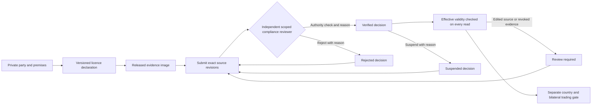

# Independent licence review

Issue: #1135; epic #1133; subsequent consumers #1136 and #1139. Owner: Sam123ben.

## Outcome and boundaries

A declaration and a clean image do not establish a verified licence. Add a private,
independent review workflow with immutable decision history, tied to the exact
party, premises, licence and evidence revisions reviewed. This slice covers
submission, verification, rejection, suspension and resubmission. Organisation
lifecycle, approved jurisdiction/category policy, bilateral trading, payments and
actual government verification integrations retain their owning stories. No
licence review alone permits ordering or dispatch. No default statutory policy
or real customer data is introduced.

Planning envelope, not measured production capacity: 100 organisations/tenant,
2 premises/organisation on average (20 permitted), 10 licences/premise and
20 decisions/licence/year across 50 tenants: 2 million decisions at 12 months.
With 2x annual growth, cumulative decisions reach 14 million at 36 months. Peak
load assumption is 100 read/10
write requests/s peak, <=32 KiB request, 10:1 reads:writes, 2x annual growth.
Target 99.9% availability and p99 reads <300ms/writes <500ms, excluding user or
external authority review. Use the existing indexed PostgreSQL; no new runtime
and no additional service or worker. At an assumed 1 KiB/decision and 3x table/index overhead,
plan approximately 6 GiB per replica at 12 months and 42 GiB at 36 months, plus
backups. Capacity, storage budget and restore review precede that growth; these
are estimates, not observed storage or load results. Load targets require
benchmark evidence before claims.

## Trust and authority

Assets are private business evidence and the integrity of legal decisions.
Threats include another tenant, a same-tenant ungranted user and a maker trying
to approve their own evidence. Every API call requires its module permission
and current explicit party grant. Review decisions require party compliance
access; being a tenant administrator does not bypass independence. The verifier
must differ from the submitter, licence revision author, premises revision author,
party revision author and evidence uploader. All three exact revision authors must
be visible and nonempty; inaccessible history cannot establish independence.
PostgreSQL forced RLS, composite
revision FKs and insert guards enforce these boundaries too. The official client sends expected-tenant and expected-subject preconditions;
subject drift returns 409 before reading or writing review history. These are
freshness checks, never substitutes for verified identity or object authorization.
No worker, cross-tenant bypass, owner pool or permissive public projection is added.

## State and contract

`PUT /v1/supply/parties/:party/licenses/:license/reviews/:review` stores a stable
UUIDv7 command with expected stream/party/premises/licence versions, evidence ID,
action, reason, verification method and non-sensitive authority-check reference.
An identical retry by the same actor returns its original receipt even after
later changes; ID reuse with different input conflicts. A stale expected stream
or current source revision conflicts, without any audit/event write.

The append-only stream transitions: no decision -> submitted; submitted ->
verified/rejected; verified -> suspended; rejected/suspended -> submitted.
A changed party/premises/licence revision or unavailable evidence requires a new
submission. Each entry preserves actor/time, original source versions, evidence
and expected sequence; histories use bounded cursor pagination. `GET .../review`
returns the latest receipt plus an effective state and blockers. This read never
labels a stale revision, inactive premise, revoked evidence, not-yet-issued or
expired licence verified. Expiry uses the premises time zone and is inclusive
through the recorded expiry date. Effective state is calculated from current
authoritative rows on every read, never Valkey. Historical decisions remain intact.

Submission requires a current released image. Verification rechecks that image,
all current revisions, active premises and current validity dates, and requires
an independent authority-check method/reference and reason. A scan is never
itself the verification method. Suspension records an attributable reason;
resubmission requires a new independent decision before effective verification.

## Atomicity and recovery

Serialize a party's source snapshot with a shared lock on its profile and premises,
and the existing licence advisory lock. Evidence is locked before reading verdict;
concurrent edits/revocations either precede the decision or make it immediately
ineffective. Keep consistent lock order: party grant, licence advisory, party row,
premises row, evidence row. No network call occurs while holding those locks.
Insert decision, audit trigger and minimized outbox event in one transaction.
A failed outbox rolls everything back. NATS delivers at least once; downstream
consumers must recheck current eligibility before commitments. Temporal is reserved
for reminders/escalation and later trading sagas, rather than this single-database
transition. Cache, scanner or authority-portal outages cannot grant verification;
PostgreSQL/authz failure denies the operation. Unknown/inaccessible objects return
404, version/state conflicts 409 and unavailable authorization 503.

## Migration, rollout and verification

Append `0004_supply`, with 5s lock and 60s statement timeouts. New tables only;
old code remains compatible. No backfill or destructive down migration. Rollback
retains immutable history and disables new review UI/API through the prior app
artifact; future code repairs forward. Production migration/rollout needs specific
approval after a tested candidate is reviewable.

TDD covers independent actors, missing/stale/revoked evidence, expiry/future dates,
revision invalidation, cross-tenant/party/grant denial, duplicate/concurrent input,
immutable DB history, forged SQL decisions, event minimization and rollback.
Then actual local API/UI with synthetic data, full race/coverage, lint/vet/build,
web type/lint/test/build, contract drift checks and hosted CI. No story closes
until all its acceptance is satisfied; this is the review slice of #1135.

## Workflow

[Rendered workflow](../../architecture/diagrams/14-supply-licence-review.svg) ·
[Editable draw.io source](../../architecture/diagrams/14-supply-licence-review.drawio).
