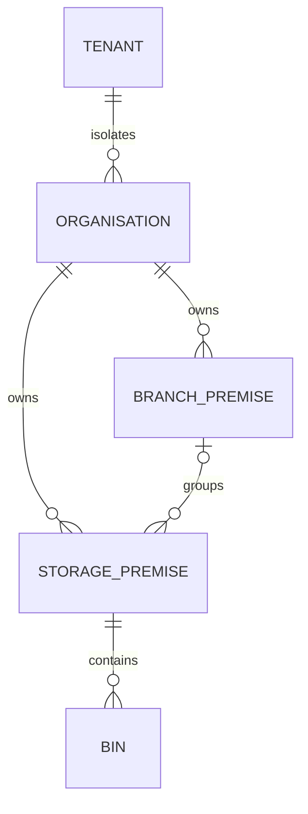

# Branch-owned warehouse and depot locations

Story #1137, epic #1133; follows the released bin configuration in #1192.

A tenant-local owned legal organisation already owns branches and storage premises.
Add an optional `branch_premise_id` to warehouse/depot premises, referencing an existing
branch of that same organisation and country. A branch belongs directly to the existing
legal organisation; it cannot point at another branch, so this structure cannot cycle.
Standalone warehouses remain valid. This is a reporting/operating structure, never
permission inheritance, licence approval, ownership transfer or cross-tenant sharing.
Corporate parent entities, territories, representative assignments, location role grants
and delivery access remain separate acceptance under #1137.

## Contract, isolation and compatibility

Extend the existing premise PUT/GET/paged list and immutable revision snapshot. The
shared generated contract accepts a UUIDv7 or null. Omission on an update preserves the
existing assignment for older clients; explicit null unlinks it. The API rechecks current
organisation grants, owned record kind, same tenant/party/country and branch type. A new
or changed assignment must select an active branch. An unchanged assignment is retained
when the branch is retired; that retirement does not move or grant access to stock.
The UI resolves an existing selection outside the loaded page, pages through available
premises and hides stale selection data on refresh errors. Labels distinguish active
and inactive branches. Read-only users cannot write.

Forced RLS remains on the existing premises/revision tables. A composite self-FK and
DB guards protect scope, UUIDv7, storage-child/branch-parent kinds and self references.
A branch with linked premises cannot change kind. API premise writes take an organisation
structure advisory lock before individual identity locks. SQL guards use the same lock
and row locks; concurrent parent reclassification and new assignment cannot both commit
an invalid structure. Current explicit grants remain locked while writing.

Stable premise IDs and optimistic versions retain existing exact-retry semantics.
A single transaction saves the head, immutable snapshot, audit and minimal existing
NATS outbox IDs/version. No addresses or branch labels enter events. PostgreSQL/authz
failure denies safely; NATS failure leaves durable outbox retry; Valkey is not structure
or permission authority. No new Temporal workflow is required for this transaction.

## Sizing, rollout and recovery

Reuse the bin spec's planning assumptions (100/1,000 tenants at 12/36 months, peak
100 RPS, 95:5 read/write, <=32 KiB inputs, <=200/page), 99.9% monthly availability and
p99 <300 ms/page. At 10 branches/tenant this adds at most 10k branch references at
36 months, within the existing PostgreSQL budget. No new service/cloud resource. Branch-child lookups reuse existing tenant/party
index prefixes across approximately 20 premises/organisation; no blocking index build
is introduced on the populated premises table.
Migration 0006_supply adds one nullable UUID column, a composite self-FK and trigger guards with bounded lock/statement timeouts. No backfill,
deletion or rewrite of historical snapshots. Old binaries preserve the new column by
not selecting it in updates; rollback retains the column, constraints and evidence.
A separate hierarchy service or second location master was rejected because existing
organisations/premises already own this information.

