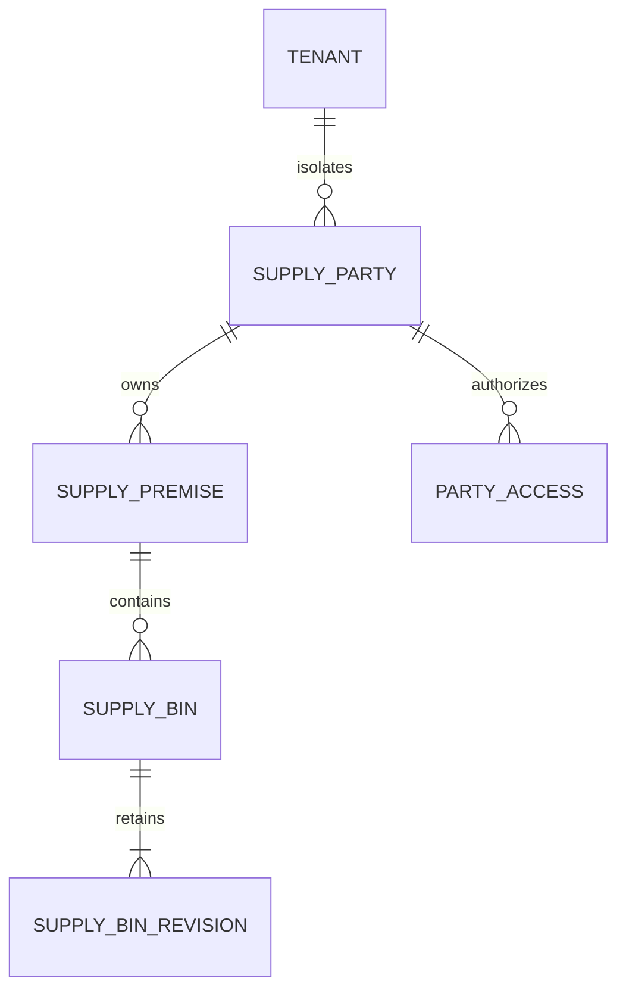

# Distributor operations and scoped access

Parent story: [#1137](https://github.com/tesserix/helivanta/issues/1137), epic #1133.
Related location master: #1011. This document does not close those stories.

## Boundary and delivery

Reuse SupplyConnect's tenant-local legal organisations (`supply_parties`) and physical
addresses (`supply_premises`). A corporate group label never grants access. Another
tenant is never a child partition. Existing licence and Finance masters retain ownership.

Deliver independently verified vertical slices in this order:

1. Warehouse/depot bins with immutable revision history and explicit existing
   organisation grants. This change implements this slice only.
2. Explicit legal-entity/branch links and sales territories/representative assignments.
   The warehouse/depot-to-branch relationship is specified in
   [the branch premise follow-up](2026-10-17-distributor-branch-premises.md); it does
   not implement corporate parent entities or territory assignments.
3. Expiring, reasoned location role grants: inventory, picker, packer, dispatcher,
   read-only auditor/regulator, with immediate revocation and independent operation checks.
4. Assigned-delivery-only driver views, approval settings and approved support escalation,
   integrated with their owning order/delivery stories and audited acceptance.

No bins endpoint grants warehouse, sales, driver, finance or platform support access.
Those roles do not acquire private organisation/licence access through this change.
Pharmacy roles and clinical access remain independent. No implicit role inheritance.

## Legacy reconciliation

The read-only exploration recorded in #1011 identifies Store > Setup > Stores,
Locations and Assigning Rack Shelf. Rack and shelf remain explicit fields; aisle and
storage class add a standard warehouse position/handling declaration. This slice
uses the existing owned organisation and physical premises, and does not claim to
finish department/store roles, category/unit mappings, auto-PO rules, movement
restrictions or import. Those remain tracked in #1011 and their owning stock stories.
No legacy records or clinical data are copied.

## Warehouse/depot bin contract

`/v1/supply/parties/:party/premises/:premise/bins` is cursor-paginated (maximum 200).
`PUT .../:bin` uses a client-generated UUIDv7 and `expected_version`; `GET .../:bin`
and cursor-paginated `GET .../:bin/revisions` return the actual saved state/history.
Code (unique within the premise), name, aisle, rack, shelf, storage class
(ambient, cold_chain, controlled, quarantine) and active/inactive status are recorded.
Storage class is a declaration, not evidence that a facility meets a legal or temperature
standard. No temperature ranges, product stock or licence approvals are inferred.

The parent must be an owned organisation and the existing premise a warehouse/depot.
The tenant, party, premise and country are server-derived and immutable. Writing an active bin
requires an active premise. Retiring a premise retains its bins; future stock workflows
must require both the premise and bin to be active. An existing bin may be retired under an inactive premise.
A premise with bins cannot be changed to a non-storage kind. Reads retain retired
records and old revisions; deletion is prohibited. Empty/inaccessible parents are
not confused: inaccessible parents return 404; valid empty parents return a paged empty list.

Read permission: `supply.bin.read` plus a current explicit administrator, purchasing,
compliance or auditor organisation grant. Write: `supply.bin.write` plus administrator
or purchasing grant. All checks are repeated server-side in the transaction. Grant
rows and the parent premise are share-locked while writing, so a committed revocation
or premise reclassification cannot race a later write. Forced RLS repeats the organisation
check; composite foreign keys prevent foreign tenant/organisation/premise references.

## Integrity, audit and failure handling

One PostgreSQL transaction commits the head, immutable snapshot with actor/time,
audit trigger and minimal NATS JetStream outbox intent. Stable bin ID plus optimistic
version collapses exact retries; differing stale changes return 409. Advisory locking
serializes concurrent retries. Events carry only party/premise/bin IDs and version,
not addresses, contacts, storage labels or staff identity. Publish failure rolls back
all database effects. No network call occurs in a transaction.

PostgreSQL or authorization unavailable: deny, no stale data. NATS unavailable: durable
outbox retains the event for relay; never claim delivery from a successful database
commit. Valkey is not permission authority and is unnecessary for this small master.
Temporal is unnecessary for this single transaction; it remains the owner of durable
multi-step workflows. No GCS objects or patient/customer data are involved.

UI uses shared API hooks, modern SelectControl, inline schema errors, keyboard focus,
explicit save/retire actions and paged history. A failed read hides cached records;
a failed save retains the draft and stable ID. Tenant/party/premise scope is in every
query key. Bins appear in the selected owned premise, not a duplicate inventory master.

## Sizing and operations

Planning assumptions, not measured capacity: 100 tenants at 12 months/1,000 at 36,
10 warehouses and 500 bins per tenant (0.5M/5M heads), 3 revisions/head, 95:5 reads:writes,
peak 100 requests/s, requests <=32 KiB and <=200 results/page. Target 99.9% monthly
availability, p99 <300 ms for one page. At ~1 KiB/head and ~2 KiB/revision, raw storage
is ~3.5/35 GB before indexes/replication/backups. No new service, cache or cloud resource;
use existing database budget, verify growth before purchasing capacity. Index equality
prefix tenant/party/premise then created_at/id; no OFFSET or unbounded list.

Migration 0005_supply is additive and forward-only. Fresh tables use bounded DDL timeouts;
no populated index rebuild. Test on a disposable database, test immutable constraints and
application rollback compatibility. Release recovery reverts the application image while
retaining the additive tables and evidence; do not delete audit history or apply down SQL.
A duplicate warehouse master or generic polymorphic entity tree is rejected because it
would create two sources of truth and weaken composite scoped references.

## Data and commit flow



```mermaid
sequenceDiagram
    actor Staff
    participant API
    participant PostgreSQL
    participant Relay as Existing outbox relay
    participant NATS as NATS JetStream
    Staff->>API: PUT bin UUIDv7 + expected version
    API->>PostgreSQL: BEGIN tenant transaction + current grant / premise locks
    PostgreSQL-->>API: Forced RLS + owned storage premise
    API->>PostgreSQL: Lock bin identity; compare saved fields/version
    alt exact retry
        PostgreSQL-->>API: Existing result; no duplicate effects
    else new valid revision
        API->>PostgreSQL: Head + immutable revision + audit + minimal outbox event
    end
    API->>PostgreSQL: COMMIT
    API-->>Staff: Saved state
    Relay->>PostgreSQL: Read committed pending outbox
    Relay->>NATS: Deliver minimal IDs/version with existing retry policy
```
