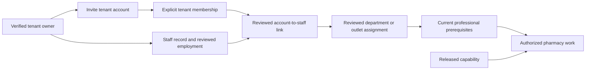
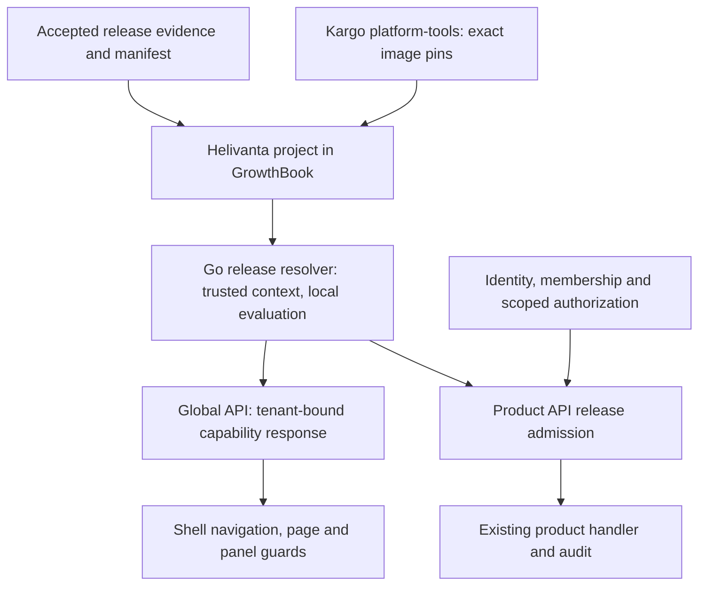

# First release: onboarding, Staff and PharmaConnect

Tracking: [#1728](https://github.com/tesserix/helivanta/issues/1728).

Date: 2026-11-16. Status: proposed implementation design; no feature is enabled by this document.

## Outcome

A new hospital or independent pharmacy owner can onboard, verify their email,
establish their tenant-owned identity, sign in and manage their team. Hospital
owners can set up their pharmacy department. Independent pharmacy owners use their
own employer and outlets. Users see only released features for which they have
current authority. Unreleased features are absent from menus and inaccessible
through bookmarked pages, direct API calls, exports and alternate client paths.

The user confirmed Mahesh's [counter acceptance plan](../../qa/2026-11-09-pharmacy-counter-acceptance-plan.md)
and [fresh-tenant guide](../../qa/2026-11-14-pharmacy-acceptance-fresh-tenant.md)
as the pharmacy baseline, requested consistent Staff release slices, GrowthBook,
exact image pins and automated platform-tool upgrades through Kargo.

This reduces release scope, not correctness. Existing identity, independent
review, professional qualification, audit and stock/financial controls remain
mandatory. A flag never substitutes for one of those controls.

## Verified starting point and evidence limits

| Source | Finding | Consequence |
| --- | --- | --- |
| `packages/ui/src/zones.ts:visibleZones` | Navigation is filtered by permissions; there is no release-capability field on `Zone`/`ZonePage` | Owners can see a broad feature set despite unfinished acceptance |
| `packages/ui/src/hms-shell.tsx:HmsShell` | Uses `visibleZones(can)` | Add release filtering alongside permission filtering, including phone navigation |
| `apps/shell/app/(workspace)/workforce/page.tsx` | Composes enrollment, directory, identity, login links, documents, credentials, employment and posting panels | Top-level menu filtering alone cannot simplify Staff |
| `backend/internal/platform/router.go` | Central route declaration, membership, permission, establishment and scoped admission | Release admission must cover every registration path, not selected handlers |
| `docs/api/reference/inventory.json` | Canonical generated route/permission inventory | Reconcile route release classification against this inventory in CI |
| Mahesh's counter plan, section 15 | Build, run-sheet, case results and reviewer sign-off fields are blank | A test plan is not a release certificate; retail flags start off |
| PR #1726, release `158d9fe3` | Person selector names/roles verified live; Kargo healthy | Evidence for this display behavior only, not all Staff or pharmacy operations |
| Platform issues #9, #691, #704 | GrowthBook and Go/web SDK integration issues remain open | Do not claim Helivanta is already integrated |
| `tesserix-k8s/argocd/prod/infrastructure/growthbook.yaml` | Shared GrowthBook definition uses a floating image tag | Pin and manage through the platform-tools Kargo path |
| Read-only GKE inspection | Namespace `growthbook`: app 1 ready replica, image `growthbook/growthbook:latest`, application package version `5.2.0`; MongoDB 1 ready replica, image `mongo:7.0` | Version is current; reproducible pin, backup/restore, SDK access and provider isolation still require verification |
| Existing infra Kargo stages | `platform-tools-prod` fails on a missing sealed-secrets file; `openbao-prod` reports protected-main write rejection | Use a dedicated GrowthBook lane within the existing infra project and reviewed PR write-back; do not copy the failing direct-push mechanism |
| Official GrowthBook release API | Latest stable is [v5.2.0](https://github.com/growthbook/growthbook/releases/tag/v5.2.0), published 2026-11-03 | Discovery result, not permission to skip compatibility checks or a proven image digest |

No existing customer data is deleted. No shared GrowthBook project, SDK connection,
feature or secret is overwritten. Root-checkout work and other product upgrades
remain outside this change.

## Release tree

```text
Helivanta
├── Essential identity and security — retained throughout
│   ├── Sign-in, verification/password continuation, account chooser
│   ├── Sign-out, MFA, session/revocation and account recovery
│   └── Tenant-bound identity, permissions and required audit
├── R1 Foundation — enable only after its acceptance record passes
│   ├── New hospital OR independent-pharmacy onboarding
│   ├── Owner workspace and essential tenant/security settings
│   ├── Staff core
│   │   ├── Named team directory and staff-account invitations
│   │   ├── Separate account, membership, employment and login-link states
│   │   ├── Required independent reviews and safe access assignment
│   │   └── Suspension/revocation and staff login verification
│   ├── Department teams — hospital pharmacy scope first
│   │   └── Members, head/supervisor and required posting reviews
│   └── PharmaConnect setup
│       ├── Ownership, employer, branches/outlets and affiliations
│       ├── Named outlet access and necessary governance
│       └── Licence/evidence and pharmacy-staff prerequisites
├── R2 Retail pharmacy — Mahesh's accepted end-to-end scope
│   ├── Catalogue, effective classifications and regulatory review
│   ├── Stock receipt, quarantine, correction, release and safety
│   ├── Prescriptions/evidence and eligible counter sale/payment
│   ├── Returns, credit notes and necessary recovery/refund paths
│   └── Sales/registers/reports and separately accepted payables
└── Later releases — default off
    ├── Staff rosters, attendance, leave, payroll and benefits
    ├── Other clinical departments, lab, emergency and billing workspace
    └── Independent supplier grants, both stock owners' fulfilment,
        hospital receiving/discrepancies and financial integration
```

R1 is a usable setup/team release; it must not imply dispensing readiness.
R2 cannot open its counter before all mandatory stock, licence, prescription,
return, payment-recovery and register dependencies pass. Hidden SupplyConnect
fulfilment does not hide the ordinary stock-intake paths that retail actually
needs. Shared backend dependencies may run without exposing their workspaces.

## Staff scope and acceptance

| Slice | Exposed task | Required proof | Kept out until separately accepted |
| --- | --- | --- | --- |
| R1 team accounts | Owner invites multiple people, sees name/email/current organization roles and invitation state | Repeated invitation is safe; verified tenant-owned account; email failures visible; expiry/resend; each person can sign in | Custom role designer, broad platform-admin grants |
| R1 staff core | Create/update staff, required employment/identity evidence, independently reviewed login link | Account creation is not employment activation; duplicate identity and stale version refusal; no self-approval | Optional HR documents/analytics not needed by released duties |
| R1 department teams | Pharmacy department members, head/supervisor, required assignment/posting review and removal | Narrow employer/department/outlet scope; peer reviewer; changes invalidate stale authority | General transfer automation and other department workflows |
| R1 pharmacy staff | Hospital-employed and independently employed pharmacy staff; required credentials and operating access | Outlet reader/editor and professional operating authority are distinct; valid reviewed evidence; inactive staff denied | Supplier staffing and cross-tenant clinical access |
| Later workforce | Scheduling, leave, attendance, payroll, benefits, advanced governance | A dedicated acceptance run and owner sign-off per group | Everything in this row starts off |

Do not silently remove evidence or review screens required by the current staff
lifecycle. Present required steps together in the core journey; retain their
existing data owners, authorization and audit. If a required step cannot be
completed using released UI and API, the dependent slice remains off.



An owner is not automatically a pharmacist. A department head is not automatically
a clinical decision-maker. Independent pharmacy collaboration never copies
hospital tenant membership or permits unrestricted tenant switching. Current
separate tenant accounts and their account chooser are preserved.

## GrowthBook and release authority

Reuse the shared self-hosted GrowthBook infrastructure with a dedicated Helivanta
project, environment and SDK connection. Verify those isolation features against
the installed edition; if unavailable, stop rather than sharing another product's
feature payload. No experiment, patient-data targeting or paid entitlement work
is required for this release.

GrowthBook owns deployment targeting values. A canonical Helivanta manifest owns
known keys, dependencies, owners, default values, route/page/panel bindings and
release-evidence references. RBAC owns what the person may do. Product owners own
object data and current narrower scope. These are four separate decisions.



For new work, availability is the intersection of deployment allowlist, valid
GrowthBook decision, dependency closure and current permission/scope. GrowthBook
cannot enable a key outside the deployed allowlist. A missing/unknown flag is off.
Release flags cannot grant permissions, waive pharmacy policy, bypass independent
review, or convert membership-only `staff_member` into operational authority.

Use server-side local evaluation through a pinned, compatibility-tested Go SDK
and an OpenFeature adapter as tracked by #9/#691. The web consumes resolved
capabilities, not a second independent evaluator. No browser SDK secret, raw rule
payload or client-supplied tenant/department/role becomes authority. Targeting uses
verified tenant and establishment context; no patient identity, prescription,
staff email or raw authentication token enters GrowthBook attributes or logs.

No per-request provider call. Refresh server snapshots at most every 30 seconds;
bound validity to 60 seconds. These are proposed acceptance limits, not claims
about the existing deployment. Missing, invalid or over-age snapshots deny new
gated work with 503. An explicit off decision returns 404 after normal identity
admission. Permission refusals remain 403, outside-object scope remains 404 and
identity/authority outages remain 503. Never serve stale-enabled indefinitely.

At 1,000/3,000 planned peak RPS from the portfolio assumptions, evaluation is
local; target p99 overhead below 2 ms, with no synchronous GrowthBook dependency
on a business handler. Capability responses are small, bounded, private/no-store
and account scoped. Provider failure does not disable sign-in, sign-out, recovery,
verification continuation or revocation. Base identity reliability remains the
existing auth contract; release admission adds no external hot-path dependency.

### Proposed registry groups

All releasable groups default false. Essential security/recovery operations are
explicitly classified baseline, not optional flags. Names below are proposed keys.

| Key suffix under `helivanta.release.` | Depends on | Release |
| --- | --- | --- |
| `onboarding` | Baseline identity | R1 |
| `team_accounts` | Baseline tenant membership and required account governance | R1 |
| `staff_core` | `team_accounts`, required employment/identity/link reviews | R1 |
| `department_teams` | `staff_core`, required posting review | R1 |
| `pharmacy_setup` | `team_accounts`, required outlet/licence governance | R1 |
| `pharmacy_staff` | `staff_core`, `pharmacy_setup`, employer-specific prerequisites | R1 |
| `pharmacy_catalogue` | `pharmacy_setup`, classification review | R2 |
| `pharmacy_stock` | `pharmacy_catalogue`, stock safety and correction/release | R2 |
| `pharmacy_prescriptions` | `pharmacy_staff`, released evidence/file pipeline | R2 |
| `pharmacy_counter` | All preceding pharmacy groups, `pharmacy_returns`, `pharmacy_reports`, accepted payment recovery | R2 |
| `pharmacy_returns` | Stock, original-sale read and complete credit/refund recovery | R2 dependency |
| `pharmacy_reports` | Audited sales/stock/register reads and exports | R2 dependency |
| `pharmacy_payables` | Accepted payable and settlement workflow | Separate R2 gate |
| `workforce_scheduling`, `workforce_payroll`, `workforce_advanced` | Own acceptance and dependency closure | Later |
| `supplier_collaboration`, `clinical`, `lab`, `emergency`, `billing_workspace` | Own acceptance and dependency closure | Later |

Counter/returns/report cycles must not become a manifest dependency cycle: the
shared original-sale read and recovery primitives are a required internal
dependency, independent of the public counter-entry flag. CI validates an acyclic
dependency graph. Do not expose the Billing workspace just to satisfy pharmacy
payment dependencies; gate that workspace separately from internal Finance APIs.

### Proposed contracts and enforcement

Add one authenticated platform-owned `GET /v1/workspace/release-capabilities`
through the Global API. It returns a fixed-schema snapshot: tenant, subject,
policy version, issue/expiry timestamps and bounded effective capability entries.
It reveals neither raw targeting rules nor why another tenant was selected.
It is a UI availability hint, never a reusable authorization credential.

Extend declared-route metadata with exactly one classification: baseline,
release-gated new work, internal dependency or tightly specified continuation.
Bind every method/path to a manifest entry, including list/count/export/download,
legacy paths, public signup, partner paths and direct product routes. Preserve
all existing admission checks; do not classify by URL prefix alone. Registry and
generated references must fail CI on unknown/unmapped routes or capabilities.

The shell hides unreleased rail links, phone menu entries, dashboard cards,
shortcuts, tabs, nested Staff panels, buttons and search results. Page guards run
before business-data queries. Bookmarks show a neutral unavailable page, without
rendering protected data. Public signup is deployment gated before a tenant
exists; existing verification/password continuation remains accessible.

Clear capability/query/form state on account switch. Bind responses to exact
current tenant, subject and transition generation. Abort stale requests; reject
late responses from the previous account. Loading/error never shows an optimistic
full menu. Pick the first permitted released landing page; avoid redirect loops.

### Disabling after activity exists

Disabling a release blocks new entry, not historical accountability. Preserve
completed records, audit and access revocation. Before any operational group is
enabled, classify its existing transaction-status, evidence, correction, refund,
stock-safety and completion paths. A continuation must reference a previously
admitted transaction and revalidate current identity, scope and legal state; it
must not create unrelated new work. Dedicated recovery navigation remains only
for authorized people with such outstanding work. Workers finish durable accepted
work; no mid-transaction flag recheck creates a half-posted stock or financial act.
If a safe drain/continuation contract is absent, that group cannot be enabled.

## Evidence-driven activation

Each group moves through draft → implemented → CI-passed → deployed-dark →
synthetic-live-accepted → approved → enabled. Evidence records exact application
commit, images, schema version, GrowthBook configuration revision, tenant model,
case IDs, result and reviewer. Merging code, route registration, one screenshot or
a successful Kargo promotion does not skip live workflow acceptance.

Use the single existing prod/QA environment with isolated synthetic pilot tenants;
no local app servers or databases. Prove hospital-owned pharmacy and independent
pharmacy independently. R1 needs owner plus multiple staff logins, scoped reader,
editor, manager/reviewer behavior, revocation and cross-tenant refusal. R2 uses
Mahesh's G-1–G-5 and SET/CAT/STK/RX/PAT/SALE/RES/RET/REP/REG/SEC/AUD/UX cases as
applicable, settles F-1–F-12 and fills section 15. Current legal/finance/professional
reviews are not replaced by flags. Maharashtra/Odisha applicability is recorded;
no country/state or drug-schedule rule is itself an optional release flag.

## GrowthBook upgrades through platform-tools Kargo

The owning repositories are `tesserix/kargo-manifests` (production promotions)
and `tesserix/tesserix-k8s` (Argo/Helm desired state). Add a dedicated GrowthBook
Warehouse/Stage within the existing infra platform-tools project. This is the
same upgrade mechanism with an independent failure boundary, not a second manual
image authority. Use PR write-back compatible with protected main, followed by
Argo revision/health verification; do not weaken branch protection.

1. Discover stable supported GrowthBook versions; exclude floating/prerelease tags.
   Start with current-minor patch automation (`>=5.2.0 <5.3.0`). Discover newer
   minor/major releases for review; widen the supported range only after upgrade
   compatibility and recovery evidence passes. Do not call range widening an
   automatic compatibility check.
2. Record an exact version and immutable multi-architecture digest in Freight and
   in the effective Argo/Helm image reference. Verify registry provenance and scan.
3. Check release notes, upgrade path, Mongo compatibility, current snapshot/restore
   evidence and free-edition availability of required project/RBAC/SDK features.
4. Kargo writes only GrowthBook's owned image fields in GitOps. Never reset shared
   flags/users, re-run a destructive seed or upgrade Mongo as an incidental change.
5. Automatic promotion requires manifest/render tests, application and SDK health,
   tenant/project isolation, flag on/off/default/failure tests and preserved data.
   Pause on failures. Major or irreversible schema changes require explicit
   reviewed migration/restore approval; never blindly auto-upgrade across them.
6. Capture prior image and configuration plus recoverable database state before
   rollout. A pod-image rollback alone is not a database rollback. Prove recovery
   before classifying a release as automatically promotable.

Upgrade automation is scoped to GrowthBook initially; preserve the existing
platform-tools mechanism for other tools. Do not broaden subscriptions and roll
unrelated infrastructure merely to deliver Helivanta flags. Incremental runtime
cost: reuse the existing GrowthBook/Mongo footprint; any backup, verification job
or replica changes require measured resource/cost review. Flag reads add no paid
experimentation or analytics ingestion.

## Alternatives and risks

- UI-only masking rejected: bookmarks and API calls bypass it.
- RBAC as a release switch rejected: owners still see unfinished features and it
  conflates authorization with delivery state.
- Separate browser evaluation rejected: account/tenant and policy drift.
- Another flag server or hardcoded tenant allowlist rejected: shared GrowthBook
  and its existing platform upgrade mechanism already have an owner.
- Blanket removal of modules rejected: internal and recovery dependencies remain.
- Floating tags and blind major upgrades rejected: no reproducible recovery point.

Critical unresolved gates are GrowthBook image provenance and immutable pin,
edition/RBAC isolation, backup/restore and upgrade compatibility, SDK contracts,
complete route/panel classification, Staff independent-review usability, R1 live
acceptance and Mahesh's retail sign-off. Until resolved, dependent flags stay off.

References: organization ORG-AU-03/06/07, ORG-AC-01–08 and ORG-ST-01–07;
India IN-PH-01–09; [portfolio](../../api/portfolio.md),
[Global API](../../api/global-connector.md),
[HTTP contracts](../../api/http-contract.md),
[schema ownership](../../api/schemas.md),
[implementation plan](../plans/2026-11-16-first-release-capabilities.md).
