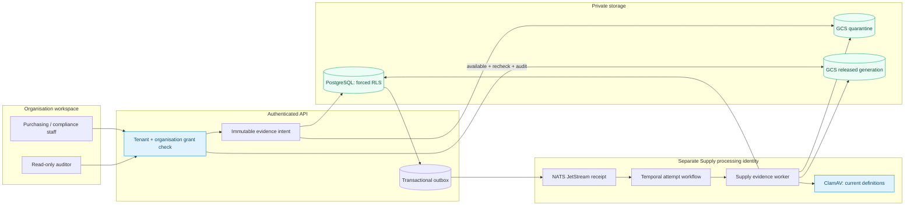

# Private organisation licence evidence

Tracks [#1135](https://github.com/tesserix/helivanta/issues/1135) under
[PharmaConnect #1133](https://github.com/tesserix/helivanta/issues/1133).
See [ADR 0028](adr/0028-supply-verification-and-evidence.md) for the wider
independent verification and trading-eligibility design.

This increment attaches passive PNG/JPEG evidence to an immutable licence
revision. A clean antivirus verdict permits authorized download; it does **not**
verify a licence, approve an organisation, or enable regulated transactions.
Independent maker/checker review, policy approval and trading gates remain open.

[Editable draw.io diagram](diagrams/supply-licence-evidence.drawio)

## Responsibilities and isolation



The API derives the tenant and subject from the verified session, validates the
organisation grant in its transaction, and locks the current licence. Hospital
ownership or affiliation grants no access. An auditor's global write permission
cannot override the organisation's read-only role.

Evidence references `(tenant, party, licence, revision)` with a compound foreign
key. Forced RLS scopes every metadata row; an unscoped runtime query sees no rows.
The worker uses the exact `helivanta_supply_evidence_worker` PostgreSQL role and
`helivanta-supply-evidence-worker` Kubernetes identity. It cannot select filenames,
clinical tables, licence declarations or audit history. Restrictive audit/outbox
policies survive changes to other modules' permissive policies. The RLS linter
still requires exactly one permissive tenant policy and allows additional AND-only
restrictions.

GCS keys contain opaque identifiers and a server-chosen UTC date:
`t/<tenant>/o/organisation/<party>/r/<licence>/d/<date>/f/<file>/v/1`.
The Supply identity gets object GET on quarantine, object CREATE/GET on release,
and an organisation-only IAM condition. It receives no bucket-list, overwrite,
delete, patient/staff path, API-owner, system-database or NATS credentials.
The separate HR worker and its existing records are preserved.

## Exactly replayable intake

```mermaid
sequenceDiagram
  autonumber
  actor Staff
  participant API
  participant PG as PostgreSQL + outbox
  participant GCS as Private GCS
  participant JetStream
  participant Temporal
  participant Worker as Supply worker + ClamAV
  Staff->>API: PUT stable UUIDv7 + revision + size/type/hash
  API->>PG: Grant/role checks; lock source; persist intent
  PG-->>Staff: Original metadata (exact replay preserves expiry)
  Staff->>API: PUT content with the same intent ID
  API->>API: Validate bounded PNG/JPEG, size and SHA-256
  API->>PG: Reauthorize; choose immutable upload date
  API->>GCS: Create or verify quarantine generation (no DB lock held)
  API->>PG: Reauthorize source and grant; pin generation + outbox atomically
  PG->>JetStream: Durable scan request: opaque IDs + attempt only
  JetStream->>Temporal: Start one workflow per immutable scope and attempt
  Temporal->>Worker: Bounded retries; redacted history
  Worker->>GCS: Read exact source generation
  Worker->>Worker: Verify bytes, passive content and current antivirus definitions
  Worker->>GCS: Create/verify immutable released generation if clean
  Worker->>PG: Compare attempt; persist verdict + audit + event atomically
  Staff->>API: Download
  API->>PG: Check current tenant, grant and available state
  API->>GCS: Read exact released generation, verify size/hash
  API->>PG: Reauthorize and record download audit
  API-->>Staff: Attachment; private/no-store; nosniff
```

A mismatched replay returns 409. File bytes, names, licence numbers and object
paths never enter NATS or Temporal history. External storage/scanner calls hold
no authorization or row locks. Delayed work cannot overwrite a newer attempt.
An existing Temporal receipt must match workflow type, queue and the full opaque
input; a duplicate ID alone is insufficient proof of successful dispatch.

```mermaid
stateDiagram-v2
  [*] --> upload_pending: immutable intent
  upload_pending --> scan_pending: generation pinned + outbox committed
  scan_pending --> available: clean scan + current definitions
  scan_pending --> rejected: unsafe or infected content
  scan_pending --> scan_error: bounded dependency failure
  scan_error --> scan_pending: retry same workflow or explicit next attempt
  available --> revoked: authorized revocation
  revoked --> [*]: retained; downloads denied
```



A historical clean image remains associated with its original revision and can
be read by authorized auditors. Editing a licence never silently moves evidence
to its new revision. Unuploaded expired or superseded intents cannot accept new
bytes. Revocation prevents future downloads and retains the audit trail.

## API and UI

Base: `/v1/supply/parties/{party}/licenses/{licence}/evidence`.

| Operation              | Method and suffix              | Organisation roles                    |
| ---------------------- | ------------------------------ | ------------------------------------- |
| Intent                 | `PUT /{file}`                  | Administrator, purchasing, compliance |
| Upload                 | `PUT /{file}/content`          | Administrator, purchasing, compliance |
| List, cursor-paginated | `GET /`                        | Above plus finance and auditor        |
| Download clean image   | `GET /{file}/download`         | Same readers                          |
| Explicit retry         | `POST /{file}/retry/{attempt}` | Writers; next committed attempt       |
| Revoke                 | `POST /{file}/revoke`          | Writers; exactly replayable           |

Every route also checks its declared global permission. The UI uses the shared
country/registration contract, tenant- and subject-specific query keys, expected-
tenant headers, cancelled operations during workspace changes, a stable upload
ID across uncertain failures, inline validation, automatic panel focus and
cursor pagination. It distinguishes the evidence's historical/current revision
and never shows a download for quarantined, rejected or revoked files.

## Release boundary

Local integration and browser evidence belongs in the release report. Disposable
PostgreSQL/NATS, a local Temporal server and protocol-level storage fixtures do
not establish production IAM or regulatory acceptance. Production activation
requires the reviewed owning infrastructure changes, an independent OpenBao
credential, CNPG role availability before migration `0003_supply`, image promotion
through Kargo/Argo, and synthetic live upload/download/isolation acceptance.
SOC 2 and HIPAA controls are supported by the design; certification and legal
approval are not claimed. No real customer data is used by these tests.
